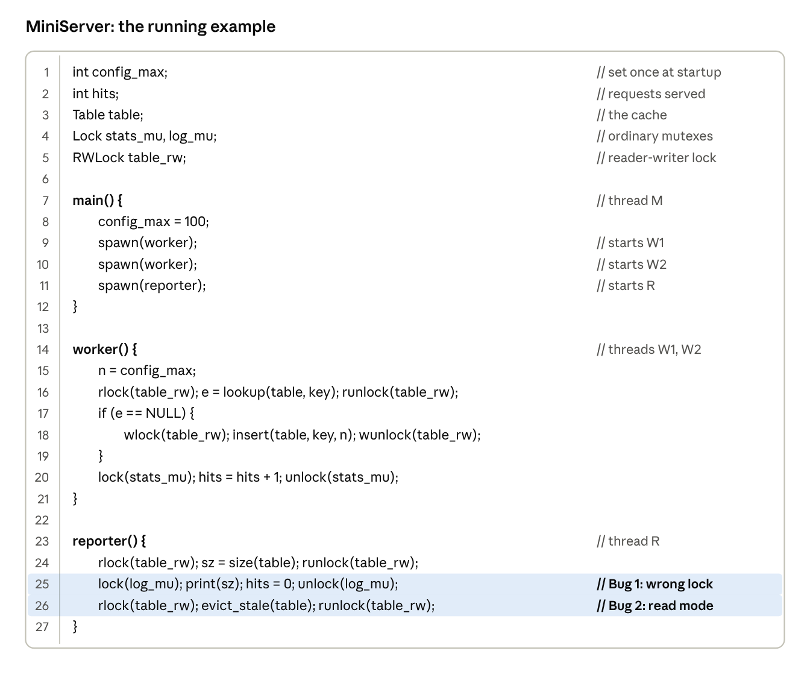
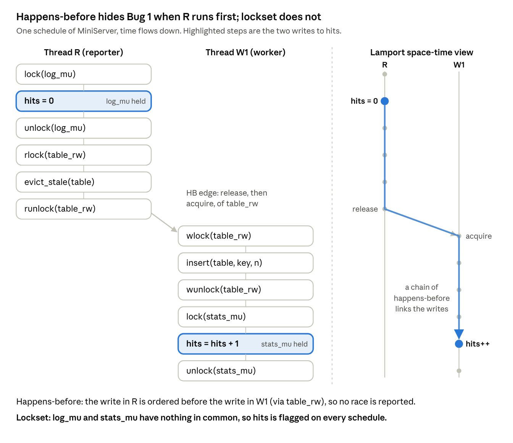
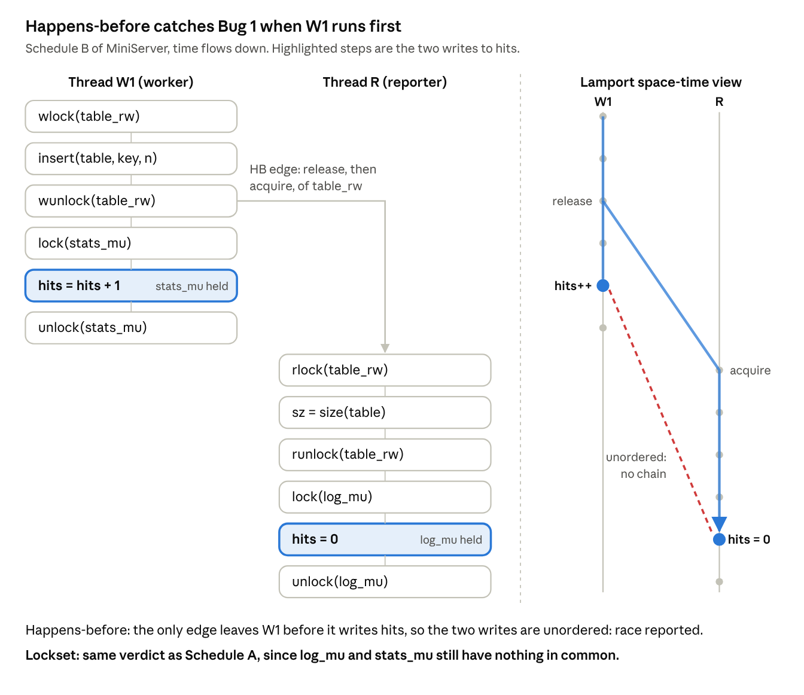
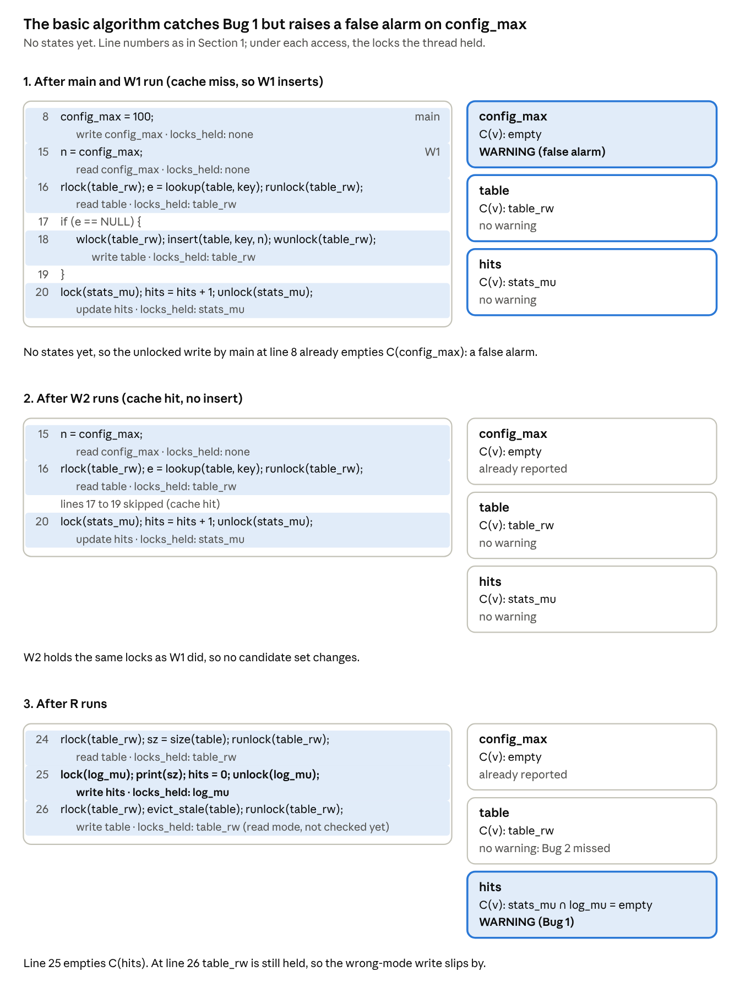
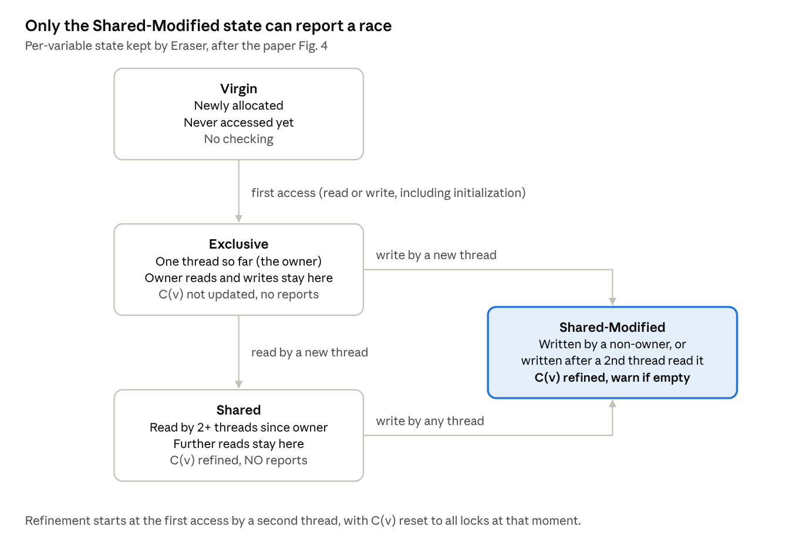
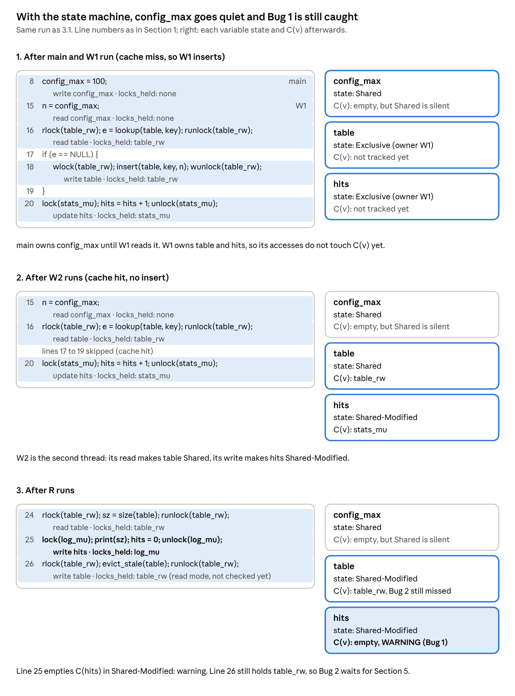
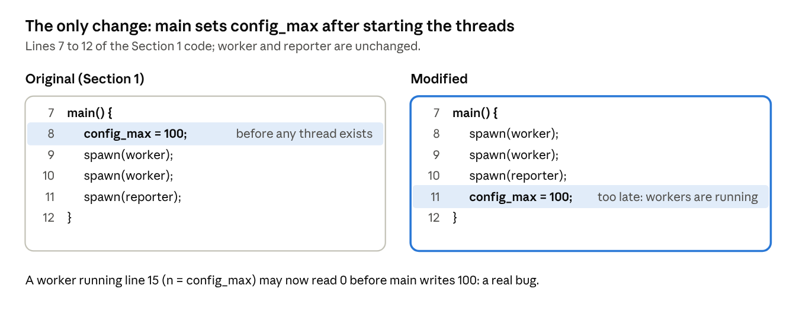
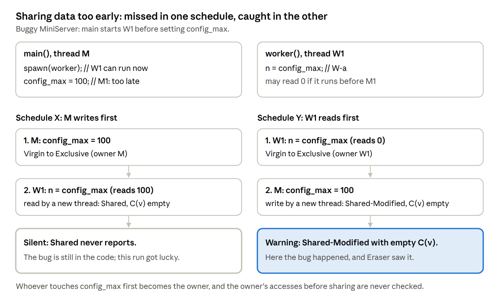
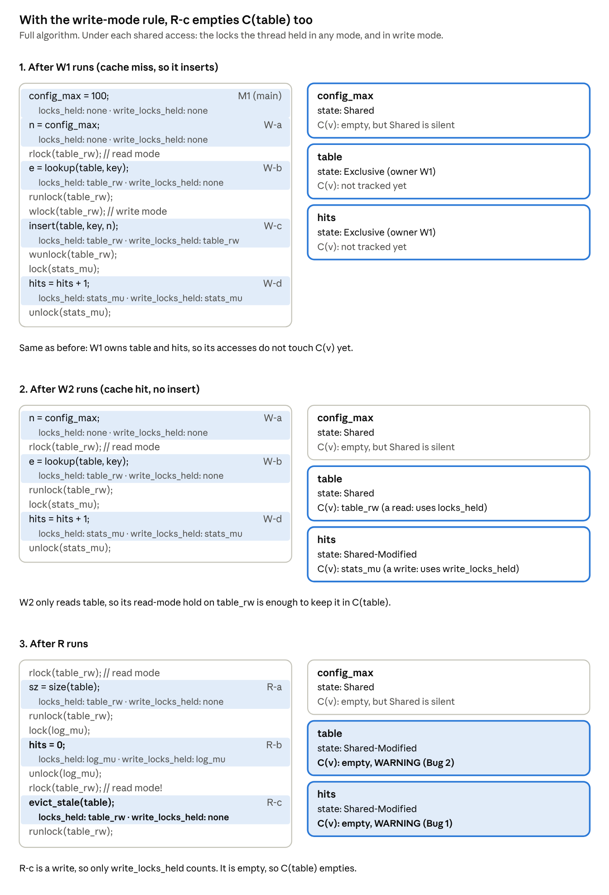
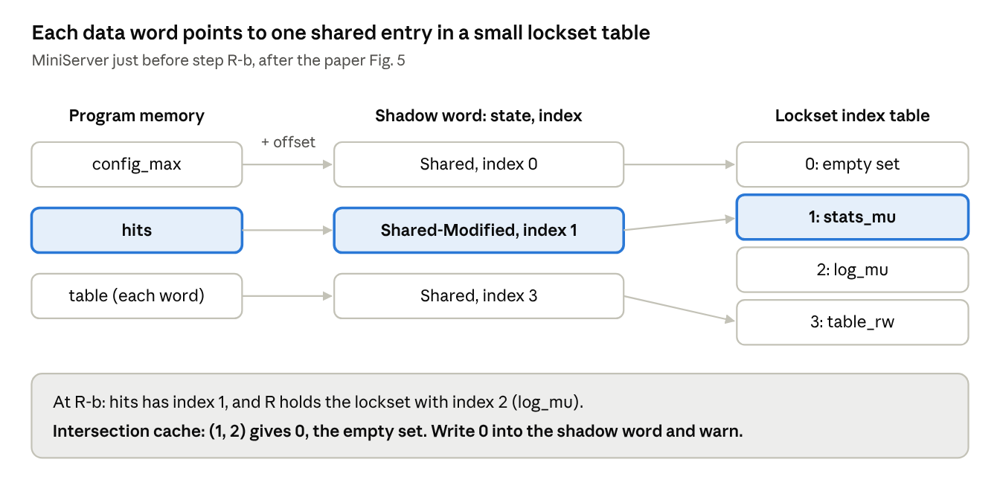

Data races are the bugs that make concurrent programming miserable. Two threads touch the same variable, at least one of them writes, nothing keeps them apart, and whether anything goes wrong depends on how the scheduler happened to interleave them. You can run a test suite a thousand times and never see it fail.

In this post I walk through **Eraser** (Savage, Burrows, Nelson, Sobalvarro and Anderson, SOSP 1997 and ACM TOCS 1997), the paper that introduced the **lockset** algorithm. Its core idea fits in one sentence:

> Instead of asking whether two accesses happened in an order the program enforced, ask whether **one lock was held for every access** to the variable across threads.

I'll use a single small example the whole way through, and run every step of the algorithm on it by hand.

## 1. A tiny server with two bugs

MiniServer is a toy web cache. A main thread sets a config value, two workers serve requests from a shared table, and a reporter thread prints statistics.



| Variable | Intended protection | What happens | Verdict we want |
| --- | --- | --- | --- |
| `config_max` | none needed: written once before other threads exist, then only read | exactly that | **stay quiet** |
| `hits` | `stats_mu` | the reporter uses the wrong lock `log_mu` | **Bug 1**: wrong lock |
| `table` | `table_rw`, write mode must be used for writes | `evict_stale` writes under a read lock | **Bug 2**: wrong mode |

A good detector flags `hits` and `table` and says nothing about `config_max`. Eraser's design is, more or less, the story of getting all three right.

## 2. Why ordering is not enough

Before Eraser, dynamic race detectors were built on Lamport's **happens-before** relation. Events within a thread are ordered. An unlock by one thread followed by a lock of the same lock by another creates an edge between threads. Chain those together, and any two conflicting accesses that are **not** ordered are a race.

The catch is that whether two accesses are ordered depends on the schedule. Consider the two schedules below.

### 2.1 Schedule A: the reporter runs first



### 2.2 Schedule B: the worker runs first



Same program, same bug, two verdicts. Worse, <mark>the ordering that hid the bug in Schedule A came from <code style="color:#d1242f">table_rw</code>, the cache's lock, which has nothing to do with <code>hits</code>; the writes to <code>hits</code> are guarded by <code style="color:#d1242f">stats_mu</code> and <code style="color:#d1242f">log_mu</code>.</mark> The authors also point out that happens-before is expensive, since it needs per-thread information about every memory location.

## 3. The core idea: intersect the locks

Eraser enforces a **locking discipline**: every shared variable is protected by some common lock, held on every access across threads. The program never says which lock protects which variable, so Eraser infers it from the run. For each variable `v` it keeps a **candidate set** C(v):

```text
locks_held(t)@l = locks t holds when it executes line l

C(v) := all locks                        // initially
on each access to v by thread t at line l:
    C(v) := C(v) ∩ locks_held(t)@l
    if C(v) = { } then warn
```

This is all done dynamically: the instrumented program updates `locks_held(t)` on every lock and unlock, and intersects on every load and store.

### 3.1 Dry run on MiniServer

**Assumed schedule:** main runs first, then W1 (a cache miss, so it inserts), then W2 (a cache hit), then R, each running to completion. Line numbers refer to the code in Section 1.



This naive version gets one of three right. It catches Bug 1, but it raises a false alarm on `config_max` (its first write held no lock) and misses Bug 2 (`table_rw` *is* held at `evict_stale`, just in the wrong mode \[read mode instead of write mode\]).

## 4. Quieting false alarms: a per-variable state machine

Two common patterns are harmless but violate the naive rule:

- Initializing data without a lock before anyone else can see it.
- Sharing data that is only read after initialization.

Eraser's two fixes:

- **For initialization:** Eraser cannot tell when initialization ends, so it uses a proxy. A variable counts as initialized when a **second thread** first touches it.
- **For read-only sharing:** Eraser reports only once a variable is **written** after being shared.

### 4.1 State Machine for the above two fixes



One detail that trips people up: allocation is not an access. Allocating memory just marks it Virgin. The first real read or write (initialization is treated as a write), by any thread, makes that thread the owner, and the owner's accesses never enter C(v).

### 4.2 Dry run with the state machine

**Assumed schedule:** the same as in 3.1: main, then W1 (cache miss), then W2 (cache hit), then R.



With this, `config_max` goes Exclusive (owned by main), then Shared when a worker reads it. C(v) is empty, but Shared never reports, so the false alarm is gone. Bug 1 is still caught.

### 4.3 The price: a schedule-dependent blind spot

#### 4.3.1 The modification

For this subsection only, change `main` so that it starts the threads **before** setting `config_max`:



#### 4.3.2 What Eraser sees under two schedules

The price is a new blind spot that depends on the schedule. If main started the workers *before* setting `config_max`, a worker might read 0. Eraser catches that only if the worker's read lands first:



The authors admit this makes Eraser more schedule-dependent than they would like, but doubt it mattered in practice.

## 5. Reader-writer locks: finding the last bug

A reader-writer lock held in read mode lets other readers in at the same time, so it protects a read but not a write. Eraser's last refinement changes one line: **reads intersect with locks held in any mode, writes intersect only with locks held in write mode.** An ordinary mutex is always exclusive, so it counts in both sets, and Bug 1 behaves as before.

```text
locks_held(t)@l       = locks t holds in ANY mode when it executes line l
write_locks_held(t)@l = locks t holds in WRITE mode when it executes line l

on each access op(v) by thread t at line l:
    if op(v) = read then
        C(v) := C(v) ∩ locks_held(t)@l
    else if op(v) = write then
        C(v) := C(v) ∩ write_locks_held(t)@l     // the one changed line
    if C(v) = { } then warn

e.g. line 26: locks_held(R)@26 = {table_rw}, but write_locks_held(R)@26 = { }
```

Here is the whole run under the final algorithm, with the held-lock sets shown at every access:



At `evict_stale`, the reporter holds `table_rw` only in read mode, so its write-mode set is empty and C(table) empties: Bug 2 is caught. The scorecard is now three for three: quiet on `config_max`, warnings on `hits` and `table`.

## 6. Making it fast enough to use

Eraser rewrites the program binary with the ATOM tool, so it needs no source code. It instruments every load and store, every lock acquire and release, and every call to the allocator. Each 32-bit word of heap or global data is treated as a possible shared variable; stack accesses through the stack pointer are skipped.

The clever part is memory. Storing a list of locks per word would be ruinous, but real programs use very few distinct **sets** of locks (the authors never saw more than 10,000). So each set gets a small integer index into a shared table, and every data word gets one **shadow word**: 2 bits of state plus a 30-bit lockset index (or, while Exclusive, the owner's thread ID). Intersections are cached, so most are a single lookup.



The result runs 10 to 30 times slower than normal, about half of it from a procedure call on every memory access. The authors' bar was simply "fast enough to debug most programs."

## 7. Living with false alarms

Eraser does raise false alarms, and the paper treats suppressing them precisely as part of the work. Three kinds covered almost everything:

| Cause | Example | Annotation |
| --- | --- | --- |
| Memory reuse | a private free list recycles an object, but its shadow words still describe the old one | `EraserReuse(addr, size)` |
| Private locks | a home-grown lock Eraser never sees being taken | `EraserReadLock`, `EraserWriteLock`, and their unlocks |
| Benign races | a double-checked lazy initialization, or approximate statistics counters | `EraserIgnoreOn()` / `EraserIgnoreOff()` |

Two examples make the "benign race" row concrete. In both, Eraser's warning is correct (no lock protects every access), but the programmer has decided the race is acceptable.

**Example 1: double-checked lazy initialization.** Open the log file on first use, without taking a lock on every call:

```c
if (logfile == NULL) {          // unlocked read: Eraser warns here
    lock(log_mu);
    if (logfile == NULL)        // re-check under the lock
        logfile = fopen("server.log", "a");
    unlock(log_mu);
}
```

`logfile` only ever changes once, from NULL to non-NULL. The worst the unlocked read can see is a stale NULL, and the re-check under `log_mu` stops the file being opened twice. One caution from the paper: on a relaxed memory model like the Alpha's, a thread could see `logfile` set but still read stale data behind it, so "benign" depends on the hardware.

**Example 2: an approximate statistics counter.** Count requests without a lock:

```c
hits = hits + 1;                // no lock: Eraser warns here
```

Two threads can read the same old value and both write `old + 1`, so one increment is lost. For a statistic like "requests served", a slightly low count is acceptable and cheaper than locking. AltaVista's HTTP server and Petal both did this on purpose. If MiniServer's authors felt the same about `hits`, Bug 1 would be annotated away with `EraserIgnoreOn()` / `EraserIgnoreOff()` instead of fixed.

A handful of annotations per program, about ten, typically took a server from hundreds of reports to zero.

A brief attempt to port Eraser into an OS kernel taught two lessons. Interrupt levels can be modeled as locks, one per level. Semaphores cannot, because they have no owner, so data handed between a device driver and a thread looks unprotected.

## 8. What it found

- **Vesta cache server:** a flag saying "this cached fingerprint is valid" was read and written without a lock. On the Alpha's relaxed memory model, another thread could see the flag set but a stale fingerprint.
- **Petal distributed disk:** a checker thread read shared state without the lock every writer held.
- **AltaVista:** the HTTP server updated configuration and statistics without locks; the indexing engine had only intentional, benign races.
- **Undergraduate OS homework:** about 10% of working submissions had races, from forgetting locks to using different locks for the same data.

Two extra experiments back the design. Two races that had sat in AltaVista's indexing code for months were reinserted, and one author found both with Eraser in minutes. And rerunning two servers with 2 threads instead of 10 gave the same reports, which is the schedule-insensitivity argument in action. These are case studies, though: there is no measure of how many races were missed.

## 9. What Eraser cannot see

- **Synchronization that is not a lock.** Semaphores, fork/join, hand-offs through a queue: anything that orders threads without an owned lock looks like a race.
- **Bugs that are not data races.** Split an increment into two locked steps, `h = hits` and then `hits = h + 1`, each under `stats_mu`. Every access is protected, so Eraser is silent, yet another worker can slip in between and an update is lost. That is an atomicity violation, and Lu et al.'s 2008 study of real bugs shows how common they are.
- **Code that never runs.** Eraser is a testing tool; it cannot show a program is race-free.

The paper also sketches a deadlock check in the same spirit: record the order in which locks are acquired, and report a cycle even if the test never hangs. That idea lives on in the Linux kernel's **lockdep**.

## 10. Where the idea went

The history after Eraser is largely about keeping its coverage while removing its false alarms. **Hybrid detectors** (O'Callahan and Choi, 2003) report a lockset violation only if the accesses are also unordered under a limited happens-before. **FastTrack** (Flanagan and Freund, 2009) made pure happens-before cheap. **RaceFuzzer** (Sen, 2008) used an imprecise detector only to propose candidates, then forced each one to actually happen. Valgrind's Helgrind and Google's ThreadSanitizer both started out lockset-based or hybrid and later moved to happens-before; for kernels, DataCollider and Linux's KCSAN sample accesses instead.

## 11. Takeaways

- **Check a rule, not the observed order.** A schedule-independent discipline lets one run expose a bug that a lucky interleaving would hide.
- **Practicality is mostly about false alarms.** The state machine, the reader-writer rule, and specific annotations are what made Eraser usable on real servers.
- **The rule only knows about locks.** That limit is why the field eventually returned to happens-before, made fast.

## References

- S. Savage, M. Burrows, G. Nelson, P. Sobalvarro, T. Anderson. *Eraser: A Dynamic Data Race Detector for Multithreaded Programs.* SOSP 1997; ACM TOCS 15(4), 1997.
- L. Lamport. *Time, Clocks, and the Ordering of Events in a Distributed System.* CACM 21(7), 1978.
- A. Dinning, E. Schonberg. *Detecting Access Anomalies in Programs with Critical Sections.* ACM/ONR Workshop on Parallel and Distributed Debugging, 1991.
- R. O'Callahan, J.-D. Choi. *Hybrid Dynamic Data Race Detection.* PPoPP 2003.
- C. Flanagan, S. Freund. *FastTrack: Efficient and Precise Dynamic Race Detection.* PLDI 2009.
- K. Sen. *Race Directed Random Testing of Concurrent Programs.* PLDI 2008.
- J. Erickson, M. Musuvathi, S. Burckhardt, K. Olynyk. *Effective Data-Race Detection for the Kernel.* OSDI 2010.
- S. Lu, S. Park, E. Seo, Y. Zhou. *Learning from Mistakes: A Comprehensive Study on Real World Concurrency Bug Characteristics.* ASPLOS 2008.
