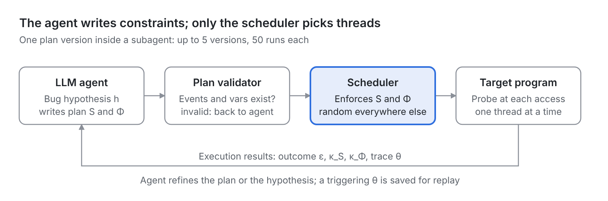
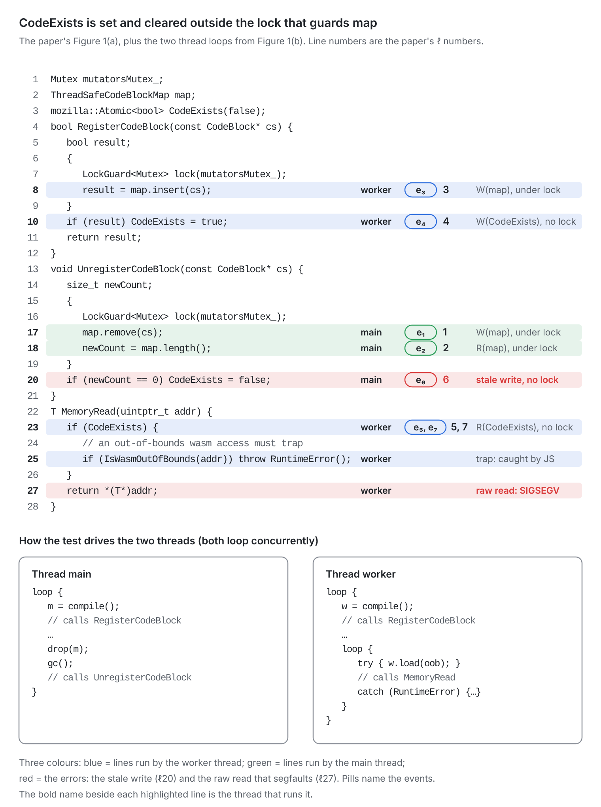
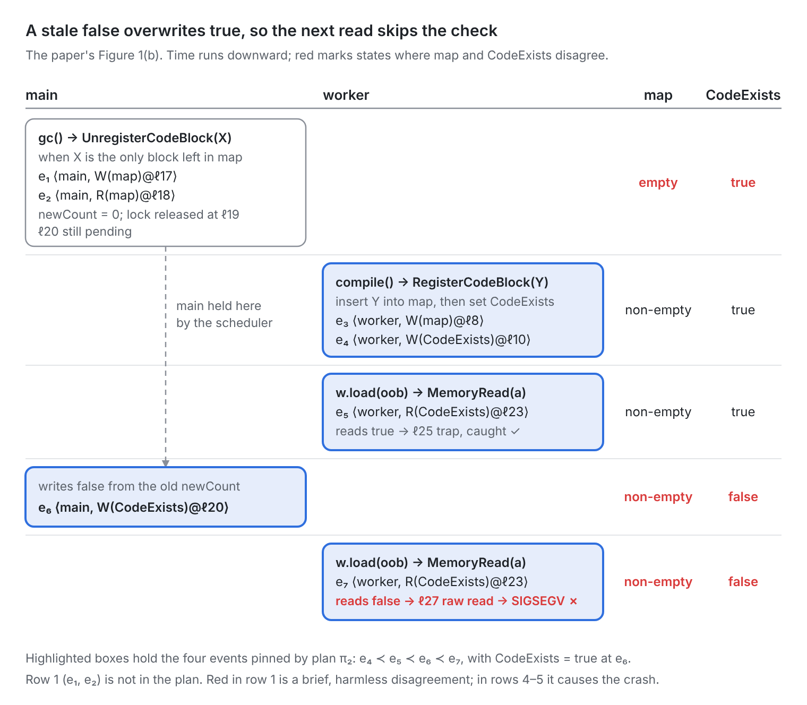

*A walkthrough of Zhang, Pasareanu and Yang, "REINS: Agent-guided Thread Scheduling for Concurrency Bug Detection and Reproduction" ([arXiv 2610.13421](https://arxiv.org/abs/2610.13421)).*

Concurrency bugs hide in interleavings. A test can pass a thousand times and crash on the next run, and when it does, you rarely get the same schedule twice.

REINS asks whether an LLM agent can narrow the search for a buggy interleaving by reasoning about *why* an interleaving would be dangerous. REINS uses an agent to predict a bug-inducing schedule and a scheduler to enforce it. The prediction is a small *schedule plan*, a few ordering and state constraints; the scheduler randomizes everything the plan doesn't cover.

## 1. Why concurrency bugs are hard to trigger

### 1.1 Controlled concurrency testing

Instead of letting the OS schedule threads, the tester inserts *scheduling points* at shared-memory accesses and synchronization operations. At each point a scheduler picks which thread runs next. Two consequences matter:

- Exploration becomes controllable: you can steer toward specific interleavings.
- Any run is a sequence of choices, so a buggy run can be replayed.

> **Where the determinism comes from.** The scheduler's choices are *not* deterministic: threads irrelevant to the plan are picked at random, so the same plan can crash on run 2 but not run 1. What makes a crash reproducible is that **every run records its trace θ** (the thread chosen at each scheduling point). When a run triggers the bug, REINS stops and saves that θ; replay mode re-executes it point by point. Replay assumes the same input and no other nondeterminism (timers, I/O, syscalls), which the paper does not discuss.

The catch: real programs hit thousands of scheduling points per run, and the scheduler has no idea which few choices matter for a bug.

### 1.2 The baselines

| Technique | Idea in one line | Why it matters here |
| --- | --- | --- |
| RW (random walk) | Pick a random runnable thread at every point | Same scheduler as REINS, no guidance: the cleanest ablation |
| PCT-3 / PCT-10 (ASPLOS'10) | Random thread priorities plus d−1 random priority-change points; probabilistic guarantee for bugs of depth d | Classic randomized CCT |
| SURW (ASPLOS'25) | Uniform sampling over a selected subset of events | Strongest baseline on RaceBench |
| RFF (ASPLOS'24) | Greybox fuzzing over reads-from partitions | Strong on some programs (ferret) |

SURW and RFF instrument at the **binary level**; REINS instruments at the **source level**. That difference explains some of REINS's losses later.

### 1.3 Bug patterns in scope

The four patterns come from Lu et al., ASPLOS'08:

- **Data race:** unsynchronized conflicting accesses.
- **Atomicity violation:** a region meant to be atomic is interleaved (the running example below).
- **Order violation:** A was meant to happen before B, but doesn't.
- **Deadlock:** a circular lock wait.

Only bugs with an **observable failure** count (crash, assertion failure or hang); silent wrong results are out of scope.

### 1.4 Closest prior work: active testing

RaceFuzzer, CTrigger, DeadlockFuzzer and Maple also predict a suspicious interleaving and then schedule threads to trigger it. The difference is that they use a **fixed pattern per bug type**, while REINS lets the agent write arbitrary constraints from program semantics.

## 2. The core idea: the agent plans, the scheduler executes

The LLM never picks a thread. It writes a **schedule plan**, a handful of ordering and state constraints, and a controlled scheduler enforces that plan at the relevant scheduling points and randomizes everywhere else.

The highlighted box is the only place thread choices are made; the agent only sees the plan going in and the results coming out.

### 2.1 Three design challenges

The paper frames the design around three challenges:

| Challenge | What goes wrong | REINS's answer |
| --- | --- | --- |
| **C1** Incomplete understanding of concurrency semantics | The agent can't build a global view of a large codebase within its context | Start from **runtime-observed** shared accesses, then pull in static info (call graph, path conditions) only where needed |
| **C2** Gap between semantics and scheduling | The agent reasons about variables and roles; the scheduler needs a thread choice at thousands of points | The **schedule plan**: constraints on only the few key events and variable states |
| **C3** Unreliable agent output | Plausible but wrong reasoning, hallucinated variables and lines | **Validate** plans against the program before running; treat **execution results** as the only evidence |

The mental model: this is constrained-random testing where an LLM writes the constraints. The agent supplies *where to look and in what order*; the scheduler supplies *every concrete decision*; real executions supply *the verdict*.

## 3. The running example: a stale flag in SpiderMonkey

The paper's Figure 1 is an atomicity violation from SpiderMonkey, Firefox's JavaScript and WebAssembly engine. It is also one of the real bugs REINS found (bug 6, wasm-codeblock), simplified.

### 3.1 The code

SpiderMonkey keeps wasm code blocks in a lock-protected `map` and caches "map is non-empty" in an atomic flag `CodeExists`. `MemoryRead` only bounds-checks when `CodeExists` is true. `UnregisterCodeBlock` computes `newCount` under the lock but writes `CodeExists` **after** releasing it.

**Figure 1(a):** the code as in the paper (line numbers are the paper's ℓ numbers), plus the two thread loops that drive it: main repeatedly compiles, drops and garbage-collects a module, while the worker compiles its own module and then loops on out-of-bounds loads.

### 3.2 The seven events

**The seven events** of Figure 1(b), each an event e = ⟨t, τ⟩ on a line of Figure 1(a):

| Event | Thread | Line | Access site τ | What happens |
| --- | --- | --- | --- | --- |
| e₁ | main | ℓ17 | W(map) | `map.remove(cs)` removes the last code block |
| e₂ | main | ℓ18 | R(map) | `newCount = map.length()` reads 0 |
| e₃ | worker | ℓ8 | W(map) | `map.insert(cs)` adds a new code block |
| e₄ | worker | ℓ10 | W(CodeExists) | publishes `CodeExists = true` |
| e₅ | worker | ℓ23 | R(CodeExists) | reads true; the out-of-bounds access is trapped |
| e₆ | main | ℓ20 | W(CodeExists) | writes the stale `false` (newCount was 0) |
| e₇ | worker | ℓ23 | R(CodeExists) | reads false; the check is skipped → SIGSEGV |

### 3.3 The buggy interleaving

The bad interleaving, step by step:

1. Main removes the last block and sees newCount = 0 (e₁, e₂), then pauses.
2. The worker registers a block and sets `CodeExists = true` (e₃, e₄).
3. The worker's first out-of-bounds access is correctly trapped (e₅).
4. Main resumes and writes the stale `CodeExists = false` (e₆).
5. The worker's next out-of-bounds access skips the check → SIGSEGV (e₇).

**Figure 1(b):** the buggy interleaving, redrawn from the paper.

The window is the gap between e₂ (main computes newCount = 0, then unlocks at ℓ19) and e₆ (main's write at ℓ20). It opens only when the last block is unregistered, and the worker must fit e₃, e₄ and e₅ inside it.

### 3.4 Why it is an atomicity violation

This is an **atomicity violation** (the paper's own classification): the map update and the CodeExists update are meant to be one atomic step that keeps CodeExists = "map is non-empty", but they sit in two separate critical sections. It is not a plain data race: CodeExists is an ***atomic variable***, so each individual access is safe; the bug is that the pair is not atomic.

## 4. The formal pieces

### 4.1 Notation

**Access site:** a read or write of variable v at line ℓ of file c.

$$
\tau = \mathit{op}(v)\,@\,c{:}\ell \qquad \mathit{op} \in \{R, W\}
$$

**Event:** thread t performing access τ at runtime.

$$
e = \langle t, \tau \rangle
$$

**State constraint:** an event e paired with a condition φ that must hold when e occurs. Φ is the set of these.

$$
(e, \varphi) \in \Phi
$$

**Predicate:** the condition φ itself, a conjunction where each φ(vᵢ) restricts one variable's value.

$$
\varphi = \bigwedge_i \varphi(v_i)
$$

For example, the state constraint (e₆, CodeExists = true) has the predicate CodeExists = true.

### 4.2 The paper's four definitions

The paper's four definitions:

| # | Name | Symbol | What it captures | Plain-English reading |
| --- | --- | --- | --- | --- |
| 1 | Observed access summary | σ\_v = ⟨v, \[⟨e₁, L₁⟩, …\]⟩ | Every observed event on v, in order, with the lockset Lᵢ held by eᵢ's thread at that access | "Who touched v, where, holding which locks" |
| 2 | Bug hypothesis | h = ⟨V\_h, T\_h, δ⟩ | Variables involved, the set of access sites τ relied on (static, no threads), a natural-language story δ | "These accesses interleaved this way cause this failure" |
| 3 | Schedule plan | π = ⟨S, Φ⟩ | S = ordering e₁ ≺ … ≺ eₙ; Φ = state constraints at given events | "Make these few events happen in this order, with these values" |
| 4 | Execution result | x = ⟨ε, κ\_S, κ\_Φ, θ, γ⟩ | Outcome, how much of S was satisfied, which state constraints failed, the trace, new coverage | "Did the plan happen, and did the bug fire?" |

### 4.3 The feedback signal (Definition 4)

- **ε** ∈ {normal, triggered, timeout, other}: how the run ended.
- **κ\_S**: length of the satisfied prefix of S (κ\_S = n means all ordering constraints held).
- **κ\_Φ**: the state constraints that *never* held when their event was ready (empty = every state constraint held).
- A run is **engaged** iff κ\_S = n and κ\_Φ is empty.
- **θ**: the full scheduling trace, enough for deterministic replay.
- **γ**: newly reached files and access sites, which feed back into scope.

The 2×2 that drives the agent's next move:

|  | Bug triggered | Bug not triggered |
| --- | --- | --- |
| **Engaged** | Success: record θ. The plan was sufficient, or incomplete with random scheduling supplying the missing condition by chance | The plan happened without a failure: a missing constraint, or no bug here |
| **Not engaged** | The bug fired off-plan: the plan was wrong or over-constrained (frequency not reported) | The plan was never realized: use κ\_S / κ\_Φ to locate the stall and fix that constraint |

The paper does not report how runs split across these four cells. But since 91% of x264 bugs need up to 20 runs rather than 1, many runs must land in a "not triggered" cell.

### 4.4 The plan for the running example

Of the seven events, the plan π₂ pins only four, in the order S = \[e₄ ≺ e₅ ≺ e₆ ≺ e₇\], plus one state constraint Φ = {(e₆, CodeExists = true)}. The Condition column is what the scheduler checks before it releases each event.

| Order in S | Event | Thread | Line | Access site τ | Condition |
| --- | --- | --- | --- | --- | --- |
| 1 | e₄ | worker | ℓ10 | W(CodeExists) | none: first in S |
| 2 | e₅ | worker | ℓ23 | R(CodeExists) | e₄ ≺ e₅ (same thread: program order already guarantees it) |
| 3 | e₆ | main | ℓ20 | W(CodeExists) | e₅ ≺ e₆ (cross-thread: the scheduler must hold main) **and** CodeExists = true (the state constraint in Φ) |
| 4 | e₇ | worker | ℓ23 | R(CodeExists) | e₆ ≺ e₇ (cross-thread: the worker's read must see main's stale write) |

Events e₁–e₃ are not in the plan, but they still matter: main must leave newCount = 0 (e₁, e₂), and the worker's insert must come after that (e₂ ≺ e₃). The plan enforces neither this order nor the precondition that X is the only block left in map, and the test's thread loops don't order them either. Random scheduling has to supply them.

> **Compression, with some luck left in.** Four events and one condition out of thousands of scheduling points is a large compression, but not a complete one: the plan still relies on luck for e₂ ≺ e₃ and for X being the only block left. This is one reason a correct plan can need several runs before it triggers.

## 5. How the scheduler executes a plan

### 5.1 The scheduling rule (Algorithm 1)

REINS's scheduler is a serializing scheduler built "following Coyote's approach": only one thread runs at a time. Let s be the number of plan events already satisfied. At each scheduling point the paused threads are split three ways (Algorithm 1):

- **T\_next:** about to perform e\_{s+1}, and its predicate holds → **run it**, s ← s + 1.
- **T\_held:** its event is later in S, or it is e\_{s+1} but the predicate doesn't hold yet, or it would break a predicate that currently holds → **suspend**.
- **T\_free:** irrelevant to the plan → **pick one at random**.

### 5.2 Executing the plan on the running example

The scheduler executing π₂ on the running example:

| s | Waiting for | Main thread | Worker thread |
| --- | --- | --- | --- |
| 0 | e₄: worker W(CodeExists)@ℓ10 | If it reaches ℓ20 (e₆, later in S) → **held** | Runs freely; reaching ℓ10 → **next**, publishes true |
| 1 | e₅: worker R(CodeExists)@ℓ23 | Still **held** at ℓ20 | e₄ is done and e₅ needs no predicate → **next**. Its first OOB read is correctly trapped |
| 2 | e₆: main W(CodeExists)@ℓ20, only if CodeExists = true | Predicate holds → **next**, writes stale false | Free to run, but would pause before any statement that modifies CodeExists. Here it is in a load loop that only calls `MemoryRead`, which reads CodeExists but never writes it |
| 3 | e₇: worker R(CodeExists)@ℓ23 | Free | e₆ is done and e₇ has no predicate → **next**. Its second OOB read sees false, skips the check → SIGSEGV |
| 4 | nothing | Run engaged: κ\_S = 4, κ\_Φ empty | ε = triggered, θ saved |

One gap in the paper's plan: ideally e₇ should carry the predicate CodeExists = false, but π₂ omits it. Here the random scheduler happens to run e₇ right after e₆, before main can re-register and set the flag back to true. In another schedule that may not happen: we get lucky.

### 5.3 When the plan gets stuck

Holding threads can deadlock the run, or the next planned event may never come. The scheduler has two escape hatches:

- **Everyone is held.** It forcibly releases one held thread so the program keeps going. This is a forced step, so s does not go up.
- **No progress for too long.** If s has not increased within a timeout, it gives up on the rest of the plan and lets the run finish under random scheduling.

> **Key consequence: a plan biases a run, it never guarantees it.** A run may drift off the planned interleaving, which is why each run records how far the plan got (κ\_S and κ\_Φ) plus the full trace θ.

For example, suppose the scheduler is at s = 2, waiting for e₆. That write only happens if main removed the **last** block, i.e. e₁ and e₂ left newCount = 0 before e₃. If the worker's insert e₃ comes first (before e₁), newCount = 1, the `if` at ℓ20 is false, and e₆ never occurs. The scheduler waits, times out, and the run ends not engaged with κ\_S = 2, which tells the agent exactly where the plan stuck.

### 5.4 Instrumentation

A single probe macro is inserted at each access site and compiled into two binaries. In the *recorder* binary the probe logs thread, site and lockset; in the *scheduler* binary it yields control to the scheduler, so every access site becomes a scheduling point. Intercepted synchronization operations are scheduling points too. Because instrumentation is source-level, interleavings *inside* a statement are invisible. That works for the running example (the window spans two statements) but not for, say, a non-atomic `x++`. The paper does not say how sync operations are intercepted, how predicates in Φ are evaluated at runtime, or whether any Coyote code is reused (Coyote targets .NET; REINS targets C/C++).

## 6. The agent loop: comprehend → attempt → assess

### 6.1 State and tools

REINS runs in rounds. Each round proposes or selects hypotheses, tests them with subagents, and decides where the next round starts. It keeps four records across rounds: **SCOPE** (files the test actually executes), **SHARED\_ACCESS** (per shared variable: every observed access, thread and lockset), **CANDIDATES** (hypotheses, each pending / succeeded / refuted / uncertain) and **ATTEMPTS** (every plan tried and what happened). Six tools are exposed to the agents over MCP:

| Tool | Modes | Role |
| --- | --- | --- |
| SearchCode | name / regex / file + line range | Read source |
| InstrumentTarget | recorder · scheduler | Inserts the probe macro; builds the two binaries |
| RunTarget | natural · collect · control · replay | Runs the program; control and replay use the scheduler |
| AnalyzeStaticInfo | callGraph · pathCond · sharedVar | Clang-AST static analysis |
| AnalyzeSharedAccess | — | Builds SHARED\_ACCESS; finds conflicting pairs (different threads, ≥ 1 write, no common lock, not ordered by create/join) |
| AnalyzeExecution | — | Aggregates per-run results |

### 6.2 Comprehend

Run the program to measure scope; instrument and run it 10 times in collect mode; build SHARED\_ACCESS and inspect conflicting pairs; read the code around the clues; write hypotheses as pending candidates. In the running example, CodeExists is accessed at e₄, e₅ and e₆ with an empty lockset, while map is always accessed under `mutatorsMutex_`. An empty lockset on an atomic variable is not itself a bug (atomics need no lock, so Eraser-style lockset checking would be a false alarm). The clue is the mismatch: map is always locked, but its cached mirror is written outside the lock. The agent proposes: "a registration between computing newCount and writing CodeExists lets a stale false overwrite true, so a later out-of-bounds access skips the check."

### 6.3 Attempt

The lead agent picks candidates and dispatches one subagent per candidate, with a budget of p = 5 plan versions, q = 50 runs per version and 30 minutes. The subagent writes a plan, has it validated (invalid plans don't count against p), runs it, and branches on the engaged/triggered 2×2. In the running example:

| Version | Plan | Result | Agent's diagnosis |
| --- | --- | --- | --- |
| π₁ | S = \[e₄ ≺ e₆\], no state constraint | Every run engaged, no crash | Main overwrites before the worker enters wasm; the worker's next registration repairs the flag first |
| π₂ | S = \[e₄ ≺ e₅ ≺ e₆ ≺ e₇\], Φ = {(e₆, CodeExists = true)} | Engaged, triggered | Success: candidate marked succeeded, θ saved |

This two-step refinement is the paper's best illustration of why "engaged but not triggered" is a useful signal.

### 6.4 Assess

Propagate results (a refutation can settle sibling candidates), summarize what successful hypotheses share, review newly reached code, and decide whether the next round starts at comprehend or attempt. The run stops when all candidates are settled or the 5-hour budget runs out. The output is a report of detected bugs, each with a replayable trace θ.

## 7. What the evaluation shows

**Setup:** Claude Sonnet 4.6; 5 hours per target; p = 5, q = 50, 30 minutes per subagent; a 64-core Threadripper; **each configuration run once**.

### 7.1 Small benchmarks: a tie

On SCTBench (42 programs) and ConVul (10 CVE extractions), one bug each, REINS detects 48 of 52 programs versus RFF 47, SURW 46, PCT-3 44, PCT-10 43 and RW 35. The 4 REINS misses are missed by every tool. REINS needs at most ~100 schedules where baselines show tails of 10³–10⁴, but it is far slower in wall time. The paper itself says there is **no significant advantage** here.

Wall time to first trigger (read off the paper's Figure 3(b) log-scale plot, so approximate):

| Tool | Median | Slowest detected program | Programs not detected (of 52) |
| --- | --- | --- | --- |
| REINS | ~400 s (~7 min) | ~1,700 s (29 min) | 4 |
| SURW | ~0.7 s | ~25 s | 6 |
| RFF | ~0.4 s | ~40 s | 5 |
| PCT-3 | ~2 s | ~70 s | 8 |
| PCT-10 | ~2 s | ~65 s | 9 |
| RW | ~1 s | ~15 s | 17 |

### 7.2 RaceBench: a modest win

On RaceBench (15 programs × 5 variants × 20 injected bugs = 1,500), REINS detects **769**, SURW 731, RFF 645, PCT-10 489, RW 439 and PCT-3 413.

- Biggest wins: x264 (68 vs SURW 45), water\_spatial (67 vs 41), cholesky (65 vs 54).
- Losses: raytrace (36 vs 60), blackscholes (19 vs 32), ferret (66 vs RFF 80).
- REINS finds nothing in the first ~5 minutes (comprehend overhead) and overtakes SURW between 60 and 90 minutes.
- Identifiers were anonymized so the agent couldn't spot injected bugs by name.
- Cost per target: 84 minutes to 5 hours; 5.7M–153.1M input tokens (about 90% prompt-cache reads).

Why REINS loses on raytrace, blackscholes and ferret, per the paper: those bugs need shared state to hold rare values that only build up over many interleaved updates, some *inside* a single statement. REINS's plans wait for the value rather than steering the build-up, its source-level probes can't switch inside a statement, and 50 runs per plan is too few. SURW and RFF instrument at the binary level and sample many more executions. The paper says the agent "correctly understands the triggering conditions" in these cases but gives no example or evidence, and proposes finer-grained instrumentation or a solver as fixes.

> **No breakdown is given.** The paper reports only per-program totals and never says how many missed bugs fall into each cause, though the causes differ in kind: bugs that need intra-statement switches (out of scope for REINS), bugs reachable at source level where the plan or budget fell short (in scope but missed), and bugs that need RaceBench's mutated input (out of reach for every tool, since all ran only the seed input).

### 7.3 Real-world bugs

Six previously unknown bugs in two Mozilla projects; all three SpiderMonkey bugs were confirmed and fixed by Mozilla's developers.

| # | Name | Project | Type | Status |
| --- | --- | --- | --- | --- |
| 1 | thread-state | NSPR | Atomicity violation | Reported |
| 2 | pool-join | NSPR | Deadlock | Reported |
| 3 | waitgroup-enum | NSPR | Atomicity violation | Reported |
| 4 | rope-flatten | SpiderMonkey / GC | Data race | Fixed |
| 5 | atom-bitmap | SpiderMonkey / GC | Data race | Fixed |
| 6 | wasm-codeblock | SpiderMonkey / Wasm | Atomicity violation | Fixed |

Bug 6 is the running example; its detection run executed 909 files and about 803k lines of SpiderMonkey. Baselines were **not** run on these projects, so this shows feasibility, not superiority.

### 7.4 Ablations (x264 only)

| Config | Bugs (of 100) | Dispatch effectiveness | Avg tokens (in/out) |
| --- | --- | --- | --- |
| REINS | 68 | 17.6% | 62.5M / 526k |
| w/o Static | 56 | 11.8% | 118.4M / 981k |
| General Agent | 46 | — | 72.2M / 156k |
| w/o Runtime | 41 | 6.6% | 79.4M / 603k |
| RW (no agent) | 30 | — | — |

- **Runtime observation matters most:** without it the agent hunts blindly and its plans stall on events that never occur. In the running example, it would never see the empty-lockset clue on CodeExists.
- **Static inspection filters benign races** early; without it subagents waste budget and token use nearly doubles.
- **General Agent** (same model and scheduler, no workflow) gets 46, evidence that the workflow, not memorization, drives results.
- **REINS finds all 30 of RW's bugs** plus 38 more.
- **Iteration pays:** 45 of 68 bugs fall to the first plan version and 23 need a revision (π₁ → π₂ is one of them); 91% trigger within 20 runs of a version.

## 8. My take

The idea is clean, and the three SpiderMonkey bugs, reported by the authors and then fixed by Mozilla's developers, are convincing. The evaluation is thinner than the headline suggests:

### 8.1 Where the evaluation is thin

- **Single runs.** Each tool and configuration was run once. REINS's agent is random, so we don't know how much its numbers would vary; the ~5% lead over SURW has no error bars.
- **One-program ablations.** Every RQ3 experiment uses only x264, which is REINS's best program in Table 2.
- **A large cost gap.** All tools got the same wall-time budget, but REINS also spends up to 153M input tokens per target and is ~100–1,000× slower to first trigger on the small benchmarks. The paper reports token counts only, never dollars.
- **Seed input only.** Any bug whose input condition the seed input doesn't satisfy can never fire, no matter how good the schedule. That ceiling is shared by every tool and is why none found more than ~51% of RaceBench's bugs.
- **Scope.** C/C++ pthreads and observable failures only; no silent corruption, no weak memory models.
- **No public code,** and the scheduler internals are unspecified.
- **Data leakage.** RaceBench identifiers were anonymized, but SCTBench, ConVul and PARSEC/SPLASH-2 sources are likely in training data.

### 8.2 What I like

- A clear separation of concerns: semantic reasoning → constraints → enforcement → executions as evidence. Hallucinations are caught by plan validation and real runs.
- Every reported bug comes with a replayable trace.
- "Engaged vs. triggered" is a genuinely useful feedback signal for refining plans.
- The authors are honest about losses and cost, and the General Agent ablation directly addresses the memorization concern.

The running example shows both sides in miniature: a hypothesis from an empty-lockset clue, a four-event plan, one informative failed version, and a replayable trace that led to a fix. It also shows what is unmeasured: we know one of up to 50 runs of π₂ crashed, but not how often π₂ triggers on fresh runs, and the plan itself still leaves e₂ ≺ e₃ and e₇'s predicate to luck.

### 8.3 Open questions

**Main question I'd want answered:**

> A plan can succeed while still leaving parts of the bug to luck (here, e₂ ≺ e₃ and e₇'s predicate). How often does a successful plan actually reproduce the bug on fresh runs, without replaying the recorded trace?

Open questions I'd want answered next:

- What is the run-to-run variance of REINS on RaceBench?
- How does REINS compare under an equal dollar or token budget, or as a second stage after SURW?
- How are synchronization operations intercepted, and how is Φ checked at runtime?
- How sensitive are the results to the model (cheaper subagents, open-weight models)?
- Would binary-level instrumentation close the raytrace/blackscholes gap?
- Could the schedule plan double as a **patch oracle**: re-run θ or π after a fix to check the race is gone?
- Is "LLM writes constraints, classical engine enforces them" a general recipe for directed fuzzing, symbolic execution or kernel race reproduction (syzkaller reproducers, KCSAN reports)?

## 9. Takeaways

- **Use the LLM as a planner, not a scheduler.** Compress semantic reasoning into a few constraints and let a classical engine make the thousands of concrete decisions.
- **Let execution be the judge.** Validated plans and real runs catch hallucinations, and "engaged but not triggered" tells the agent exactly what to fix.
- **A plan biases a run; it doesn't guarantee one.** Luck still fills the gaps a plan leaves, and the price is minutes and millions of tokens where baselines take seconds.

## 10. References

- Y. Zhang, C. S. Pasareanu, G. Yang. *REINS: Agent-guided Thread Scheduling for Concurrency Bug Detection and Reproduction.* arXiv:2610.13421, 2026.
- H. Zhao, D. Wolff, U. Mathur, A. Roychoudhury. *Selectively Uniform Concurrency Testing* (SURW). ASPLOS 2025.
- D. Wolff, Z. Shi, G. J. Duck, U. Mathur, A. Roychoudhury. *Greybox Fuzzing for Concurrency Testing* (RFF). ASPLOS 2024.
- S. Burckhardt, P. Kothari, M. Musuvathi, S. Nagarakatte. *A Randomized Scheduler with Probabilistic Guarantees of Finding Bugs* (PCT). ASPLOS 2010.
- P. Deligiannis, A. Senthilnathan, F. Nayyar, C. Lovett, A. Lal. *Industrial-Strength Controlled Concurrency Testing for C# Programs with Coyote.* TACAS 2023.
- J. Liang, M. Yuan, Z. Ding, S. Ma, X. Han, C. Zhang. *RaceBench: A Triggerable and Observable Concurrency Bug Benchmark.* AsiaCCS 2023.
- P. Thomson, A. F. Donaldson, A. Betts. *Concurrency Testing Using Schedule Bounding: An Empirical Study* (SCTBench). PPoPP 2014.
- Y. Cai, B. Zhu, R. Meng, H. Yun, L. He, P. Su, B. Liang. *Detecting Concurrency Memory Corruption Vulnerabilities* (ConVul). ESEC/FSE 2019.
- S. Lu, S. Park, E. Seo, Y. Zhou. *Learning from Mistakes: A Comprehensive Study on Real World Concurrency Bug Characteristics.* ASPLOS 2008.
- S. Savage, M. Burrows, G. Nelson, P. Sobalvarro, T. Anderson. *Eraser: A Dynamic Data Race Detector for Multithreaded Programs.* ACM TOCS 15(4), 1997.
- K. Sen. *Race Directed Random Testing of Concurrent Programs* (RaceFuzzer). PLDI 2008.
- J. Yu, S. Narayanasamy, C. Pereira, G. Pokam. *Maple: A Coverage-Driven Testing Tool for Multithreaded Programs.* OOPSLA 2012.
