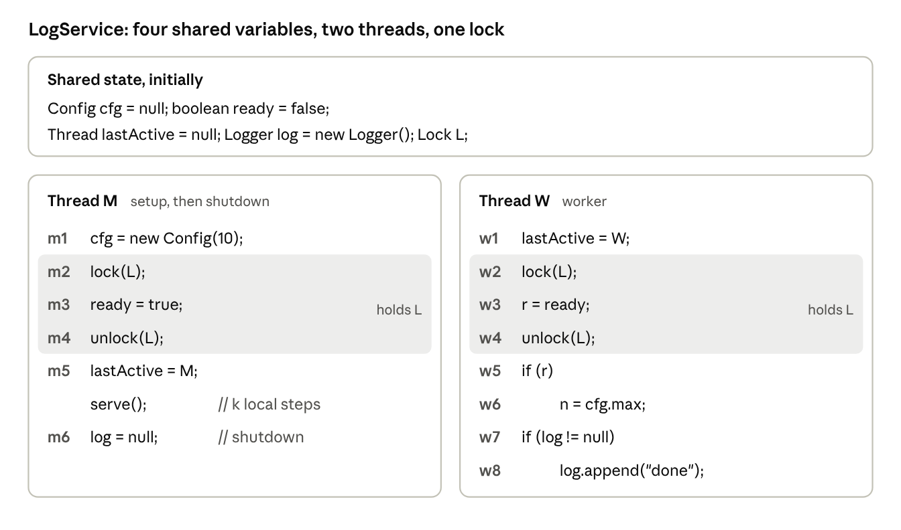
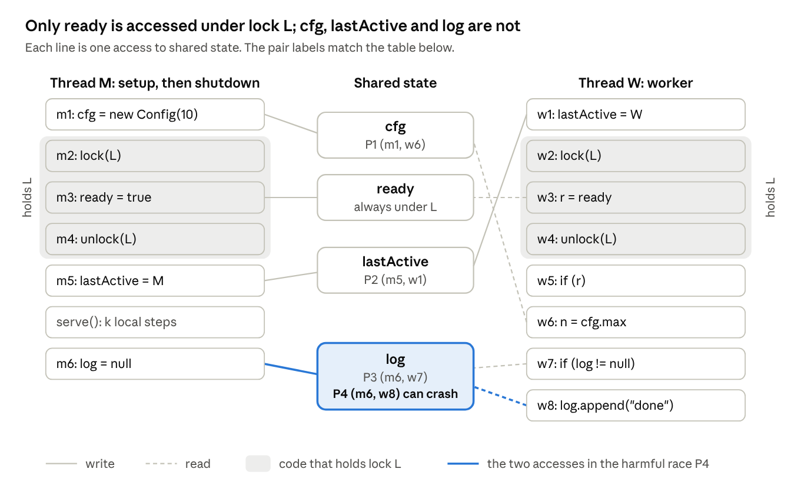
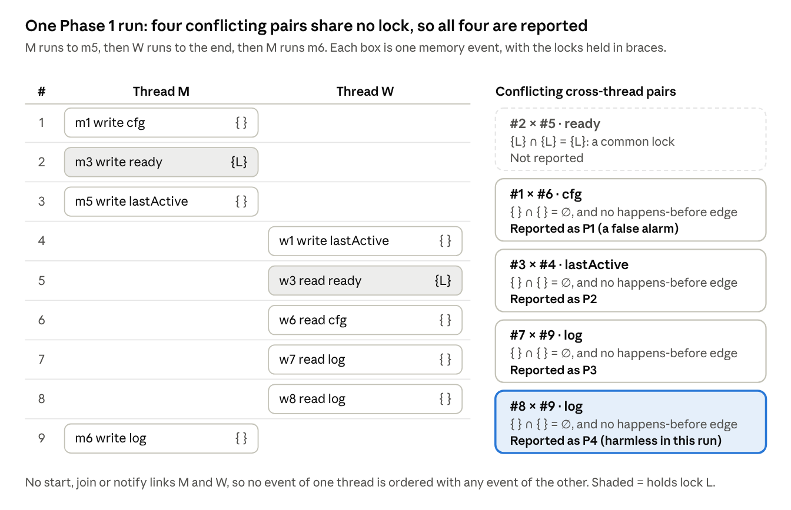
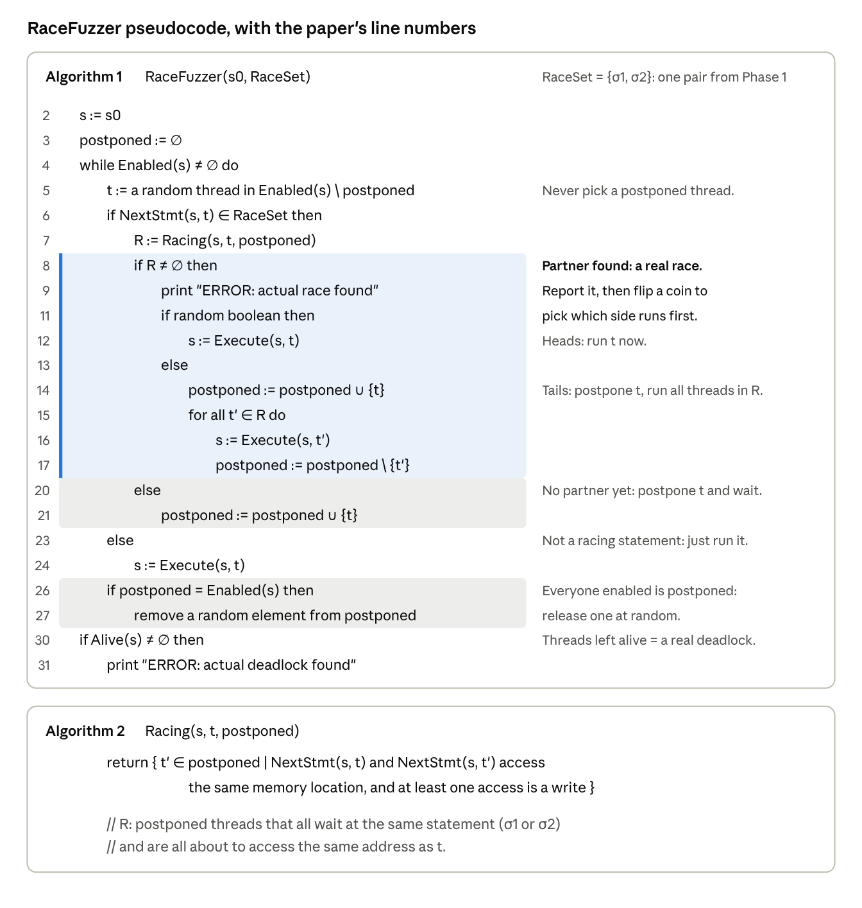
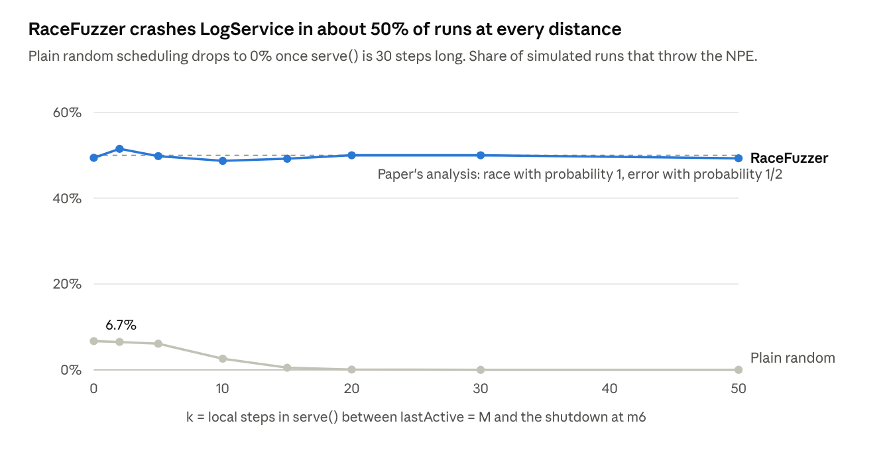

Race detectors have long forced a choice. Tools that **predict** races, like lockset and hybrid detectors, warn about races that never showed up in your run, but many of those warnings are false. Tools that are **precise**, like happens-before detectors, never cry wolf, but they only see races whose ordering happened to show up in the run you watched. Either you triage a pile of warnings by hand, or you miss bugs.

In this post I walk through **RaceFuzzer** (Koushik Sen, *Race Directed Random Testing of Concurrent Programs*, PLDI 2008), which refuses that choice. Its idea fits in one sentence:

> Take each race a predictive detector suspects, and steer the thread scheduler until the two racing accesses are **one step apart in two different threads**. If that moment happens, the race is real.

I'll use one small example the whole way through and trace every step on it.

## 1. A tiny program with four suspects

`LogService` has two threads. **M** sets up a config, signals readiness under a lock `L`, serves requests for a while, then shuts the logger down. **W** is a worker: it reads the config if the service is ready, then writes to the logger if the logger still exists. A launcher starts both threads together, so nothing like `start` or `join` orders them.

The paper's model assumes each statement touches at most one shared variable. That's why the null check (`w7`) and the call (`w8`) are separate statements. In practice this holds automatically, because the tool works on Java bytecode, where every field access is its own instruction.

Only `ready` is accessed under `L`. The other three shared variables are touched with no lock held:

So any lock-based detector will suspect four pairs of statements. Here is what is actually true of each:

| Pair | Variable | Truth |
| --- | --- | --- |
| **P1** (m1, w6) | `cfg` | **False alarm.** W reads `cfg` only after seeing `ready == true`, which M sets after `m1`. The flag, guarded by `L`, orders them. |
| **P2** (m5, w1) | `lastActive` | **Real, benign.** A debugging field nobody reads. |
| **P3** (m6, w7) | `log` | **Real, harmless.** If the shutdown wins, the null check sees `null` and W skips the append. |
| **P4** (m6, w8) | `log` | **Real, harmful.** If the shutdown lands between the check and the use, W throws a `NullPointerException`. |

A good tool should stay quiet on P1, confirm P2 through P4, and show that P4 can crash.

## 2. Phase 1: where the suspects come from

RaceFuzzer doesn't invent its suspects. It takes them from an existing predictive detector. The paper uses the **hybrid** detector of O'Callahan and Choi (PPoPP 2003), but says any static or dynamic detector would do. This phase is not the paper's contribution.

The hybrid detector watches one run and flags two memory accesses when all of these hold:

- different threads, same memory location, at least one write;
- **no common lock** held (the lockset part, from Eraser);
- **not ordered** by `start`, `join` or `wait/notify` (a happens-before check that deliberately ignores lock release → acquire edges).

Formally, a memory event is `MEM(σ, m, a, t, L)`: thread `t`, executing statement `σ`, performs access `a` (READ or WRITE) on location `m` while holding lock set `L`. Two events are reported when:

$$
\begin{aligned}
& e_i = \mathrm{MEM}(\sigma_i, m_i, a_i, t_i, L_i) \;\wedge\; e_j = \mathrm{MEM}(\sigma_j, m_j, a_j, t_j, L_j) \\
& \wedge\; t_i \neq t_j \;\wedge\; m_i = m_j \;\wedge\; (a_i = \mathrm{WRITE} \vee a_j = \mathrm{WRITE}) \\
& \wedge\; L_i \cap L_j = \emptyset \;\wedge\; \neg(e_i \prec e_j) \;\wedge\; \neg(e_j \prec e_i)
\end{aligned}
$$

Here `≺` is happens-before built only from `start`, `join` and `wait/notify`. When the condition holds, the statements (σi, σj) become a racing pair.

Here is one run of LogService in which M runs up to `m5`, W runs to the end, and then M shuts down:

All four suspects are flagged, including the false alarm P1: the real ordering goes through `ready` and `L`, and the hybrid test ignores lock edges. Notice also that nothing crashed in this run. Phase 1 predicts P4 from a run where it did not crash. That's the payoff of lockset-style reasoning.

Two terms are worth keeping apart here:

- An **event race** is two specific executions in one run, such as events #8 and #9 above.
- A **racing pair** is the two *statements* behind them, here (m6, w8). Many event races, from many schedules, converge on the same pair, and the pair is what Phase 1 hands to Phase 2.

Phase 1 is not schedule-free either. It can only flag statements that actually executed: if W happens to read `ready == false`, it never runs `w6`, and P1 is never flagged. But that's only a coverage requirement. A happens-before detector needs coverage **and** a lucky ordering: the two accesses must also be unordered in the interleaving it saw.

## 3. Phase 2: postpone, then flip a coin

Phase 2 is the contribution. It takes **one** racing pair at a time, `RaceSet = {σ1, σ2}`, and runs the program under its own scheduler. Only one thread runs at a time, and every choice comes from a seeded random number generator:

The idea, step by step:

1. **Pick a random thread** that is enabled and not postponed.
2. **If its next statement isn't σ1 or σ2, just run it.** Everything outside the pair is uninteresting.
3. **If it is, look for a partner.** `Racing` returns `R`: the postponed threads that all wait at the same statement (σ1 or σ2) and are all about to access the same address as this thread, with at least one write.
4. **No partner yet: postpone the thread.** It waits, frozen one step before its racing access.
5. **Partner found: that's a real race.** Two threads are each one step from conflicting accesses to the same address, with nothing in between. RaceFuzzer reports it, then flips a coin. Heads: run this thread first. Tails: postpone it, and run every thread in `R` first.
6. **If every enabled thread is postponed, release one at random.** That thread runs its next statement unconditionally, which avoids an infinite loop. This is how a false pair ends: the partner never shows up, so the waiting thread is eventually let go.

Three details make this work.

- **The invariant.** At line 5, no two postponed threads ever race with each other. Every race is detected the moment it becomes complete, when a thread that isn't postponed arrives to finish the pair, and it's settled right away. That's why tails runs *all* of `R`, not just one thread: leaving one behind would put two racing threads in `postponed`, where nothing ever compares them.
- **The coin flip doesn't fix anything.** It only decides which of the two conflicting accesses goes first. Both orders are possible in real executions, and usually only one is harmful, so trying both at random is how RaceFuzzer finds out whether the race can crash the program.
- **Replay is free.** Because the seed fixes every choice, rerunning with the same seed reproduces the crash exactly. Nothing needs to be recorded.

## 4. Watching it work on LogService

To check the traces and numbers below, I wrote a small simulator of the algorithm and ran it on LogService.

### 4.1 P4: the crash

With `RaceSet = {m6, w8}`, one run goes like this:

1. W runs `w1`–`w7`. It sees a live logger at `w7`, so it heads for `w8`.
2. W arrives at `w8`. No partner is postponed yet, so **W is postponed**.
3. M runs through its setup and `serve()`. W just waits, however long that takes.
4. M arrives at `m6`. `Racing` finds W, so a **real race is reported**.
5. The coin says "run M first": `log = null`. M finishes.
6. Now everyone enabled is postponed, so W is released and runs `log.append(...)`: **NullPointerException**.

If the coin had gone the other way, W would have appended first and nothing would break. If M had reached `m6` first, M would have waited for W instead, and the race would be found from W's side. Over 2,000 seeds, the race was created in **100%** of runs and the crash happened in about **50%**.

### 4.2 P1: the partner never comes

With `RaceSet = {m1, w6}`, M gets postponed at `m1` before even setting `cfg`. W then reads `ready == false`, skips `w6`, and finishes. Everyone enabled is now postponed, so M is released and runs to the end. W can only reach `w6` after `m3`, which comes after `m1`, so the two threads can never meet. **0 of 2,000** runs reported a race. RaceFuzzer stays silent without anyone reading the code.

### 4.3 The scorecard

| Pair | Phase 1 | Race created | Crash | RaceFuzzer's verdict |
| --- | --- | --- | --- | --- |
| P1 (m1, w6) | suspected | 0% | — | not confirmed |
| P2 (m5, w1) | suspected | 100% | 0% | real |
| P3 (m6, w7) | suspected | 100% | 0% | real |
| P4 (m6, w8) | suspected | 100% | ≈ 50% | real **and harmful** |

Phase 1 gave four identical-looking warnings. Phase 2 sorted them into three tiers.

## 5. Why distance doesn't matter

Postponing changes the question. Without it, the two racing accesses must *happen* to land next to each other. With it, the second thread only has to get there *eventually*.

The paper makes the point with a tiny program (its Figure 2). Thread 2 writes `x = 1` right at the start. Thread 1 runs a long critical section and only then checks `if (x == 0) ERROR`. Under a normal or plain random scheduler, thread 2 almost always writes early, so ERROR is almost never reached, and the longer the critical section, the rarer it gets. A happens-before detector also misses the race, because the lock the two threads take in between happens to order the accesses. Under RaceFuzzer, whichever thread arrives first waits for the other. So the race is created with **probability 1**, and the coin reaches ERROR with **probability 1/2**, however long the critical section is.

LogService behaves the same way. As `serve()` grows, plain random scheduling almost never puts the shutdown between W's check and its use. RaceFuzzer doesn't care:

Real programs often have hundreds of statements between two racing accesses, which is the right-hand side of this chart. In the paper's experiments the measured hit probability was high but not always 1: from 0.41 to 1.00.

## 6. Where RaceFuzzer sits among detectors

It helps to treat each detector as the **set of pairs it reports** and compare those sets on one fixed trace.

**Happens-before ⊆ Hybrid ⊆ Lockset.** Suppose two accesses held a common lock. Mutual exclusion forces one critical section to finish before the other starts, and the unlock → lock edge orders the two accesses. So any pair a happens-before detector reports must have disjoint lock sets. It's also unordered once lock edges are dropped, so the hybrid detector reports it too. The hybrid test, in turn, is just the lockset test plus an extra condition.

**Where RaceFuzzer fits.** Let *Induced* be the pairs RaceFuzzer actually brought next to each other in the runs it tried, and *Real* the pairs that can race in some feasible execution. Then:

- RF = Hybrid ∩ Induced, and Induced ⊆ Real. That's the "no false warnings" property.
- Define the ideal confirmer RFideal := Hybrid ∩ Real.

For a fixed trace used as Phase 1's input, this gives the whole picture:

$$
\{\mathit{HB},\ \mathit{RF}_{\mathrm{actual}}\} \subseteq \mathit{RF}_{\mathrm{ideal}} \subseteq \mathit{Hybrid} \subseteq \mathit{LS}
$$

Two caveats keep this honest:

- **HB ⊆ RFideal needs HB's races to be real.** That's guaranteed only for the *first* race in a trace (Mathur, Kini and Viswanathan, OOPSLA 2018). A later HB report can be infeasible, because reordering the earlier race may change the program's control flow.
- **RFactual can miss real pairs it failed to induce** with a finite number of runs. How close it gets to RFideal is a recall question. The paper answers it empirically, not with a proof.

LogService shows why RaceFuzzer beats happens-before on coverage. If W takes `L` before M does, the edge from W's unlock to M's lock orders `w1` before `m5`, and a happens-before detector misses the real race P2. That happens in about half of all runs. RaceFuzzer creates P2 every time, because it doesn't wait for a lucky synchronization order; it chooses one.

So the one-line summary: **RaceFuzzer turns an imprecise predictor's suspicions into precise, reproducible, partly triaged race reports.**

## 7. What it found, and what it cannot do

### 7.1 Results

The prototype instruments Java bytecode as part of Sen's CalFuzzer tool set, and only switches threads at synchronization operations and the two racing statements. It was run on 14 Java programs and libraries totalling about 600K lines:

- **763 suspected pairs became 93 confirmed races.** On the jigsaw web server, 547 hybrid warnings shrank to 36 real races.
- **Every previously known real race was confirmed.** On moldyn it also found 2 benign races that earlier tools had missed.
- **Exceptions on 31 pairs, against 3 with the JVM's default scheduler.**
- **The cost is dominated by Phase 1, the hybrid detector.** It took over an hour on some compute-heavy benchmarks. Each Phase 2 run was far cheaper, 1.1× to 3× normal on the I/O-bound programs, although there is one batch of runs per pair.

Two bugs stand out. In **cache4j**, an unprotected write to a `_sleep` flag let one thread interrupt another at the wrong moment, crashing it with an uncaught `InterruptedException`. In the **JDK 1.4.2 collections**, `l1.containsAll(l2)` on synchronized lists locks `l1` but iterates over `l2` without `l2`'s lock. A concurrent `l2.removeAll(...)` then triggers `ConcurrentModificationException` or `NoSuchElementException`. The synchronized wrapper never made the method safe for its *argument*.

### 7.2 Limits

- **It confirms; it never refutes.** A pair that wasn't induced might be a false alarm, or just a rare real race.
- **It only tests what Phase 1 saw.** A racing statement that never executed during Phase 1 is never tried.
- **"Harmful" means an exception or error.** A race that silently corrupts data counts as benign.
- **It can't see bugs that need real parallelism.** Only one thread runs at a time, so effects of relaxed memory models never show up.
- **It needs safety valves.** Lock operations in native code, and threads that spin without synchronizing, can hang the scheduler. A watchdog thread releases postponed threads, at the cost of sometimes missing a slow partner.

## 8. Takeaways

- **Predict, then confirm.** A cheap but imprecise predictor says where to look, and a controlled scheduler turns each suspicion into evidence. Neither half is precise and predictive on its own; together they are.
- **Control beats chance.** Postponing a thread at a racing statement makes the race likely no matter how far apart the two accesses are, where stress testing and passive detectors depend on luck.
- **A race report should come with a run.** A seed that replays the race, and a coin flip that shows whether it crashes, make a report something a developer can act on.
- **The idea generalizes.** Phase 2 only needs a set of statements whose simultaneous execution could be a problem. Sen's group applied the same approach to atomicity violations (AtomFuzzer) and deadlocks (DeadlockFuzzer).

## 9. References

- K. Sen. *Race Directed Random Testing of Concurrent Programs.* PLDI 2008. [PDF](https://www.cs.columbia.edu/~junfeng/10fa-e6998/papers/racefuzz.pdf)
- R. O'Callahan, J.-D. Choi. *Hybrid Dynamic Data Race Detection.* PPoPP 2003.
- S. Savage, M. Burrows, G. Nelson, P. Sobalvarro, T. Anderson. *Eraser: A Dynamic Data Race Detector for Multithreaded Programs.* ACM TOCS 15(4), 1997.
- L. Lamport. *Time, Clocks, and the Ordering of Events in a Distributed System.* CACM 21(7), 1978.
- M. Musuvathi, S. Qadeer. *Iterative Context Bounding for Systematic Testing of Multithreaded Programs.* PLDI 2007.
- U. Mathur, D. Kini, M. Viswanathan. *What Happens-After the First Race? Enhancing the Predictive Power of Happens-Before Based Dynamic Race Detection.* OOPSLA 2018. [arXiv](https://arxiv.org/abs/1808.00185v1)
- C.-S. Park, K. Sen. *Randomized Active Atomicity Violation Detection in Concurrent Programs.* FSE 2008.
- P. Joshi, C.-S. Park, K. Sen, M. Naik. *A Randomized Dynamic Program Analysis Technique for Detecting Real Deadlocks.* PLDI 2009.
- P. Joshi, M. Naik, C.-S. Park, K. Sen. *CalFuzzer: An Extensible Active Testing Framework for Concurrent Programs.* CAV 2009. [PDF](https://www.cis.upenn.edu/~mhnaik/papers/cav09.pdf)
