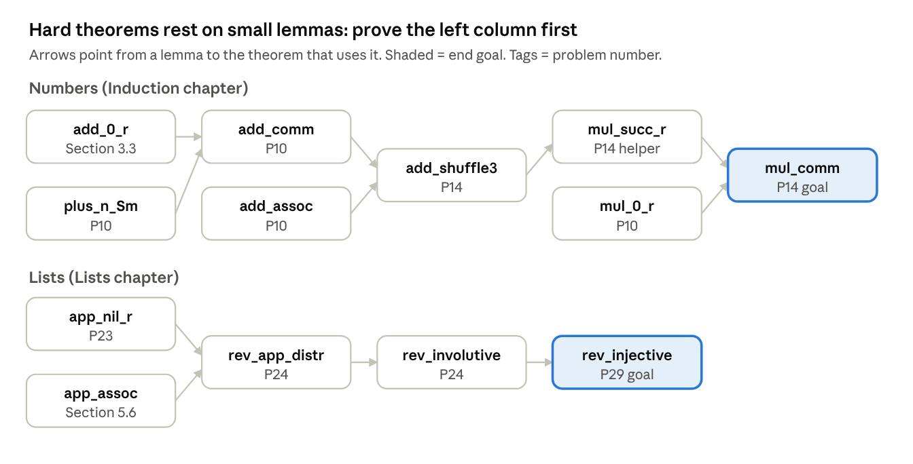

## 1. How to Use This Tutorial

A hands-on guide to writing proofs in Rocq, from your first `reflexivity` to the tactics used in real verification proofs. It follows the first three chapters of *Logical Foundations* (Software Foundations, Vol. 1), **Basics → Induction → Lists**, and then goes beyond them:

- **Section 1, getting started:** a tactic index, step-by-step setup in VS Code, the core proof loop, and a roadmap.
- **Sections 2, 3 and 5, the book's chapters:** Basics, Induction and Lists, one idea per step, each with minimal code and the tactic it introduces.
- **Section 4, advanced tactics:** what real proofs need beyond the book's first chapters: integers, automatic arithmetic with `lia`, `apply` and `assert` for helper facts, `exfalso` for impossible cases, splitting "or" and "and", unfolding definitions, and closing several goals at once with `try` and `all:`.
- **Section 6, practice:** 30 problems, from one-tactic warm-ups to challenges.
- **Section 7, reference:** hints, answers, a tactic cheat sheet, tips for when you are stuck, and a lemma dependency map.

### 1.1 Tactic index

Every tactic and command in this tutorial, in the order it is taught, with where it is explained. Tactics work inside a proof; commands are used outside proofs, or to wrap them.

| # | Tactic or command | Kind | What it does | Explained in |
| --- | --- | --- | --- | --- |
| 1 | `Compute e.` | Command | Evaluate an expression | 2.1 |
| 2 | `Check e.` | Command | Show the type of an expression, constructor or lemma | 2.4 |
| 3 | `intros n` | Tactic | Move a `forall` variable or an assumption into the context | 2.10.2, 2.10.5 |
| 4 | `simpl` | Tactic | Run the definitions to simplify the goal; changes the goal you see | 2.10.2 |
| 5 | `reflexivity` | Tactic | Close a goal whose two sides are equal, computing if needed | 2.10.2 |
| 6 | `Proof.` / `Qed.` | Command | Start a proof / finish it and have Rocq recheck it | 2.10.3 |
| 7 | `Admitted.` | Command | Accept a claim without proof (placeholder only) | 2.10.6 |
| 8 | `rewrite -> H` / `rewrite <- H` | Tactic | Replace one side of an equation with the other, using a hypothesis | 2.11.1 |
| 9 | `rewrite lemma` | Tactic | The same, using an already-proved lemma | 2.11.2 |
| 10 | `destruct n as [ … ] eqn:E` | Tactic | Split the goal into one case per constructor. The optional `as [ … ]` names what each case carries; the optional `eqn:E` records which case you are in | 2.12.2–2.12.5 |
| 11 | `intros` with a pattern | Tactic | Shorthand for Row 3 + Row 10 | 2.12.7 |
| 12 | `induction n` | Tactic | Prove a base case, then a step that may use the induction hypothesis | 3.3 |
| 13 | `replace e1 with e2` | Tactic | Swap one specific sub-term; prove the equality as a side goal | 3.5 |
| 14 | `Search pattern.` | Command | Find lemmas matching a pattern | 3.8 |
| 15 | `assumption` | Tactic | The goal is exactly one of the hypotheses | 4.2.1 |
| 16 | `t1; t2` | Tactic | Run `t2` on every goal `t1` produces | 4.2.2 |
| 17 | `lia` | Tactic | Do integer/natural-number arithmetic automatically | 4.2.3 |
| 18 | `subst` | Tactic | Replace a variable by what a hypothesis says it equals | 4.2.4 |
| 19 | `exfalso` | Tactic | "This case is impossible": show the hypotheses contradict | 4.2.5 |
| 20 | `apply L` | Tactic | Use lemma `L`; its premises become the new goals | 4.2.6 |
| 21 | `assert (H : P) by tac` | Tactic | Prove a helper fact on the spot and keep it as `H` | 4.2.7 |
| 22 | `replace … in H` | Tactic | `replace` inside a hypothesis | 4.2.8 |
| 23 | `destruct` on an "or" hypothesis | Tactic | One case per alternative of `A \/ B \/ C` | 4.2.9 |
| 24 | `exact H` / `exact (L a b H)` | Tactic | Close the goal with a named hypothesis, or a lemma applied to its arguments | 4.3.1 |
| 25 | `split` | Tactic | Prove an "and" (`A /\ B`) as two goals | 4.3.2 |
| 26 | `intros … [H1 H2]` / `destruct H as [H1 H2]` | Tactic | Split an "and" hypothesis into two hypotheses | 4.3.3 |
| 27 | `unfold f in *` / `simpl in *` / `cbn` | Tactic | Expand a definition, or simplify, in the goal and every hypothesis | 4.3.4 |
| 28 | `apply (L a b c)` and `_` | Tactic | Give a lemma its arguments when `apply` can't infer them; `_` lets Rocq fill one in | 4.3.5 |
| 29 | `try t` / `all: t` | Tactic | Attempt a tactic without failing / run it on every open goal | 4.3.6 |
| 30 | `induction l` (lists) | Tactic | Induction on lists: `[]` case, then `h :: t` case | 5.6 |

### 1.2 Setup

- The current edition targets **Rocq 9** (formerly Coq). Imports use `From Stdlib Require ...` and `From LF Require Export Basics.`
- Download the book's `.v` sources and work inside the `lf/` directory. Build a chapter before importing it: `make Basics.vo`, or `rocq compile -Q . LF Basics.v`.
- Use an interactive IDE: **VS Code + VsRocq**, **Proof General** (Emacs), or **RocqIDE**. You step through a proof one sentence at a time and watch the goal panel change.

**Step by step with VS Code**

1. **Install Rocq and the VsRocq language server** (via opam; the Rocq Platform installer is an alternative). In a terminal:

   ```bash
   opam install rocq-prover vsrocq-language-server
   eval $(opam env)
   which vsrocqtop        # should print a path
   ```

   If opam picks versions that don't match, pin Rocq first (e.g. `opam pin add rocq-core 9.1.0`) as the [VsRocq README](https://github.com/rocq-prover/vsrocq) describes.
2. **Install the VS Code extension.** Press F1, run *Extensions: Install Extension*, search for **VsRocq**, install it. If it reports that it cannot find `vsrocqtop`, set `"vsrocq.path"` in Settings to the path printed by `which vsrocqtop`. Tip: launch VS Code from the same terminal (`code .`) so it sees your opam environment.
3. **Download the book.** From [softwarefoundations.cis.upenn.edu](https://softwarefoundations.cis.upenn.edu/), download the *Logical Foundations* archive and extract it. You get an `lf/` folder with `Basics.v`, `Induction.v`, `Lists.v`, `_CoqProject` and a `Makefile`.
4. **Open the folder, not a single file.** In VS Code use *File → Open Folder* on `lf/`. VsRocq reads `_CoqProject` (which contains `-Q . LF`) from the folder root; that is what makes `From LF Require Export Basics.` resolve.
5. **Build once.** Open the integrated terminal (Ctrl+\`) and run:

   ```bash
   make               # builds every chapter's .vo file
   make Basics.vo     # or just one chapter
   ```

   If there is no `Makefile`, create one with `rocq makefile -f _CoqProject *.v -o Makefile`.
6. **Step through a chapter.** Open `Basics.v`. VsRocq checks the file as you go; the **goal panel** on the right shows the context and goal at your cursor. Move the cursor line by line through a proof and watch the goal change. That is the main skill this tutorial assumes.
7. **Do the practice problems in your own file.** Create `Practice.v` inside `lf/`, start it with `From LF Require Export Lists.` (after `make Lists.vo`), then paste problems from Section 6 and replace each `Admitted.` with a proof.

**If something breaks**

- *Cannot find a physical path bound to LF*: you opened a single file rather than the `lf/` folder, or the chapter's `.vo` is not built yet.
- *Compiled library ... makes inconsistent assumptions*: you edited an earlier chapter. Run `make` again (or `make clean; make`).
- *Works in the terminal but not in VS Code*: VS Code is using a different Rocq install. Launch it from the terminal after `eval $(opam env)`, or set `vsrocq.path`.

### 1.3 The core loop

1. State a claim with `Theorem`, `Lemma` or `Example`.
2. Type `Proof.`, then apply tactics one at a time while reading the goal panel.
3. Finish with `Qed.` when no subgoals remain. Use `Admitted.` only as a temporary placeholder.

### 1.4 Roadmap

| Section | Programming idea | Proof idea | Key tactics |
| --- | --- | --- | --- |
| 2. Basics | `Inductive` types, `match`, `Fixpoint` | Simplification, rewriting, case analysis | `intros`, `simpl`, `reflexivity`, `rewrite`, `destruct` |
| 3. Induction | Reuses `nat`; adds `double`, binary `bin` | Induction, in-place helper facts, finding lemmas | `induction`, `replace`, `Search` |
| 4. Advanced Tactics | Integers (`Z`); your own `Definition`s of statements | Arithmetic automation, contradictions, helper facts, case splits on "or", working with "and", several goals at once | `assumption`, `;`, `lia`, `subst`, `exfalso`, `apply`, `assert`, `replace … in H`, `destruct` on `\/`, `exact`, `split`, `unfold`, `try`, `all:` |
| 5. Lists | Pairs, lists, options, partial maps | Induction on lists | `induction` on lists |
| 6. Practice Problems | 30 exercises across Basics, Induction and Lists | Choosing between simplification, case analysis and induction | All of the above |
| 7. Hints, Answers and Cheat Sheet | Reference material | Hints, answers and a lemma dependency map | Tactic cheat sheet |

## 2. Basics: Functional Programming in Rocq

Rocq has almost nothing built in: booleans, numbers and even equality tests are user-defined. You learn two things here: writing programs in **Gallina** (Rocq's functional language) and proving simple facts about them with **tactics**.

### 2.1 Step 1: Enumerated types and pattern matching

An `Inductive` declaration defines a type by listing its **constructors**. Functions inspect values with `match`.

```coq
Inductive day : Type :=
  | monday
  | tuesday
  | wednesday
  | thursday
  | friday
  | saturday
  | sunday.

Definition next_working_day (d : day) : day :=
  match d with
  | monday => tuesday
  | tuesday => wednesday
  | wednesday => thursday
  | thursday => friday
  | friday => monday
  | saturday => monday
  | sunday => monday
  end.
```

There are three ways to test a function:

1. **Compute** it: `Compute (next_working_day friday).` prints `monday : day`.
2. **State an Example** and prove it: `Example test : next_working_day (next_working_day saturday) = tuesday. Proof. simpl. reflexivity. Qed.`
3. **Extract** it to OCaml, Haskell or Scheme (covered in later chapters).

### 2.2 Step 2: Booleans, notation and conditionals

`bool` is just another two-constructor type. Functions over it are truth tables written as matches.

```coq
Inductive bool : Type :=
  | true
  | false.

Definition negb (b : bool) : bool :=
  match b with
  | true => false
  | false => true
  end.

Definition andb (b1 b2 : bool) : bool :=
  match b1 with
  | true => b2
  | false => false
  end.

Definition orb (b1 b2 : bool) : bool :=
  match b1 with
  | true => true
  | false => b2
  end.

Notation "x && y" := (andb x y).
Notation "x || y" := (orb x y).
```

- `Notation` adds infix syntax; it does not change the definition.
- Note that `andb` and `orb` only match on `b1`. This detail matters later: `simpl` gets stuck when the first argument is an unknown variable.

### 2.3 Step 3: Conditionals (`if`-`then`-`else`)

On booleans, `if` works exactly as in any other language. Under the hood, though, it is shorthand for a `match`, and that is why it also works on types that are not `bool`.

#### 2.3.1 Example on `bool`

First define `bool` with an `Inductive` declaration, exactly like `day`: a type with two constructors, `true` and `false`. Then write `negb`, `andb` and `orb` with `if` instead of `match`:

```coq
Inductive bool : Type :=
  | true
  | false.

Definition negb' (b : bool) : bool :=
  if b then false
  else true.

Definition andb' (b1 b2 : bool) : bool :=
  if b1 then b2
  else false.

Definition orb' (b1 b2 : bool) : bool :=
  if b1 then true
  else b2.

Example test_andb' : andb' true false = false.
Proof. reflexivity. Qed.
```

They compute the same results as the `match` versions in Step 2.

#### 2.3.2 Example on any inductive type with two values

Under the hood, if takes the then-branch when the value is the first constructor declared in its type. So `if` works on **any** inductive type with exactly two constructors. Here is a black-and-white type:

```coq
Inductive bw : Type :=
  | bw_black
  | bw_white.

Definition invert (x : bw) : bw :=
  if x then bw_white
  else bw_black.

Compute (invert bw_black).   (* ==> bw_white : bw *)
Compute (invert bw_white).   (* ==> bw_black : bw *)
```

Here `if x then ...` means "if `x` is `bw_black`", because `bw_black` is declared first. Nothing about `bw_black` is "true"; it is just first.

#### 2.3.3 The catch

If you reorder the constructors (`| bw_white | bw_black`), `invert` silently flips its meaning and still type-checks.

### 2.4 Step 4: Types and `Check`

`Check e` prints the type of `e`. Functions are values with arrow types: `negb : bool -> bool`, `andb : bool -> bool -> bool`.

```coq
Check true.
(* ===> true : bool *)

Check (negb true).
(* ===> negb true : bool *)

Check negb.
(* ===> negb : bool -> bool *)

Check andb.
(* ===> andb : bool -> bool -> bool *)

(* Add ": type" to have Rocq verify the type you expect *)
Check (andb true false) : bool.   (* accepted *)
Check true : day.                 (* error: true has type bool, not day *)
```

Read `bool -> bool -> bool` as "give me two `bool`s and I return a `bool`".

`negb true` has type `bool` (not `bool -> bool`) because the function has already been applied to its argument.

### 2.5 Step 5: Constructors with arguments

A constructor can carry data. `primary` takes an `rgb` value.

#### 2.5.1 A constructor that carries data

```coq
Inductive rgb : Type :=
  | red
  | green
  | blue.

Inductive color : Type :=
  | black
  | white
  | primary (p : rgb).

Definition isred (c : color) : bool :=
  match c with
  | primary red => true
  | _ => false
  end.
```

`_` is a **wildcard** pattern. In isred it matches every value not caught by the branch above it, i.e. everything except primary red.

The line `| primary (p : rgb)` declares a constructor `primary` that takes one `rgb` value. So `color` has exactly five values:

```coq
black
white
primary red
primary green
primary blue
```

```coq
Check primary.
(* ===> primary : rgb -> color *)
(* give it an rgb, get a color *)
```

Declaring the `Inductive` makes `primary` a global name you can use anywhere after it, in this file and in files that import it.

#### 2.5.2 Matching on a constructor with an argument

A `match` can cover all three primaries in one branch. `p` is just a name for whichever `rgb` is inside:

```coq
Definition monochrome (c : color) : bool :=
  match c with
  | black => true
  | white => true
  | primary p => false   (* covers red, green and blue at once *)
  end.
```

### 2.6 Step 6: Modules

`Module X. ... End X.` scopes names, so later code refers to `X.foo`.

Example of `Module`: two definitions can share the name `foo` because one lives inside the module.

```coq
Module Playground.
  Definition foo : rgb := blue.
End Playground.

Definition foo : bool := true.

Check Playground.foo : rgb.   (* the one inside the module *)
Check foo : bool.             (* the one outside *)
```

Step 8 (Natural numbers) relies on this: the book defines its own `nat` inside `Module NatPlayground`, so it does not clash with the standard library's `nat`.

### 2.7 Step 7: Tuples

A single constructor with several arguments acts as a **tuple**, e.g. `bits (b0 b1 b2 b3 : bit)` for a nybble.

```coq
Inductive bit : Type :=
  | B1
  | B0.

Inductive nybble : Type :=
  | bits (b0 b1 b2 b3 : bit).   (* one constructor, four fields *)

Check (bits B1 B0 B1 B0) : nybble.

(* Pattern matching unwraps the four fields *)
Definition all_zero (nb : nybble) : bool :=
  match nb with
  | bits B0 B0 B0 B0 => true
  | bits _ _ _ _ => false
  end.

Compute (all_zero (bits B1 B0 B1 B0)).   (* ==> false *)
Compute (all_zero (bits B0 B0 B0 B0)).   (* ==> true *)
```

### 2.8 Step 8: Natural numbers (unary)

#### 2.8.1 The idea: tally marks

Think of counting with tally marks. Zero is "no marks". Every larger number is "one more mark than the number before".

Rocq writes numbers exactly this way, with two constructors:

- `O` (the letter O) means **zero**.
- `S` means **one more than**. `S` stands for *successor*.

#### 2.8.2 The definition

```coq
Module NatPlayground.   (* so our nat doesn't clash with the library's *)

Inductive nat : Type :=
  | O
  | S (n : nat).
```

This has the same shape as `color` in Step 2.5:

- `primary (p : rgb)` takes an `rgb` and makes a `color`.
- `S (n : nat)` takes a `nat` and makes a `nat`.

The only new thing is that `S` takes a value of **the type being defined**. That is what lets `nat` grow forever.

#### 2.8.3 Building numbers one step at a time

```coq
O              (* 0 *)
S O            (* 1  = one more than 0 *)
S (S O)        (* 2  = one more than 1 *)
S (S (S O))    (* 3  = one more than 2 *)
```

`color` has exactly five values. `nat` has infinitely many, because you can always wrap one more `S` around a number.

**Where does "3" come from?** Nothing in the definition says `S (S (S O))` is three. The definition only says how to *write* a `nat`: some `S`s followed by an `O`. The names are arbitrary; `stop` and `tick` would work just as well.

The meaning "`S` = one more" comes from how we *use* it. Functions like `pred` (below) and `plus` (Step 2.9) are written to treat each `S` as +1. That is what makes `S (S (S O))` behave like three.

The digit `3` is a separate convenience built into Rocq, and it only applies to the **standard library's** `nat`, not our copy. For that type, Rocq reads `3` as `S (S (S O))` and prints it back as `3`:

```coq
(* outside NatPlayground, using the library's nat *)
Check (S (S (S O))).
(* ===> 3 : nat *)
```

Inside `NatPlayground` the same `Check` prints `S (S (S O)) : nat`, because Rocq has no digit notation for our own `nat`.

#### 2.8.4 `S` stores, it doesn't compute

`S O` does not *run* anything to produce 1. Like `primary red`, it **is** the value: a piece of data. Rocq never simplifies `S O` further; it is already as simple as it gets.

#### 2.8.5 A first function: `pred` (subtract one)

```coq
Definition pred (n : nat) : nat :=
  match n with
  | O => O
  | S n' => n'
  end.

End NatPlayground.
```

Read the two branches in plain words:

1. If `n` is zero, answer zero (there is nothing smaller).
2. If `n` is "one more than some `n'`", answer `n'`. In other words, peel off one `S`.

For example, `pred (S (S O))` matches the second branch with `n'` = `S O`, so the answer is `S O`. In digits: `pred 2 = 1`.

### 2.9 Step 9: Recursive functions with `Fixpoint`

Recursive functions use `Fixpoint`. Rocq requires **structural recursion**: each recursive call must be on a strictly smaller piece of the input, so every function terminates.

```coq
Fixpoint even (n : nat) : bool :=
  match n with
  | O => true
  | S O => false
  | S (S n') => even n'
  end.

Fixpoint plus (n m : nat) : nat :=
  match n with
  | O => m
  | S n' => S (plus n' m)
  end.

Fixpoint mult (n m : nat) : nat :=
  match n with
  | O => O
  | S n' => plus m (mult n' m)
  end.

Fixpoint eqb (n m : nat) : bool :=
  match n, m with
  | O, O => true
  | S n', S m' => eqb n' m'
  | _, _ => false
  end.
```

Trace of `plus 3 2`: `S (plus 2 2)` → `S (S (plus 1 2))` → `S (S (S (plus 0 2)))` → `5`.

**Writing `plus 3 2` as `3 + 2`.** Typing `plus`, `mult` and `eqb` everywhere gets clumsy, so the book adds `Notation` declarations. This is the same idea as `&&` and `||` for booleans in Step 2:

```coq
Notation "x + y"   := (plus x y)  (at level 50, left associativity) : nat_scope.
Notation "x - y"   := (minus x y) (at level 50, left associativity) : nat_scope.
Notation "x * y"   := (mult x y)  (at level 40, left associativity) : nat_scope.
Notation "x =? y"  := (eqb x y)   (at level 70) : nat_scope.
Notation "x <=? y" := (leb x y)   (at level 70) : nat_scope.
```

- A notation only changes how you *type* and *read* the code. `3 + 2` is still `plus 3 2` underneath.
- `level` sets the precedence of which operator executes first: a lower level goes first. So `1 + 2 * 3` means `1 + (2 * 3)`.

**`=` versus `=?`.** They look alike but are different things:

- `x =? y` is a **boolean computation**. `Compute (2 =? 3).` gives `false`.
- `x = y` is a **claim** that you prove. Step 10 shows how.

### 2.10 Step 10: What a proof is, and proof by simplification (`intros`, `simpl`, `reflexivity`)

#### 2.10.1 What a proof is in Rocq

Rocq is a **proof checker**. You state a claim, then give step-by-step instructions that convince Rocq the claim is true. Rocq accepts the proof only if every step is valid.

This is stronger than testing. `Compute (plus 0 5).` checks **one** input. A theorem with `forall` covers **every** input at once.

#### 2.10.2 Tactics: the commands inside a proof

A **tactic** is one instruction to Rocq inside a proof, like "do this step next". Each tactic changes what is left to prove. This step uses only three:

| Tactic | In plain words | What it does to the claim |
| --- | --- | --- |
| `intros n` | "Let `n` be any number." | `forall n, 0 + n = n` becomes `0 + n = n`, for one arbitrary `n` |
| `simpl` | "Simplify." Run the function definitions as far as they go. `Compute (0 + 5).` turns `0 + 5` into `5`; `simpl` does the same on the claim, even though `n` is unknown. | `0 + n = n` becomes `n = n`, because the standard library's `plus` returns the second number when the first is `0` |
| `reflexivity` | "Both sides are the same, so we're done." | Closes any claim of the form `a = a` |

**Key difference between `simpl` and `reflexivity`:**

- `simpl` **changes the goal you see** and then stops, leaving the simplified goal for your next tactic.
- `reflexivity` **never shows you a simplified goal.** It either finishes or fails.

Every proof sits between `Proof.` and `Qed.`. These are the same three words you saw in earlier examples (`Proof. simpl. reflexivity. Qed.`). Step 2.10.5 walks through them on a real example and shows what VS Code displays after each one.

#### 2.10.3 The parts of a proof

```coq
Theorem plus_O_n : forall n : nat, 0 + n = n.   (* 1. a name and a claim *)
Proof.                                         (* 2. start the proof     *)
  intros n.                                    (* 3. tactics, one by one *)
  simpl.
  reflexivity.
Qed.                                           (* 4. Rocq checks and saves it *)
```

1. **The claim.** `plus_O_n` is its name. `forall n : nat, 0 + n = n` reads "for every natural number `n`, `0 + n` equals `n`". `Theorem`, `Lemma` and `Example` all mean the same thing to Rocq.
2. **`Proof.`** opens the proof.
3. **Tactics** are the instructions. Each one changes what is left to prove.
4. **`Qed.`** ends the proof. Rocq rechecks everything and records the theorem so later proofs can use it.

Note that `=` here is a *claim* you prove, not the boolean test `=?` from Step 2.9.

#### 2.10.4 The proof state: context and goal

While you are inside a proof, the goal panel in VS Code shows the **proof state**. It has two parts, separated by a line:

- **Above the line: the context.** Things you are allowed to assume.
- **Below the line: the goal.** What you still have to show.

Right after `Proof.`, nothing is assumed yet:

```coq
(* context: empty *)
============================
forall n : nat, 0 + n = n
```

The proof is finished when no goals remain. (The exact look of the panel varies a little by editor.)

#### 2.10.5 Walking through the proof, one tactic at a time

**`intros n`** means "let `n` be some arbitrary number". It moves `n` from the goal into the context:

```coq
n : nat
============================
0 + n = n
```

**`simpl`** runs the definitions as far as possible. `plus` matches on its first argument. Here that is `0`, so the first branch fires and `0 + n` becomes `n`:

```coq
n : nat
============================
n = n
```

**`reflexivity`** closes a goal whose two sides are identical. Rocq reports *No more goals*, and `Qed.` saves the theorem.

#### 2.10.6 Good to know

- `reflexivity` simplifies on its own, so `simpl` is often optional. It is useful for *seeing* the intermediate goal.
- An `Example` like `next_working_day saturday = monday` is the same kind of proof with no `forall`: there is nothing to introduce.
- `Admitted.` accepts a claim **without** proof. It is a placeholder for exercises, and dangerous elsewhere.
- `n + 0 = n` cannot be proved this way: `plus` matches on `n`, which is unknown. That needs `destruct` (Step 2.12) or induction (Section 3).

**Worked example: a proof with no `forall`.** Here is the `Example` from the bullet above, step by step.

```coq
Example test_saturday : next_working_day saturday = monday.
Proof.
  simpl.
  reflexivity.
Qed.
```

1. **After `Proof.`** There is no `forall`, so there is nothing to introduce and the context is empty:

   ```coq
   ============================
   next_working_day saturday = monday
   ```
2. **After `simpl`.** `next_working_day` matches on its argument. The argument is `saturday`, so the `saturday => monday` branch fires:

   ```coq
   ============================
   monday = monday
   ```
3. **After `reflexivity`.** Both sides are identical, so the goal closes. Rocq reports *No more goals*, and `Qed.` saves `test_saturday`.

Compare with `plus_O_n` in 2.10.5: same `simpl` then `reflexivity`, but no `intros` step, because the claim is about one specific day rather than every number.

### 2.11 Step 11: Proof by rewriting (`rewrite`)

`rewrite` replaces an expression in the goal with another one **known to be equal** to it. This is the ordinary rule of substituting equals for equals: swapping two equal things cannot change whether a statement is true.

**Precondition:** `rewrite` needs an equation `a = b` to rewrite with. It can come from one of two places:

- **a hypothesis in the context**, like `H : n = m`, or
- **an already-proved lemma**, like `mult_n_O : forall n, 0 = n * 0`. A proved theorem is a fact you are entitled to use.

Without such an equation, `rewrite` fails: Rocq won't swap terms it hasn't been told are equal.

#### 2.11.1 Rewriting with a hypothesis

```coq
Theorem plus_id_example : forall n m : nat,
  n = m -> n + n = m + m.
Proof.
  intros n m H.   (* H : n = m *)
  rewrite -> H.   (* goal becomes m + m = m + m *)
  reflexivity.
Qed.
```

**Reading the example with these points:**

1. The claim is `forall n m : nat, n = m -> n + n = m + m`. Read `->` as *if … then*: **if** `n = m`, **then** `n + n = m + m`. The theorem promises nothing when `n` and `m` differ.
2. `intros n m H` takes `n` and `m` as arbitrary numbers, and takes the **assumption** `n = m` into the context under the name `H`. We never prove `n = m`; we are allowed to assume it.
3. So `H : n = m` is the equation that `rewrite` needs. Here it comes from **a hypothesis**.
4. `rewrite -> H` substitutes `m` for `n`, giving `m + m = m + m`, and `reflexivity` closes it.

**Which way does `rewrite` go?** A hypothesis like `H : n = m` has a **left side** (`n`) and a **right side** (`m`):

- `rewrite -> H` (or just `rewrite H`): find the **left** side `n` in the goal and replace it with the **right** side `m`.
- `rewrite <- H`: the reverse. Find the right side `m` and replace it with the left side `n`.

In the proof above, with `H : n = m` and goal `n + n = m + m`, both directions work:

```coq
(* rewrite -> H : every n becomes m *)
m + m = m + m        (* reflexivity closes it *)

(* rewrite <- H : every m becomes n *)
n + n = n + n        (* reflexivity closes it too *)
```

Direction matters when only one side appears in the goal. If the goal mentions `m` but not `n`, then `rewrite -> H` fails, because there is no `n` to find. You would need `rewrite <- H`.

#### 2.11.2 Rewriting with a proved lemma

The second source of equations is a lemma that is already proved. The standard library proves this one:

```coq
Check mult_n_O.
(* ===> mult_n_O : forall n : nat, 0 = n * 0 *)
```

You can `rewrite` with it exactly like a hypothesis:

```coq
Theorem mult_n_0_m_0 : forall p q : nat,
  (p * 0) + (q * 0) = 0.
Proof.
  intros p q.
  rewrite <- mult_n_O.   (* p * 0 becomes 0 *)
  rewrite <- mult_n_O.   (* q * 0 becomes 0 *)
  reflexivity.           (* 0 + 0 = 0 *)
Qed.
```

- **Why `<-`?** The lemma reads `0 = n * 0`. We want to replace `n * 0` (its right side) with `0` (its left side), which is right-to-left.
- **Where does `n` come from?** The lemma says "for all `n`". Rocq fills in `n` by matching the pattern `_ * 0` against the goal: first it finds `p * 0`, so `n` = `p`.
- **Why two rewrites?** Each `rewrite` fixes `n` to a single value. The first handles `p * 0` and the second handles `q * 0`.

### 2.12 Step 12: Proof by case analysis (`destruct`)

#### 2.12.1 The problem: `simpl` gets stuck

Take the claim "`n + 1` is never zero", written with the boolean test `=?`:

```coq
Theorem plus_1_neq_0_firsttry : forall n : nat,
  (n + 1) =? 0 = false.
Proof.
  intros n.
  simpl.   (* does nothing! *)
Abort.
```

`simpl` makes no progress because:

- `+` decides what to do by looking at its **first** number. Here that is `n`, which is unknown, so Rocq can't pick a branch.
- `=?` also looks at its first argument, `n + 1`, which is stuck for the same reason.

Compare `0 + n` in Step 10: there the first number was `0`, a known constructor, so `simpl` could run.

#### 2.12.2 The idea: check every possible shape of `n`

From Step 8, every `nat` has one of exactly two shapes:

- `O` (zero), or
- `S n'` (one more than some number `n'`).

If the claim holds for **both** shapes, it holds for every number. The tactic `destruct n` does this split: it replaces the one goal with **one goal per constructor**.

#### 2.12.3 The proof

```coq
Theorem plus_1_neq_0 : forall n : nat,
  (n + 1) =? 0 = false.
Proof.
  intros n.
  destruct n as [| n'] eqn:E.
  - (* case 1: n is O *)
    reflexivity.
  - (* case 2: n is S n' *)
    reflexivity.
Qed.
```

#### 2.12.4 Walking through it, one step at a time

**After `intros n`**, there is one goal, and it is stuck:

```coq
n : nat
============================
(n + 1) =? 0 = false
```

**After `destruct n as [| n'] eqn:E`**, there are now **two** goals.

Goal 1, where `n` is zero:

```coq
n : nat
E : n = 0
============================
(0 + 1) =? 0 = false
```

Goal 2, where `n` is one more than some `n'`:

```coq
n, n' : nat
E : n = S n'
============================
(S n' + 1) =? 0 = false
```

**Case 1: `reflexivity`.** Everything is known: `0 + 1` computes to `1`, and `1 =? 0` computes to `false`. Both sides are `false`, so the goal closes.

**Case 2: `reflexivity`.** `n'` is still unknown, but now `+` sees `S` in front. So `S n' + 1` computes to `S (n' + 1)`: some number starting with `S`. That is enough for `=?`: anything of the form `S …` compared with `0` is `false`. The goal closes, and Rocq reports *No more goals*.

#### 2.12.5 Reading the `destruct` line piece by piece

- `destruct n`: split on the shape of `n`, one goal per constructor.
- `as [| n']`: names for what each constructor carries, one slot per constructor, separated by `|`. `O` carries nothing, so its slot (before the `|`) is empty. `S` carries one number, which we name `n'`.
- `eqn:E`: record which case you are in as a hypothesis `E` (`n = 0` or `n = S n'`). It is optional, but it helps you keep track.

#### 2.12.6 Bullets: keeping the cases apart

Each `-` starts the proof of **one** goal. Rocq makes you finish that goal before moving to the next `-`, so the cases can't get mixed up.

If you `destruct` again inside a case, use a different symbol (`+`, then `*`) for the inner level. Here is a proof with two booleans:

```coq
Theorem andb_commutative : forall b c : bool,
  andb b c = andb c b.
Proof.
  intros b c.
  destruct b eqn:Eb.
  - destruct c eqn:Ec.
    + reflexivity.   (* b = true,  c = true  *)
    + reflexivity.   (* b = true,  c = false *)
  - destruct c eqn:Ec.
    + reflexivity.   (* b = false, c = true  *)
    + reflexivity.   (* b = false, c = false *)
Qed.
```

- `bool`'s constructors carry nothing, so no `as [...]` is needed.
- Two booleans give four cases: one row of the truth table each.

#### 2.12.7 Shorthand

Destructing right after introducing is so common that Rocq has a shortcut:

- `intros [| n'].` introduces `n` and destructs it in one step (but gives you no `E` equation).
- `intros [] [].` does the same for two booleans, giving the four cases above.

**For each variable you split, use one `[]` pattern** in that variable's position.

*Example 1: one variable, any name.*

```coq
Theorem plus_1_neq_0'' : forall n : nat,
  (n + 1) =? 0 = false.
Proof.
  intros [| k].    (* splits n, the 1st variable; calls the smaller number k *)
  - reflexivity.   (* goal: (0 + 1) =? 0 = false   *)
  - reflexivity.   (* goal: (S k + 1) =? 0 = false *)
Qed.
```

Writing `k` instead of `n'` changes nothing except the name shown in case 2.

*Example 2: two variables, choose which one to split.*

```coq
Theorem andb_false_r' : forall b c : bool,
  andb b false = false.
Proof.
  intros [] c.     (* 1st position is b: split it; c is just named *)
  - reflexivity.   (* goal: andb true false = false  *)
  - reflexivity.   (* goal: andb false false = false *)
Qed.
```

Here `b` is split because the pattern `[]` is in the **first** slot. If you wrote `intros b []` instead, `c` would be split and `b` would stay unknown.

### 2.13 Step 13: Fixpoints and structural recursion, revisited

Rocq checks that some argument **decreases** on every recursive call. A function that terminates but recurses on a value that is not a sub-term (for example `n - 1` instead of `n'`) is rejected. The fix is to restructure the match so the recursion follows the shape of the data.

### 2.14 Practice problems for Basics

Hints for each are in Section 7.4.

**P1. ★ weekend (new).** Define a function and prove two tests.

```coq
Definition weekend (d : day) : bool. (* := ... *) Admitted.
Example test_weekend1 : weekend saturday = true. Admitted.
Example test_weekend2 : weekend tuesday = false. Admitted.
```

**P2. ★ nandb, andb3 (book).** `nandb b1 b2` is true when at least one input is false; `andb3` is true when all three are true. Define both with `match`.

**P3. ★ factorial and ltb (book).**

```coq
Fixpoint factorial (n : nat) : nat. (* := ... *) Admitted.
Example test_factorial2 : factorial 5 = mult 10 12. Admitted.
Definition ltb (n m : nat) : bool. (* use leb, no new Fixpoint *) Admitted.
Example test_ltb3 : ltb 4 2 = false. Admitted.
```

**P4. ★ Free proofs by computation (new).** Each needs only `intros` and `reflexivity`. Explain to yourself *why* `simpl` can make progress.

```coq
Theorem orb_true_l : forall b : bool, true || b = true. Admitted.
Theorem leb_0_n    : forall n : nat, 0 <=? n = true. Admitted.
Theorem even_SS    : forall n : nat, even (S (S n)) = even n. Admitted.
```

**P5. ★ plus\_id\_exercise and mult\_n\_1 (book).**

```coq
Theorem plus_id_exercise : forall n m o : nat,
  n = m -> m = o -> n + m = m + o. Admitted.
Theorem mult_n_1 : forall p : nat, p * 1 = p.
(* use mult_n_Sm and mult_n_O *) Admitted.
```

**P6. ★★ De Morgan for booleans (new).**

```coq
Theorem negb_andb : forall b c : bool,
  negb (andb b c) = orb (negb b) (negb c). Admitted.
```

**P7. ★★ andb\_true\_elim2 (book).**

```coq
Theorem andb_true_elim2 : forall b c : bool,
  andb b c = true -> c = true. Admitted.
```

**P8. ★★ identity\_fn\_applied\_twice and andb\_eq\_orb (book).**

```coq
Theorem identity_fn_applied_twice :
  forall (f : bool -> bool),
  (forall (x : bool), f x = x) ->
  forall (b : bool), f (f b) = b. Admitted.

Theorem andb_eq_orb : forall (b c : bool),
  (andb b c = orb b c) -> b = c. Admitted.
```

**P9. ★★★ binary (book).** Define `incr : bin -> bin` and `bin_to_nat : bin -> nat` for `Inductive bin := Z | B0 (n : bin) | B1 (n : bin).` (least significant bit first). Test: `bin_to_nat (incr (incr (B1 Z))) = 3`.

## 3. Induction: Proof by Induction

Case analysis splits a number into `0` and `S n'`, but leaves you stuck again on `n'`. Induction fixes this: in the `S n'` case you get to **assume the claim already holds for `n'`**.

### 3.1 Step 1: Import the previous chapter

```coq
From LF Require Export Basics.
```

This needs a compiled `Basics.vo`. Put `-Q . LF` in `_CoqProject`, then run `make Basics.vo` (or `rocq compile -Q . LF Basics.v`). If you edit `Basics.v`, recompile everything that depends on it, or you will see "inconsistent assumptions" errors.

### 3.2 Step 2: See why `destruct` is not enough

`0 + n = n` is easy because `plus` matches on its **first** argument. `n + 0 = n` is not:

```coq
Theorem add_0_r_secondtry : forall n : nat, n + 0 = n.
Proof.
  intros n. destruct n as [| n'] eqn:E.
  - reflexivity.          (* 0 + 0 = 0: fine *)
  - simpl.                (* S (n' + 0) = S n': stuck on n' + 0 *)
Abort.
```

You could `destruct n'` again, but `n` can be arbitrarily large, so this never ends.

### 3.3 Step 3: Use `induction`

The principle: prove `P(0)`, then prove `P(n') -> P(S n')`; conclude `P(n)` for all `n`.

```coq
Theorem add_0_r : forall n : nat, n + 0 = n.
Proof.
  intros n. induction n as [| n' IHn'].
  - (* n = 0 *)    reflexivity.
  - (* n = S n' *) simpl. rewrite -> IHn'. reflexivity.
Qed.
```

What happens in each subgoal:

1. **Base case:** `n` becomes `0`; the goal is `0 + 0 = 0`.
2. **Inductive case:** `n` becomes `S n'`, and the context gains `IHn' : n' + 0 = n'`. After `simpl`, the goal is `S (n' + 0) = S n'`; `rewrite -> IHn'` finishes it.

The intro pattern `[| n' IHn']` names the new variable **and** the induction hypothesis in the second case. The `intros n` is optional: `induction` introduces quantified variables itself.

**What `IHn'` is.** `IHn'` is the **induction hypothesis**: the claim itself, assumed true for the smaller number `n'`. In the inductive case of `add_0_r`, the goal panel shows:

```coq
n' : nat
IHn' : n' + 0 = n'          (* assumed: the claim for n' *)
============================
S n' + 0 = S n'             (* to prove: the claim for S n' *)
```

The name `IHn'` is just a label you choose in the pattern, like `n'`. The second slot of `[| n' IHn']` holds two names because the `S` case gives you two things: the smaller number and the hypothesis about it.

### 3.4 Step 4: The standard first lemmas

These build on each other. Prove them in order, because later ones `rewrite` with earlier ones.

```coq
Theorem minus_n_n : forall n, minus n n = 0.
Theorem mul_0_r   : forall n : nat, n * 0 = 0.
Theorem plus_n_Sm : forall n m : nat, S (n + m) = n + (S m).
Theorem add_comm  : forall n m : nat, n + m = m + n.
Theorem add_assoc : forall n m p : nat, n + (m + p) = (n + m) + p.
```

`add_comm` needs both `add_0_r` (base case) and `plus_n_Sm` (inductive case). This pattern recurs constantly: **when the inductive step gets stuck, the missing piece is usually a separate lemma.**

### 3.5 Step 5: Proofs within proofs (`replace`)

Sometimes you need a small fact that does not deserve its own lemma. `replace e1 with e2` swaps `e1` for `e2` in the goal and adds a second subgoal `e1 = e2`.

```coq
Theorem plus_rearrange : forall n m p q : nat,
  (n + m) + (p + q) = (m + n) + (p + q).
Proof.
  intros n m p q.
  replace (n + m) with (m + n).
  - reflexivity.                    (* main goal, now trivial *)
  - rewrite add_comm. reflexivity.  (* side goal: m + n = n + m *)
Qed.
```

**Why use `replace` here instead of just `rewrite add_comm`?**

The only difference between the two sides of the goal is `n + m` versus `m + n`, so we want to swap **just that inner sum**:

```coq
(n + m) + (p + q) = (m + n) + (p + q)
```

But the goal contains several `+` signs, and `rewrite` uses the **first** sum it finds, scanning from the outside in. The first one is the whole left side:

```coq
(n + m) + (p + q)
└─ a ─┘   └─ b ─┘     (* the OUTER +, with a = n + m, b = p + q *)
```

So `rewrite add_comm` swaps `a` and `b` and produces:

```coq
(p + q) + (n + m) = (m + n) + (p + q)
```

That's true, but it's no progress: the wrong `+` was swapped. There are two ways to hit the right one:

1. **`replace (n + m) with (m + n)`.** You name the exact sub-term to change. This is what the proof above does.
2. **`rewrite (add_comm n m)`.** You give the lemma its arguments, so it can only mean `n + m = m + n`. `rewrite` then changes exactly that sub-term, leaving `(m + n) + (p + q) = (m + n) + (p + q)` for `reflexivity`.

### 3.6 Step 6: Formal vs. informal proofs

The chapter's motto: informal proofs are algorithms; formal proofs are code. A good informal proof states the induction explicitly and reminds the reader of the current goal at each step:

**Informal Proof**

> *Theorem:* For any n, m, p: n + (m + p) = (n + m) + p. *Proof:* By induction on n.
>
> - Suppose n = 0. We must show 0 + (m + p) = (0 + m) + p. This follows from the definition of +.
> - Suppose n = S n', with IH n' + (m + p) = (n' + m) + p. We must show S n' + (m + p) = (S n' + m) + p. By the definition of +, this is S (n' + (m + p)) = S ((n' + m) + p), which follows from the IH. *Qed.*

Do not just translate tactics into English. Say what is being shown and why it holds.

### 3.7 Step 7: Binary numbers, revisited

The chapter ends by proving properties of the `bin` type from Basics:

```coq
Inductive bin : Type :=
  | Z
  | B0 (n : bin)
  | B1 (n : bin).
```

1. `bin_to_nat_pres_incr`: `bin_to_nat (incr b) = 1 + bin_to_nat b`. Converting commutes with incrementing.
2. `nat_bin_nat`: `bin_to_nat (nat_to_bin n) = n`. Uses the previous lemma.
3. The reverse direction **fails**: `B0 Z` and `Z` both mean zero, so a round trip does not return the original `bin`. The fix is a `normalize` function, and the advanced exercise proves `nat_to_bin (bin_to_nat b) = normalize b`.

Lesson: the shape of an induction proof follows the shape of the recursion, so keep your function definitions as simple as possible.

### 3.8 Step 8: `Search`

`Search` finds lemmas you have forgotten:

- `Search plus.` lists every lemma mentioning `plus`.
- `Search (_ + _ = _ + _).` matches a shape; `_` is a wildcard.
- `Search (?x + ?y = ?y + ?x).` uses pattern variables (`?x`) to require repeated subterms.
- `Search (_ + _ = _ + _) inside Induction.` restricts to one module.

## 4. Advanced Tactics

This section covers advanced topics that go beyond the first three chapters: integers (`Z`) and the further tactics that real verification proofs rely on. Each tactic is explained with a small example.

**Prerequisites:** all of Section 2, plus 3.5 (`replace`).

### 4.1 Integers: `Z` and `%Z`

So far every number was a `nat`: 0, 1, 2, …, never negative. C programs use `int`, which can be negative, so verification lemmas use Rocq's integer type **`Z`**.

```coq
From Stdlib Require Import ZArith Lia.   (* integers, and the lia tactic *)

Check (-9)%Z.        (* ===> -9 : Z *)
Check Z.abs.         (* ===> Z.abs : Z -> Z   (absolute value) *)
```

- **`%Z`** means "read this number as an integer, not a `nat`". Verification lemmas write `10%Z`, `(-9%Z)` and so on for this reason.
- **`Z.abs i1`** is the absolute value \|i1\|.
- **`is_sint32 x`** is not part of Rocq. It comes from Frama-C, a tool that generates such lemmas, and means "`x` fits in a signed 32-bit `int`".

### 4.2 Advanced tactics

Each tactic below has a one-line description and a small example, simplest first. The examples use `nat`, as in Section 2, and need `From Stdlib Require Import Lia.` at the top of the file.

#### 4.2.1 `assumption`

**In plain words:** "The goal is literally one of my hypotheses."

```coq
Theorem ex_assumption : forall n : nat,
  n = 3 -> n = 3.
Proof.
  intros n H.
  assumption.
Qed.
```

After `intros n H`, the goal is exactly hypothesis `H`:

```coq
n : nat
H : n = 3
============================
n = 3
```

`assumption` finds `H` and closes the goal.

#### 4.2.2 `t1; t2`: run a tactic on every resulting goal

**In plain words:** Run `t1`, then run `t2` on every goal `t1` leaves.

```coq
Theorem ex_seq : forall b : bool,
  andb b true = b.
Proof.
  intros b.
  destruct b; reflexivity.
Qed.
```

- `destruct b` creates two goals: `andb true true = true` and `andb false true = false`.
- `; reflexivity` runs `reflexivity` on **both**, so no bullets are needed.

Without `;` you would write `destruct b.` and then `- reflexivity.` twice.

#### 4.2.3 `lia`: automatic arithmetic

**In plain words:** `lia` is a helper library that generates the proof for you. It handles goals built from `+`, `-`, `<=`, `<`, `=` and constants, using the hypotheses.

```coq
Theorem ex_lia : forall n m : nat,
  n <= m -> n < m + 1.
Proof.
  intros n m H.
  lia.
Qed.
```

The goal before `lia`:

```coq
n, m : nat
H : n <= m
============================
n < m + 1
```

`lia` generates a proof that `n <= m` implies `n < m + 1` and closes the goal in one step. No `rewrite` or `induction` is needed. Rocq's kernel still checks the generated proof, just like a hand-written one.

**Its limit:** `lia` treats a product of two unknowns, like `n * n`, as one opaque quantity. So it cannot prove `forall n : nat, n <= n * n`, even though it is true.

#### 4.2.4 `subst`: substitute a variable away

**In plain words:** If a hypothesis says `x = e`, replace `x` with `e` **everywhere**: in the goal **and** in every hypothesis.

```coq
Theorem ex_subst : forall n m : nat,
  n = m + 1 -> n - 1 = m.
Proof.
  intros n m H.
  subst.
  lia.
Qed.
```

**Before `subst`:**

```coq
n, m : nat
H : n = m + 1
============================
n - 1 = m
```

**After `subst`:** `H` says `n` equals `m + 1`, so every `n` is replaced and `H` disappears:

```coq
m : nat
============================
m + 1 - 1 = m
```

Then `lia` closes it.

**`subst` versus `rewrite H`:**

- `rewrite H` replaces every match, but **only in the goal line** (the statement below the bar) of the goal you are working on. Hypotheses are left alone, and `H` stays in the context.
- `subst` replaces the variable **everywhere** in the goal you are working on: the goal line and all hypotheses above the bar. It then deletes both the variable and `H`, since they are no longer needed.
- Neither tactic touches **other open goals** (for example, the other cases left by a `destruct`). Each goal has its own context, and tactics act on the current goal only, unless you spread them with `;`.

#### 4.2.5 `exfalso`: "this case is impossible"

**In plain words:** "The hypotheses contradict each other, so this case can't happen."

**What `exfalso` means:**

- **It throws the goal away.** `exfalso` replaces whatever the goal is with `False`.
- **You now prove the hypotheses are false.** Specifically, that they can't all be true at the same time. The flaw you are looking for is in the hypotheses, never in the goal.
- **Why the goal no longer matters.** A theorem says "**if** these hypotheses hold, **then** the goal holds". If the hypotheses can never hold, the "if" is never met, so the theorem is true **whatever the goal says**. In logic: from a contradiction, anything follows.

```coq
Theorem ex_exfalso : forall n : nat,
  n = 3 -> n = 5 -> 1 = 2.
Proof.
  intros n H1 H2.
  exfalso.
  lia.
Qed.
```

The goal `1 = 2` is irrelevant, because the hypotheses themselves are faulty: `n` can't be 3 **and** 5. `exfalso` discards the goal and asks you to prove `False` from the hypotheses instead:

```coq
n : nat
H1 : n = 3
H2 : n = 5
============================
False
```

`lia` then spots the contradiction between `H1` and `H2`. (Here `lia` would also succeed without `exfalso`; writing it makes the reasoning explicit.)

#### 4.2.6 `apply`: use a lemma backwards

**In plain words:** "Use lemma `L`." If `L`'s conclusion matches the goal, the goal becomes `L`'s premises.

First, a small lemma:

```coq
Lemma le_add_right : forall a b : nat,
  a <= b -> a <= b + 1.
Proof. intros a b H. lia. Qed.
```

Now use it:

```coq
Theorem ex_apply : forall n : nat,
  n <= 4 -> n <= 4 + 1.
Proof.
  intros n H.
  apply le_add_right.
  assumption.
Qed.
```

**Before `apply`:** the goal is `n <= 4 + 1`.

**What `apply` does:**

- It matches the goal against the lemma's conclusion, `a <= b + 1`, and finds `a = n` and `b = 4`.
- The lemma says that to get its conclusion you only need its premise, `a <= b`.
- So the goal becomes that premise, `n <= 4`, which `assumption` closes using `H`.

Think of `apply` as working **backwards**: "to prove this, it is enough to prove that".

#### 4.2.7 `assert (H : P) by tac`: prove a helper fact on the spot

**In plain words:** "First prove the helper fact `P` using `tac`, then keep it as `H`." An inline helper lemma.

The helper fact can be proved with any tactic. Below are the two most common ways: with `rewrite` (4.2.7.1) and with a lemma (4.2.7.2).

##### 4.2.7.1 Proving the helper fact with `rewrite`

```coq
Theorem ex_assert : forall n : nat,
  n = 2 -> n + n = 4.
Proof.
  intros n H.
  assert (H2 : n + n = 2 + 2) by (rewrite H; reflexivity).
  rewrite H2.
  reflexivity.
Qed.
```

Reading the `assert` line from left to right:

1. `(H2 : n + n = 2 + 2)`: state a helper fact and name it `H2`.
2. `by (rewrite H; reflexivity)`: prove it right away. Rewriting with `H` turns it into `2 + 2 = 2 + 2`.
3. `H2` is added to the context for the rest of the proof:

```coq
n : nat
H : n = 2
H2 : n + n = 2 + 2
============================
n + n = 4
```

Then `rewrite H2` gives `2 + 2 = 4`, which `reflexivity` computes.

Without `by`, `assert` creates the helper fact as a separate goal for you to prove first.

##### 4.2.7.2 Proving the helper fact with a lemma

This uses the lemma `le_add_right` from 4.2.6:

```coq
Lemma le_add_right : forall a b : nat,
  a <= b -> a <= b + 1.

Theorem ex_assert_lemma : forall n : nat,
  n <= 4 -> n <= 6.
Proof.
  intros n H.
  assert (H5 : n <= 4 + 1) by (apply le_add_right; assumption).
  lia.
Qed.
```

The proof after `by`, step by step:

1. **To prove:** `H : n <= 4 ⊢ n <= 4 + 1` (the asserted fact, not the main goal).
2. **`apply le_add_right`.** The lemma's conclusion `a <= b + 1` matches the asserted fact with `a = n` and `b = 4`. So we now need to prove its premise, `n <= 4`.
3. **`assumption`** closes it using `H`.
4. **Back in the main proof**, the context now contains `H5 : n <= 4 + 1`, and the main goal `n <= 6` is unchanged. `lia` finishes it.

(Here `lia` alone would have worked. The pattern matters when `lia` can't make the step by itself, for example when the step needs a product of two unknowns.)

**Two ways to use a lemma:**

| Use | Direction | The lemma's conclusion must match |
| --- | --- | --- |
| `apply L` on the goal (4.2.6) | **Backwards**: "to prove the goal, it's enough to prove `L`'s premises" | the goal |
| `assert (H : fact) by (apply L; …)` | **Forwards**: "derive a new fact from what I already know" | the asserted fact; the main goal can be anything |

#### 4.2.8 `replace e1 with e2 in H`: replace inside a hypothesis

**In plain words:** Step 3.5's `replace`, but inside hypothesis `H` instead of the goal. It leaves a side goal `e2 = e1`.

```coq
Theorem ex_replace_in : forall n : nat,
  5 <= n + 0 -> 5 <= n.
Proof.
  intros n H.
  replace (n + 0) with n in H.
  - assumption.   (* main goal *)
  - lia.          (* side goal: n = n + 0 *)
Qed.
```

**Before:** `H : 5 <= n + 0`, and the goal is `5 <= n`. They differ only by the `+ 0`, but `assumption` can't see past it: `simpl` can't remove `+ 0` either, because `plus` matches on its first number, `n`, which is unknown (Step 3.2).

**After `replace (n + 0) with n in H`:** there are two goals.

1. **Main goal.** `H` now reads `5 <= n`, exactly the goal, so `assumption` closes it.
2. **Side goal `n = n + 0`.** Rocq makes you justify the swap, and `lia` proves it.

The only difference from Step 3.5 is `in H`: the swap happens in a hypothesis instead of the goal.

#### 4.2.9 `destruct` on an "or" (`\/`)

**In plain words:** If a hypothesis says "A or B", split the proof into one case per alternative. This is the same `destruct` as in Step 2.12, used on a hypothesis instead of a number.

`A \/ B` means "A or B". Three alternatives are written `A \/ B \/ C`, which Rocq reads as `A \/ (B \/ C)`.

If a **hypothesis** says "A or B or C", you can split it with `destruct`. You get one case per alternative:

- **The goal stays exactly the same** in every case.
- **Only the assumption changes.** In each case, the "or" hypothesis is replaced by one alternative, which you may assume is true.

This differs from `destruct n` in Step 2.12, where the goal itself changes (`n` becomes `0` in one case and `S n'` in the other). For example, with the hypothesis `H : n = 0 \/ n = 1 \/ n = 2`:

```coq
destruct H as [H0 | [H1 | H2]].
(* goal 1 assumes H0 : n = 0   *)
(* goal 2 assumes H1 : n = 1   *)
(* goal 3 assumes H2 : n = 2   *)
```

The nested brackets mirror `A \/ (B \/ C)`: the outer `|` separates `A` from the rest, and the inner one separates `B` from `C`.

##### 4.2.9.1 Example: two alternatives

```coq
Theorem ex_or2 : forall n : nat,
  n = 0 \/ n = 1 -> n <= 1.
Proof.
  intros n H.
  destruct H as [H0 | H1].
  - lia.
  - lia.
Qed.
```

**Before `destruct`:**

```coq
n : nat
H : n = 0 \/ n = 1
============================
n <= 1
```

**After `destruct H as [H0 | H1]`**, there are two goals, one per alternative:

```coq
(* goal 1 *)                 (* goal 2 *)
H0 : n = 0                   H1 : n = 1
=================            =================
n <= 1                       n <= 1
```

Each is closed by `lia`. The pattern `[H0 | H1]` works like `[| n']` in Step 2.12: one slot per case, separated by `|`. Here each slot holds the name of that case's assumption.

##### 4.2.9.2 Example: three alternatives

```coq
Theorem ex_or3 : forall n : nat,
  n = 0 \/ n = 1 \/ n = 2 -> n < 3.
Proof.
  intros n H.
  destruct H as [H0 | [H1 | H2]]; lia.
Qed.
```

- `n = 0 \/ n = 1 \/ n = 2` is read as `n = 0 \/ (n = 1 \/ n = 2)`, so the pattern nests the same way: `[H0 | [H1 | H2]]`.
- This gives three goals, assuming `n = 0`, `n = 1` and `n = 2` respectively.
- `; lia` (Step 4.2.2) closes all three at once.

##### 4.2.9.3 Proving an "or"

Sometimes you need the other direction: **prove** an "or" fact rather than split one. For arithmetic facts, `lia` can do this directly:

```coq
Theorem ex_or_goal : forall n : nat,
  n <= 1 -> n = 0 \/ n = 1.
Proof.
  intros n H.
  lia.
Qed.
```

If `n <= 1`, then `n` is 0 or 1, and `lia` works that out on its own.

### 4.3 More tactics

These six come up constantly once proofs get longer: closing a goal with a named fact, working with "and", expanding definitions, giving a lemma its arguments, and handling several goals in one line. As in 4.2, the examples use `nat` and need `From Stdlib Require Import Lia.` at the top of the file.

#### 4.3.1 `exact`: close the goal with a specific fact

**In plain words:** "This hypothesis (or this lemma, applied to these arguments) is exactly the goal."

```coq
Theorem ex_exact : forall n m : nat,
  n = m -> m = n -> n = m.
Proof.
  intros n m H1 H2.
  exact H1.
Qed.
```

- After `intros`, the context holds `H1 : n = m` and `H2 : m = n`, and the goal is `n = m`.
- `exact H1` names the hypothesis that matches. `assumption` (4.2.1) would find it too, but `exact` makes the proof say **which** fact closes the goal.

`exact` also takes a lemma with its arguments. With `le_add_right` from 4.2.6:

```coq
Theorem ex_exact_lemma : forall n : nat,
  n <= 4 -> n <= 4 + 1.
Proof.
  intros n H.
  exact (le_add_right n 4 H).
Qed.
```

- `le_add_right n 4` has the type `n <= 4 -> n <= 4 + 1`.
- Giving it `H : n <= 4` as well produces a proof of `n <= 4 + 1`, which is exactly the goal.
- **Difference from `apply`:** `exact` must match the goal completely and leaves no new goals. `apply` (4.2.6) can leave the lemma's premises behind as new goals.

#### 4.3.2 `split`: prove an "and"

**In plain words:** To prove `A /\ B` ("A and B"), prove `A`, then prove `B`.

```coq
Theorem ex_split : forall n : nat,
  n = 3 -> n + 1 = 4 /\ n * 2 = 6.
Proof.
  intros n H.
  split.
  - rewrite H. reflexivity.   (* goal: n + 1 = 4 *)
  - rewrite H. reflexivity.   (* goal: n * 2 = 6 *)
Qed.
```

- `split` turns one goal into two, one per side of the `/\`, so the proof uses bullets (2.12.6).
- `/\` is "and"; `\/` is "or" (4.2.9). To split an "or" you `destruct` a **hypothesis**; to split an "and" you `split` the **goal**.

#### 4.3.3 Splitting an "and" hypothesis: `[H1 H2]`

**In plain words:** If a hypothesis says `A /\ B`, take it apart into two hypotheses, one for `A` and one for `B`.

```coq
Theorem ex_and_hyp : forall n m : nat,
  n = 1 /\ m = 2 -> n + m = 3.
Proof.
  intros n m [Hn Hm].
  rewrite Hn.
  rewrite Hm.
  reflexivity.
Qed.
```

After `intros n m [Hn Hm]`:

```coq
n, m : nat
Hn : n = 1
Hm : m = 2
============================
n + m = 3
```

- The pattern `[Hn Hm]` has **no `|`**: an "and" gives **one** case holding **two** facts. Compare `[H0 | H1]` for an "or" (4.2.9.1): **two** cases, one fact each.
- The same split in two steps: `intros n m H.` then `destruct H as [Hn Hm].`

`split` and `[H1 H2]` often appear together. Here they swap the two sides of an "and":

```coq
Theorem and_swap : forall P Q : Prop,
  P /\ Q -> Q /\ P.
Proof.
  intros P Q [HP HQ].
  split.
  - exact HQ.   (* goal: Q *)
  - exact HP.   (* goal: P *)
Qed.
```

`P` and `Q` here are any statements (`Prop`), not numbers.

#### 4.3.4 `unfold`, `simpl in *` and `cbn`: expand definitions everywhere

**In plain words:** `unfold f` replaces the name `f` with its definition. Adding `in H` does this inside hypothesis `H`; adding `in *` does it in the goal **and** in every hypothesis.

First, a small definition of our own:

```coq
(* between lo x hi: x lies in the range lo..hi *)
Definition between (lo x hi : nat) : Prop :=
  lo <= x /\ x <= hi.

Theorem ex_unfold : forall x : nat,
  between 2 x 5 -> between 1 x 6.
Proof.
  intros x H.
  unfold between in *.
  destruct H as [H1 H2].
  split.
  - lia.   (* goal: 1 <= x *)
  - lia.   (* goal: x <= 6 *)
Qed.
```

**Before `unfold between in *`:**

```coq
x : nat
H : between 2 x 5
============================
between 1 x 6
```

**After:** both `H` and the goal show the definition:

```coq
x : nat
H : 2 <= x /\ x <= 5
============================
1 <= x /\ x <= 6
```

- **Why unfold first?** `lia` does not look inside definitions. To `lia`, `between 2 x 5` is an unknown statement, so calling `lia` before unfolding fails.
- `unfold between` without `in *` changes only the goal and leaves `H` as it was.

**`simpl in *`** does the same for `simpl`: it simplifies the goal and every hypothesis.

```coq
Theorem ex_simpl_in : forall n : nat,
  0 + n = 4 -> 1 + n = 5.
Proof.
  intros n H.
  simpl in *.
  rewrite H.
  reflexivity.
Qed.
```

After `simpl in *`, `H` becomes `n = 4` and the goal becomes `S n = 5`. Then `rewrite H` gives `5 = 5`, which `reflexivity` closes.

**`cbn`** is another simplifier, newer and more predictable than `simpl` about what it unfolds. In small proofs like these, `cbn` and `simpl` give the same result. You will often see `cbn` in proofs written by tools.

#### 4.3.5 `apply` with arguments, and `_`

**In plain words:** Tell `apply` exactly how to fill in a lemma's variables, when it can't work them out from the goal.

```coq
Lemma le_trans3 : forall a b c : nat,
  a <= b -> b <= c -> a <= c.
Proof. intros a b c H1 H2. lia. Qed.

Theorem ex_apply_args : forall n : nat,
  n <= 4 -> n <= 6.
Proof.
  intros n H.
  apply (le_trans3 n 4 6).
  - exact H.   (* goal: n <= 4 *)
  - lia.       (* goal: 4 <= 6 *)
Qed.
```

- **Why the arguments?** The goal `n <= 6` fixes `a = n` and `c = 6`, but says nothing about the middle value `b`. Plain `apply le_trans3` stops with the error `Unable to find an instance for the variable b.`
- **`apply (le_trans3 n 4 6)`** chooses `b = 4`. The lemma's two premises become the goals `n <= 4` and `4 <= 6`.
- **`_` means "work this one out yourself".** Only `b` is missing, so `apply (le_trans3 _ 4 _)` also works: Rocq fills in `a` and `c` from the goal.
- **Hypotheses can be arguments too.** In 4.3.1, `le_add_right n 4 H` passes `H` for the lemma's premise, so no goal is left over.

#### 4.3.6 `try` and `all:`: one line for several goals

**In plain words:**

- `try t`: attempt `t`; if it fails, do nothing instead of stopping with an error.
- `all: t`: run `t` on **every** open goal, not only the first one.

The proof in 4.3.5 left two goals and closed them with two bullets. One line does the same:

```coq
Theorem ex_all : forall n : nat,
  n <= 4 -> n <= 6.
Proof.
  intros n H.
  apply (le_trans3 n 4 6).
  all: try exact H; try lia.
Qed.
```

How `all: try exact H; try lia` handles each goal (`t1; t2` is from 4.2.2):

| Goal | `try exact H` | `try lia` | Result |
| --- | --- | --- | --- |
| `n <= 4` | Succeeds: `H` is exactly this goal | Nothing left to run on | Closed |
| `4 <= 6` | Fails, so `try` skips it | Proves `4 <= 6` | Closed |

- **Bullets vs. one line:** bullets show which tactic closes which goal, so they are easier to read and debug. The one-line version throws every tactic at every goal and keeps whatever works.
- **Why tools like it:** an automated prover does not have to match tactics to goals. It writes one line that covers them all, so proofs written by agents often end this way.
- **Careful with `try`:** it hides failures. If no tactic closes a goal, `try` stays silent, and the goal is still open when you reach `Qed`, which then refuses the proof.

## 5. Lists: Working with Structured Data

Lists are the first data structure where induction does real work. The chapter's two big lessons: **induct on the argument the function recurses on**, and **when the induction hypothesis is too weak, generalize the statement**.

### 5.1 Step 1: Pairs

```coq
Inductive natprod : Type :=
  | pair (n1 n2 : nat).

Notation "( x , y )" := (pair x y).

Definition fst (p : natprod) : nat :=
  match p with
  | (x, y) => x
  end.

Definition snd (p : natprod) : nat :=
  match p with
  | (x, y) => y
  end.

Definition swap_pair (p : natprod) : natprod :=
  match p with
  | (x, y) => (y, x)
  end.
```

- `match p with (x, y) => ...` matches **one pair**. `match n, m with x, y => ...` matches **two values**. They are not interchangeable.
- `p = (fst p, snd p)` does not simplify, because `p` is opaque. `destruct p as [n m]` exposes its structure and creates **one** subgoal, since `natprod` has one constructor.

```coq
Theorem surjective_pairing : forall (p : natprod),
  p = (fst p, snd p).
Proof.
  intros p. destruct p as [n m]. simpl. reflexivity.
Qed.
```

### 5.2 Step 2: Lists of numbers

```coq
Inductive natlist : Type :=
  | nil
  | cons (n : nat) (l : natlist).

Notation "x :: l" := (cons x l) (at level 60, right associativity).
Notation "[ ]" := nil.
Notation "[ x ; .. ; y ]" := (cons x .. (cons y nil) ..).
```

`1 :: (2 :: (3 :: nil))`, `1 :: 2 :: 3 :: nil` and `[1;2;3]` are the same list. `::` is right-associative at level 60, so `1 + 2 :: [3]` parses as `(1 + 2) :: [3]`.

### 5.3 Step 3: The core list functions

```coq
Fixpoint repeat (n count : nat) : natlist :=
  match count with
  | O => nil
  | S count' => n :: repeat n count'
  end.

Fixpoint length (l : natlist) : nat :=
  match l with
  | nil => O
  | h :: t => S (length t)
  end.

Fixpoint app (l1 l2 : natlist) : natlist :=
  match l1 with
  | nil => l2
  | h :: t => h :: (app t l2)
  end.
Notation "x ++ y" := (app x y) (right associativity, at level 60).

Definition hd (default : nat) (l : natlist) : nat :=
  match l with
  | nil => default
  | h :: t => h
  end.

Definition tl (l : natlist) : natlist :=
  match l with
  | nil => nil
  | h :: t => t
  end.
```

Note that `app` recurses on `l1` only. So `[] ++ l` simplifies immediately, but `l ++ []` needs induction.

### 5.4 Step 4: Bags (multisets) as lists

A `bag` is a `natlist` where order does not matter but duplicates do: `Definition bag := natlist.` The exercises implement `count`, `sum`, `add`, `member`, `remove_one`, `remove_all` and `included`. These are good practice in writing recursive functions and reusing existing ones (e.g. `sum` is just `app`).

### 5.5 Step 5: Reasoning about lists

Three levels of difficulty, matching Basics and Induction:

1. **Simplification:** `nil_app : forall l, [] ++ l = l` is `reflexivity`, because `app` matches on its first argument.
2. **Case analysis:** `tl_length_pred : pred (length l) = length (tl l)` needs `destruct l as [| n l']`. Note the cons case names **two** things: head and tail.
3. **Induction:** most interesting facts.

### 5.6 Step 6: Induction on lists

To prove `P l` for all lists: prove `P []`, then prove `P l' -> P (n :: l')`.

```coq
Theorem app_assoc : forall l1 l2 l3 : natlist,
  (l1 ++ l2) ++ l3 = l1 ++ (l2 ++ l3).
Proof.
  intros l1 l2 l3. induction l1 as [| n l1' IHl1'].
  - (* l1 = [] *)       reflexivity.
  - (* l1 = n :: l1' *) simpl. rewrite -> IHl1'. reflexivity.
Qed.
```

The intro pattern `[| n l1' IHl1']` names the head, the tail, and the induction hypothesis about the tail. Induct on `l1`, not `l2`, because `++` recurses on its first argument.

### 5.7 Step 7: Generalizing the statement

Sometimes the induction hypothesis is too specific to use.

```coq
(* Stuck: IH talks about repeat n (c' + c'), goal needs repeat n (c' + S c') *)
Theorem repeat_double_firsttry : forall c n : nat,
  repeat n c ++ repeat n c = repeat n (c + c).

(* Works: two independent counts give a stronger IH *)
Theorem repeat_plus : forall c1 c2 n : nat,
  repeat n c1 ++ repeat n c2 = repeat n (c1 + c2).
Proof.
  intros c1 c2 n. induction c1 as [| c1' IHc1'].
  - simpl. reflexivity.
  - simpl. rewrite <- IHc1'. reflexivity.
Qed.
```

A more general statement gives a more general (stronger) hypothesis. If you are stuck, try proving something **stronger**.

### 5.8 Step 8: Reversing a list, and finding the missing lemma

```coq
Fixpoint rev (l : natlist) : natlist :=
  match l with
  | nil => nil
  | h :: t => rev t ++ [h]
  end.
```

Proving `length (rev l) = length l` by induction gets stuck at `length (rev l' ++ [n]) = S (length l')`. The fix follows a typical path:

1. Try the exact missing fact, `length (rev l ++ [n]) = S (length (rev l))`. It fails: too specific.
2. Generalize away the `rev`: `app_length_S : length (l ++ [n]) = S (length l)`. This proves by induction.
3. Use it: `simpl. rewrite -> app_length_S. rewrite -> IHl'. reflexivity.`
4. Generalize further: `app_length : length (l1 ++ l2) = length l1 + length l2`.

### 5.9 Step 9: Options

A function like `nth` has no good answer for an out-of-range index. Returning a magic value (`42`) hides errors. Instead, make failure explicit:

```coq
Inductive natoption : Type :=
  | Some (n : nat)
  | None.

Fixpoint nth_error (l : natlist) (n : nat) : natoption :=
  match l with
  | nil => None
  | a :: l' =>
      match n with
      | O => Some a
      | S n' => nth_error l' n'
      end
  end.

Definition option_elim (d : nat) (o : natoption) : nat :=
  match o with
  | Some n' => n'
  | None => d
  end.
```

### 5.10 Step 10: Partial maps

A simple key-value store built as a list of records.

```coq
Inductive id : Type :=
  | Id (n : nat).

Definition eqb_id (x1 x2 : id) : bool :=
  match x1, x2 with
  | Id n1, Id n2 => n1 =? n2
  end.

Inductive partial_map : Type :=
  | empty
  | record (i : id) (v : nat) (m : partial_map).

Definition update (d : partial_map) (x : id) (value : nat) : partial_map :=
  record x value d.

Fixpoint find (x : id) (d : partial_map) : natoption :=
  match d with
  | empty => None
  | record y v d' =>
      if eqb_id x y then Some v
      else find x d'
  end.
```

`update` shadows rather than overwrites: `find` returns the **first** matching record. Exercises prove `update_eq` (finding the key you just set) and `update_neq` (other keys are unaffected).

## 6. Practice Problems

30 problems, ordered by difficulty within each chapter. ★ = a few tactics, ★★ = case analysis or one induction, ★★★ = needs a helper lemma, ★★★★ = challenge. "(book)" marks the book's own exercise name, so you can check against the `.v` file; "(new)" problems are extra. Paste each into a file after `From LF Require Export Lists.` (or the relevant chapter) and replace `Admitted.` with a proof.

### 6.1 Basics

The Basics problems (P1–P9) now sit at the end of Basics, in Section 2.14.

### 6.2 Induction

**P10. ★★ basic\_induction (book).** Prove in order:

```coq
Theorem mul_0_r   : forall n : nat, n * 0 = 0. Admitted.
Theorem plus_n_Sm : forall n m : nat, S (n + m) = n + (S m). Admitted.
Theorem add_comm  : forall n m : nat, n + m = m + n. Admitted.
Theorem add_assoc : forall n m p : nat, n + (m + p) = (n + m) + p. Admitted.
```

**P11. ★★ double\_plus and eqb\_refl (book).**

```coq
Lemma double_plus : forall n, double n = n + n. Admitted.
Theorem eqb_refl  : forall n : nat, (n =? n) = true. Admitted.
```

**P12. ★★ mult\_1\_r and double\_add (new).**

```coq
Theorem mult_1_r   : forall n : nat, n * 1 = n.  (* by induction this time *)
Admitted.
Theorem double_add : forall n m : nat,
  double (n + m) = double n + double m. Admitted.
```

**P13. ★★ even\_S (book).**

```coq
Theorem even_S : forall n : nat, even (S n) = negb (even n). Admitted.
```

**P14. ★★★ add\_shuffle3 and mul\_comm (book).**

```coq
Theorem add_shuffle3 : forall n m p : nat,
  n + (m + p) = m + (n + p).  (* no induction; use replace *)
Admitted.
Theorem mul_comm : forall m n : nat, m * n = n * m. Admitted.
```

**P15. ★★★ mult\_plus\_distr\_r and mult\_assoc (book).**

```coq
Theorem mult_plus_distr_r : forall n m p : nat,
  (n + m) * p = (n * p) + (m * p). Admitted.
Theorem mult_assoc : forall n m p : nat,
  n * (m * p) = (n * m) * p. Admitted.
```

**P16. ★★★ Binary round trip (book).**

```coq
Theorem bin_to_nat_pres_incr : forall b : bin,
  bin_to_nat (incr b) = 1 + bin_to_nat b. Admitted.
Fixpoint nat_to_bin (n : nat) : bin. Admitted.
Theorem nat_bin_nat : forall n, bin_to_nat (nat_to_bin n) = n. Admitted.
```

**P17. ★★★★ Gauss's sum (new).**

```coq
Fixpoint sum_to (n : nat) : nat :=
  match n with
  | O => O
  | S n' => n + sum_to n'
  end.

Theorem gauss : forall n : nat, double (sum_to n) = n * S n. Admitted.
```

### 6.3 Lists

**P18. ★ snd\_fst\_is\_swap (book).**

```coq
Theorem snd_fst_is_swap : forall (p : natprod),
  (snd p, fst p) = swap_pair p. Admitted.
```

**P19. ★★ list\_funs (book).** Define `nonzeros`, `oddmembers` and `countoddmembers` (the last with `Definition`, reusing the others).

```coq
Example test_nonzeros : nonzeros [0;1;0;2;3;0;0] = [1;2;3]. Admitted.
Example test_countoddmembers1 : countoddmembers [1;0;3;1;4;5] = 4. Admitted.
```

**P20. ★★ length\_repeat (new).**

```coq
Theorem length_repeat : forall n c : nat, length (repeat n c) = c. Admitted.
```

**P21. ★★ Bag functions (book).** Define `count`, `sum`, `add`, `member`.

```coq
Example test_count1  : count 1 [1;2;3;1;4;1] = 3. Admitted.
Example test_member2 : member 2 [1;4;1] = false. Admitted.
```

**P22. ★★ hd\_error and option\_elim\_hd (book).**

```coq
Definition hd_error (l : natlist) : natoption. Admitted.
Theorem option_elim_hd : forall (l : natlist) (default : nat),
  hd default l = option_elim default (hd_error l). Admitted.
```

**P23. ★★ app\_nil\_r (book).**

```coq
Theorem app_nil_r : forall l : natlist, l ++ [] = l. Admitted.
```

**P24. ★★★ rev\_app\_distr, then rev\_involutive (book).**

```coq
Theorem rev_app_distr : forall l1 l2 : natlist,
  rev (l1 ++ l2) = rev l2 ++ rev l1. Admitted.
Theorem rev_involutive : forall l : natlist, rev (rev l) = l. Admitted.
```

**P25. ★★★ count\_app (new).** Your proof's shape depends on how you defined `count`.

```coq
Theorem count_app : forall (v : nat) (l1 l2 : bag),
  count v (l1 ++ l2) = count v l1 + count v l2. Admitted.
```

**P26. ★★★ rev\_repeat (new).**

```coq
Theorem rev_repeat : forall n c : nat, rev (repeat n c) = repeat n c. Admitted.
```

**P27. ★★★ eqblist (book).** Define list equality and prove it reflexive.

```coq
Fixpoint eqblist (l1 l2 : natlist) : bool. Admitted.
Theorem eqblist_refl : forall l : natlist, true = eqblist l l. Admitted.
```

**P28. ★★ update\_eq and update\_neq (book).**

```coq
Theorem update_eq : forall (d : partial_map) (x : id) (v : nat),
  find x (update d x v) = Some v. Admitted.
Theorem update_neq : forall (d : partial_map) (x y : id) (o : nat),
  eqb_id x y = false -> find x (update d y o) = find x d. Admitted.
```

**P29. ★★★ rev\_injective (book).** Do **not** use induction.

```coq
Theorem rev_injective : forall (l1 l2 : natlist),
  rev l1 = rev l2 -> l1 = l2. Admitted.
```

### 6.4 Predict before you prove

**P30. ★★ more\_exercises (book).** For each theorem, first write down whether it needs (a) only simplification and rewriting, (b) case analysis, or (c) induction. Then prove it. Answers are in Section 7.3.

| # | Theorem | Your prediction |
| --- | --- | --- |
| 1 | `leb_refl : forall n, (n <=? n) = true` |  |
| 2 | `zero_neqb_S : forall n, 0 =? (S n) = false` |  |
| 3 | `andb_false_r : forall b, andb b false = false` |  |
| 4 | `S_neqb_0 : forall n, (S n) =? 0 = false` |  |
| 5 | `mult_1_l : forall n, 1 * n = n` |  |
| 6 | `all3_spec : forall b c, orb (andb b c) (orb (negb b) (negb c)) = true` |  |
| 7 | `mult_plus_distr_r : forall n m p, (n + m) * p = (n * p) + (m * p)` |  |

## 7. Hints, Answers and Cheat Sheet

Try each problem for at least 15 minutes before reading its hint. The hints give the proof *shape*, not every keystroke.

### 7.1 Tactic cheat sheet

| Tactic | What it does | Typical use |
| --- | --- | --- |
| `intros x H` | Moves `forall` variables and hypotheses into the context | First line of almost every proof |
| `simpl` | Evaluates the goal as far as definitions allow | Before `rewrite`, to expose structure |
| `simpl in H` | Same, on a hypothesis | Simplify `andb true c = true` to `c = true` |
| `reflexivity` | Closes `a = a` (after some unfolding) | Last step of most branches |
| `rewrite -> H` / `rewrite <- H` | Replaces the LHS of `H` by its RHS (or the reverse) | Using a hypothesis or a proved lemma |
| `rewrite (lemma a b)` | Rewrites with explicitly chosen arguments | When `rewrite` picks the wrong subterm |
| `destruct x eqn:E` | One subgoal per constructor of `x` | Booleans, pairs, empty vs. non-empty |
| `induction x` | Base case plus inductive case with an IH | `nat` and lists |
| `replace e1 with e2` | Swaps `e1` for `e2`; adds subgoal `e1 = e2` | Targeted rewriting |
| `Search pattern` | Finds lemmas matching a shape | "What is the name of add\_comm again?" |

Intro patterns: for `nat` write `[| n' IHn']`; for lists write `[| h t IHt]`; for pairs write `[a b]`. Each slot between the bars corresponds to one constructor.

### 7.2 When you are stuck

1. **`simpl` does nothing.** Check which argument the function matches on. If that argument is a variable, `destruct` or `induction` on it.
2. **Induction on the wrong variable.** Induct on the argument the function recurses on: `n` in `n + m`, `l1` in `l1 ++ l2`.
3. **The inductive case needs a fact you do not have.** State it as a separate lemma and prove it first (`plus_n_Sm` for `add_comm`, `app_length_S` for `rev_length`).
4. **The IH is too specific.** Generalize the statement, or `intros` fewer variables before `induction` so the IH stays universally quantified.
5. **`rewrite` hits the wrong place.** Instantiate the lemma, e.g. `rewrite (add_comm n m)`, or use `replace`.
6. **A hypothesis says `false = true`.** It is a contradiction; `rewrite` with it turns the goal into something trivial (later chapters use `discriminate`).

### 7.3 Answers to P30 (predict before you prove)

| # | Theorem | Answer | Why |
| --- | --- | --- | --- |
| 1 | `leb_refl` | (c) induction | `n <=? n` recurses down to `n' <=? n'` |
| 2 | `zero_neqb_S` | (a) simplification | `eqb` matches `0` first, then `S n` gives `false` |
| 3 | `andb_false_r` | (b) case analysis | `andb` matches on `b`, which is unknown |
| 4 | `S_neqb_0` | (a) simplification | Both arguments have a visible constructor |
| 5 | `mult_1_l` | (a) plus a lemma | `1 * n` simplifies to `n + 0`; finish with `add_0_r` |
| 6 | `all3_spec` | (b) case analysis | Destruct both booleans |
| 7 | `mult_plus_distr_r` | (c) induction | On `n`, then `add_assoc` |

### 7.4 Hints for P1 to P29

**Basics**

- **P2.** `nandb`: match on `b1`; `true => negb b2`, `false => true`.
- **P3.** `factorial`: `O => 1`, `S n' => mult n (factorial n')`. `ltb n m := leb (S n) m`.
- **P4.** `orb` matches its first argument (`true`), `leb` returns `true` when its first argument is `0`, and `even` has an explicit `S (S n')` clause. So each goal reduces by computation.
- **P5.** `intros n m o H1 H2. rewrite H1. rewrite H2. reflexivity.` For `mult_n_1`: `rewrite <- mult_n_Sm. rewrite <- mult_n_O. reflexivity.`
- **P6.** `intros [] []` gives four cases; each is `reflexivity`.
- **P7.** `destruct b`. In the `true` case, `simpl in H` gives `H : c = true`. In the `false` case, `H : false = true`; `destruct c`, and in the bad branch `rewrite H` turns the goal into `true = true`.
- **P8.** `intros f H b. rewrite H. rewrite H. reflexivity.` For `andb_eq_orb`: `destruct b`, then `simpl in H` and `rewrite H` in each case.
- **P9.** `incr`: `Z => B1 Z`, `B0 n => B1 n`, `B1 n => B0 (incr n)`. `bin_to_nat`: `B0 n` means 2 × n, `B1 n` means 1 + 2 × n.

**Induction**

- **P10.** `add_comm`: induction on `n`. Base case uses `add_0_r`; step uses `simpl`, the IH, then `plus_n_Sm`.
- **P11.** `double_plus` step: `simpl. rewrite IHn'. rewrite <- plus_n_Sm. reflexivity.`
- **P12.** Both are `induction n; simpl; rewrite IH; reflexivity` once you see the shape.
- **P13.** After `simpl` and `rewrite IHn'`, the goal is `even n' = negb (negb (even n'))`. Finish with `negb_involutive`.
- **P14.** `add_shuffle3`: `rewrite add_assoc` twice, then `replace (n + m) with (m + n)`. `mul_comm`: first prove a helper mul\_succ\_r, `n * S k = n + n * k` by induction on `n` (it uses `add_shuffle3`); then induct on `m` using `mul_0_r` and the helper.
- **P15.** Distributivity: induction on `n`, then `add_assoc`. Associativity: induction on `n`, then `mult_plus_distr_r`.
- **P16.** Define `bin_to_nat (B0 n) := double (bin_to_nat n)` so `simpl` and the IH line up. `nat_to_bin`: `O => Z`, `S n' => incr (nat_to_bin n')`. Then `nat_bin_nat` is induction plus `bin_to_nat_pres_incr`.
- **P17.** Induction on `n`. In the step, `simpl`, then `rewrite double_add, IHn'`. Use `double_plus` and the library lemma `mult_n_Sm : n * m + n = n * S m`, then reshuffle with `add_comm` and `add_assoc`. `replace` helps pin down the exact sub-term.

**Lists**

- **P18.** `intros [n m]. reflexivity.`
- **P19.** `nonzeros`: a nested match on the head, `0 => nonzeros t`, otherwise keep it. `countoddmembers l := length (oddmembers l)`.
- **P20.** Induction on `c` (the count), not `n`.
- **P21.** `count v (h :: t) := if h =? v then S (count v t) else count v t`. `sum := app`. `add v s := v :: s`.
- **P22.** `hd_error`: `nil => None`, `h :: t => Some h`. `option_elim_hd`: `destruct l`; both cases are `reflexivity`.
- **P23.** Induction on `l`; `simpl; rewrite IH`.
- **P24.** `rev_app_distr`: induction on `l1`. Base case needs `app_nil_r`; step needs `app_assoc`. `rev_involutive`: induction, `simpl`, `rewrite rev_app_distr`, `simpl`, IH.
- **P25.** Induction on `l1`. In the step, `simpl`, then `destruct (h =? v)` to split the `if`; each branch is `simpl; rewrite IH; reflexivity`.
- **P26.** First prove `repeat n c ++ [n] = n :: repeat n c` by induction on `c`. Then `rev_repeat` is induction plus that lemma.
- **P27.** `eqblist`: `[], [] => true`; `h1 :: t1, h2 :: t2 => (h1 =? h2) && eqblist t1 t2`; otherwise `false`. Reflexivity uses `eqb_refl` from Induction.
- **P28.** Prove `eqb_id_refl : forall x, eqb_id x x = true` first (destruct `x`, use `eqb_refl`). Then `update_eq` is `simpl; rewrite eqb_id_refl`. `update_neq`: `simpl; rewrite H`.
- **P29.** `rewrite <- (rev_involutive l1). rewrite H. rewrite rev_involutive. reflexivity.`

### 7.5 Lemma dependency map



Prove the lemmas on the left before the theorems on the right; each end goal is only two or three steps once its lemmas exist.

### 7.6 Sources

- [Basics: Functional Programming in Rocq](https://softwarefoundations.cis.upenn.edu/lf-current/Basics.html)
- [Induction: Proof by Induction](https://softwarefoundations.cis.upenn.edu/lf-current/Induction.html)
- [Lists: Working with Structured Data](https://softwarefoundations.cis.upenn.edu/lf-current/Lists.html)

Problems marked "(new)" are not from the book; their hints are untested sketches, so run them in Rocq before relying on them.
