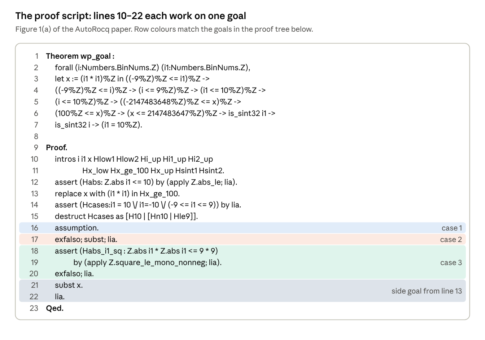
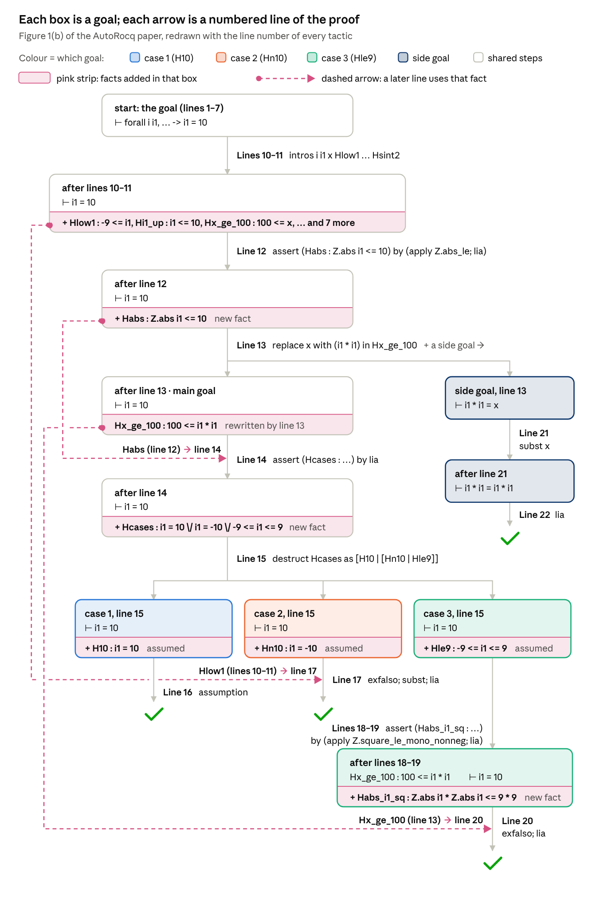

## 1. Bridge to the Paper

This section connects my earlier tutorial, [*Proof Solving in Rocq: From First Proofs to Advanced Tactics*](), to the paper *Agentic Verification of Software Systems* (AutoRocq, FSE 2026). Figure 1 of the paper proves one lemma extracted from a C program. Below are the lemma, a map of where each tactic appears in its proof, and a line-by-line walkthrough.

**Prerequisites:** this post builds on that tutorial. Read these sections there first:

- **Section 2 (Basics)**, especially 2.10–2.12: what a proof is, `rewrite`, and `destruct`.
- **Section 3 (Induction)**: 3.2 (why `simpl` gets stuck on `n + 0`), 3.5 (`replace`) and 3.8 (`Search`).
- **Section 4.1**: integers (`Z`, `%Z`, `Z.abs`, `is_sint32`).
- **Sections 4.2.1–4.2.9**: the nine tactics Figure 1 uses: `assumption`, `t1; t2`, `lia`, `subst`, `exfalso`, `apply`, `assert`, `replace … in H` and `destruct` on an "or". Section 1.2 below shows where each one appears in Figure 1.

### 1.0 Figure 1 for reference





*Redrawn from Figure 1 of Tu et al., "Agentic Verification of Software Systems", Proc. ACM Softw. Eng. 3, FSE (2026), [doi:10.1145/3808164](https://doi.org/10.1145/3808164), CC BY-NC-ND 4.0, with line numbers added to the proof tree. Top: the proof obligation `wp_goal` extracted from an SV-COMP program, and AutoRocq's proof. Bottom: the proof tree built while proving.*

Line numbers in 1.3 refer to the proof script above.

### 1.1 Reading the lemma

Here is the lemma from Figure 1(a), lines 1–7, with the `%Z` markers dropped for readability:

```coq
Theorem wp_goal :
  forall (i i1 : Z),
  let x := i1 * i1 in
  -9 <= i1 ->                (* Hlow1      *)
  -9 <= i ->                 (* Hlow2      *)
  i <= 9 ->                  (* Hi_up      *)
  i1 <= 10 ->                (* Hi1_up     *)
  i <= 10 ->                 (* Hi2_up     *)
  -2147483648 <= x ->        (* Hx_low     *)
  100 <= x ->                (* Hx_ge_100  *)
  x <= 2147483647 ->         (* Hx_up      *)
  is_sint32 i1 ->            (* Hsint1     *)
  is_sint32 i ->             (* Hsint2     *)
  i1 = 10.
```

In plain words: for any integers `i` and `i1`, let `x` be `i1 * i1`. **If** all ten conditions hold, **then** `i1 = 10`.

- `let x := i1 * i1 in` just gives `i1 * i1` the short name `x`.
- Each `->` is an assumption, exactly as in the Proof Solving tutorial (Section 2.11). The comments show the names the proof gives them.

**Why is it true?** `i1` lies between -9 and 10. If `i1` were between -9 and 9, then `i1 * i1` would be at most 81, contradicting `100 <= x`. So `i1` must be 10.

### 1.2 Where Figure 1 uses each tactic

Each tactic is taught in the Proof Solving tutorial (see the prerequisites). This table shows where it appears in the proof of `wp_goal`; line numbers refer to the proof script in 1.0.

| Tactic | In the Proof Solving tutorial | Where Figure 1 uses it |
| --- | --- | --- |
| `assumption` | 4.2.1 | Line 16 closes the case where `H10 : i1 = 10` and the goal is `i1 = 10`. |
| `t1; t2` | 4.2.2 | Line 17, `exfalso; subst; lia`, chains three tactics on one goal. |
| `lia` | 4.2.3 | Finishes almost every branch. Because `lia` can't multiply unknowns, the agent first proves a fact about `Z.abs i1 * Z.abs i1` with a lemma (line 18). |
| `subst` | 4.2.4 | Line 17 replaces `i1` with `-10`. Line 21 (`subst x`) does the same for the local definition `x := i1 * i1`. |
| `exfalso` | 4.2.5 | The cases `i1 = -10` (line 17) and `-9 <= i1 <= 9` (line 20) are impossible, so both start with `exfalso`. |
| `apply` | 4.2.6 | Line 12 uses `apply Z.abs_le`, which turns `Z.abs i1 <= 10` into `-10 <= i1 <= 10`. |
| `assert … by …` | 4.2.7 | Lines 12, 14 and 18 add the facts `Habs`, `Hcases` and `Habs_i1_sq`. Lines 12 and 18 prove theirs with a lemma (4.2.7.2): `Z.abs_le` and `Z.square_le_mono_nonneg`. |
| `replace … in H` | 4.2.8 | Line 13 turns `Hx_ge_100 : 100 <= x` into `100 <= i1 * i1`, and leaves the side goal `i1 * i1 = x` for lines 21–22. |
| `destruct` on an "or" | 4.2.9 | Line 15 splits `Hcases` into its three cases. Line 14 goes the other way: `lia` **proves** the "or" fact (4.2.9.3). |

### 1.3 Walking through Figure 1, line by line

Line numbers refer to Figure 1(a).

#### 1.3.1 Line 10: introduce everything

**Line 10, `intros i i1 x Hlow1 … Hsint2`.** This introduces both integers, `x`, and the ten assumptions under the names in 1.1. The goal is now `i1 = 10`.

#### 1.3.2 Line 12: derive |i1| ≤ 10 with `Z.abs_le` so that we can destruct into separate cases later

**Line 12, `assert (Habs : Z.abs i1 <= 10) by (apply Z.abs_le; lia)`.**

The library lemma it uses:

```coq
Z.abs_le : forall a b : Z,
  Z.abs a <= b <-> -b <= a <= b
```

In plain words: \|a\| ≤ b is the same as -b ≤ a ≤ b.

The proof after `by`, step by step:

1. **To prove:** `Hlow1 : -9 <= i1, Hi1_up : i1 <= 10, … ⊢ Z.abs i1 <= 10`
2. **`apply Z.abs_le`**. `apply` matches `a` to `i1` and `b` to `10`. As a consequence, we now need to prove the right-hand side, `-10 <= i1 <= 10`.
3. **To prove:** `Hlow1 : -9 <= i1, Hi1_up : i1 <= 10, … ⊢ -10 <= i1 <= 10`
4. **`lia`** solves this directly from `Hlow1` and `Hi1_up`.

Back in the main proof, the context now contains `Habs : Z.abs i1 <= 10`, and the main goal `i1 = 10` is unchanged.

#### 1.3.3 Line 13: replace `x` inside `Hx_ge_100` so that it can be used in one of the destruct cases later (case 3, line 20)

**Line 13, `replace x with (i1 * i1) in Hx_ge_100`.** `Hx_ge_100` becomes `100 <= i1 * i1`. This also creates a side goal, `i1 * i1 = x`, which is handled last (lines 21–22).

#### 1.3.4 Line 14: using `Habs` from 1.3.2, split `i1` into its three possible cases (destructed on line 15)

**Line 14, `assert (Hcases : i1 = 10 \/ i1 = -10 \/ (-9 <= i1 <= 9)) by lia`.**

Here `lia` uses `Habs` (\|i1\| ≤ 10), which we proved on line 12, to derive these three conditions.

#### 1.3.5 Lines 15–20: split into cases and close each one

**Line 15, `destruct Hcases as [H10 | [Hn10 | Hle9]]`.** Three goals, one per alternative, as in the Proof Solving tutorial, 4.2.9.

- **Case `i1 = 10` (line 16, `assumption`).** The goal `i1 = 10` is exactly `H10`. Done.
- **Case `i1 = -10` (line 17, `exfalso; subst; lia`).** Impossible: `Hlow1` says -9 ≤ i1. `exfalso` makes the goal `False`, `subst` replaces `i1` with -10 everywhere, and `lia` spots -9 ≤ -10 as a contradiction.
- **Case -9 ≤ i1 ≤ 9 (lines 18–20).** This case needs more work, so here it is step by step.
  1. **Spot the contradiction and pick the route.** If -9 ≤ i1 ≤ 9 is true, then i1 · i1 ≤ 81. But `Hx_ge_100` says `100 <= i1 * i1`. Both can't hold, so the hypotheses contradict each other and we take the `exfalso` route (Proof Solving tutorial, 4.2.5). To get there, we first need the fact "i1 · i1 ≤ 81" in the context. `lia` can't prove it alone, because it can't multiply unknowns.
  2. **Prove the bound with a lemma (line 18).** The lemma is:

     ```coq
     Z.square_le_mono_nonneg : forall n m : Z, 0 <= n -> n <= m -> n * n <= m * m
     ```

     In plain words: if n is between 0 and m, then n · n ≤ m · m.

     The agent asserts the fact it wants:

     ```coq
     assert (Habs_i1_sq : Z.abs i1 * Z.abs i1 <= 9 * 9) by (apply Z.square_le_mono_nonneg; lia)
     ```
     - To prove: `⊢ Z.abs i1 * Z.abs i1 <= 9 * 9`
     - `apply Z.square_le_mono_nonneg` matches the lemma's conclusion `n * n <= m * m`, with n → `Z.abs i1` and m → `9`. What's left to prove are the lemma's two preconditions: `0 <= Z.abs i1` and `Z.abs i1 <= 9`.
     - `; lia` runs on both. `0 <= Z.abs i1` holds for any absolute value. `Z.abs i1 <= 9` follows from the case hypothesis -9 ≤ i1 ≤ 9.
     - Both preconditions are proved, so `Habs_i1_sq` is added to the context.

     **Why `Z.abs i1` and not `i1`?** The lemma needs 0 ≤ n, and i1 can be negative (say -5). `Z.abs i1` is never negative, and \|i1\| · \|i1\| equals i1 · i1 anyway.
  3. **Prove `False` with `exfalso; lia`.** The context now holds:

     ```coq
     Hx_ge_100  : 100 <= i1 * i1
     Habs_i1_sq : Z.abs i1 * Z.abs i1 <= 9 * 9
     ```
     - `exfalso` changes the goal from `i1 = 10` to `False`.
     - `lia` computes 9 \* 9 = 81 and works out that `Z.abs i1 * Z.abs i1` is the same as `i1 * i1`. So the two facts say i1 · i1 ≥ 100 and i1 · i1 ≤ 81. No number is both, so `lia` proves `False` and the case is closed.

#### 1.3.6 Lines 21–22: close the side goal from `replace`

**Lines 21–22, the side goal from `replace`: `subst x. lia.`** The goal is `i1 * i1 = x`. `subst x` replaces `x` with its definition `i1 * i1`, leaving `i1 * i1 = i1 * i1`, which `lia` closes. Then `Qed.`

### 1.4 Connecting back to the paper's ideas

- **Proof tree (Fig. 1b, §4.2).** The root is the original goal. `replace` and `destruct` create the branches: three cases plus the side goal. Each leaf is a goal closed by `assumption` or `lia`. This is the tree AutoRocq keeps track of.
- **Context search (§4.1, Table 1).** `Z.abs_le` and `Z.square_le_mono_nonneg` weren't in the lemma; AutoRocq found them with queries like `Search (Z.abs _ <= _).`. That is the `Search` command from the Proof Solving tutorial (Section 3.8).
- **Why the result is trustworthy (§6.5).** However the tactics were chosen, `Qed` makes Rocq's kernel recheck the whole proof. A wrong LLM suggestion simply fails; it can never produce a false "proved".
- **Human vs. agent (§6.4, Fig. 9).** The human expert instead wrote two helper lemmas and split on the sign of `i1`. Both proofs rest on the same fact: i1² ≥ 100 forces \|i1\| ≥ 10.

## 2. The Paper's Main Contributions

**1. An agent that works *with* Rocq, not just through it.**

- **The problem:** Frama-C turns a C program and its spec into goals like `wp_goal`, but someone still has to prove them.
- **Earlier tools:** they either predict one tactic at a time from a trained model (Proverbot9001, QEDCartographer), or have an LLM write a whole proof and then repair it (if erroneous) (PALM, Rango, Copra). The authors ran all five on their benchmark and show that none of them could prove a lemma as complex as `wp_goal`.
- **What's new:** AutoRocq is the first proof *agent*: an LLM (GPT-4.1, with no training on proof corpora) that talks to Rocq in a loop. At every step it decides whether to try a tactic or first ask Rocq a question.
- **Why it's safe:** `Qed` makes Rocq's kernel recheck the whole proof, so a wrong guess can only fail; it can never produce a false "proved".

**2. Three ingredients, all visible in our example.**

- **Context search (§4.1):** the agent decides when it is missing a fact and queries Rocq (as Rocq loads all the lemmas and definitions that can be used in generating proofs). `Search (Z.abs _ <= _).` surfaced `Z.abs_le` (line 12), and `Search (_ * _ <= _ * _).` surfaced `Z.square_le_mono_nonneg` (line 19). Neither lemma appears in the goal.
- **Proof-tree awareness (§4.2):** the agent keeps the tree from 1.0 (the side goal from line 13, the three cases from line 15), so it always knows which goals are still open.
- **Feedback (§4.3):** every Rocq error goes back to the LLM to fix the tactic. After three repeated errors the agent runs a context search instead, and it reuses successful past proofs.
- **In numbers:** for `wp_goal`, 48 of its 59 tactic attempts failed, yet it found the proof in 156.7 seconds; a Rocq expert needed 20 minutes for a different proof (§6.4).

**3. A program-verification benchmark and the results.**

- **New benchmark (§5.1):** existing datasets (CoqGym, CoqStoq) are mostly mathematics, so the authors extracted lemmas from 131 SV-COMP C programs, using Frama-C plus LLM-generated loop invariants.
- **Main results:** AutoRocq proves 48.0% of the CoqGym math lemmas and 30.9% of the verification lemmas. That beats five baselines by 15.2–172.8% on math and 10.6–204.6% on verification, and 168 lemmas are proved by AutoRocq alone.
- **Ablation (Table 3):** removing context search hurts the most: the success rate drops from 44.3% to 30.0%.
- **Linux kernel case study (§7):** on code such as `memmove`, `strcpy` and `hex2bin`, it proves 12 of 60 lemmas, or 18 when it can also call CoqHammer.
