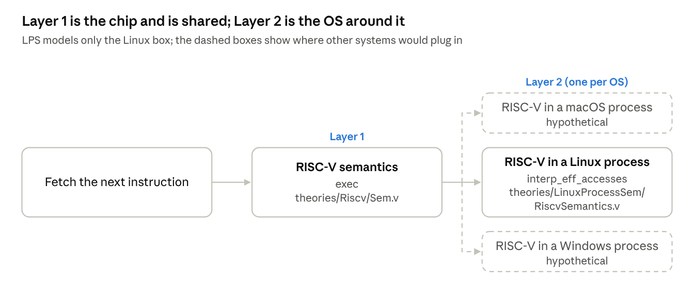
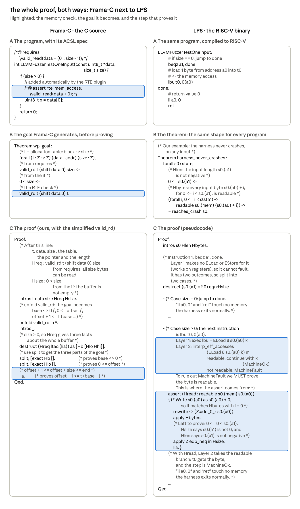
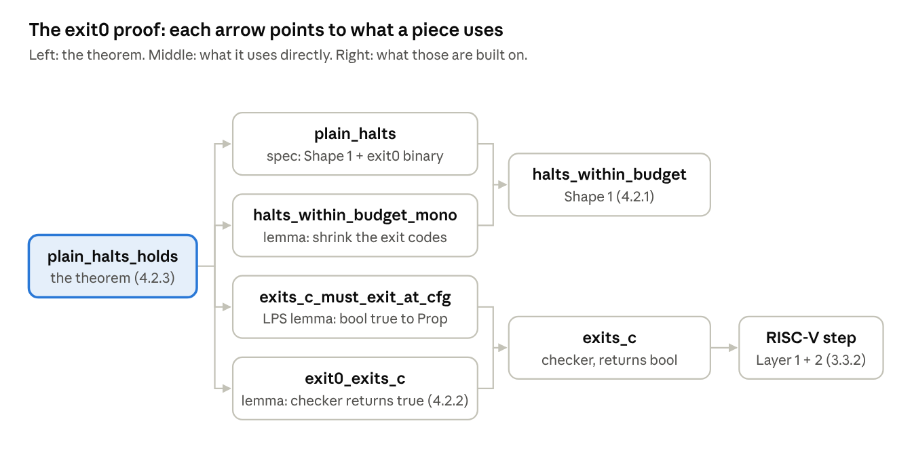
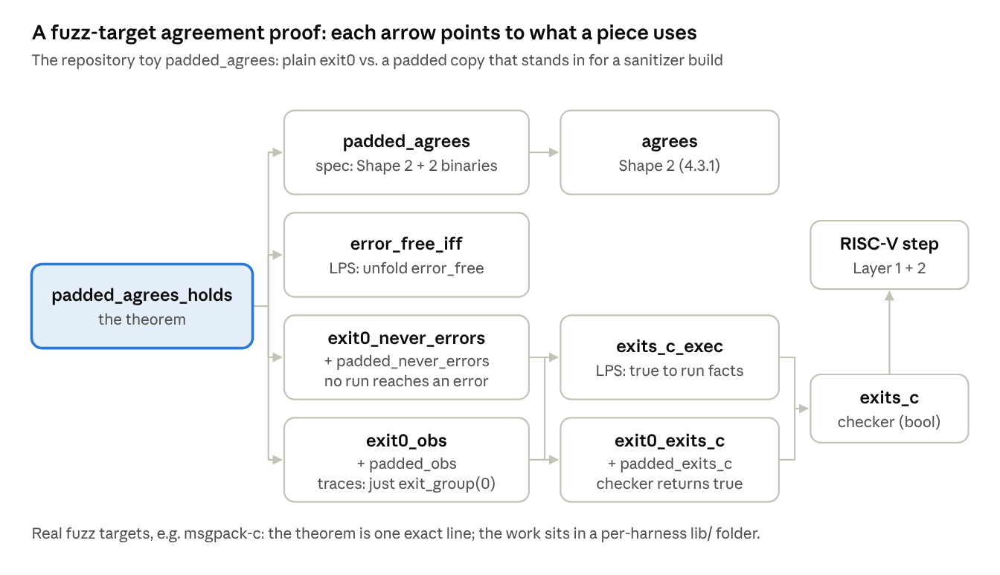

## 1. Introduction and background

*Based on Anthropic's research post on [formal verification](https://www.anthropic.com/research/formal-verification) and the public proofs at [theorem-labs/oss-verify-proofs](https://github.com/theorem-labs/oss-verify-proofs). Those proofs are stated in **LPS**, Theorem's Rocq model of a Linux process running a RISC-V binary ([theorem-labs/rocq-linux-process-semantics](https://github.com/theorem-labs/rocq-linux-process-semantics)). Code marked **(real)** in 3.3 and Section 4 is quoted, lightly trimmed, from those two repositories at the commit the proofs pin. Code marked **(our example)** is ours, written to match.*

**In one line:** instead of writing a spec in C terms and letting Frama-C generate goals, they compile the program to RISC-V machine code and state **one generic theorem**: "this fuzz test never crashes, for any input under 64 MB". Claude then has to prove that theorem in Rocq.

### 1.0 What you need first

This tutorial describes a **computer** inside Rocq: its registers and its memory. The ideas below are all you need for that.

#### 1.0.1 Pairs: one value that holds two things

```coq
Inductive natprod : Type :=
  | pair (n1 n2 : nat).
Notation "( x , y )" := (pair x y).

Definition fst (p : natprod) : nat :=
  match p with
  | (x, y) => x
  end.

Compute fst (3, 5).   (* ==> 3 *)
```

**In plain words:** a pair bundles two values, and `fst` / `snd` take them back out.

**In this tutorial:** the computer's state bundles several things at once: registers and memory.

#### 1.0.2 Records: pairs with named parts

A `Record` is a pair (or triple, or more) whose parts have **names**:

```coq
Record state := { a0 : Z ; a1 : Z ; mem : Z -> option Z }.
```

**In plain words:** a `state` has three parts called `a0`, `a1` and `mem`. If `s` is a state, `s.(a0)` means "the `a0` part of `s`". It does the same job as `fst`, but by name.

#### 1.0.3 Options: "maybe a value"

```coq
Inductive natoption : Type :=
  | Some (n : nat)
  | None.

Fixpoint nth_error (l : natlist) (n : nat) : natoption :=
  match l with
  | nil => None
  | a :: rest =>
      match n with
      | O => Some a
      | S k => nth_error rest k
      end
  end.

Compute nth_error [4; 5; 6] 1.   (* ==> Some 5 *)
Compute nth_error [4; 5; 6] 9.   (* ==> None *)
```

**In plain words:** `Some x` means "here is the answer, `x`", and `None` means "there is no answer". Asking for position 9 of a 3-element list gives `None`: that is an **out-of-bounds read**, the same kind of bug this tutorial is about.

Rocq's built-in `option` works the same way for any type: `option Z` is `Some z` or `None`.

#### 1.0.4 Partial maps: lookup tables

```coq
Inductive partial_map : Type :=
  | empty
  | record (i : id) (v : nat) (m : partial_map).

Fixpoint find (x : id) (d : partial_map) : natoption :=
  match d with
  | empty => None
  | record y v rest =>
      if eqb_id x y then Some v
      else find x rest
  end.
```

**In plain words:** a partial map is a table of (key, value) entries. `find` looks a key up and returns `Some value`, or `None` if the key isn't in the table.

**In this tutorial:** **memory is a lookup table** from addresses to bytes. Looking up an address that was never allocated gives `None`.

#### 1.0.5 Memory as a function

Instead of a list of entries, this tutorial stores memory as a **function**: give it an address, and it answers `Some byte` or `None`. For example, memory holding the 3-byte input `"Hi!"` at addresses 1000–1002:

```coq
Open Scope Z_scope.

Definition mem_hi (addr : Z) : option Z :=
  (* letter H *)
  if addr =? 1000 then Some 72
  (* letter i *)
  else if addr =? 1001 then Some 105
  (* exclamation mark *)
  else if addr =? 1002 then Some 33
  (* everything else: nothing there *)
  else None.

(* gives Some 105 *)
Compute mem_hi 1001.
(* gives None : reading here is a memory error *)
Compute mem_hi 1003.
```

That is all `mem : Z -> option Z` means in 1.0.2: the same kind of function as `mem_hi`.

#### 1.0.6 Readable: when an address holds a byte

The proof in 3.3.3 uses `readable`. It is built directly on the memory function of 1.0.5:

```coq
(* readable mem_func a : address a holds a byte in memory mem_func *)
(* mem_func : the memory, a function from addresses to Some byte or None,
   exactly like mem_hi in 1.0.5 *)
(* a : the address we want to read *)
Definition readable (mem_func : Z -> option Z) (a : Z) : Prop :=
  exists b, mem_func a = Some b.
```

**With `mem_hi` from 1.0.5 as the memory:**

- `readable mem_hi 1001` is true, because `mem_hi 1001 = Some 105`.
- `readable mem_hi 1003` is false, because `mem_hi 1003 = None`, so reading there is a memory error.

*This is our simplified version. In the real LPS model, a load faults when no readable segment holds the byte (see the table in Section 2). The idea is the same, but the real check is on segments rather than this one function.*

## 2. Two ways to say "no memory errors"

|  | Frama-C | Anthropic's post / LPS |
| --- | --- | --- |
| What is analysed | the **C source** | the **compiled RISC-V binary** |
| What "no memory error" means | ACSL checks such as `\valid_read(p)`, added by a human or by Frama-C's RTE plugin | the **machine model** defines it: a load from a byte no readable segment holds is a `MachineFault`; in the AddressSanitizer build, ASan's own checks call `abort()`, which also counts as an error |
| Who writes the spec | humans, or Frama-C's RTE plugin for runtime errors | nobody: every program gets the same statement shapes (`agrees`, `halts_within_budget`), filled in with its binaries |
| What gets proved | many small goals (`wp_goal`s), one per check | one theorem about every execution of the whole binary |
| Loop invariants | written in the ACSL annotations, before goals are generated | not in the spec at all: they must live **inside** the proof (my inference; the post does not discuss loops) |

## 3. Verifying at the Source Code vs Binary Level

### 3.1 The "hello world" program

A fuzz test ("harness") is a function that receives random bytes. This one reads the first byte, guarded so it never reads an empty buffer:

```c
int LLVMFuzzerTestOneInput(const uint8_t *data, size_t size) {
  if (size > 0) {
    // the only memory access
    uint8_t x = data[0];
  }
  return 0;
}
```

The only possible memory error is reading `data[0]` when the buffer is empty. The `if` rules that out. Remove the `if` and both approaches below would fail on `size = 0`.

### 3.2 Source Code Level (using Frama-C)

1. **Spec at the C level.** The caller promises `data` points to `size` readable bytes. Frama-C's RTE plugin then adds an automatic check before the memory access:

   ```c
   /*@ requires \valid_read(data + (0 .. size - 1)); */
   int LLVMFuzzerTestOneInput(const uint8_t *data, size_t size) {
     if (size > 0) {
       // added automatically by the RTE plugin
       /*@ assert rte: mem_access: \valid_read(data + 0); */
       uint8_t x = data[0];
     }
     return 0;
   }
   ```
2. **Frama-C turns the `assert` into a goal**, in its memory model:
   1. **Helper function `valid_rd`**

      `valid_rd` (defined below) returns a `Prop`. Given a table `t`, a pointer `p` and a count `n`, it returns the statement "the `n` cells starting at `p` can be read". It is Frama-C's Rocq version of ACSL's `\valid_read` from point 1:

      ```coq
      (* valid_rd t p n : the n cells starting at pointer p can be read *)
      Definition valid_rd (t : Z -> Z) (p : addr) (n : Z) : Prop :=
        (* reading 0 cells is always fine *)
        n > 0 ->
          (* p is not the NULL pointer *)
          base p <> 0
          (* p is not before the start of its block *)
          /\ 0 <= offset p
          (* p + n is not past the end of its block *)
          /\ offset p + n <= t (base p).
      ```

      Here `t` is the **allocation table**: `t b` returns how many cells block `b` has.

      **Example:** the input `"Hi!"` is block 7 with 3 cells, so `t 7 = 3`, and `data` is block 7, offset 0.

      | Check | Arithmetic | Returns? |
      | --- | --- | --- |
      | `valid_rd t data 3` (all 3 bytes) | `0 + 3 <= 3` | True |
      | `valid_rd t (shift data 2) 1` (the `'!'`) | `2 + 1 <= 3` | True |
      | `valid_rd t (shift data 3) 1` (one past the end) | `3 + 1 <= 3` is false | **False**: memory error |

      *This is simplified, written from Frama-C's description of its memory model rather than copied from its source. It matches Frama-C's own lemma `valid_rd_null`: a pointer with base 0 is readable only for `n <= 0`.*
   2. **The goal**

      ```coq
      Theorem wp_goal :
        (* t = allocation table: block -> size *)
        forall (t : Z -> Z) (data : addr) (size : Z),
        (* from requires *)
        valid_rd t (shift data 0) size ->
        (* from the if *)
        0 < size ->
        (* the RTE check *)
        valid_rd t (shift data 0) 1.
      ```
3. **An agent proves the goal**, reading 1 byte is fine because at least 1 byte is readable.

   Our proof (also in the side-by-side widget, 3.4):

   ```coq
   Proof.
     (* After this line:
          t, data, size : the table, the pointer and the length
          Hreq  : valid_rd t (shift data 0) size
                  from requires: all size bytes can be read
          Hsize : 0 < size
                  from the if: the buffer is not empty *)
     intros t data size Hreq Hsize.
     (* unfold valid_rd: the goal becomes
          base <> 0 /\ 0 <= offset /\ offset + 1 <= t (base ...) *)
     unfold valid_rd in *.
     intros _.
     (* size > 0, so Hreq gives three facts about the whole buffer *)
     destruct (Hreq ltac:(lia)) as [Hb [Hlo Hhi]].
     (* use split to get the three parts of the goal *)
     split; [exact Hb |].   (* proves base <> 0 *)
     split; [exact Hlo |].  (* proves 0 <= offset *)
     (* offset + 1 <= offset + size <= end *)
     lia.                   (* proves offset + 1 <= t (base ...) *)
   Qed.
   ```

   **Step by step** (write `p` for `shift data 0`):
   1. **`intros t data size Hreq Hsize`** names everything. The goal is `valid_rd t p 1`.
   2. **`unfold valid_rd in *`** opens the definition everywhere:
      - Goal: `1 > 0 -> base p <> 0 /\ 0 <= offset p /\ offset p + 1 <= t (base p)`
      - `Hreq`: `size > 0 -> base p <> 0 /\ 0 <= offset p /\ offset p + size <= t (base p)`
   3. **`intros _`**: the goal starts with `1 > 0 ->`. We assume `1 > 0` and throw its name away (`_`), since we never need it.
   4. **`destruct (Hreq ltac:(lia)) as [Hb [Hlo Hhi]]`**: `Hreq` first needs `size > 0`, and `ltac:(lia)` proves it from `Hsize : 0 < size`. `Hreq` then gives its three facts, and `destruct` names them:
      - `Hb : base p <> 0`
      - `Hlo : 0 <= offset p`
      - `Hhi : offset p + size <= t (base p)`
   5. **`split; [exact Hb |]`**: the goal is `A /\ (B /\ C)`. `split` makes two goals, `A` and `B /\ C`. `[exact Hb |]` runs `exact Hb` on the first (`A` is exactly `Hb`) and nothing on the second.
   6. **`split; [exact Hlo |]`**: same again, `B` is exactly `Hlo`. Left to prove: `offset p + 1 <= t (base p)`.
   7. **`lia`**: from `Hsize` (`0 < size`) and `Hhi`, `offset p + 1 <= offset p + size <= t (base p)`. Done.

   **In plain words:** the whole buffer fits in its block (`Hreq`), and the buffer is not empty (`Hsize`), so its first byte fits too.

### 3.3 Binary Level (Anthropic + Theorem's way)

#### 3.3.1 The compiled code

The same function, compiled to RISC-V (simplified). By convention, register `a0` holds `data` and `a1` holds `size`. `t0` is one temporary register, scratch space for the byte being read:

```asm
LLVMFuzzerTestOneInput:
    # if size == 0, jump to done
    beqz  a1, done
    # load 1 byte from address a0 into t0   <- the memory access
    lbu   t0, 0(a0)
done:
    # return value 0
    li    a0, 0
    ret
```

#### 3.3.2 The machine model: where "memory error" is defined



For each step of the machine (one instruction), LPS performs 3 steps and interacts with 2 layers:

1. **Fetch** the next instruction from memory.
2. **Layer 1, `exec`** (`theories/Riscv/Sem.v`): turns the instruction into an **effect tree** (type `eff`), a set of requests such as `ELoad` ("read memory") and `EStore` ("write memory"). It never touches memory itself.
3. **Layer 2, `interp_eff_accesses`** (`theories/LinuxProcessSem/RiscvSemantics.v`, a different file that imports and wraps Layer 1): takes that tree and the memory, answers each request, and returns a `machine_result`: `MachineOk`, `MachineFault` or `MachineUnmodeled`.

**`eff` is short for "effect":** the effects on the outside world (here, memory) that an instruction asks for. LPS calls the type "the effect tree".

**Layer 1: the instruction asks memory for bytes (real, `theories/Riscv/Sem.v`).** A load instruction like `lbu` does not read memory itself. It produces an `ELoad` request ("give me `n` bits at address `a`, then continue with `k`"):

```coq
(* exec: what one instruction i does to the core c (registers and pc) *)
Definition exec (sz : word) (i : instr) (c : core) : eff :=
  ...
  (* one case per kind of instruction *)
  match i with
  | Lui rd imm => ...
  | Auipc rd imm => ...
  ...
  (* the case for loads, such as lbu *)
  | Load msz sgn rd rs1 imm =>
      (* the address = register rs1 + offset *)
      load_val msz sgn (rget c rs1 + sext 64 imm)
        (* then: put the loaded value v in register rd *)
        (λ v, EDone (rset rd v cn))
  ...

Definition load_val (sz : msize) (sgn : bool) (a : word) (k : word -> eff) : eff :=
  match sz with
  (* lbu = 1 byte = 8 bits *)
  | SZ1 => ELoad 8 a (λ v, k (if sgn then sext 64 v else zext 64 v))
  ...
```

**Layer 2: `interp_eff_accesses` answers the requests (real, `theories/LinuxProcessSem/RiscvSemantics.v`).** This function is Layer 2's **entry point**. It takes the effect tree from Layer 1 and the memory `m`, answers each request, and returns a `machine_result`. It has three important cases:

1. **`EDone`**: no request left, so the instruction is done: `MachineOk`.
2. **`ELoad`**: if the bytes are readable, continue with `k`; if not, `MachineFault`.
3. **`EStore`**: if every byte is writable, update memory and continue with `k`; if not, `MachineFault`.

```coq
(* interp_eff_accesses: answer the requests that one instruction makes,
   using memory m *)
Fixpoint interp_eff_accesses (t : eff) (m : word -> option byte) : ... :=
  match t with
  (* no request left: the instruction is done *)
  | EDone c => MachineOk ...
  (* a load request: read n bits at address a, then continue with k *)
  | ELoad n a k =>
      (* readable:     success, go back to Layer 1 via k *)
      (* not readable: MachineFault *)
      ...
  (* a store request: write value v (n bits) at address a, then continue with k *)
  | EStore n a v k =>
      (* writable:     success, update memory m, then go back to Layer 1 via k *)
      (* not writable: MachineFault *)
      ...
  | EEbreak _ => ...
  | EFault _ => ...
  | EDefinedIllegal _ => ...
  | EIllegal _ | EEcall _ => MachineUnmodeled
  end.
```

**What it returns:** every step ends in one of three results.

```coq
Inductive machine_result (A : Type) : Type :=
  (* the step worked, and here is the result (of type A) *)
  | MachineOk (result : A)
  (* the PROGRAM crashed, e.g. SIGSEGV; no result inside *)
  | MachineFault
  (* the MODEL gave up on this step; no result inside *)
  | MachineUnmodeled.
```

Both `MachineFault` and `MachineUnmodeled` count as **errors**. That makes the model fail-closed: a step it cannot interpret can never pass as safe.

#### 3.3.3 How the proof would go for 3.1 "Hello World" Code

**This is our pseudocode in LPS terms (not exact).** The proof steps through the machine code of 3.3.1, one instruction at a time.

> **The most important point:** the memory check that Frama-C inserts as an `assert` shows up by itself, at the `lbu`, because of Layer 2's `ELoad` rule. It reuses the `readable` function from [1.0.6](#106-readable-when-an-address-holds-a-byte): address a holds a byte in memory.

```coq
(* Our example: the harness never crashes, on any input *)
Theorem harness_never_crashes :
  forall s0 : state,
    (* Hlen: the input length s0.(a1) is not negative *)
    0 <= s0.(a1) ->
    (* Hbytes: every input byte s0.(a0) + i, for 0 <= i < s0.(a1), is readable *)
    (forall i, 0 <= i < s0.(a1) -> readable s0.(mem) (s0.(a0) + i)) ->
    ~ reaches_crash s0.
Proof.
  intros s0 Hlen Hbytes.

  (* Instruction 1: beqz a1, done.
     Layer 1 makes no ELoad or EStore for it (works on registers), so it cannot fault.
     It has two outcomes, so split into two cases. *)
  destruct (s0.(a1) =? 0) eqn:Hsize.

  - (* Case size = 0: jump to done.
       "li a0, 0" and "ret" touch no memory: the harness exits normally. *)
    ...

  - (* Case size > 0: the next instruction is lbu t0, 0(a0).
       Layer 1:  exec lbu  =  ELoad 8 s0.(a0) k
       Layer 2:  interp_eff_accesses (ELoad 8 s0.(a0) k) m
                   readable:     continue with k   (MachineOk)
                   not readable: MachineFault
       To rule out MachineFault we MUST prove the byte is readable.
       This is where the assert comes from: *)
    assert (Hread : readable s0.(mem) s0.(a0)).
    { (* Write s0.(a0) as s0.(a0) + 0, so it matches Hbytes with i = 0 *)
      rewrite <- (Z.add_0_r s0.(a0)).
      apply Hbytes.
      (* Left to prove: 0 <= 0 < s0.(a1).
         Hsize says s0.(a1) is not 0, and Hlen says s0.(a1) is not negative *)
      apply Z.eqb_neq in Hsize.
      lia. }
    (* With Hread, Layer 2 takes the readable branch: t0 gets the byte,
       and the step is MachineOk.
       "li a0, 0" and "ret" touch no memory: the harness exits normally. *)
    ...
Qed.
```

### 3.4 Recap: Binary Version vs. the Frama-C Version



The two proofs have the same core, "one byte fits in a non-empty buffer". They differ in where the obligation comes from: Frama-C writes it down in advance, while in LPS it is a case of Layer 2 that the proof has to rule out.

With a loop, say one that reads every byte, the proof would also need an invariant such as "the pointer register stays between `a0` and `a0 + a1`". In the Frama-C workflow that invariant is written into the annotations. Here it would be stated and proved **inside** the Rocq proof, as an induction over the loop iterations, and checked by Rocq like every other step.

### 3.5 What this buys, and what it costs

- **No spec writing.** "Never crashes" needs no human to describe what the program should do.
- **The compiler is not trusted.** The proof is about the binary that actually runs, so a compiler bug cannot hide a crash. Frama-C reasons about the C source and has to trust that the compiler preserves its meaning.
- **The guarantee is narrower.** It says the program doesn't crash for inputs under 64 MB, on static single-threaded RISC-V Linux, using AddressSanitizer's notion of a crash. It does **not** say the program computes the right answer. That would need a functional spec, which the post writes by hand only in its zlib case study.
- **The proofs are huge.** All the reasoning a Frama-C user puts into annotations moves into the proof. The post reports about 600,000 lines of Rocq for a typical library.

## 4. The real model, on toy programs

### 4.0 The toy program: source code and machine code

**The smallest real example: `exit0` (real, `tests/toy/`).** The repository's own "hello world" is a 132-byte RISC-V program of three instructions:

#### 4.0.1 Source code (C)

In C, this program is simply:

```c
int main(void) {
  // exit with status 0
  return 0;
}
```

#### 4.0.2 Machine code (RISC-V)

The toy was written directly as machine code, not compiled from C. A compiled `main` would also bring in the C library's startup code, which is many more instructions. As machine code, it is just three instructions:

```asm
# a0 := 0   (the exit status)
addi a0, zero, 0
# a7 := 94  (94 = Linux syscall number of exit_group)
addi a7, zero, 94
# ask Linux to run syscall a7: exit_group(0)
ecall
```

### 4.1 What is a shape?

A shape is a **statement template**, defined once in `theories/Shapes.v`. It is a `Definition` that takes a binary (an `Image`) and some limits, and returns the theorem (a `Prop`) to prove about that binary. Every program reuses the same shapes: only the binary plugged in changes, so nobody writes a spec by hand. 4.2 uses Shape 1 on the plain build; 4.3 uses Shape 2 for fuzz targets.

### 4.2 Plain build: Shape 1, `halts_within_budget` (the program always exits)

#### 4.2.1 The spec

Its spec (real, `tests/toy/exit0/Statements.v`):

```coq
(** On every input on which [plain] is never refused memory for exceeding
    16 GiB, and when the environment refuses nothing it is not forced to,
    every execution exits with status 0 or 2. *)
Definition plain_halts : Prop :=
  halts_within_budget Budgets.Standard.lim_source Exits.ok_or_refused Images.plain.
```

`halts_within_budget` is one of the shared statement shapes (real, `theories/Shapes.v`):

```coq
(* halts_within_budget lim allowed img : the binary img always exits,
   with a status in the list allowed *)
Definition halts_within_budget (lim : Z) (allowed : list word) (img : Image) : Prop :=
  (* for every way the process can start (en) and every input (inp) *)
  forall (en : ExecEntry) (inp : ProcInput),
    (* ... where the start is a valid one for this binary *)
    valid_entry img en inp ->
    (* ... and the input is a valid one *)
    valid_input inp ->
    (* IF the program is never refused memory for going over the budget lim
       (forced_only_cfg: the system refuses nothing it is not forced to) *)
    ~ run_scfg_budget_refused forced_only_cfg img lim en inp ->
    (* THEN every execution exits, with a status in the list allowed *)
    must_exit_in_scfg forced_only_cfg allowed img lim en inp.
```

Nothing in the shape mentions the program in Section 4.0: `Images.plain` is just the binary, loaded into Rocq by a tool. That is what makes the spec mechanical.

#### 4.2.2 `exit0_exits_c`: run the binary and check that it exits

**The real `exit0` proof works by running the model (real, `tests/proofs/lib/Exit0Run.v`):**

```coq
Lemma exit0_exits_c : forall sp rnd argv envp uid hw,
  exits_c E0.loaded_segments verdict_accept 8
    (init_machine_state E0.loaded_segments E0.init_pc E0.phdrs sp rnd argv envp uid hw)
  = true.
Proof.
  intros. rewrite (with_mem_eta (init_machine_state _ _ _ _ _ _ _ _ _)).
  generalize (ms_mem (init_machine_state E0.loaded_segments E0.init_pc E0.phdrs
                        sp rnd argv envp uid hw)).
  intros mem. vm_compute. reflexivity.
Qed.
```

- **`exits_c … 8`** is an executable checker built into LPS. It runs the machine for up to 8 steps and returns `true` if the program reaches `exit_group` with the expected status (`verdict_accept` is status 0).
- **`forall sp rnd argv envp uid hw`** stands for whatever the kernel chose: stack address, randomness, arguments, environment and so on. The proof holds for all of them.
- **`vm_compute`** runs that check inside Rocq and gets `true`. 4.2.3 shows how this one run becomes the full `plain_halts` statement.

#### 4.2.3 `plain_halts_holds`: prove the shape from 4.2.1

**The theorem that proves Shape 1 for `exit0` (real, `tests/proofs/toy/exit0/plain_halts/Proof.v`).** `Statements.plain_halts` is the shape `halts_within_budget` from 4.2.1, filled in with the binary from Section 4.0. Its last line uses `exit0_exits_c` from above:

```coq
Theorem plain_halts_holds : Statements.plain_halts.
Proof.
  (* open plain_halts: it is halts_within_budget ... Images.plain *)
  unfold Statements.plain_halts.
  (* prove it for the smaller set of exit codes {0};
     {0} is inside the allowed set {0, 2} *)
  apply (halts_within_budget_mono _ [verdict_accept]).
  (* side goal: every code in {0} is also in {0, 2} *)
  { intros code [<- | []]. left. reflexivity. }
  (* fix one start state (sp, brk0, mbase, rnd) and one input;
     the validity and budget premises are not needed, so drop them (_) *)
  intros [sp brk0 mbase rnd] inp _ _ _.
  (* open the binary and the "every execution exits" statement *)
  unfold Images.plain. cbn [must_exit_in_scfg].
  (* only one allowed code is left: reduce to "must exit with status 0" *)
  apply must_exit_in_at_cfg_singleton. unfold init_config.
  (* LPS lemma: if the checker says the run exits within 8 steps,
     then every execution exits; the checker part is exit0_exits_c *)
  apply (exits_c_must_exit_at_cfg _ _ _ 8);
    [reflexivity | reflexivity | apply Exit0Run.exit0_exits_c].
Qed.
```

#### 4.2.4 How the pieces fit



1. **4.2.1** defines the shape `halts_within_budget`, and `plain_halts` fills it in with `exit0`'s binary.
2. **`exit0_exits_c`** (above) does the computing: it runs the machine and gets `true`.
3. **`plain_halts_holds`** joins them: it proves `plain_halts`, using `exit0_exits_c` in its last line.

Shape 2, `agrees` (4.3), is not used for `exit0`: it is for real fuzz targets, which are built twice (plain and with ASan).

### 4.3 Fuzz targets: Shape 2, `agrees` (no memory errors)

#### 4.3.1 The spec

**The statement real fuzz targets get: `agrees` (real, `theories/Shapes.v`).** For a fuzz test, the binary is built twice: once plain, and once with AddressSanitizer (ASan). The memory-safety spec says both builds are error-free and behave the same:

```coq
Definition agrees (lim_plain lim_san : Z) (plain san : Image) : Prop :=
  forall (en_plain en_san : ExecEntry) (inp : ProcInput),
    valid_entry plain en_plain inp ->
    valid_entry san en_san inp ->
    valid_input inp ->
    ~ run_budget_refused plain lim_plain en_plain inp ->
    (* plain build: no error *)
    error_free (run plain lim_plain en_plain inp)
    (* ASan build: no error *)
    /\ error_free (run san lim_san en_san inp)
    (* both builds behave the same *)
    /\ trace_equiv (bh_traces (run plain lim_plain en_plain inp))
                   (bh_traces (run san lim_san en_san inp)).
```

- **`error_free`** means no `MachineFault`, no unmodeled step, and no `abort()`.
- **ASan does the memory checking.** ASan compiles extra instructions into the binary that check every memory access and call `abort()` on a bad one. So "the ASan build is error-free on every input" means ASan never finds a memory error, on any input within the limits.

#### 4.3.2 The proof, on the toy `padded_agrees`

The repository proves Shape 2 on a toy too: `padded_agrees` (real, `tests/proofs/toy/exit0/padded_agrees/Proof.v`) compares the plain `exit0` binary with a padded copy that plays the role of the sanitizer build. Its proof has the same pieces as 4.2, used twice, once per binary:



- **Two binaries, so every lemma comes in a pair:** one for `exit0`, one for `padded`.
- **`agrees` has three parts** (4.3.1): plain is error-free, the other build is error-free, and both have the same traces. `*_never_errors` gives the first two, `*_obs` gives the third.
- **Real fuzz targets** (for example msgpack-c `unpack_pack_fuzzer`): `asan_agrees_holds` is a single `exact` line, and the real work sits in that harness's own `lib/` folder (heap, malloc, the harness code, and so on), because a real binary is tens of KB, not three instructions.
