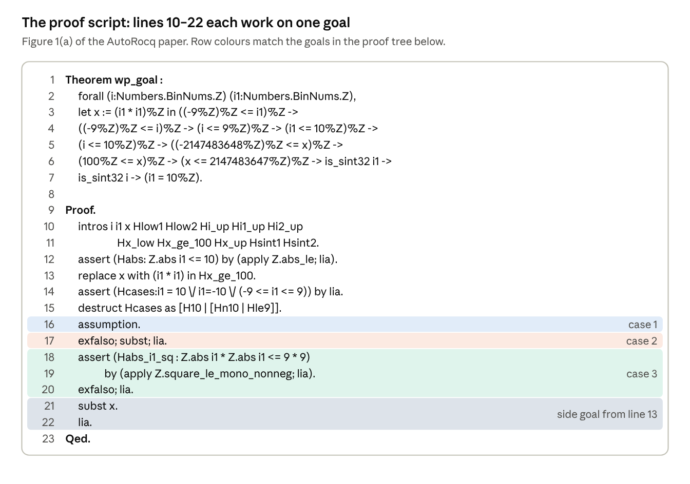

## 1. Follow-up Paper: LemmaNet

*Zhao, Tu, Liu, Rinard and Roychoudhury, "Automated Lemma Discovery in Agentic Program Verification", ASE '26, [doi:10.1145/3832783.3834356](https://doi.org/10.1145/3832783.3834356), CC BY 4.0. Code excerpts below are simplified from its Figures 1–2.*

**In one line:** LemmaNet is built *on top of* [AutoRocq]() and adds the one thing AutoRocq can't do: **invent new helper lemmas** that aren't in any library.

### 1.1 How the two papers connect

- **Built on AutoRocq.** AutoRocq (FSE 2026) is an LLM agent that proves Frama-C verification goals in Rocq, finding helper lemmas in Rocq's libraries. LemmaNet's implementation (§4.4) uses AutoRocq as its proof agent and adds two new components around it.
- **Same benchmark, plus harder ones.** LemmaNet reuses AutoRocq's 641 SV-COMP verification conditions (VCs) from 131 programs, and adds 300 VCs from the NTP4VC benchmark: the Linux kernel, Contiki OS, the C++ standard library, an X.509 parser and more, some over 1,000 lines of code.
- **Same Linux kernel source.** Its running example, `hex2bin`, is one of AutoRocq's kernel case-study functions, and both papers cite the same VerKer work (Efremov et al.) for the ACSL-annotated kernel code.

### 1.2 The gap: retrieving lemmas vs. inventing them

AutoRocq's own showcase example (Figure 1 of the AutoRocq paper, below) already shows the gap. There, a goal called `wp_goal` asks Rocq to prove `i1 = 10` for an integer `i1`, from bounds such as `-9 <= i1 <= 10` and `100 <= i1 * i1`. The LLM searched Rocq's libraries with the `Search` command and used two existing lemmas:

- **`Z.abs_le`** (line 12), found with `Search (Z.abs _ <= _).`: `|a| <= b` is the same as `-b <= a <= b`. It lets the proof derive `|i1| <= 10` from the bounds on `i1`.
- **`Z.square_le_mono_nonneg`** (lines 18–19), found with `Search (_ * _ <= _ * _).`: if `0 <= n <= m`, then `n * n <= m * m`. It gives `|i1| * |i1| <= 81` in the case `-9 <= i1 <= 9`, which contradicts `100 <= i1 * i1`.

Neither lemma appears in the goal; both already existed in Rocq's standard library. A human expert proved the same goal differently, by writing two new lemmas of their own.



|  | AutoRocq | Human expert (AutoRocq §6.4) | LemmaNet |
| --- | --- | --- | --- |
| Where helper facts come from | **Retrieved** from Rocq's libraries with `Search` | **Written by hand** as two new helper lemmas | **Invented** by the LLM, then proved in Rocq |
| In `wp_goal` | `Z.abs_le`, `Z.square_le_mono_nonneg` | Split on the sign of `i1` | (automates what the expert did) |

LemmaNet's §2.2 states the problem directly: existing approaches focus on "lemma retrieval from existing libraries only", but for VCs "key lemmas are often not available in the proof context."

### 1.3 Primer: loop invariants

About 42% of LemmaNet's goals come from loops, and its running example is a loop invariant, so this is the one new idea worth learning first.

#### 1.3.1 What a loop invariant is

**In plain words:** a loop invariant is a fact that is true **before the loop starts** and stays true **after every iteration**, however many iterations there are.

- A verifier can't run a loop "for every possible number of iterations". The invariant is a one-line summary of what *all* iterations have in common.
- Frama-C can't guess invariants by itself, so they are written in the ACSL spec (by a human, or by an LLM, as in AutoRocq §5.1.3).

#### 1.3.2 The three checks

For an invariant `I` on a loop `while (c) { body }`:

1. **Established:** `I` is true when the loop is first reached.
2. **Preserved:** if `I` is true at the start of an iteration (and `c` holds), then `I` is still true after `body` runs.
3. **Useful:** when the loop exits, `I` plus "`c` is now false" gives you the property you wanted after the loop.

This is **induction**, counted over iterations: check 1 is the base case (`n = 0`), and check 2 is the inductive step, where `I` plays the role of the induction hypothesis `IHn'`.

#### 1.3.3 A tiny example

```c
/*@ requires n >= 0; */
int i = 0, s = 0;
/*@ loop invariant 0 <= i <= n;
    loop invariant s == 2 * i;  */
while (i < n) {
  s = s + 2;
  i = i + 1;
}
//@ assert s == 2 * n;
```

1. **Established:** at the start `i = 0` and `s = 0`, so `0 <= 0 <= n` and `0 == 2 * 0`.
2. **Preserved:** write `i`, `s` for the values at the **start** of an iteration, and `i'`, `s'` for the values **after** the body runs.
   - **Assume** (the invariant plus the loop condition):
     - `0 <= i <= n` (invariant 1)
     - `s == 2 * i` (invariant 2)
     - `i < n` (the loop condition, since we entered the body)
   - **The body gives:** `s' = s + 2` and `i' = i + 1`.
   - **Prove** the invariant for the new values: `0 <= i' <= n` and `s' == 2 * i'`.
     - `s' = s + 2 = 2 * i + 2 = 2 * (i + 1) = 2 * i'`, using `s == 2 * i`.
     - `i' = i + 1 >= 0`, using `0 <= i`; and `i' = i + 1 <= n`, using `i < n`.
3. **As a Rocq goal:** here is check 2 in the shape Frama-C produces (simplified). `lia` proves it in one step:

   ```coq
   forall n i s i' s' : Z,
     0 <= i <= n -> s = 2 * i -> i < n ->   (* invariant + loop condition *)
     s' = s + 2 -> i' = i + 1 ->              (* the loop body *)
     0 <= i' <= n /\ s' = 2 * i'.             (* invariant again, for i', s' *)
   ```
4. **Useful:** at exit, `i < n` is false and we know from the invariant that `i <= n`, hence the only possibility is `i == n`. So `s == 2 * i` becomes `s == 2 * n`, which is exactly the `assert`.

#### 1.3.4 What Frama-C does with an invariant

**In plain words:** Frama-C doesn't prove anything itself. It turns **each check from 1.3.2 into a separate theorem**, and a tool like AutoRocq or LemmaNet then has to prove each theorem in Rocq.

For the tiny example in 1.3.3, Frama-C would produce roughly these five goals:

| # | Goal Frama-C generates | What it asks you to prove |
| --- | --- | --- |
| 1 | invariant `0 <= i <= n` is **established** | it holds when the loop starts (`i = 0`) |
| 2 | invariant `0 <= i <= n` is **preserved** | if it holds for `i`, it holds for `i'` |
| 3 | invariant `s == 2 * i` is **established** | it holds when the loop starts (`s = 0`, `i = 0`) |
| 4 | invariant `s == 2 * i` is **preserved** | if it holds for `i`, `s`, it holds for `i'`, `s'` |
| 5 | the `assert` after the loop | the "useful" check: invariants + `i < n` false give `s == 2 * n` |

- Each row becomes its own Rocq theorem, named `wp_goal` like the one in 1.4.2.
- The program is verified only when **all** of them are proved.
- In a **preserved** goal (rows 2 and 4), the invariant appears twice:
  - **For row 2** (`0 <= i <= n`): once as a **hypothesis** about `i` (before the iteration), and once as the **conclusion** about `i'` (after it).
  - **For row 4** (`s == 2 * i`): once as a **hypothesis** about `i`, `s` (before the iteration), and once as the **conclusion** about `i'`, `s'` (after it).

  You can see this in the Rocq goal in 1.3.3, point 3, which checks rows 2 and 4 together: its first line of hypotheses is the invariant, and its last line is the invariant again for the new values.

#### 1.3.5 Ghost variables

**What a ghost variable is:** a variable that exists only in the spec, never in the compiled code. It **remembers an old value**, so an invariant can talk about "where we started".

**A simple example first:**

```c
void bump(int x, int n) {
  //@ ghost int x0 = x;          // remember x's starting value
  /*@ loop invariant x >= x0; */
  while (n > 0) {
    x = x + 1;
    n = n - 1;
  }
  //@ assert x >= x0;
}
```

- **Why `x0` is needed:** `x` is a parameter, so we don't know its starting value, and once the loop changes `x` the old value is gone. `x0` keeps a copy just for the proof.
- **Established:** at the start `x == x0`, so `x >= x0`.
- **Preserved:** the body gives `x' = x + 1`. From `x >= x0` we get `x' = x + 1 >= x0` (ignoring overflow).
- **Useful:** at exit, the invariant `x >= x0` is exactly the `assert`.

### 1.4 Running example: `hex2bin` from the Linux kernel

This running example follows LemmaNet's workflow on one goal, in four steps:

1. **The low-level goal (1.4.2).** Frama-C states the loop-invariant check in its own memory model: pointers as blocks and offsets, plus about 35 hypotheses. Retrieving library lemmas, as AutoRocq does, is not enough here.
2. **A high-level, semantics-aware proof (1.4.3).** The LLM first restates the property in source-code-level terms and proves this simple "dummy" version. This is where it recognizes *why* the property holds.
3. **Bridging lemmas (1.4.4).** The LLM then works out how to carry that same high-level reasoning into Frama-C's low-level semantics. It writes helper lemmas that make sense in Frama-C's implementation but follow the logic of the dummy proof.
4. **The real proof (1.4.5).** With those lemmas in place, the proof of Frama-C's goal is short and follows the same logic as the dummy proof.

#### 1.4.1 The C code and the invariant

`hex2bin` turns a hex string into bytes. The highlighted loop invariant says `src` never drops below its starting value `osrc`:

```c
//@ ghost char *osrc = src;          // ghost variable: remembers the start
/*@ loop invariant osrc <= src; ... */
while (count--) {
  int hi = hex_to_bin(*src++);
  int lo = hex_to_bin(*src++);
  ...
}
```

**In plain words:** `src` moves forward by 2 every iteration, so it can only grow. This is almost trivially true.

- **Same pattern as `bump` (1.3.5):** `osrc` is a ghost variable playing the role of `x0`, `src` plays the role of `x`, and each iteration adds 2 instead of 1.
  - **Established:** at the start, `src == osrc`.
  - **Preserved:** each iteration does `src++` twice, so if `osrc <= src` before, then `osrc <= src + 2` after.
- **Proving the preservation check is the hard part.** Not because the idea is hard, but because Frama-C's version of it is buried in low-level detail (1.4.2). That Rocq goal has hypothesis `addr_le a1 a2` (i.e. `osrc <= src`) and conclusion `addr_le a1 (shift a2 2)` (i.e. `osrc <= src + 2`).

#### 1.4.2 What Frama-C turns it into

Frama-C's WP plugin turns the one-line preservation check into this Rocq goal (LemmaNet Figure 2(a), already simplified by the authors; the comments are mine). Here `a1` is `osrc` and `a2` is `src`:

```coq
Theorem wp_goal :
  forall (t: Z -> Z) (t1: addr -> Z) (t2: Z -> Z)
         (a: addr) (i: Z) (i1: Z) (i2: Z) (a1: addr) (a2: addr),
  (* local abbreviations: memory reads and bit operations *)
  let x := (16 * i) in let x1 := lor i1 x in
  let x2 := offset a2 in let x3 := offset a1 in
  let x4 := t1 a2 in let x5 := t2 (to_uint8 x4) in
  let x6 := t1 (shift a2 1) in let x7 := t2 (to_uint8 x6) in
  let x8 := land 68 x5 in let x9 := land 68 x7 in
  (* counters, offsets, bit arithmetic *)
  ~ (i2 = 0) -> (x = (lsl i 4)) -> ((i1 + x) = x1) ->
  ((Z.quot (x2 + ((-1) * x3)) 2) = 0) ->
  ((Z.rem (x3 + ((-1) * x2)) 2) = 0) ->
  (0 <= i2) -> (0 <= i1) -> (0 <= i) ->
  ((region (base a1)) <= 0) -> ((region (base a)) <= 0) ->
  (0 <= x1) -> ((to_uint64 ((-1) + i2)) <= i2) ->
  (i1 <= 15) -> (i <= 15) -> (x1 <= 255) ->
  (* memory model and type facts *)
  IsArray_uint8 t2 -> linked t -> sconst t1 ->
  is_sint32 i1 -> is_sint32 i -> is_uint64 i2 ->
  addr_le a1 a2 ->                    (* <-- osrc <= src: the invariant before the iteration *)
  addr_le a1 a1 -> addr_le a a -> is_sint8 x4 -> is_uint8 x5 ->
  is_sint8 x6 -> valid_rw t (shift a 0) (1 + i2) ->
  valid_rd t (shift a1 0) (1 + (2 * i2)) -> is_uint8 x7 ->
  (* what hex_to_bin returned for the two characters *)
  ((x8 = 0) -> (i = (-1))) -> (~(x8 = 0) -> ((L_hex_to_bin x4) = i)) ->
  ((x9 = 0) -> (i1 = (-1))) -> (~(x9 = 0) -> ((L_hex_to_bin x6) = i1)) ->
  (* the other loop invariant, about the characters read so far *)
  (forall (a3: addr), addr_lt a3 a2 -> addr_le a1 a3 ->
     ~ ((land 68 (t2 (to_uint8 (t1 a3)))) = 0)) ->
  (forall (a3: addr), addr_lt a3 a1 -> addr_le a1 a3 ->
     ~ ((land 68 (t2 (to_uint8 (t1 a3)))) = 0)) ->
  (* the conclusion *)
  addr_le a1 (shift a2 2).            (* osrc <= src + 2 *)
```

**What to notice:**

- **About 35 hypotheses, but the proof needs only one:** `addr_le a1 a2`. Everything else is Frama-C describing memory, integer types and bit operations, which is noise for this particular claim.
- **Even with the right hypothesis, `lia` can't finish.** `addr_le`, `shift` and `base` are Frama-C's memory-model definitions, not arithmetic. To get from `addr_le a1 a2` to `addr_le a1 (shift a2 2)`, you need facts that connect them, and no library has those facts. That is exactly what the helper lemmas in 1.4.4 provide.
- **Compare with 1.4.3:** the same claim, written in source-level terms, takes three lines.

AutoRocq on its own fails to prove this goal.

#### 1.4.3 A short, "semantics-aware" version

**The key idea in the paper** is that to create these new and unique lemmas, we must first reason at a semantically higher level. This only happens if we first create a short, simple, semantics-aware version of the property we are trying to prove, which usually references source-code-level lexical tokens.

##### 1.4.3.1 Small helpers used from Frama-C

`addr`, `base`, `offset` and `shift` come from **Frama-C's WP memory library**, which Frama-C loads into Rocq alongside the goal.

```coq
(* A pointer = which memory block (base) + position inside it (offset) *)
Record addr : Type := Mk_addr { base : Z ; offset : Z }.

(* shift p k = pointer arithmetic "p + k": same block, offset moved by k *)
Definition shift (p : addr) (k : Z) : addr :=
  Mk_addr (base p) (offset p + k).
```

The proofs below also use one more Frama-C helper: `addr_le p q`, which says pointer `p` is at or before pointer `q`.

##### 1.4.3.2 The LLM's short version

An LLM reads the C code and specs and writes what the invariant *really* says (see below), in source-code-level lexical terms, then proves it in Rocq (it may re-use some of Frama-C's utilities):

```coq
Definition addr_le_model (p q : addr) : Prop :=
  base p = base q /\ offset p <= offset q.

Lemma goal_osrc_le_src_preserved :
  forall osrc src : addr,
  addr_le_model osrc src -> addr_le_model osrc (shift src 2).
Proof.
  intros osrc src [Hb Hoff].
  split.
  (* SubGoal 1: base osrc = base (shift src 2) *)
  - unfold shift, base in *; simpl in *; exact Hb.
  (* SubGoal 2: offset osrc <= offset (shift src 2) *)
  - unfold shift, offset in *; simpl in *; lia.
Qed.
```

The proof is LemmaNet's Figure 2(b), step by step:

1. **`intros osrc src [Hb Hoff]`**: `intros osrc src` brings in the two addresses, and `[Hb Hoff]` brings in the LLM's assumed hypothesis. `[Hb Hoff]` splits `addr_le_model osrc src` by its "and" (`/\`) into two named hypotheses:

   ```coq
   Hb   : base osrc = base src
   Hoff : offset osrc <= offset src
   ====================================
   addr_le_model osrc (shift src 2)
   ```
2. **`split`**: the goal (`addr_le_model osrc (shift src 2)`) is also an "and" (using `addr_le_model`), so it becomes two goals, `base osrc = base (shift src 2)` and `offset osrc <= offset (shift src 2)`.
3. **First goal (base preserved):** `base osrc = base (shift src 2)`. Unfolding `shift` and `base` rewrites each side:

   ```coq
   (* the goal *)
   base osrc = base (shift src 2)
   
   (* LHS: osrc is a variable, so there is nothing to unfold *)
   base osrc
   
   (* RHS, step 1: unfold shift *)
   base (Mk_addr (base src) (offset src + 2))
   (* RHS, step 2: simpl, since base picks the first field of Mk_addr *)
   base src
   
   (* the goal after unfolding *)
   base osrc = base src
   ```

   Shifting a pointer keeps its block, so the goal is now exactly `Hb`, and `exact Hb` closes it.
4. **Second goal (offset incremented):** `offset osrc <= offset (shift src 2)`. Unfolding `shift` and `offset` rewrites each side:

   ```coq
   (* the goal *)
   offset osrc <= offset (shift src 2)
   
   (* LHS: osrc is a variable, so there is nothing to unfold *)
   offset osrc
   
   (* RHS, step 1: unfold shift *)
   offset (Mk_addr (base src) (offset src + 2))
   (* RHS, step 2: simpl, since offset picks the second field of Mk_addr *)
   offset src + 2
   
   (* the goal after unfolding *)
   offset osrc <= offset src + 2
   ```

   The offset only grows by 2, so `lia` proves the goal from `Hoff : offset osrc <= offset src`.

**In plain words:** same memory block, and the offset only grows. This version is easy to prove.

**Key risk:** the proof is simple *because* `addr_le_model` is our own, simple definition. Nothing guarantees it matches Frama-C's real `addr_le`, so this short version is only a guide. The real target is still Frama-C's original goal, proved in 1.4.4–1.4.5.

#### 1.4.4 Helper lemmas that bridge the core semantic argument into the Frama-C implementation

This is the workflow step that connects the two levels. From the dummy proof (1.4.3.2), the LLM already knows the high-level reason the property holds: **same memory block, and the offset only grows**. Now it asks how to say each of those facts in Frama-C's low-level semantics, using Frama-C's own `addr_le` and `shift` rather than our `addr_le_model`.

The answer is a small set of helper lemmas. Each one makes sense in Frama-C's implementation, yet carries one step of the dummy proof's logic:

| Step of the dummy proof (1.4.3.2) | Helper lemma that carries it into Frama-C |
| --- | --- |
| From `osrc <= src`, both pointers are in the same block (`Hb`) | `HL2_addr_le_same_base`: from `addr_le p q`, get `base p = base q` |
| Same block, and moving `src` forward by 2 keeps `osrc` at or before it (`Hoff`, then `lia`) | `HL1_addr_le_shift_same_base`: same base, `addr_le p q` and `0 <= k` give `addr_le p (shift q k)` |

The LLM proposes these lemmas, each with its own Rocq proof:

```coq
Lemma HL1_addr_le_shift_same_base :
  forall p q k, base p = base q -> addr_le p q ->
  (0 <= k)%Z -> addr_le p (shift q k).

Lemma HL2_addr_le_same_base :
  forall p q, addr_le p q -> base p = base q.
```

**Who proves these?** The LLM writes each helper lemma *together with its proof*. Rocq then compiles them, so every proof must pass the kernel check, and any lemma whose proof fails is discarded (1.5.1). The original paper doesn't print these proofs (it shows them as `Proof... Qed.` with the steps cut out), so only the statements are shown here.

#### 1.4.5 The final proof of Frama-C's goal

HL1 and HL2 from 1.4.4 sit above this theorem in the same file, already proved.

**The actual proof from the paper** (only the names in the `intros` line are elided there):

```coq
Theorem wp_goal :
  (* ... the ~35 hypotheses from 1.4.2, including addr_le a1 a2 ... *) ->
  addr_le a1 (shift a2 2).          (* WHAT WE PROVE: osrc <= src + 2 *)
Proof.
  intros ... ; cbn.
  (* Uses only:
       Hle_a1a2                       (hypothesis from Frama-C)
       HL1_addr_le_shift_same_base    (helper lemma, 1.4.4)
       HL2_addr_le_same_base          (helper lemma, 1.4.4) *)
  (* Goal: addr_le a1 (shift a2 2) *)
  apply (HL1_addr_le_shift_same_base a1 a2 2).
  apply (HL2_addr_le_same_base _ _ Hle_a1a2).
  all: try (exact Hle_a1a2); try lia.
Qed.
```

**The same proof, explained in depth, one step per goal.** Every goal still has to be closed by a step of its own. The paper's last line is just shorthand that closes two goals at once. Written out with bullets (each - starts the next open goal), one bullet per goal:

```coq
Theorem wp_goal :
  (* ... the ~35 hypotheses from 1.4.2, including addr_le a1 a2 ... *) ->
  addr_le a1 (shift a2 2).          (* WHAT WE PROVE: osrc <= src + 2 *)
Proof.
  intros ... ; cbn.
  (* Uses only:
       Hle_a1a2                       (hypothesis from Frama-C)
       HL1_addr_le_shift_same_base    (helper lemma, 1.4.4)
       HL2_addr_le_same_base          (helper lemma, 1.4.4) *)
  (* Goal: addr_le a1 (shift a2 2) *)
  apply (HL1_addr_le_shift_same_base a1 a2 2).
  (* 3 goals are now open: A, B, C *)
  - (* Goal A: base a1 = base a2 *)
    apply (HL2_addr_le_same_base _ _ Hle_a1a2).
  - (* Goal B: addr_le a1 a2 *)
    exact Hle_a1a2.
  - (* Goal C: 0 <= 2 *)
    lia.
Qed.
```

**How the paper's shorthand maps onto this:**

1. **Without bullets, a tactic works on the first open goal.** So after `apply HL1`, the paper's next line `apply HL2 …` works on Goal A and closes it. That is the first bullet.
2. **Goals B and C are left.** The last line is `all: try (exact Hle_a1a2); try lia.`, built from three pieces:
   - `all:` means "run what follows on **every** goal still open", here B and C.
   - `t1; t2` means "run `t1`, then run `t2` on every goal `t1` leaves behind". If `t1` already closed the goal, there's nothing left for `t2`.
   - `try t` means "attempt `t`; if it fails, do nothing instead of stopping with an error".
3. **On Goal B:** `exact Hle_a1a2` succeeds and closes it, so `lia` has nothing left to do. That is the second bullet.
4. **On Goal C:** `exact Hle_a1a2` fails, because `0 <= 2` is not `addr_le a1 a2`, so `try` skips it. Then `lia` proves `0 <= 2`. That is the third bullet.

An agent likes the shorthand because it doesn't have to work out which tactic belongs to which goal: it throws both at every goal and keeps whatever works.

Reading it tactic by tactic:

1. `apply HL1 …` works backwards. To prove `addr_le a1 (shift a2 2)`, it is enough to prove three things: `base a1 = base a2`, `addr_le a1 a2`, and `0 <= 2`.
2. `apply HL2 …` proves `base a1 = base a2` from the hypothesis `Hle_a1a2 : addr_le a1 a2`.
3. `all: …` runs the tactic on **every** remaining goal. `exact Hle_a1a2` closes `addr_le a1 a2`, and `lia` closes `0 <= 2`.

### 1.5 How LemmaNet works

#### 1.5.1 Offline lemma synthesizer (before proving)

- **Program semantic analyzer:** an LLM reads the sliced C code and ACSL specs and writes the semantics-aware goal plus its proof (1.4.3). It gets up to five tries to make the file compile in Rocq.
- **Obligation-aligned lemma synthesis:** the LLM compares that short goal with Frama-C's goal and proposes helper lemmas with proofs, plus a plan for where to apply each one (1.4.4).
- Lemmas that don't compile are thrown away, along with any lemmas that depend on them.

#### 1.5.2 Online lemma adapter (during proving)

- An offline lemma may not quite fit the goal, for example because of a **type mismatch** (`Z` vs. `addr`) or a **naming conflict** (a different definition of `is_sint32`).
- Using Rocq's error message, the agent then refines the lemma (strengthens it or fixes its types) or proposes a new one.
- Refined lemmas are added as `assert`s (helper facts proved on the spot), so each one needs its own proof.

#### 1.5.3 Why it is still trustworthy

- The final proof is always a proof of **Frama-C's original goal**; the LLM's short version is only a guide.
- Unproven statements are never added to the context, and `Qed` still makes Rocq's kernel recheck everything, just as in AutoRocq.

### 1.6 Results

- **941 VCs in total** (641 SV-COMP + 300 NTP4VC), with the same LLM (GPT-5.2) for every tool: LemmaNet proves **364**, AutoRocq 287 (+26.8%), Copra 240 (+51.7%), and CoqHammer 123.
- **On the harder NTP4VC set:** 66 vs. 40 for AutoRocq (+60%). LemmaNet also proves the most VCs no other tool proves (78).
- **Ablation:** removing the step that reads the program source drops LemmaNet from 364 to 301. That supports the paper's main claim: proving VCs benefits from *understanding the program*, not just the maths.
- **What the lemmas do:** most are about memory and addresses (28%), followed by simplification, typing and arithmetic. In 88% of the uniquely proved VCs that use helper lemmas, a lemma **bridges** the program-level idea and Frama-C's encoding, just like `HL1` and `HL2`.
- **Side note:** with GPT-5.2 instead of GPT-4.1, AutoRocq itself now proves 247/641 SV-COMP VCs (38.5%, up from 30.9% in its own paper).
