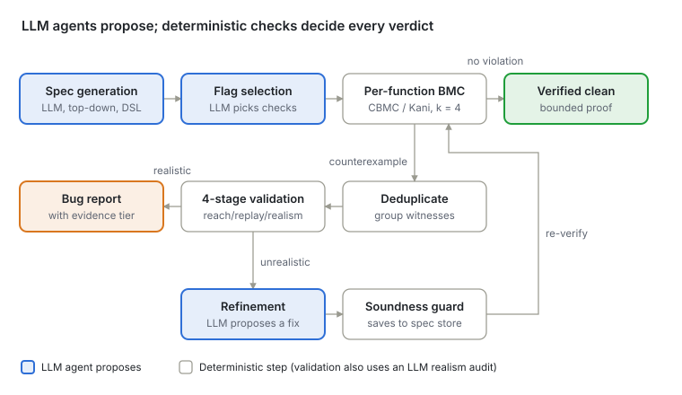

**Authors' code:** [github.com/agentic-prover/aprover](https://github.com/agentic-prover/aprover) (BMC-Agent; Python, CBMC/Kani backends, BSD license). Live demo at [aprover.ai](https://www.aprover.ai).

## 0. The paper in one paragraph

**Paper:** Youcheng Sun, Jiawen Liu, Daniel Kroening, Jason Xue. *Agentic Model Checking.* [arXiv:2605.21434](https://arxiv.org/abs/2605.21434), May 2026.

**One-sentence summary:** let LLM agents do the jobs that need *judgment* (guessing what a function is supposed to do, deciding whether a crash is realistic), and let a **bounded model checker** do every job that needs *proof* — the slogan is **"agents propose, solvers verify."**

The system, **BMC-Agent**, takes a C or Rust codebase with no specs at all, invents a contract for every function, checks each function one at a time with CBMC (C) or Kani (Rust), and then filters the crashes it finds through a four-stage pipeline so that only believable bugs get reported. On LLM-written code it confirmed **62 real bugs** across four corpora.

**How to read this tutorial:**

- **Sections 1–4** build the background: what a spec is, what a model checker does, and two classic ideas (compositional verification and CEGAR). If you already know these, skim.
- **Sections 5–10** walk through the paper's design, always anchored on a real bug from the paper.
- **Section 11** covers the results.

## 1. The problem: verifying code nobody fully wrote

**LLM-generated systems code (kernels, compilers, drivers) is full of low-level bugs, and none of it comes with a specification.** The paper names three compounding difficulties:

1. **The bugs are low-level.** Integer overflows, off-by-one indices, missing bounds checks. To rule these out you must reason about *every* possible input, not just a few test cases.
2. **There are no specs.** Formal tools need to be told what "correct" means. Nobody wrote that down — the developer may not even understand every generated function.
3. **Contracts live at call sites, not inside functions.** This is the paper's most interesting observation, so let's make it concrete.

### Example: the "implicit contract" pattern

Imagine an LLM writes this byte reader for an ELF parser (in the spirit of the bugs the paper found in a Claude-written C compiler):

```rust
pub fn read_u32(data: &[u8], offset: usize) -> u32 {
    u32::from_le_bytes([data[offset], data[offset+1],
                        data[offset+2], data[offset+3]])
}
```

And the caller looks like this:

```rust
if offset + 4 <= data.len() {      // caller checks bounds
    let x = read_u32(data, offset);
}
```

- **Today, nothing crashes.** Every existing caller checks the bounds first.
- **But `read_u32` itself promises nothing.** It's `pub`, so any future caller — or an attacker feeding a crafted `.o` file through a different path — can call it with `offset = data.len()` and panic.
- The safety rule ("`offset + 4 <= data.len()`") is **implicit**: it lives in the callers' heads, not at the function boundary.

This creates a dilemma for any bug finder:

| If the tool… | …then |
| --- | --- |
| reports every function that *can* crash | every helper looks broken (**over-reporting**) |
| reports only crashes current callers trigger | every helper looks fine (**under-reporting**) |

The paper's answer is to sort possible crashes into two kinds, depending on **who could actually trigger them**.

**Active bug: the program can crash today.**

- Somewhere in the project's own code, a chain of function calls reaches the broken function with a bad value.
- Example: the compiler's own file parser calls `read_u32` without checking the offset, so a malformed input file crashes it.
- **Fix it now.**

**Latent bug: the program doesn't crash today, but it could.**

- Every caller inside the project is careful and checks values before passing them in, so nothing in the current code triggers the crash.
- But the function is **public**. Someone outside the project (another program, a future developer, an attacker with a crafted file) can call it directly with a bad value and crash it.
- **A hidden trap: harden it before someone steps on it.**

**Making the threat model explicit** means you tell the tool which of these you care about:

- "I'm worried about attackers": latent bugs count as **real bugs**.
- "I only care about what my program does today": latent bugs are reported as **latent** (lower priority).

Keep this distinction in mind. In the Rust compiler, 24 of the 25 bugs are the latent kind, so whether you call them "bugs" depends on this choice. Sections 8 and 11 come back to it.

### Why not just ask an LLM?

The paper's core claim: **"An LLM can flag suspicious patterns; it cannot prove their absence."** An LLM reviewer will say a function looks "fragile" but can't produce a concrete crashing input or guarantee it checked every path. That's the job of a model checker.

## 2. Background I — Specifications: what "correct" means

**A specification is a contract: a precondition the caller must satisfy, and a postcondition the function then guarantees.** Without one, a verifier has nothing to check against.

### Pre- and postconditions

Take a function that returns the larger of two ints:

```c
int max(int a, int b) { return a > b ? a : b; }
```

- **Precondition** (what the caller promises): nothing — any `a`, `b` is fine. Write it as `true`.
- **Postcondition** (what the function promises): `result >= a && result >= b && (result == a || result == b)`.

Now a function that *does* need a precondition:

```c
int get(int *arr, int len, int i) { return arr[i]; }
```

- **Precondition:** `arr` is valid for `len` ints **and** `0 <= i < len`.
- **Postcondition:** `result == arr[i]`.

The precondition is where the "implicit contract" from Section 1 becomes **explicit**. If the precondition is violated, it's the caller's fault; if the postcondition fails while the precondition held, it's the function's fault.

### `assume` and `assert`: how a checker uses a spec

Verification tools turn a spec into two primitives:

- **`assume(P)`** — "only consider executions where P is true." Paths violating P are silently dropped. Used for **preconditions**.
- **`assert(P)`** — "P must be true here on every remaining path; if not, report a counterexample." Used for **postconditions** and safety checks.

In CBMC (the C model checker) these are `__CPROVER_assume` and `__CPROVER_assert`; in Kani (for Rust) they're `kani::assume` and `kani::assert`. A **harness** is a small `main`-like function that wires them together:

```c
void harness_get(void) {
    int len = nondet_int();          // any int
    int i   = nondet_int();          // any int
    int *arr = malloc(len * sizeof(int));
    __CPROVER_assume(len > 0 && len < 8 && arr != NULL);
    __CPROVER_assume(0 <= i && i < len);     // precondition
    int r = get(arr, len, i);
    __CPROVER_assert(r == arr[i], "post");    // postcondition
}
```

`nondet_int()` means "the checker may pick **any** value here" — that's how one harness covers all inputs at once.

**Key insight for this paper:** writing these harnesses and specs by hand is what makes formal verification expensive. BMC-Agent's first job is to have an LLM **write them automatically**, in a small language (a DSL) that a parser can translate mechanically into `assume`/`assert`.

## 3. Background II — Bounded model checking (BMC)

**BMC asks a SAT/SMT solver: "is there *any* input that makes an assertion fail within k loop iterations?" If yes, it hands you that exact input (a counterexample); if no, the property is proven — up to the bound k.**

### Testing vs. BMC, by example

```c
int avg(unsigned a, unsigned b) { return (a + b) / 2; }
// spec (post): result >= min(a,b) && result <= max(a,b)
```

- **Testing** tries a few values: `avg(2,4)=3` ✓, `avg(10,20)=15` ✓. Looks fine.
- **BMC** translates the code into a logical formula over 32-bit variables `a`, `b` and asks the solver whether `NOT(post)` is satisfiable. The solver finds `a = 0xFFFFFFFF, b = 2`: `a + b` wraps to `1`, result is `0`, which is below `min(a,b)=2`. **Counterexample.**

That's the power: the solver doesn't guess — it searches the *entire* 2^64 input space symbolically and either produces a concrete witness or proves none exists.

### How BMC handles loops: unwinding

A formula can't contain an infinite loop, so BMC **unrolls** each loop k times:

```c
for (i = 0; i < n; i++) p[i] = 0;
```

becomes (for k = 2)

```c
if (0 < n) { p[0] = 0;
  if (1 < n) { p[1] = 0;
    assert(!(2 < n));   // "unwinding assertion"
}}
```

The last line is the **unwinding assertion**: it fails if the real loop could run more than k times. This matters later — if `n` is unconstrained, BMC reports a failure that is not a bug at all, just "I ran out of unrolling." The paper calls this a **loop-bound artifact**. BMC-Agent uses **k = 4** by default.

**When exactly does this fire?** Whenever the values an input is *allowed* to take would make the loop run more times than the unwinding bound. With k = 4 and `n` free to be anything, `n = 1000` is allowed, so the loop could run 1000 times while BMC only unrolled 4. That's the "I ran out of unrolling" failure, even though the code is fine. There are two ways out:

- **Tighten the bound on the input** so it fits the loop bound, e.g. `assume(n <= 4)`. Larger `n` values then go unchecked, so this trades coverage for a decisive answer.
- **Raise k** to cover the realistic range of `n`, at the cost of a bigger, slower formula.

### The three possible results

| Outcome | Meaning |
| --- | --- |
| **Verified clean** | No violation exists for any input, for loops up to k iterations |
| **Counterexample** | A concrete input that breaks an assertion (may be real *or* spurious) |
| **Inconclusive** | Timed out or ran out of resources |

Note the word **bounded**: "verified clean" is a real proof, but only relative to (a) the spec you gave it and (b) the bound k. The paper is careful to say *bounded, spec-relative* verification.

### The two tools

- **CBMC** — the classic BMC tool for C (co-author Daniel Kroening is one of its creators). It understands C's memory model and can add automatic checks for pointer validity, array bounds, and — when you pass flags like `--unsigned-overflow-check` — arithmetic overflow.
- **Kani** — Amazon's BMC tool for Rust, built on CBMC. It knows Rust's panic points: out-of-bounds slice index, `unwrap()` on `None`, integer overflow in debug mode, etc.

### Why BMC (and not testing, fuzzing, or theorem provers)?

The paper's argument has three parts:

1. **Concrete counterexamples.** A failing BMC run gives you an actual input you can *replay* to see if it crashes. Deductive provers (e.g., Frama-C/Wp) just say "couldn't prove it."
2. **Works per function.** BMC can check one function in isolation, so the work parallelizes.
3. **Specs can be refined.** When a counterexample turns out to be spurious, you fix the spec and rerun — and the fix helps every caller (Section 4).

## 4. Background III — Compositional verification and CEGAR

**Two classic ideas make BMC scale and make it robust to bad guesses: check one function at a time using callee contracts (compositional), and when a counterexample is fake, fix the model and retry (CEGAR).**

### 4a. Compositional verification with stubs

BMC on a whole kernel blows up: every function, every loop, every path in one giant formula. The fix is **assume-guarantee reasoning**:

- Each function has a contract (pre, post).
- When checking function `f`, every callee `g` is **replaced by a stub** that just returns *any* value satisfying `g`'s postcondition.
- So checking `f` never looks inside `g`'s body.

**Example.**

```c
size_t compute_len(const char *s);   // post: result <= 255

void copy_name(char dst[256], const char *s) {
    size_t n = compute_len(s);
    memcpy(dst, s, n);
    dst[n] = '\0';
}
```

When checking `copy_name`, the harness replaces `compute_len` with:

```c
size_t compute_len_stub(const char *s) {
    size_t r = nondet_size_t();
    __CPROVER_assume(r <= 255);   // callee's postcondition
    return r;
}
```

CBMC now proves `dst[n]` is in bounds (n ≤ 255 < 256) without analyzing `compute_len` at all. Separately, `compute_len` is checked against its own spec. Each query is small.

**Two consequences the paper exploits:**

1. **Order matters.** Check callees before callers, so each callee's spec exists before it's used as a stub. Functions in the same "layer" of the call graph are independent → **run in parallel**.
2. **Stubs can lie.** If `compute_len`'s spec said only `result >= 0`, the stub could return 1000 and CBMC would report a bogus overflow in `copy_name`. A too-weak callee spec creates **spurious counterexamples** in its callers. That leads to…

### 4b. CEGAR: Counterexample-Guided Abstraction Refinement

CEGAR (Clarke et al., 2000) is a loop:

1. Check an **abstract** (simplified, over-approximate) model.
2. Got a counterexample? Check whether it is real in the **concrete** program.
3. Real → report the bug. **Spurious** → **refine** the abstraction so that fake path is excluded, go to 1.

Classic CEGAR refines *predicates* (logical facts the abstraction tracks). **The paper lifts CEGAR to the spec level**: the "abstraction" is the set of LLM-written specs and stubs. When a counterexample is spurious, an agent proposes a **tighter spec** — and because that spec is also the stub in every caller's harness, **the refinement propagates up the call graph automatically.**

In the `copy_name` example: the spurious overflow is noticed, an agent strengthens `compute_len`'s postcondition to `result <= 255` (after checking the real body supports it), and `copy_name` — plus every other caller of `compute_len` — re-verifies with the better stub.

## 5. The core idea: agents propose, solvers verify

**Every task that needs semantic judgment goes to an LLM agent; every decision that could change a verification verdict is double-checked by something deterministic (a parser, the BMC solver, a soundness guard, or actually running the code).**

### Why this split is the right one

Compare the two prior approaches the paper positions against:

- **LLM-only verification** (e.g., FM-Agent): the LLM writes the spec *and* judges whether the code meets it. Scales well, readable — but **unsound** for arithmetic/memory safety. An LLM simply cannot enumerate 2^64 inputs.
- **LLM + deductive prover** (e.g., AutoSpec with Frama-C, Lemur): sound, but provers give no concrete counterexample when they fail, and struggle with loop-heavy systems code.
- **This paper — LLM + BMC:** sound within the bound, *and* produces concrete witnesses, which enables replay, classification, and refinement.

### Three architectural commitments

1. **Specs are inferred top-down from caller context**, in a restricted DSL that compiles mechanically to `assume`/`assert` — optionally including *functional* correctness, not just "doesn't crash." (Section 7, 10)
2. **Verification is compositional**: one function at a time, callees as stubs, so cost scales with one function's size, and spec fixes propagate to callers. (Section 4, 7)
3. **Counterexamples are not bug reports**: they go through a four-stage validation pipeline; spurious ones drive refinement instead of being thrown away. (Section 8, 9)

The diagram below shows how these pieces connect.



*BMC-Agent pipeline. Blue boxes are LLM agents; every LLM output passes through a deterministic step before it can change a verdict.*

## 6. End-to-end walkthrough: the `kapi_file_size` bug

**The paper's motivating example is a 5-line function in VibeOS (an LLM-written ARM64 hobby kernel) that looks safe because it checks for NULL — and BMC-Agent proves it still crashes.** Follow it phase by phase; every later section is a zoom-in on one of these phases.

### The code

```c
static int kapi_file_size(void *node) {
    if (!node) return -1;
    vfs_node_t *n = (vfs_node_t *)node;
    return (int)n->size;
}
```

User applications call this through a **function-pointer table** (`kapi`) — the kernel's public API. Read it as a reviewer: there's a NULL check, so it looks defensive. What's wrong?

### Phase 1 — Spec generation (LLM)

The spec agent reads the body plus a **domain summary** of the codebase, which says `kapi_*` functions are the user-facing API. It writes:

- **Pre:** `null(node) || valid(node)` — callers may pass anything: NULL or some pointer.
- **Post:** if `node` is NULL, return -1; otherwise return `(int)node->size`.

Notice the **gap**: the precondition admits *any* non-null pointer, but the postcondition only makes sense if that pointer actually addresses a real `vfs_node_t`. The C type system (`void *`) can't express that obligation. **The gap between pre and post is the bug.**

### Phase 2 — BMC (CBMC)

The harness picks `node` nondeterministically, calls the function, and asserts the postcondition. CBMC returns a counterexample: a **non-null pointer that doesn't point to a valid `vfs_node_t`**. The NULL check passes; `n->size` reads garbage memory.

### Phase 3, Stage 1 — Reachability

A call-site scan finds **no callers inside the codebase** — the function is only reached via the `kapi` table. So it's a **system entry point**: whatever a user program passes arrives unfiltered. Nothing stops an app passing a dangling, freed, or made-up pointer. → tier **CONFIRMED\_SYSTEM\_ENTRY**.

### Phase 3, Stage 3 — Dynamic replay

BMC-Agent compiles a real C harness with GCC that calls `kapi_file_size` with a non-null bogus pointer, with signal handlers installed. Result: **SIGSEGV**. → upgraded to **CONFIRMED\_DYNAMIC** (the strongest tier).

### Phase 3, Stage 4 — Realism audit

An LLM reviews the whole record and rates it **REALISTIC**: the function is user-reachable, and the only defense is a NULL check any non-null value bypasses.

### The lesson: why each stage is needed

| Alone, this stage… | …cannot |
| --- | --- |
| LLM review | prove the postcondition holds or fails for *all* inputs |
| BMC | tell whether the witness input is reachable in the real system |
| Dynamic execution | *find* the bad input in the first place |

**Fix (from the paper):** a NULL check is insufficient for an untrusted pointer. Either pass a typed handle validated at creation, or validate `node` against a registry of live VFS nodes before dereferencing.

## 7. Architecture I — From source code to BMC verdicts

**Before any checking, BMC-Agent parses the code, builds the call graph, writes a spec for every function (top-down), picks per-function overflow checks, then runs one small BMC query per function (bottom-up, in parallel).**

### Step 0 — Parse and summarize

The pipeline parses the source, builds the **call graph** (who calls whom), and produces a compact **domain summary**: headers, types, signatures, and optionally external docs (API docs, hardware specs). This summary is what told the spec agent in Section 6 that `kapi_*` is the user-facing API.

The language decides the backend: `.c`/`.h` → **CBMC**, `.rs` → **Kani**. Everything else in the pipeline is language-agnostic; small per-backend **adapters** handle differences.

### Step 1 — Spec generation (§3.1)

**Direction: top-down.** Start at functions nobody calls (entry points), then move toward leaves. Why? A function's *intended* behavior is best seen in how callers use it; reading only the body tends to just restate what the code does (bugs included).

For each function the agent:

1. Reads the function body, caller context, and domain summary.
2. Drafts the pre/postcondition in the **DSL**.
3. Runs a deterministic **parser** on the draft.
4. Retries if parsing fails (up to a configurable limit).

> **Note:** each spec is written **without reading the callees' code**. The agent looks only at the function's own body, its caller context, and the domain summary (signatures, types, headers). Callees matter only later, at verification time, when they are replaced by stubs built from their own specs. (The authors' repo has an optional mode that lets the agent browse the source tree, but it is off by default.)

**The DSL.** A small spec language with predicates that are easy for an LLM to emit and map one-to-one onto `assume`/`assert`. Predicates appearing in the paper's examples:

| DSL predicate | Meaning |
| --- | --- |
| `null(p)` | `p` is NULL |
| `valid(p)` | `p` points to a live object |
| `valid_range(p, 0, n)` | `p[0..n)` is readable/writable |
| `valid_string(s)` | `s` is a NUL-terminated string |
| `\result` | the return value (in postconditions) |
| `old(e)` | value of `e` before the call (for state-mutating functions) |

**Example (net\_get\_mac, from the paper's Case Study 1):**

```c
void net_get_mac(uint8_t *mac) { memcpy(mac, our_mac, 6); }
```

- **Precondition:** `valid_range(mac, 0, 6)`, i.e. `mac` must point to at least 6 writable bytes.
- **Postcondition:** `valid_range(mac, 0, 6)`, and `/* mac[0..5] holds the device's MAC address */` (natural language, so not checked).
- **Harness:** the function is a public API with no callers, so nothing constrains `mac`; the harness lets it be any pointer.
- **Counterexample:** CBMC immediately finds `mac = NULL`, which breaks the precondition the function silently relies on.
- **Fix:** one line, `if (!mac) return;`.

> **Note: only the DSL part of a spec is checked.** Each precondition and postcondition is one boolean expression. DSL predicates and C expressions are translated into `assume`/`assert`, but any natural-language part like "`mac[0..5]` holds the MAC address" becomes a `/* comment */` and is **not checked**. The `--strict-dsl` option (off by default) forces pure C expressions to prevent cases where the LLM mixes comments and predicates. \
>
> **Side Note:** `valid_range(p, lo, hi)` translates  to `p != NULL && lo >= 0 && hi >= lo`; whether 6 bytes are really allocated is caught by CBMC's built-in pointer checks on `memcpy`. *(Source: paper §B and the repo README.)*

**Two extra mechanisms:**

- **Dual-source generation:** generate each spec twice — one prompt focused on *caller intent*, one on *implementation behavior*. Disagreement is flagged for a human. (This is how the kapi\_file\_size pre/post "tension" got recorded.)
- **Recursion:** mutually recursive functions are collapsed into one **strongly connected component** (via Kosaraju's algorithm) and specified as a unit.

### Step 2 — Per-function flag selection (§3.2)

CBMC can add automatic checks, but they're off by default because turning them all on everywhere creates noise (e.g., intentional wraparound in hash functions looks like a bug). The CBMC flags (Kani has analogues):

- `--unsigned-overflow-check`
- `--signed-overflow-check`
- `--conversion-check`
- `--pointer-overflow-check`

An LLM reads each function and decides which flags make semantic sense. **Example:** for `calloc(nmemb, size)` it reasons that multiplying two caller-supplied sizes can wrap → enables `--unsigned-overflow-check`.

This turned out to matter: the Realtek driver bug (Section 11) was only found once this step enabled unsigned and pointer overflow checks.

### Step 3 — Per-function BMC (§3.3)

For each function, the engine synthesizes a harness:

1. Make all inputs nondeterministic.
2. Add environment assumptions and **learned invariants** from the knowledge base (Section 9).
3. `assume(pre)`.
4. Call the function (callees are **stubs** constrained by their postconditions).
5. `assert(post)` plus the automatic safety checks.

**Defaults:** `unwind bound k = 4`, `timeout 120 s per function`.

The paper uses the below retry strategies to handle flaky outcomes:

- CBMC "too many addressed objects" → retry with larger `--object-bits`.
- Kani unwind exhausted → bound 4 → 16. Kani timeout → shrink slice bound 4 → 2 → 1.

**Scheduling:** callees before callers (so stubs exist), and all functions in one call-graph layer run **in parallel**. Thus the wall-clock time per layer in bounded by the slowest function in that particular layer.

### Step 4 — Deduplication (§3.4)

One bug often produces many counterexamples. They're grouped by **(function, property type)** so the expensive validation stages run once per defect.

## 8. Architecture II — "Counterexamples are not bug reports"

**Every BMC counterexample passes four filters — reachability, callee feasibility, dynamic replay, realism — and comes out either as a bug with an evidence tier, or as a spurious witness that feeds the refinement loop.**

Why so much filtering? Because per-function BMC is deliberately **over-approximate**: the harness lets inputs be *anything the precondition allows*, and stubs return *anything the callee's postcondition allows*. Both can produce states the real program never reaches. On VibeOS, 145 deduplicated counterexamples became just 34 confirmed bugs.

### Bug Verdicts


**Evidence tier levels** - how strong is the evidence of the suspected violation?

1. `CONFIRMED_DYNAMIC` (highest) - the witness can crash a compiled binary file that invokes the library being tested
2. `CONFIRMED_SYSTEM_ENTRY` - we have traced and confirmed that the  solver-generated counter example  can actually reach the flagged function from a high-level entrypoint
3. `CONFIRMED_BMC` (lowest) - a solver-confirmed violation, atleast one immediate caller can provide the bug inducing input, but reachability from an entry point has not been confirmed

**Realism Verdict** - how realistic is it to encounter this violation in an actual deployment?

1. `REALISTIC`
2. `UNREALISTIC`

**Threat Model** - does it matter for our threat-models?

1. REAL\_BUG (an in-tree path actually triggers it)
2. LATENT  (no in-tree path triggers it, but it could be triggered in future code, if the programmer is not careful about how it calls the library)
3. SPURIOUS

### Stage 1 — Classification and input reachability

Stage 1 does two things. The paper's §3.5 mentions only the second; the first comes from the authors' code (`cex_validator.py`, the "CEx Classifier" in the repo README).

1. **Classify the witness.** An LLM, using CBMC, labels the generated witness as `REAL_BUG`, `SPURIOUS` or `UNRESOLVED`. `SPURIOUS` witnesses, such as a loop-bound artifact, skip the remaining stages and go straight to the refinement loop (Section 9).
2. **Trace reachability.** For the rest, we take the witness and **walk up** the call graph and determine if  each caller can actually supply these values.
   - **Example (`vfs_lookup`, Case Study 5):** walk up the call chain `kapi_open → vfs_open_handle → vfs_lookup` reaches the system entry (`kapi_open`) that accepts user path strings. So a user can supply a crashing witness. Hence it is reachable.
   - If propagation stops at an entry point (like **`vfs_lookup`**) then we mark it **CONFIRMED\_SYSTEM\_ENTRY** else it is marked **CONFIRMED\_BMC**

Stage 1 assigns a provisional tier: `CONFIRMED_SYSTEM_ENTRY` or `CONFIRMED_BMC`.

### Stage 2 — Callee feasibility (replacing callee-stubs with real callee-code)

The witness may depend on a stub returning something the real callee never returns. So: **swap the stubs for the real callee bodies**, pin the witness inputs, re-run BMC. If the violation survives, it's reachable through real callee behavior.

> **How deep does it inline? Up to the file boundary.** From the authors' code (`harness_generator.py`, `generate_feasibility_harness`):
>
> - It collects **every** callee reachable from the function — callees, their callees, and so on — **as long as they are defined in the same source file**, and inlines all of their real bodies. Callees defined **in other files** or in libraries stay as **stubs** built from their LLM postconditions.
> - If the function has **no same-file callees**, Stage 2 is skipped

*Analogy:* in Section 4's `copy_name`, if the stub returned 1000, this stage would plug in the real `compute_len` and discover it can't — killing the false alarm.

Stage 2 is a filteration criteria, any violation that turns out to be a false alarm is removed.

### Stage 3 — Dynamic replay

Compile a GCC harness that sets up exactly the witness state, run it on the host, catch `SIGSEGV`, `SIGABRT`, `SIGFPE`, `SIGILL`. If the witness triggers these failure then the bug is assigned the  `CONFIRMED_DYNAMIC` tier (the highest).

**Subtle point:** a crash is *sufficient* evidence, but not *necessary*.  Those that don't crash stay at `CONFIRMED_SYSTEM_ENTRY`.

### Stage 4 — Realism audit

Stages 1–3 show *symbolic* reachability. They can't rule out states that never occur in deployment for reasons outside the model: impossible hardware states, framework globals that are always initialized, lifecycle violations. Two layers:

1. **Deterministic witness-pattern detectors (regex)** catch known artifact classes without an LLM call — e.g., "a library's init-time global is NULL," "a USB-serial framework pointer is NULL inside a registered callback," "path-divergent unwind" (the failing property is on a path the witness doesn't actually take).
2. **LLM audit** for the rest: reads spec, harness, witness, and source; says `REALISTIC` or `UNREALISTIC`. If it can't decide, the witness is treated as unrealistic (conservative for *reporting*; these bugs go to the refinement stage).

**Example of what this catches (libxml2):** a dynamic harness crashed `xmlBufGrowInternal`, but only with the struct state `content = NULL, contentIO ≠ NULL`. Every libxml2 code path that nulls `content` also nulls `contentIO`, so that state can't arise through the API. The paper reports this one slipped past the LLM and was caught in manual triage — and was then turned into a permanent detector (Section 9).

### Example distribution of evidence tiers on VibeOS

| Tier | What backs it | VibeOS count |
| --- | --- | --- |
| **CONFIRMED\_DYNAMIC** | Real crash signal on a compiled harness | 16 |
| **CONFIRMED\_SYSTEM\_ENTRY** | BMC witness + traced to a no-caller entry point | 14 |
| **CONFIRMED\_BMC** | BMC witness; reachability not yet traced to an entry | 4 |

### Threat models: active vs. latent

For the results on the Rust compiler codebase, the paper adds a three-way verdict — `REAL_BUG` / `LATENT` / `SPURIOUS` — gated by a `--threat-model` flag:

- Under **security**: a panic reachable through any `pub fn` is a `REAL_BUG` (attackers control inputs crossing the API).
- Under **safety** or **functional**: if no in-tree caller produces the trigger, it's `LATENT` — so this is more of a hardening task, not an active crash. Future code that invokes this libary may pass bad inputs and cause a bug.

## 9. Architecture III — Refinement: spurious witnesses make the model better

### 9.1 Overview

**What comes in:** counterexamples from Section 8 that were judged *not real*:

- witnesses that **Stage 4 (realism audit)** rated `UNREALISTIC` or uncertain, and
- witnesses that the **Stage 1 classifier** marked `SPURIOUS`, such as a loop-bound artifacts

**What happens to them:** they are not thrown away. Instead:

1. An LLM suggests a fix: a tighter spec, or different checker settings.
2. A deterministic soundness guard checks that the fix can't hide a real bug.
3. BMC runs again with the fix.
4. Fixes that pass are saved and reused in future runs.

Why bother? In the `calloc` case, the real bug was *hiding behind* a fake one.

### 9.2 Case study: `calloc`, step by step

```c
void *calloc(size_t nmemb, size_t size) {
    size_t total = nmemb * size;          /* no overflow guard */
    void *ptr = malloc(total);
    if (ptr != NULL) {
        uint8_t *p = (uint8_t *)ptr;
        for (size_t i = 0; i < total; i++) p[i] = 0;
    }
    return ptr;
}
```

#### 9.2.1 The spec

**Spec (LLM):**

- **Pre:** `nmemb * size` doesn't exceed `SIZE_MAX`.
- **Post:** the result is NULL, or a valid, zeroed buffer of `nmemb * size` bytes.

#### 9.2.2 Round 1 and refinement

**Round 1 — a fake counterexample.** `total` can be huge, so the zeroing loop can run more than k = 4 times. CBMC reports `calloc.unwind.0` — the **unwinding assertion** from Section 3. Not a bug, just "I stopped unrolling."

- A naive tool would either report this as a bug (false positive) or drop it — and in both cases **never look at the multiplication**.

**Refinement.** The classifier labels it SPURIOUS (loop-bound artifact) and produces a tighter precondition that keeps the loop count small. That refined spec replaces the old one, is persisted, and `calloc` goes into a **re-check queue**.

#### 9.2.3 Round 2

**Round 2 — the real bug.** With the loop no longer exploding, CBMC explores the arithmetic and finds:

```
witness: nmemb = 2^63, size = 2   →   true product 2^64 wraps to total = 0
```

#### 9.2.4 Where the crash happens

**Where does it crash? Not inside `calloc`.**

- With `total = 0`: `malloc(0)` returns either NULL or a valid pointer to a **0-byte** block (the C standard allows both).
- The zeroing loop runs 0 times, so `calloc` itself returns cleanly.

**The crash happens in the caller.** The caller asked for 2^63 elements of 2 bytes each and got back a non-NULL pointer, so it believes it owns a huge buffer. Its first write, e.g. `p[0] = 1`, goes past the 0-byte block: a **heap overflow**. That's exactly how the paper's dynamic harness crashed with SIGABRT: it treated the returned pointer as a 2^63-element array.

> **To be explicit:** with these inputs, the crash was observed in the **test harness**, not in VibeOS. The harness is a small C program that BMC-Agent generates with the LLM's help, and it plays the role of `calloc`'s caller. `calloc` has no callers inside VibeOS, so no real VibeOS code was shown to crash. The harness calls `calloc`, then uses the 0-byte result as a 2^63-element array, and *that* write triggers the SIGABRT. The paper still ranks this finding at the top tier, `CONFIRMED_DYNAMIC`.

#### 9.2.5 A faster route, and the fix

**Shortcut via flag selection:** with flag selection (Section 7, Step 2) enabled, the LLM turns on `--unsigned-overflow-check` for calloc, and CBMC flags the multiplication **in the first pass** (same witness `nmemb = 2^63, size = 2` !!). It even traces a second overflow downstream in `malloc`'s `ALIGN_UP(size, 16)`. Two independent paths, same root cause.

**Fix:** `if (nmemb != 0 && size > SIZE_MAX / nmemb) return NULL;`

### 9.3 The three kinds of refinement

| Class | What changes | Example |
| --- | --- | --- |
| **Verifier-level** | BMC parameters: unwind bound, slice bound, which checks are on | Raise unwind bound for a short fixed loop; change the flags |
| **Caller-side** | Tighten *this* function's precondition using facts every caller already ensures | calloc's loop-bound constraint |
| **Callee/spec** | Strengthen a stubbed callee's postcondition from its real body or sibling functions | `compute_len` returns ≤ 255 (Section 4) |

### 9.4 The soundness guard

The danger of refinement is obvious: an agent could "fix" a counterexample by writing a precondition so strong it excludes the bug. The **soundness guard** is a deterministic check that rejects refinements which could mask real bugs — e.g., preconditions stronger than what legitimate callers actually supply, or callee contracts that contradict the observed implementation. Each function also has a bounded **iteration budget**; unresolved witnesses are logged for humans.

### 9.5 Persistent knowledge (§3.7)

Three kinds of learned knowledge carry over across runs:

- **Spec store**: refined pre/postconditions and learned callee contracts, per function.
- **Pattern library**: the deterministic witness detectors from Stage 4, extended when an artifact class keeps recurring.
- **Project-wide clauses**: facts assumed in *every* function's harness. A clause is promoted here from the spec store once 3 or more different functions have learned it independently.
  - **Example (libxml2):** libxml2 lets users plug in their own allocator through the function pointers `xmlMalloc`, `xmlRealloc` and `xmlFree`, which are never NULL after initialization. BMC first treated them as "could be anything" and produced counterexamples with `xmlMalloc == NULL`. The realism audit rejected these, refinement added `xmlMalloc != NULL && xmlRealloc != NULL && xmlFree != NULL` to several functions' preconditions, and the clause was then promoted project-wide. Future runs don't have to rediscover them.

## 10. Beyond crashes: functional-correctness specs

### 10.1 Overview

**"Doesn't crash" is a weak guarantee; BMC-Agent can optionally ask "computes the right answer," by having the LLM write a reference expression that gets AND-ed into the postcondition.** This found the one bug in the Rust compiler that no crash-check could see.

### 10.2 Defensive vs. functional specs

- **Defensive spec:** rules out panics — no out-of-bounds, no overflow, no `unwrap` on `None`.
- **Functional spec (`functional_spec`):** states *what the output should be*. Drawn from four templates:

| Template | Shape | Example |
| --- | --- | --- |
| Reference equivalence | result = closed-form formula | `max(a,b)` returns `a > b ? a : b` |
| Algebraic identity | result satisfies an invariant | `align_up(x, a) % a == 0` |
| Fold expression | result = iterated computation over a sequence | a hash = `fold` over bytes |
| Round-trip | decode(encode(x)) == x | serialize then parse returns the original |

### 10.3 The `align_up` bug (claudes-c-compiler, Rust)

`align_up(offset, align)` should round `offset` up to the next multiple of `align`. The LLM-written implementation used `checked_add` so it would **never panic** on overflow — but on overflow it silently returns `offset` **unchanged**.

- **Defensive spec:** passes. No panic is possible.
- **Functional spec:** `result % align == 0`. Kani finds `align_up(usize::MAX, 8)` returns `usize::MAX`, and `usize::MAX % 8 = 7 ≠ 0`. **Misaligned result, silently.**

This is the only one of the 25 CCC bugs the defensive workflow would have missed. It is also the only one that stays a **REAL\_BUG under every threat model**: it breaks the function's own contract regardless of who calls it.

### 10.4 Positive results: bounded functional equivalence

The same machinery can *prove* things, not just find bugs. Within the BMC bounds, the paper verified:

- **`gnu_hash`** equals the djb2-style fold: start at 5381, for each byte `h = h*33 + b` (wrapping).
- **`sysv_hash`** equals the SysV ELF hash fold.
- **`align_up_64`** satisfies `result >= val && result - val < align && result % align == 0`, under the precondition that `align` is a power of two and `val + align` doesn't overflow.
- **`write_elf64_phdr` / `write_elf64_shdr`** emit the exact 56-byte / 64-byte little-endian ELF header layouts.

## 11. What the evaluation shows

**62 confirmed bugs across four corpora — mostly in LLM-written code — plus clean bounded proofs on heavily fuzzed libraries.** Setup for C: CBMC 5.95.1, k = 4, 120 s per function, LLM backbone Claude Sonnet 4.6, GCC 12.3 replay on x86-64 Linux.

### Confirmed bugs by corpus

| Corpus | Language / size | Confirmed bugs | Highlights |
| --- | --- | --- | --- |
| **VibeOS** (LLM-written ARM64 kernel) | C, \~15k LoC, 675 functions | **34** | 16 dynamic, 14 system-entry, 4 BMC-only; 16 of 34 in the TrueType font parser |
| **claudes-c-compiler** (LLM-written) | Rust, \~50k LoC | **25** | 24 panics on public byte helpers + 1 functional bug (`align_up`) |
| **jq 1.8.1** | C, OSS-Fuzz hardened | **2** | Pointer-arithmetic UB, filed as GitHub security advisories |
| **Realtek r8125 driver** (out-of-tree Linux) | C | **1** | u32-wrap bounds-check bypass in an ioctl → arbitrary MMIO read/write (needs `CAP_NET_ADMIN`) |

### Reading the VibeOS numbers

- 145 deduplicated counterexamples → **34 realistic**, 85 unrealistic, 26 uncertain. The pipeline threw out roughly three of every four witnesses.
- The 16 font-parser bugs share one root cause: offsets and sizes read **from the font file itself** are trusted without bounds checks — so a crafted font crashes the kernel (e.g., `stbtt__buf_get8` checks `cursor < size`, but `size` came from the file and can claim 1 GiB).
- Other examples worth knowing: `hal_get_time_us` divides by a timer-frequency register that reads 0 on QEMU until firmware sets it (division by zero at boot); `wsod_draw_line` computes `fb_width - 40` in unsigned arithmetic, so a width under 40 wraps to a \~2^32-iteration loop inside an IRQ handler.
- The authors manually replayed six findings on the real VibeOS/QEMU image and tried simple fixes; behavior changed as expected.

### Clean verification on hardened code

When there are no bugs, does the tool say so instead of crying wolf?

| Target | Result |
| --- | --- |
| OpenSSL ASN.1 (`asn1_lib.c`) | 15 of 24 leaf functions clean, including every DER decoder (to unwind bound 10) |
| libxml2 `pattern.c` / `xpointer.c` / `schematron.c` | 54/54, 9/9, 37/37 clean |
| libxml2 `encoding.c` | 127 raw counterexamples → 0 confirmed bugs |
| curl `strparse.c` | 8 of 20 leaf parsers clean |
| protobuf upb | 3 of 3 leaf wire decoders clean |

### The big empirical finding about LLM-written code

Across 50k lines of Claude-written Rust, BMC-Agent found **no memory-safety bugs** (Rust prevents those) and **no logic bugs** in the parser, codegen, register allocation, or IR passes. All 24 defensive bugs fit **one anti-pattern**: public byte-helper functions with no precondition checks, whose callers all correctly maintain the missing invariant.

The authors argue this is evidence the inferred specs are *right*: the precondition BMC-Agent inferred (e.g., `offset + N <= data.len()`) is exactly the check every caller already performs. A wrong or fabricated spec wouldn't happen to match the callers' code.

They are explicit that this attribution is **qualitative** — no ablation study yet.
