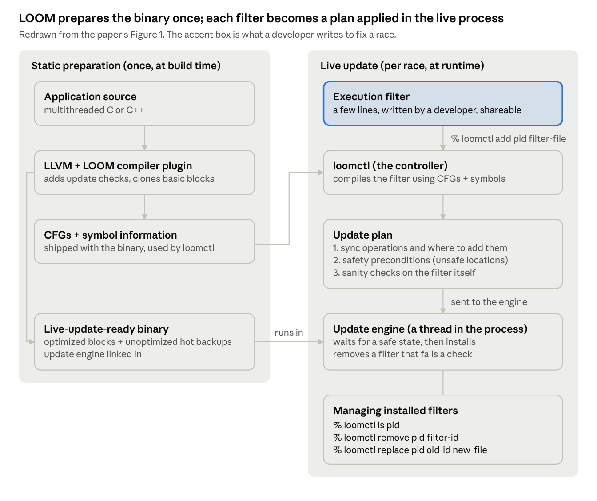
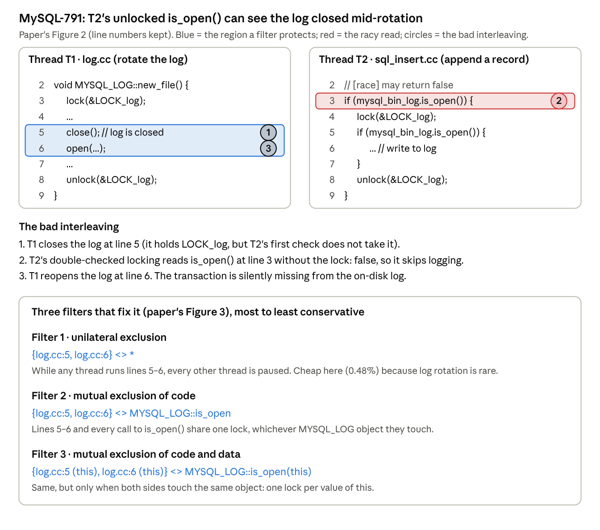
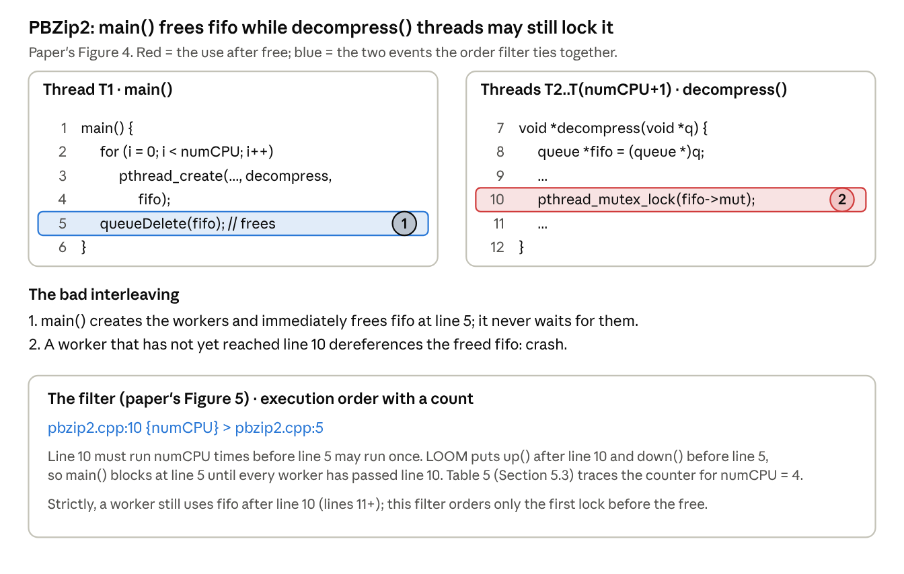
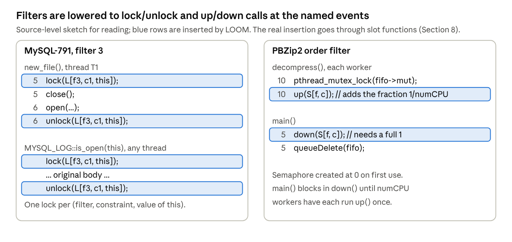
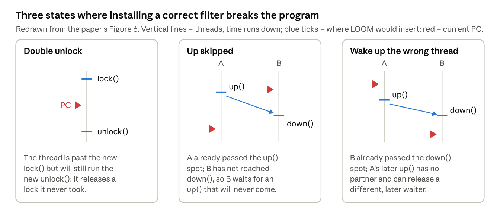
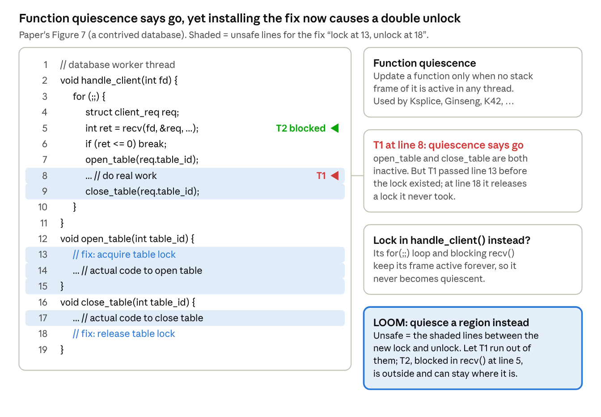
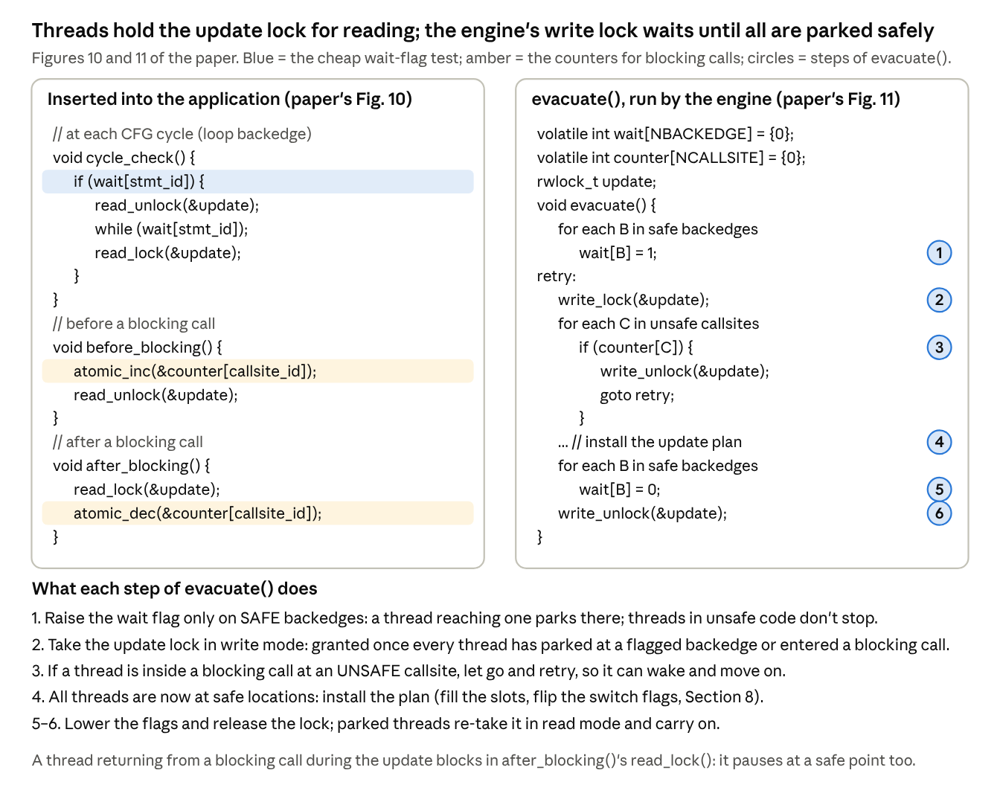
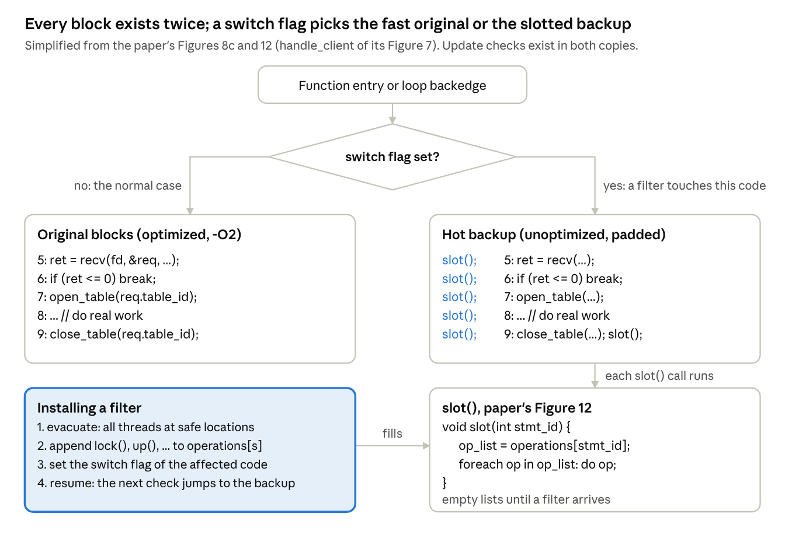

## 1. How to use this tutorial

**LOOM lets you patch a race in a running program without restarting it: you write a small declarative *execution filter* ("these two code regions are mutually exclusive"), and LOOM turns it into locks or semaphores and installs them only once no thread is in a place where the new synchronization could break.** Paper: Jingyue Wu, Heming Cui, Junfeng Yang, *Bypassing Races in Live Applications with Execution Filters*, OSDI 2010 ([USENIX page](https://www.usenix.org/conference/osdi10/bypassing-races-live-applications-execution-filters)).

### 1.1 The paper in one paragraph

Races in deployed software take days to years to fix, and the usual fix (a source patch plus a restart, or a hot patch) is slow to produce and can itself be wrong. LOOM separates the **workaround** from the **real fix**. A developer writes an execution filter in a tiny language with three constraint types: **execution order** (`e1 > e2`), **mutual exclusion** (`r1 <> r2`) and **unilateral exclusion** (`r <> *`). LOOM compiles the filter into an **update plan**: which lock or semaphore operations go where, which program states are unsafe for installing them, and sanity checks. To install it, LOOM's **evacuation** algorithm pauses every thread at a *safe* location, letting threads that are inside an *unsafe* region run until they leave it. To keep normal-run overhead near zero, a compile-time **hybrid instrumentation** pass keeps an optimized copy of every basic block plus an unoptimized "hot backup" with empty hooks that the filter can fill in at runtime. On nine real races in MySQL, Apache, PBZip2 and SPLASH2, overhead is mostly under 2% (MySQL about 4%), and a filter installs in 368 ms where waiting for function quiescence did not finish in an hour. (Function quiescence is the rule older live-update systems use: install a fix only when no thread has the affected function on its call stack. Section 6.2 explains why it fails here.)

### 1.2 Roadmap

***Table 1:*** *Roadmap: the question each section answers.*

| Section | Question it answers |
| --- | --- |
| 2. The problem | Why are deployed races left unfixed for so long, and what makes a live fix hard? |
| 3. LOOM at a glance | What are the parts, and what does a user actually type? |
| 4. The execution filter language | How do you say "make these regions atomic" or "run this before that"? |
| 5. From filters to locks and semaphores | What code does LOOM insert, and what does `{n}` count? |
| 6. Unsafe application states | Why can a correct filter break the program if installed at the wrong moment? |
| 7. The evacuation algorithm | How does LOOM move every thread to a safe place without stopping the world forever? |
| 8. Hybrid instrumentation | How can arbitrary code be added at runtime with near-zero normal-run cost? |
| 9. Evaluation | How fast, how scalable, how timely, and how big are real filters? |
| 10. Related work | How does it relate to Eraser, RaceFuzzer and live update? |

## 2. The problem: deployed races stay unfixed for a long time

**Of nine well-studied real races, the time from bug report to a released fix ranged from 18 days to nearly 8 years, even though most reports already contained a correct diagnosis.** LOOM's goal is to protect the running program during that gap.

### 2.1 What kinds of races

The paper uses "race" broadly, following Lu et al.'s study (ASPLOS'08):

- **Data races:** two unsynchronized accesses to the same location, at least one a write.
- **Atomicity violations:** a code region that should run as a unit gets interleaved by another thread (MySQL-791 below).
- **Order violations:** A should happen before B, but nothing enforces it (PBZip2 below).

The fix for all three is the same kind of thing: **add synchronization that removes the bad interleavings.** That shared shape is what makes a tiny, declarative fix language possible.

### 2.2 How long fixes take (paper's Table 1)

***Table 2:*** *Delays in fixing nine real races (dates from the paper's Table 1; day counts computed here).*

| Race | Reported | Diagnosed | Fix posted | Released | Report to diagnosis (days) | Report to fix (days) | Report to release (days) |
| --- | --- | --- | --- | --- | --- | --- | --- |
| Apache-25520 | 2003-12-15 | 2003-12-18 | 2004-01-17 | 2004-03-19 | 3 | 33 | 95 |
| Apache-21287 | 2003-07-02 | — | 2003-12-18 | 2004-03-19 | — | 169 | 261 |
| Apache-46215 | 2008-11-14 | — | — | — | — | — | — |
| MySQL-169 | 2003-03-19 | — | 2003-03-24 | 2003-06-20 | — | 5 | 93 |
| MySQL-644 | 2003-06-12 | — | — | 2004-05-30 | — | — | 353 |
| MySQL-791 | 2003-07-04 | 2003-07-04 | 2003-07-14 | 2003-07-22 | 0 | 10 | 18 |
| Mozilla-73761 | 2001-03-28 | 2001-03-28 | 2001-04-09 | 2001-05-07 | 0 | 12 | 40 |
| Mozilla-201134 | 2003-04-07 | 2003-04-07 | 2003-04-16 | 2004-01-08 | 0 | 9 | 276 |
| Mozilla-133773 | 2002-03-27 | 2002-03-27 | 2009-12-01 | 2010-01-21 | 0 | 2,806 | 2,857 |

Dates are from the paper's Table 1 (taken from Bugzilla); "—" means the paper could not derive the date. The three day columns are computed here from those dates.

Two observations from the paper:

- **Diagnosis is not the bottleneck.** For seven of nine races, the user's bug report already had the right root cause.
- **Developers chase an efficient fix.** Mozilla-201134 and Mozilla-133773 each drew more than 30 messages of discussion, yet each could be fixed by adding one critical section. Performance pressure pushes developers away from "just add a lock."

### 2.3 Why existing tools don't close the gap

- **Detection, replay and diagnosis tools** (Eraser, RaceTrack, CHESS, RaceFuzzer, CTrigger, ODR, PRES…) find and explain races. They don't protect a deployed program.
- **Software update** fixes it but needs a **restart**, which hurts availability (Section 9.5 measures 2–4 s of downtime plus cache warm-up).
- **Live update** swaps new code into a running process. Systems such as Ginseng, STUMP and Ksplice turn a source patch into a "hot patch". This avoids the restart but still starts from a **conventional source patch**, so it inherits two problems:
  - **Unsafe patches.** A patch is arbitrary C (new locks, moved code). Installing it mid-run is safe only if the current state fits the new code, e.g. no thread is halfway through a region the patch now locks. Deciding that for an arbitrary patch is undecidable, so these systems need programmer annotations. LOOM's filters are narrow enough to check automatically (Section 7).
  - **Delay.** The patch still has to be written, reviewed, tested and released.

### 2.4 LOOM's two technical challenges

1. **Safety.** Even a correct filter can break the program if installed while a thread is in the middle of the code it protects (for example, a thread that skipped the new `lock()` later runs the new `unlock()`). LOOM must check for such states and install only in a consistent one, atomically, while threads keep running. The standard heuristic, **function quiescence**, is not enough (Section 6). Answer: **evacuation** (Section 7).
2. **Overhead.** The program must run at near-native speed while it waits for a filter that may never come. General binary instrumentation (Pin) costs up to 1,065% in the paper's runs. Answer: **hybrid instrumentation** (Section 8).

## 3. LOOM at a glance

**LOOM does its expensive work once at build time, so that at runtime installing a fix is just compiling a few-line filter and flipping some flags inside the running process.** It runs in user space on Linux and needs no OS or compiler changes.

***Figure 1:*** *LOOM architecture: static preparation at build time and live update at runtime (redrawn from the paper's Figure 1).*

### 3.1 The pieces

- **Compiler plugin (build time).** Runs inside LLVM. It:
  - links a copy of the update engine into the binary;
  - inserts cheap update checks on loop backedges and around blocking calls (Section 7.2);
  - keeps a hot-backup copy of every basic block (Section 8);
  - saves CFGs and debug symbols for the controller.
- **Controller, `loomctl` (runtime, outside the process).** Takes a filter and a process ID and compiles the filter into an **update plan** with three parts: the synchronization operations and their locations, the safety preconditions (which program locations are unsafe), and sanity checks on the filter.
- **Update engine (runtime, a thread inside the process).** Receives the plan, waits until every precondition holds (evacuation, Section 7), installs the operations, and later removes the filter if a sanity check fails (again only in a safe state).

## 4. The execution filter language

**A filter says *what* must be synchronized, not *how*: "these regions exclude each other" or "this event happens before that one". Because the intent is explicit, LOOM can check it and compile it, instead of reverse-engineering scattered `lock()`/`unlock()` calls.**

The paper gives three reasons for a declarative language:

- **Productivity:** developers skip low-level synchronization details.
- **Analyzable safety:** LOOM never has to guess what a critical section is meant to cover.
- **Free error checking:** LOOM can insert checks when it lowers the filter (Section 5.4).

### 4.1 Syntax (paper's Table 2)

***Table 3:*** *Execution filter language: syntax and meaning (paper's Table 2).*

| Construct | Syntax | Meaning |
| --- | --- | --- |
| Event `e` | `file:line` | A dynamic instance of the statement at that file and line |
| Event with data | `file:line (expr)` | Only instances where `expr` has a matching value are synchronized with each other |
| Event with count | `e{n}` | The event's number of occurrences; used in execution order |
| Region `r` | `{e1, …, ei ; ei+1, …, en}` | A dynamic instance of a code region: entry events before `;`, exit events after |
| Region from a function | `func (args)` | One call of `func`; `(args)` tells different calls apart |
| Execution order | `e1 > e2 > … > en` | e1 happens before e2, e2 before e3, … |
| Mutual exclusion | `r1 <> r2 <> … <> rn` | Every pair ri, rj is mutually exclusive |
| Unilateral exclusion | `r <> *` | r runs as if single-threaded: all other threads pause |

- **Allowed expressions** for `expr` and `n`: a constant or primitive variable `a`, `a+b`, `&a`, `&a[i]`, `&a->f`, and nested combinations. **No function calls and no dereferences**, for safety.
  - `&a->f` and `&a[i]` are not dereferences in this sense: they only compute an address (`a` plus an offset) and never read memory through the pointer.
- **Mutual vs. unilateral exclusion:** mutual exclusion needs every participant to take the same lock. Unilateral exclusion needs no cooperation from the other code: it stops everyone else. The paper's footnote adds that it is subtly different from single-threaded execution because it allows no context switches.

### 4.2 Example 1: an atomicity violation in MySQL (MySQL-791)

***Figure 2:*** *MySQL-791: the racy interleaving and three execution filters that fix it (paper's Figures 2 and 3).*

**Why not just patch the source?** The obvious fix is to delete the unlocked check at T2 line 3. But when MySQL is configured to skip logging for speed, that always takes `LOCK_log` and raised response time by more than 10% in the authors' runs. So the real MySQL developers built a more involved fix (a new flag field and a changed `close()`).

**The filters trade reliability for speed, and the user picks.** Filter 1 is the bluntest and still costs only 0.48%, because log rotation is rare. Filters 2 and 3 narrow the second region and then the data. This flexibility is the paper's main argument for filters as workarounds.

### 4.3 Example 2: an order violation in PBZip2

***Figure 3:*** *PBZip2: the use-after-free order violation and its execution-order filter (paper's Figures 4 and 5).*

Here the bug is not that two regions overlap, but that one event (`free`) can come before another (`lock` on the queue). The fix is an **execution order** constraint, with `{numCPU}` saying how many times the first event must occur.

### 4.4 What the three constraint types cover

***Table 4:*** *Which constraint type fits which race class.*

| Race class | Natural constraint | Paper's examples |
| --- | --- | --- |
| Atomicity violation | mutual or unilateral exclusion | MySQL-169, -644, -791; Apache-21287, -25520 |
| Order violation | execution order | PBZip2; SPLASH2 fft, lu, barnes |
| Data race | mutual exclusion of the two accesses | (subsumed by the above in the evaluation) |

The paper says new constraint types are easy to add, but these three were enough for all nine races.

## 5. How filters become locks and semaphores

**Each constraint becomes ordinary synchronization at the named events: mutual exclusion is a lock, execution order is a semaphore, and unilateral exclusion reuses the evacuation machinery to pause everyone else.**

***Figure 4:*** *Lowering filters to synchronization: MySQL filter 3 becomes a lock, the PBZip2 filter becomes a semaphore.*

### 5.1 The three lowerings

- **Execution order `ei > ei+1`:** a semaphore `up()` at `ei` and a `down()` at `ei+1`. A chain `e1 > e2 > e3` is one such pair per arrow.
  - `e1 > e2`: `up(S1)` after e1, `down(S1)` before e2.
  - `e2 > e3`: `up(S2)` after e2, `down(S2)` before e3.
  - So e2 gets both: it waits on S1 before running and signals S2 after, which forces e1, then e2, then e3.
  - S1 and S2 must be separate semaphores. With one shared semaphore, e3's `down()` could consume e1's `up()`, and e3 could run before e2. (My interpretation: the paper keys objects by filter, constraint and expr, and a chain is one constraint, so it does not say this explicitly.)
- **Mutual exclusion `r1 <> r2`:** `lock()` at every region entry and `unlock()` at every region exit, all on the same lock.
- **Unilateral exclusion `r <> *`:** no lock can do this, since the other code never calls it. LOOM uses evacuation (Section 7) to pause all other threads at safe locations while `r` runs, and resumes them afterwards.

The paper does not say whether the call goes immediately before or after the statement. For the fixes to work, `lock()` and `down()` must come **before** their event and `unlock()` and `up()` **after** it (e.g., `open()` at line 6 must be inside the MySQL critical section). Figure 4 assumes that reading.

### 5.2 Synchronization objects are made on demand

- **Key:** (filter ID, constraint ID, value of `expr` if present). So filter 3 gets one lock per `MYSQL_LOG` object.
- **Creation:** the first time an inserted operation touches a key. Locks start unlocked, semaphores start at 0.
- **Storage:** a hash table (default 256 entries).
- **Garbage collection:** an object may be freed when it is unlocked or its counter is 0, and re-created if needed later. In the experiments it was never needed.

### 5.3 What `{n}` counts

For `e1{n1} > e2{n2}`, `up()` adds **1/n1** to the counter and `down()` takes away **1/n2**. So the first event must happen n1 times to "pay for" n2 occurrences of the second. `n` is read the first time its event runs and later changes are ignored.

Tracing the PBZip2 filter, `pbzip2.cpp:10 {numCPU} > pbzip2.cpp:5`, with numCPU = 4 (no `{n}` on line 5, so n2 = 1):

***Table 5:*** *Semaphore counter trace for the PBZip2 filter with numCPU = 4.*

| Step | Event | Counter | main() at line 5 |
| --- | --- | --- | --- |
| 0 | main() reaches line 5, calls `down()` | 0 | blocked (needs 1) |
| 1 | worker 1 passes line 10, `up()` | 1/4 | blocked |
| 2 | worker 2 passes line 10, `up()` | 2/4 | blocked |
| 3 | worker 3 passes line 10, `up()` | 3/4 | blocked |
| 4 | worker 4 passes line 10, `up()` | 1 → 0 after `down()` | runs `queueDelete(fifo)` |

The paper says the implementation uses integers rather than fractions but not how. One natural reading (my interpretation): scale by n1 · n2, so `up()` adds n2 and `down()` needs n1.

### 5.4 Evaluating `expr` and `n`

- `expr` and `n` are found through **debug information**. LOOM parses them with GDB's `parse_exp_1()` into an expression tree, then compiles the tree into low-level instructions using the DWARF library.
- This happens **in the controller**, so the running program never pays for it.
- Only side-effect-free forms are allowed (Section 4.1), so evaluating them inside the application cannot change its behavior.

### 5.5 Three safety mechanisms in the lowering

1. **Isolation between filters.** Keys include the filter and constraint ID, so two filters never share a lock or semaphore.
2. **Sanity checks in the update plan.** E.g., for a region `c`, check that `c`'s `unlock()` never releases a lock that `c`'s `lock()` did not take.
3. **Deadlock recovery.** A buggy filter can deadlock, but then one of its own operations must be in the wait cycle. LOOM detects this with **timeouts** and removes the offending filter automatically (again in a safe state).

Note the division of labour. These checks catch a **bad filter**. A **good filter installed at a bad moment** is a separate problem, which Sections 6 and 7 handle.

## 6. Unsafe application states

**A filter that is correct by itself can still break the program if a thread is already in the middle of the code it protects when it is installed. LOOM must install only when no thread is in such a place, and it must check and install atomically while threads keep running.**

### 6.1 Three ways a good filter goes wrong

***Figure 5:*** *Three unsafe states for installing a filter: double unlock, up skipped, wrong thread woken (redrawn from the paper's Figure 6).*

The safe conditions follow directly:

- **Mutual exclusion:** no thread is executing inside any of the protected regions.
- **Execution order `e1 > e2`:** either both `e1` and `e2` have already occurred, or neither has.

**Why not just ignore an `unlock()` of an unlocked lock?** The paper rejects this for two reasons. It does nothing for execution-order constraints. And it blurs two different problems: an unsafe *state* and a buggy *filter*. A sanity check that tolerated stray unlocks could no longer tell them apart, and might reject a correct filter only because it was installed at a bad moment.

### 6.2 Why function quiescence is not enough

**Function quiescence** is the standard live-update safety rule: replace a function only when no stack frame of that function is active. It works for many updates. It fails here because **a filter's constraint can span several functions**, and a thread can be *between* them.

***Figure 6:*** *The contrived database worker, where function quiescence allows an unsafe install (paper's Figure 7).*

Figure 6 shows both failure modes:

1. **Quiescent but unsafe.** Lock in `open_table()`, unlock in `close_table()`. A thread at line 8 has neither function on its stack, yet it is inside the critical section the fix creates.
2. **Safe placement, but never quiescent.** Put the lock and unlock in `handle_client()` itself. That function runs a `for(;;)` loop and blocks in `recv()`, so its frame is always active and the update waits forever. Section 9.6 measures exactly this: function quiescence did not install an Apache filter within an hour.

LOOM's answer is to **quiesce an arbitrary set of program locations**, chosen from the filter, rather than whole functions. That is evacuation.

## 7. The evacuation algorithm

**Evacuation quiesces an arbitrary set of code regions on demand: LOOM computes which program locations are unsafe for this filter, lets threads in those locations run until they leave, parks every thread at a safe location, installs the filter, and resumes.** It never needs a whole function to be inactive.

Three steps:

1. **Compute unsafe locations** for the filter (static, conservative).
2. **Evacuate:** let threads at unsafe locations run on, and block every thread at a safe location.
3. **Install** the filter and resume the threads.

### 7.1 Computing unsafe program locations

**Mutual exclusion.** LOOM works on the **interprocedural control flow graph (ICFG)**, which links each function's CFG through calls and returns. `reachable(s1, s2)` means there is an ICFG path from s1 to s2. For a filter `f` with `r1 <> r2 <> … <> rn`, the paper defines:

$$
\mathit{unsafe}(f) = \{\, s \mid \exists i \in [1,n].\ \mathit{reachable}(r_i.\mathit{entries},\, s) \wedge \mathit{reachable}(s,\, r_i.\mathit{exits}) \,\}
$$

In words: s is unsafe if a thread there may have passed a region entry (where the new `lock()` goes) and may still reach a region exit (where the new `unlock()` goes).

**A subtlety the paper leaves implicit, settled by LOOM's source code.**

- **The literal reading fails.** Read literally, the formula marks almost the whole loop of the paper's Figure 7 (Figure 6 here) unsafe. From line 13 the loop leads back to `recv()` at line 5, and from there forward to line 18. A small script on the paper's Figure 8a ICFG confirms it: every node in the loop, including the `recv()` callsite and the loop backedge, satisfies the literal formula. Evacuation would then never finish, which contradicts the paper's statement that LOOM can update while threads block in `recv()`.
- **What the implementation does.** LOOM's evaluation-era code ([`loom-bit/mark-region/mark-region.cpp`](https://github.com/wujingyue/loom/blob/c77da26e23a15dc9ada0bebaae3aba34dde6a6dc/loom-bit/mark-region/mark-region.cpp), 2010) runs a forward depth-first search from each region entry and **stops at the region's exits**. Every update check it visits is marked unsafe; all other checks get their wait flag set.
  - Calls are followed into the callee, and a return goes back to every call site of that function.
  - A call to a function where every path hits an exit (such as `close_table()`) ends the search there.
- **So the actual rule is:** s is unsafe if it is reachable from a region entry **without passing a region exit**. The code does not separately check that s can still reach an exit, so it is, if anything, more conservative.
- **On Figure 6:** replaying that search gives unsafe = lines 13, 14, 15, 8, 9 and 17 (it stops at the exit, line 18). The loop backedge and `recv()` are safe, as the shading shows.

**Execution order.** For `e1 > e2 > … > en`, LOOM derives regions and reuses the method above:

- Find a statement `sd` that **dominates** every `ei` (it lies on every path from program start to each `ei`).
- Treat each `{sd ; ei}` as a region and compute its unsafe statements.
- Intuition: past `sd`, a thread may be partway to its event. This is how the "both occurred or neither" condition of 6.1 is enforced.

**Crossing threads.** The `ei` can be in different threads, so the ICFG is extended to a **thread ICFG (TICFG)**. Each `pthread_create(func)` is treated as a call to `func`, with an extra join edge from `func`'s exit back to the creation site.

**Thread pools.** Servers create threads once at startup and reuse them. Dominators computed from creation sites would then only run at startup. The fix is to annotate thread reuse as a special creation site. The evaluation never needed this.

### 7.2 Controlling application threads: the update lock

LOOM pauses and resumes threads with one **read-write lock, `update`**:

- **Application threads hold it in read mode** while they run.
- **The engine takes it in write mode** to update, which pauses every thread once they have all let go.

Threads let go only at **update checks**, which the compiler plugin places carefully:

- **One check per CFG cycle:** on each loop backedge and on one function entry in each recursive call cycle. A thread in a loop therefore checks at least once per iteration. Straight-line code without blocking calls needs no check, since it finishes quickly. Instrumenting every function entry would be too costly.
- **Around blocking calls:** release before and re-take after, so a thread stuck in `recv()` does not hold up an update. Only **leaf-level** blocking calls are instrumented: if `foo()` calls a blocking `bar()`, only the call to `bar()` is wrapped.
- **What counts as blocking:** conservatively, every call to an external function (no source available) except Math library functions. This avoids user annotations.

### 7.3 Pausing only at safe locations

Two kinds of variables decide *where* a thread may park:

- **Wait flag per update-check site** (backedge or chosen function entry). Set means "park here". LOOM sets flags only at **safe** sites, so threads at unsafe ones keep running until they reach a safe one. That is the evacuation.
- **Counter per blocking callsite.** A call can't be skipped like a flag check without changing semantics, so LOOM counts how many threads are inside each call site. It is a counter rather than a flag because several threads can be in the same call.

***Figure 7:*** *Instrumentation that pauses application threads, and the evacuate() algorithm (paper's Figures 10 and 11).*

**Why the `if (wait[stmt_id])` test matters for speed.** Without it, every backedge would release and re-take the lock. With it, threads normally just read a flag that is almost always 0, and the cache and branch predictor hide the cost. Section 9.2 shows this one test makes Apache faster than the uninstrumented original.

### 7.4 Trace: installing the table-lock fix in Figure 6

Setup: three worker threads. T1 is at line 8 (inside the future critical section), T2 is blocked in `recv()` at line 5, T3 is at line 6. Unsafe locations are the ones from 7.1, so the loop backedge B10 is safe, and no blocking callsite is unsafe. Replayed with the same script (Table 6):

***Table 6:*** *Step-by-step evacuation trace for the table-lock fix in Figure 6.*

| Step | Update engine | T1 (line 8) | T2 (in `recv()`) | T3 (line 6) |
| --- | --- | --- | --- | --- |
| 1 | `wait[B10] = 1`, then `write_lock` blocks | holds read lock, keeps running | read lock already released by `before_blocking()`; `counter[recv] = 1` | holds read lock, keeps running |
| 2 | waiting | lines 9, 17, 18, 19 (leaves the unsafe region) | blocked | lines 7, 13, 14, 15, 8, … |
| 3 | waiting | reaches B10, flag set: `read_unlock`, spins | blocked | … 9, 17, 18, 19 |
| 4 | waiting | parked at B10 | blocked | reaches B10: `read_unlock`, spins |
| 5 | write lock granted; no unsafe callsite has a positive counter | parked | blocked (safe) | parked |
| 6 | install: lock at 13, unlock at 18 | parked | if `recv()` returns now, `after_blocking()` waits on `read_lock` | parked |
| 7 | `wait[B10] = 0`, `write_unlock` | re-takes read lock, continues at line 5 | continues | re-takes read lock, continues at line 5 |

At install time T1 and T3 are at B10 and T2 is at line 5, all outside the unsafe set. Note that T3 walks *through* lines 13–18 during evacuation. That is fine: the filter does not exist yet, and by the time it does, T3 is out.

### 7.4.1 Where it would retry

If the filter put a blocking call **inside** the region (say `recv()` between lines 13 and 18), that callsite would be unsafe. A thread blocked there would keep its counter positive, so step 3 of `evacuate()` would drop the write lock and retry until that thread wakes and leaves.

### 7.5 Why it is correct (the paper's argument)

The full proof is in the technical report. The paper's sketch:

- **Analysis:** interprocedural and flow-sensitive, with a crude pointer analysis to find thread functions, join sites and function-pointer targets. It is **sound** (it never marks an unsafe location safe), and filters are small, so imprecision rarely matters. If it ever does, the developer can adjust the filter.
- **Compiler reordering:** the analysis returns only unsafe backedges and external callsites, which are exactly the instrumented points. The instrumentation acts as a barrier the compiler won't reorder across.
- **Hardware reordering:** correct if (1) wait-flag reads and writes are atomic (aligned integers) and (2) the update-lock operations include the right memory barriers (atomic operations like Linux's `rw_spinlock`). This holds on x86 and AMD64. Weaker hardware such as Alpha would need full barriers added.

## 8. Hybrid instrumentation

**LOOM pays for flexibility at compile time instead of at runtime: every basic block is compiled twice, once optimized and once as an unoptimized "hot backup" with an empty hook before each statement. Normal runs use the fast copy; a filter fills the hooks and flips a flag so execution moves to the backup.**

### 8.1 Why not the usual options

***Table 7:*** *Other ways to update code at runtime, and why LOOM avoids them.*

| Approach | How it updates code | Problem for LOOM |
| --- | --- | --- |
| Function redirection (most live-update systems) | Compile new function versions; redirect calls through a table or jump | Needs a source patch; code must be position-independent (PIC overhead); suffers the function quiescence problem. Turning loop bodies into functions helps only for reducible CFGs. |
| Dynamic binary instrumentation (Pin, DynamoRIO, vx32) | Translate and rewrite code at runtime | High cost just to run under the framework: 199% reported for Pin, about 10× on CPU-bound Apache in the paper's runs (Section 9.1) |
| Jump-based patching (Detours, …) | Overwrite instructions with jumps | Hard to make automatically safe: position-dependent code, short instructions, block layout |

### 8.2 How it works

***Figure 8:*** *Hybrid instrumentation: basic block cloning, switch flags and the slot function (simplified from the paper's Figures 8c and 12).*

- **Slot function (paper's Figure 12).** Before each statement in the backup, a call to `slot(stmt_id)` runs whatever operations are in `operations[stmt_id]`. Updating a location at runtime is just editing that list.
- **Basic block cloning** (an idea from Liblit et al.'s remote sampling work). Slots everywhere would be slow and block compiler optimization, so they exist only in the backup copy.
- **Switch flags.** Checked only at **function entries and loop backedges**, the same kind of points as the update checks. They are almost always 0, so the cache and branch predictor make them nearly free.
- **Synchronization.** Threads read switch flags while holding the update lock in read mode. The engine sets them while holding it in write mode, so the switch is atomic with the rest of the install.
- **A side benefit.** LOOM relies on debug symbols, which optimization can make inaccurate. Because the backup is unoptimized, the line numbers a filter names map cleanly onto it.

Net effect: an application compiled with LOOM runs the same optimized code as before until a filter arrives (Section 9.1). After that, only the code around the filter runs the slower backup.

## 9. Evaluation

**On nine real races, LOOM costs under 2% during normal runs everywhere except MySQL (about 4%), installs a fix in 368 ms where function quiescence did not finish in an hour, and fixes every race with filters averaging 3.79 events.**

### 9.1 Setup

- **Races (paper's Table 3):** MySQL-791, -169, -644; Apache-21287, -25520; PBZip2; SPLASH2 fft, lu, barnes. They were chosen because earlier studies used them and they reproduce under LLVM.
- **Machine:** 2.66 GHz Intel quad-core, 4 GB, 32-bit Linux 2.6.24. Scalability ran on a 48-core AMD machine (four 12-core 1.9 GHz CPUs, 64 GB).
- **Workloads:** SysBench advanced transactions for MySQL and ApacheBench for Apache. Both were made **CPU-bound** (data in memory, client and server on one machine) so network time can't hide LOOM's overhead. 16 worker threads for the servers, 4 for PBZip2 and SPLASH2.
- **Build and repetition:** `llvm-gcc -O2` plus `llc`; each number is the mean of 50 runs.
- PBZip2 and SPLASH2 don't need live update. They are included because a filter is still a quick workaround there, and to measure overhead and scalability.

### 9.2 Overhead during normal operation (paper's Figure 13)

Table 8 gives the relative overhead before any filter is installed; negative means faster than the original.

***Table 8:*** *Normal-run overhead of LOOM vs. bare Pin (paper's Figure 13).*

| Benchmark | LOOM | Pin (no tool) |
| --- | --- | --- |
| Apache throughput | −1.84% | 88.86% |
| Apache response time | −1.83% | 1,065.39% |
| MySQL throughput | 3.76% | 74.73% |
| MySQL response time | 4.11% | 296.19% |
| SPLASH2 fft | −0.17% | 16.86% |
| SPLASH2 barnes | 0.55% | 14.94% |

**Which optimizations matter (paper's Figure 14).**

- **Basic block cloning** cut Apache's response-time overhead from about 100% to 17%, and fft's overhead from about 15× to 8×.
- **The wait-flag test** (`if (wait[stmt_id])`) is what brings Apache below the original: without it, threads release and re-take the update lock at every backedge.
- **Inlining** LOOM's instrumentation helps little for the servers but a lot for SPLASH2 (final overhead at most 0.65% for fft and 1.91% for barnes).

### 9.3 Scalability (paper's Figure 15, 48-core machine)

- Overhead barely changes from 1 to 32 server threads: **under 3% for Apache and under 12% for MySQL** at 32 threads.
- MySQL started at about 16%. Profiling showed two update-check sites in tight loops (`ptr_compare_1` and `Field_varstring::val_str`, string compare and copy) that ran extremely often and were unlikely ever to need an update. Disabling them gave 12%. The authors note this could be automated.

### 9.4 Reliability: can filters fix the races, and at what cost?

All nine races were fixed, each in more than one way (checked by inspecting the binaries). Filters are small: **3.79 events on average, at most 16.**

***Table 9:*** *Filter size and overhead for atomicity violations (paper's Table 4).*

| Race | Mutual exclusion events | Mutual TPUT | Mutual RESP | Unilateral events | Unilateral TPUT | Unilateral RESP |
| --- | --- | --- | --- | --- | --- | --- |
| MySQL-169 | 2 | 0.14% | 0.15% | 1 | 3.28% | 3.37% |
| MySQL-644 | 4 | 0.22% | 0.20% | 4 | 32.58% | 48.34% |
| MySQL-791 | 4 | 0.23% | 0.32% | 2 | 0.33% | 0.48% |
| Apache-21287 | 16 | −0.02% | −0.03% | 2 | 54.03% | 118.16% |
| Apache-25520 | 1 | 0.52% | 0.55% | 1 | 86.04% | 637.03% |

***Table 10:*** *Filter size and overhead for order violations (paper's Table 5).*

| Race | Events | Overhead |
| --- | --- | --- |
| PBZip2 | 6 | 1.26% |
| SPLASH2-fft | 6 | 0.08% |
| SPLASH2-lu | 2 | 1.68% |
| SPLASH2-barnes | 2 | 1.99% |

The overheads are on top of LOOM's own normal-run overhead. What the tables show:

- **Mutual-exclusion filters are nearly free** (under 0.6%).
- **Unilateral filters are shorter to write but can be very expensive:** 637% response time for Apache-25520, whose logging code runs on every request. They are cheap only when the protected code is rare (MySQL-791, MySQL-169).
- **A practical recipe:** install a unilateral filter for immediate protection, then `loomctl replace` it atomically with a faster mutual-exclusion filter. Or keep the "expensive" one if your workload rarely runs that code.

### 9.5 Availability (paper's Figure 16)

Compared with a restart through `/etc/init.d` to apply a conventional fix (MySQL-791, Apache-25520):

- **Restart:** Apache was unavailable for about 4 s and MySQL for about 2 s. Both then lost their caches and needed a ramp-up period.
- **LOOM** (filter installed at second 5): no throughput drop for MySQL and only a slight one for Apache.
- The comparison favors restart, since it counts only installing the fix, not the time to write and release a patch.

### 9.6 Timeliness

- **Benchmark:** Apache-25520 with a mutual-exclusion filter that makes `ap_buffered_log_writer` a critical region, under the same workload.
- **LOOM:** installed in **368 ms**, mostly spent waiting for threads to evacuate.
- **Function quiescence** (simulated by letting threads pause wherever an update check is, with no location marked unsafe-to-pause, and waiting for the function to become inactive): **not installed within one hour**, the experiment's limit.
- This matters for servers: a known race can be exploited by malicious clients while the fix waits.

## 10. Related work and where LOOM sits

***Table 11:*** *Related work and how LOOM differs.*

| Area | Systems | How LOOM differs |
| --- | --- | --- |
| Live update | Ginseng, STUMP, Ksplice, DynAMOS, OPUS, K42 | They start from a source patch and rely on function quiescence or many annotations (safety of arbitrary updates is undecidable). LOOM targets quick, automatically-checked workarounds. STUMP is closest (multithreaded C). DynAMOS's manually written function versions are for safety; LOOM's block cloning is automatic and for speed. |
| Error survival and recovery | ClearView, ASSURE, failure-oblivious computing, Rx, Vigilante | ClearView and ASSURE are not safe in LOOM's sense and don't target races. Rx recovers but does not fix. Vigilante's self-verifying alerts share LOOM's "no need to trust the sender" benefit. |
| Deadlock avoidance | Dimmunix, Gadara | Control only lock operations; could be adapted to races at coarser granularity. |
| Atomicity-violation prevention | Kivati | Uses hardware watchpoints, of which there are few, so it can't prevent all atomicity violations or any order violations. LOOM can work around what Kivati misses. |
| Instrumentation | Pin, DynamoRIO, vx32; Detours; Liblit et al.; LIFT | Static frameworks are fast but fixed at compile time; dynamic ones are flexible but slow. LOOM combines them. |
| Aspect-oriented programming | AspectJ-style weaving, CiAO | Similar in spirit (weave synchronization into code), but none support fixing races at runtime. |
| Detection and diagnosis | Eraser, RaceTrack, AVIO, MUVI, CHESS, CTrigger, RaceFuzzer | Complementary: they find races, LOOM works around them. |

**Connecting to the earlier papers in this series.** Eraser (lockset) and RaceFuzzer (race-directed testing) *find* races. Lu et al.'s study, which the authors credit as inspiration, explains *why* real fixes take long and why developers avoid adding locks. LOOM is the next step in that pipeline. A detector's report can become a **preventive filter** immediately, and be removed if the report turns out false or benign. LOOM can also force a racy interleaving, much like RaceFuzzer does, to *demonstrate* a race.
