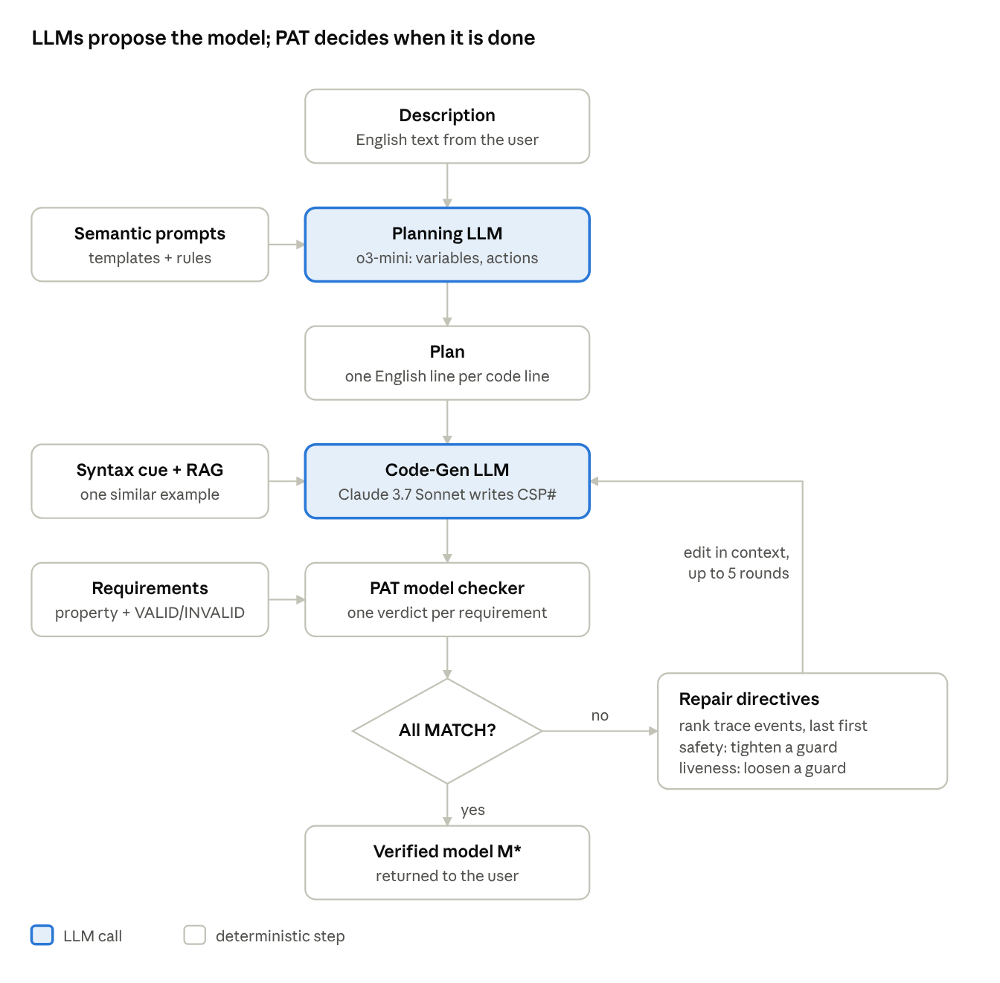
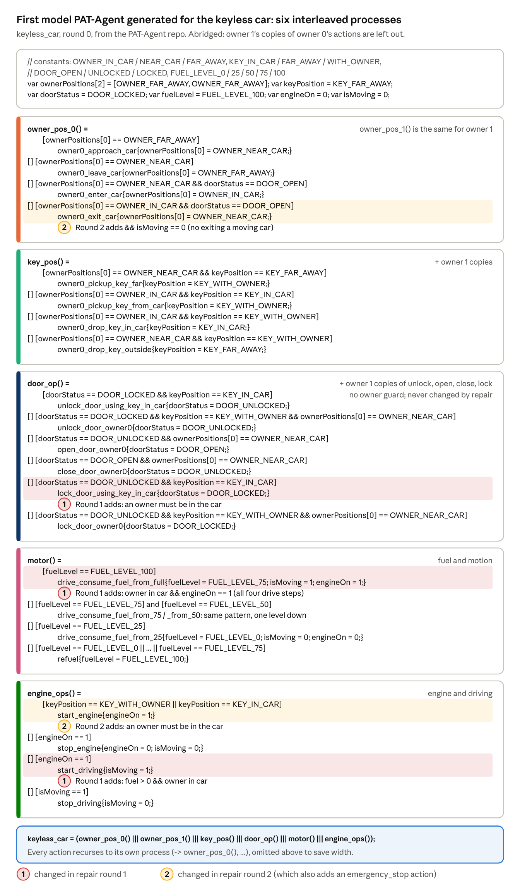
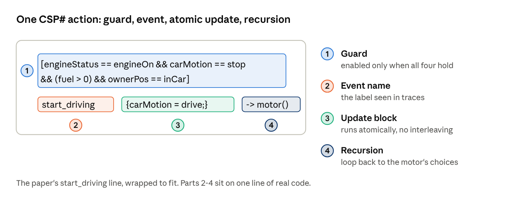
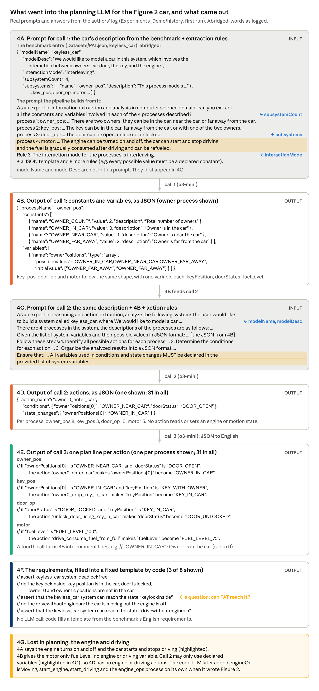
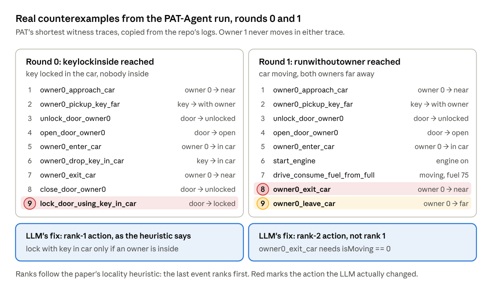
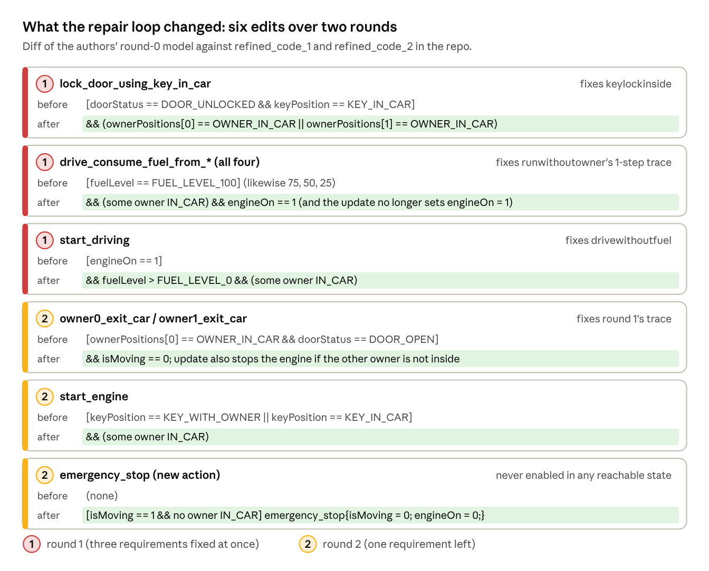
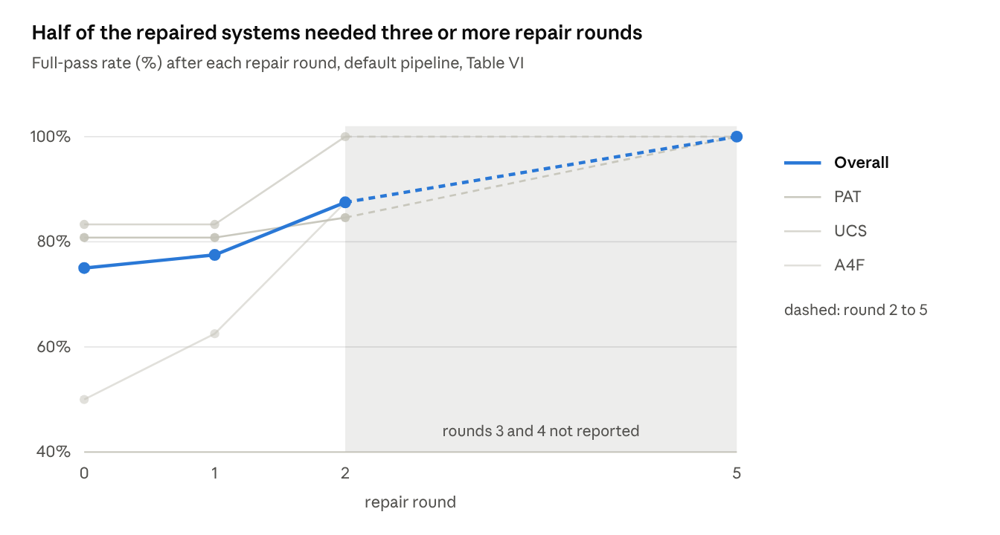

## 1. The big picture

PAT-Agent turns an English description of a concurrent system into a CSP# model, then lets the PAT (Process Analysis Toolkit) model checker judge it. When the model fails a requirement, a repair loop feeds PAT's counterexample back to an LLM until every requirement matches. With that loop, it reaches a 100% full-pass rate on 40 benchmark systems. The paper is by Zuo, Zhang, Wang, Cai, Hou, Sun and Dong (NUS, Griffith, Auckland), [arXiv 2509.23675](https://arxiv.org/abs/2509.23675), accepted at [ASE 2025](https://conf.researchr.org/details/ase-2025/ase-2025-papers/200/PAT-Agent-Autoformalization-for-Model-Checking).

### 1.1 The problem

Model checking can prove that a design never deadlocks or never reaches a dangerous state. The catch is that someone has to write the model first, in a formal language such as CSP#. That step needs expertise most engineers do not have.

LLMs can write code, so the obvious idea is to ask one to write the model. Asked directly, they often produce models that do not compile, or that compile but behave differently from what the user meant. The paper measures this: the best single LLM fully satisfies only 52.5% of systems (Section 9).

**Autoformalization** is the name for this translation from informal text to a formal artifact. Most prior work autoformalizes single formulas (an English sentence into one LTL formula). PAT-Agent autoformalizes a whole *system model*: variables, concurrent processes, guarded actions, and the assertions to check.

### 1.2 The idea in one paragraph

PAT-Agent splits the job into four parts.

1. A **Planning LLM** (o3-mini) reads the description and fills structured templates: constants, variables, and guarded actions, as JSON. It then writes a line-by-line plan in plain English.
2. A **Code Generation LLM** (Claude 3.7 Sonnet) turns each plan line into CSP#, helped by a PAT syntax cheat sheet and one retrieved example of a similar plan and its code.
3. The **PAT model checker** checks each requirement and reports whether its outcome matches what the user expected.
4. A **Repair Loop** takes PAT's counterexample, ranks the actions in it that are likely to blame, and asks the code LLM for a targeted edit, up to 5 times.

The LLMs propose; PAT decides. Nothing is accepted because an LLM says it is right. It is accepted only when PAT's verdicts match the user's expected outcomes.

***Figure 1.** The PAT-Agent pipeline, redrawn from the paper's Fig. 1. Source: the paper.*

Read it top to bottom. The two shaded boxes are the only LLM calls; every arrow back into Code-Gen carries a counterexample-driven edit, never a fresh plan.

### 1.3 The running example: a car

***Figure 2.** The first model PAT-Agent generated for the keyless car (repair round 0), abridged. Source: the authors' repo, `Experiments_Demo/generated_code/keyless_car/0.csp`.*

Each process is a loop of guarded actions joined by `[]`. Here `[]` is not a pair of brackets but CSP#'s choice operator: the process offers every alternative whose guard is currently true, and whichever one happens next decides the step. A condition inside single brackets, like `[doorStatus == DOOR_OPEN]`, is a guard. The last line interleaves all six processes. The six are one process per owner (the benchmark specifies two owners), plus the key, the door, the motor and the engine. Red and amber rows mark the guards the repair loop changed in rounds 1 and 2 (Section 7.1.4).

How to read one line of Figure 2, for example `[] [ownerPositions[0] == OWNER_NEAR_CAR] owner0_leave_car{ownerPositions[0] = OWNER_FAR_AWAY;}`:

1. `[]` means **or**: this is one more alternative the process can choose.
2. `[ownerPositions[0] == OWNER_NEAR_CAR]` is the **guard**: this alternative is allowed only while owner 0 is near the car.
3. `owner0_leave_car` is the **event**, the name that shows up in traces.
4. `{ownerPositions[0] = OWNER_FAR_AWAY;}` is the **update**: what changes when the event happens.

So the whole line says: *or, if owner 0 is near the car, owner 0 may leave, and is then far away.*

The paper's running example is a car with **keyless entry** (the benchmark calls it `keyless_car`). "Keyless" means the key is a fob that only has to be with an owner or inside the car; nobody turns it in a lock. So the key is still part of the model. Its benchmark entry describes four subsystems: the **owners** (there are two, owner 0 and owner 1), the **key**, the **door** and the **motor**. The model the pipeline generated (Figure 2) gives each owner its own process and splits the motor into `motor` (fuel and motion) and `engine_ops` (engine and driving), so it has six processes.

The car's whole state is six shared variables. Every value is a named constant declared with `#define`:

| Variable | Possible values | # values | Initial value | Written by |
| --- | --- | --- | --- | --- |
| ownerPositions\[0\], ownerPositions\[1\] | OWNER\_IN\_CAR, OWNER\_NEAR\_CAR, OWNER\_FAR\_AWAY | 3 each | OWNER\_FAR\_AWAY | owner\_pos\_0, owner\_pos\_1 |
| keyPosition | KEY\_IN\_CAR, KEY\_FAR\_AWAY, KEY\_WITH\_OWNER | 3 | KEY\_FAR\_AWAY | key\_pos |
| doorStatus | DOOR\_OPEN, DOOR\_UNLOCKED, DOOR\_LOCKED | 3 | DOOR\_LOCKED | door\_op |
| fuelLevel | 0, 25, 50, 75, 100 | 5 | 100 | motor |
| engineOn | 0, 1 | 2 | 0 | motor, engine\_ops |
| isMoving | 0, 1 | 2 | 0 | motor, engine\_ops |

So there are 3 × 3 × 3 × 3 × 5 × 2 × 2 = 1,620 possible valuations. PAT reached 1,125 of them in the first model and 706 in the final, verified one (Section 2.2). Note that `KEY_WITH_OWNER` does not record *which* owner holds the key.

The benchmark gives eight requirements. The paper's Table I shows three of them, renamed and simplified to a single owner:

| Name in the repo | Requirement (benchmark's wording) | Expected | In the paper |
| --- | --- | --- | --- |
| deadlockfree | The system never deadlocks | VALID | P1 |
| keylockinside | Key in the car, door locked, neither owner in the car | INVALID | P2 (`keyInsideDoorLocked`) |
| runwithoutowner | Car moving, both owners far away | INVALID | closest to P3 (`driveWithoutDriver`) |
| (5 more) | Five more requirements exist in the benchmark but are not discussed here |  | not shown |

Two of the eight are *positive* (expected VALID): they demand that some driving situation stays possible. Section 11.1 explains why that matters.

- **Deadlock is not possible:** an owner who is far away can always `approach_car`, and one who is near can always `leave_car`. With two owners walking back and forth, some action is always enabled.

**Where this comes from.** The paper itself prints only fragments of the car: the JSON skeleton (its Fig. 2; the real version is Figure 4B here), one plan line (Section 5.4), one code line (Figure 3 here), three simplified assertions (its Table I) and one trace (the real traces are Figure 5 here). There is no appendix in the PDF. The full material is in the authors' [GitHub repo](https://github.com/ZuoXinyue/PAT-Agent):

- `Datasets/PAT.json`, entry 14 (`keyless_car`): the description and the eight requirements.
- `Experiments_Demo/generated_code/keyless_car/`: a complete run, with the first model, PAT's outputs, the mismatch traces, two repair rounds and the verified model.

The paper's names look like simplified versions of the repo's: `ownerPos` for the two-element `ownerPositions`, `carMotion` for `isMoving`, `driveWithoutDriver` for `runwithoutowner`. To check claims here, I wrote a small CSP# interpreter in Python. On the authors' models it reproduces PAT's logged state counts (1,125 and 706) and every logged trace exactly.

### 1.4 Roadmap

- Sections 2–3 build the background: model checking, then CSP# and PAT, using the car.
- Section 4 states the problem formally, as the paper does.
- Sections 5–8 walk the pipeline stage by stage, ending with two full repair rounds on the car.
- Sections 9–10 cover the evaluation and the user study, with every aggregate number recomputed.
- Section 11 reads the paper critically: what "100%" does and does not mean.

## 2. Background: model checking from scratch

A model checker explores every state a finite model can reach and checks a property in each one. If the property fails, it returns a concrete path to the failure. That path, the **counterexample**, is what PAT-Agent's repair loop feeds on.

### 2.1 A model is a labelled transition system

The paper (Section II-B) defines a process as a labelled transition system (LTS) ⟨S, Act, →, s₀⟩:

- **S**: the states. In CSP#, a state is a valuation of the model's typed variables (plus where each process is in its code).
- **Act**: the observable events, like `open_door`. Internal steps are written τ and are not in Act.
- **→ ⊆ S × (Act ∪ {τ}) × S**: the transitions. A step s —α→ s′ is one atomic state change.
- **s₀**: the initial state.

Take the car's door as owner 0 sees it in the authors' model (Figure 2). It has three states and four of owner 0's events (owner 1 has the same four events):

| From | Event | Guard also needs | To |
| --- | --- | --- | --- |
| locked | `unlock_door_owner0` | owner 0 near the car, key with an owner | unlocked |
| unlocked | `lock_door_owner0` | owner 0 near the car, key with an owner | locked |
| unlocked | `open_door_owner0` | owner 0 near the car | open |
| open | `close_door_owner0` | owner 0 near the car | unlocked |

Two more door events belong to neither owner: `unlock_door_using_key_in_car` and `lock_door_using_key_in_car`. Repair later adds an owner check to `lock_door_using_key_in_car` only; `unlock_door_using_key_in_car` never changes.

### 2.2 Concurrency multiplies states

The car runs six processes at once. When processes run in **interleaving**, any one of them may take the next step, so the global state is the combination of all of them.

In the car, the six variables can take 3 × 3 × 3 × 3 × 5 × 2 × 2 = 1,620 combinations (the variable table in Section 1.3). Guards rule many of them out: PAT reached 1,125 states in the authors' first model and 706 in the verified one (model was corrected to satisfy all three properties). The paper's PAT dataset averages about 101,000 states per system. This growth is the **state-explosion problem**, and it is why model checkers exist rather than people enumerating by hand.

### 2.3 Three kinds of questions

PAT-Agent uses three of PAT's built-in checks:

- **Deadlock-freedom.** Does every reachable state have at least one enabled transition? A state with none is a deadlock.
- **Reachability.** Can the system reach some state where a predicate holds, such as "driving with nobody inside"?
- **Linear temporal logic (LTL).** Does *every* execution satisfy a formula over time? `[]` means "always" and `<>` means "eventually".

Two families of properties matter for repair:

- **Safety:** nothing bad ever happens.
  - Example: "never drive without a driver".
  - A finite path is enough to violate it.
- **Liveness:** something good eventually happens.
  - Example: "after starting to drive, the car eventually stops".
  - Only an infinite path can violate it, usually a loop that keeps skipping the good event.

### 2.4 Counterexamples and witnesses

When a check fails, the model checker can usually show why:

- A violated safety property gives a finite path from s₀ to a bad state.
- A violated liveness property gives a lasso: a path, then a loop that repeats forever.
- A *successful* reachability check gives a **witness**: a path to the target state.

One asymmetry matters later. When a property *holds* (no deadlock, or a target is *not* reachable), there is no path to show. You cannot print a path to a state that does not exist. Section 7.2.1 shows how this splits PAT-Agent's repair cases into those with a trace and those without.

## 3. CSP# and PAT: a crash course

CSP# is the language PAT-Agent must write. It is CSP (Hoare's Communicating Sequential Processes) plus shared typed variables and small C#-like update blocks. PAT, the Process Analysis Toolkit from NUS, explores its state space.

### 3.1 Required

You need these three parts to follow the rest of the tutorial.

#### 3.1.1 Reading one CSP# action

Here is the one line of model code the paper shows, the `start_driving` action of the motor process:

***Figure 3.** The paper's one line of CSP# model code (`start_driving`), annotated part by part. Source: the paper.*

Read it in four parts:

1. **Guard** `[ ... ]`: the action is enabled only if the engine is on, the car is stopped, there is fuel, and the owner is inside.
2. **Event name** `start_driving`: this label appears in traces and counterexamples.
3. **Update block** `{carMotion = drive;}`: runs atomically. No other process can step in between.
4. **Recursion** `-> motor()`: after the step, the motor goes back to offering all its actions.

A whole process is a list of such lines joined by `[]`. Because every line recurses back to its own process, each process is a loop that keeps offering whichever of its actions are currently enabled.

#### 3.1.2 The two operators the car uses

- `[]` means **or**: it separates the alternatives a process can choose from. Each alternative can happen only while its guard holds.
- `|||` means **interleave**: the processes run side by side, and at each step any one of them may move.

These are the only CSP# operators the car model in Figure 2 uses. The full list is in 3.2.2.

#### 3.1.3 Assertions and the expected outcome

PAT checks properties written as `#assert` lines. The paper's Table I gives three of the car's eight requirements, simplified to one owner (the full list is in Section 1.3):

| IDs | Type | Assertion | Expected | M₀ gives |
| --- | --- | --- | --- | --- |
| P1 | Deadlock | `#assert car() deadlockfree;` | VALID | VALID (match) |
| P2 | Reachability | `#define keyInsideDoorLocked (key == inCar && door == locked && ownerPos != inCar);` then `#assert car() reaches keyInsideDoorLocked;` | INVALID | INVALID (match) |
| P3 | Reachability | `#define driveWithoutDriver (carMotion == drive && ownerPos != inCar);` then `#assert car() reaches driveWithoutDriver;` | INVALID | **VALID (mismatch)** |

**Note:** these assertion definitions are tied to the generated model. Each `#define` is written in the model's own variable names and values (`key`, `door`, `ownerPos`, `inCar`), so it is not independent of the model. The assertions only make sense together with the LLM-generated model they were written for.

The "Expected" column is the key idea. `reaches X` is VALID when X *can* happen. So to say "X must never happen", the user writes `reaches X` and expects **INVALID**. A requirement is satisfied when PAT's verdict equals the expected one.

The same safety requirement can be written as an LTL invariant with the opposite expectation: `#assert car() |= [] !driveWithoutDriver;` expected VALID. Both say the bad state is unreachable.

### 3.2 Optional

Background and reference material. You can skip it on a first read.

#### 3.2.1 Why PAT and CSP#

PAT supports state-space exploration and LTL checking for concurrent and real-time systems. It has been used for industrial protocols, real-time controllers and cyber-physical systems. CSP# suits event-driven systems with shared state, like the car, where several components read and write the same variables.

The authors note CSP# is niche. There is little public CSP# code for an LLM to have learned from, unlike TLA+ or Isabelle. That scarcity is one reason the pipeline leans on a syntax cheat sheet and retrieved examples.

#### 3.2.2 The full grammar, operator by operator

The paper uses this subset of CSP#:

$$
P ::= \mathit{Stop} \mid \mathit{Skip} \mid e \to P \mid e\{prog\} \to P \mid P \,\square\, Q \mid \mathtt{if}(b)\{P\}\,\mathtt{else}\,\{Q\} \mid P ; Q \mid P \parallel_A Q \mid P \,|||\, Q
$$

| Paper notation | PAT text | Meaning | Car example |
| --- | --- | --- | --- |
| Stop | `Stop` | Does nothing, ever. A deliberate deadlock. | not used |
| Skip | `Skip` | Terminates successfully. | not used |
| e → P | `e -> P` | Do event e, then behave as P. | `close_door -> door()` |
| e{prog} → P | `e{x = 1;} -> P` | Do e and run the update block atomically, then P. | `start_driving{carMotion = drive;} -> motor()` |
| P □ Q | `P [] Q` | External choice: offer both; the first event taken picks the branch. | the alternatives inside each process |
| if(b){P} else {Q} | same | Branch on a boolean. | not needed here |
| P ; Q | `P; Q` | Run P to completion, then Q. | not needed here |
| P ∥\_A Q | `P \|\| Q` | Run both; they must synchronize on events in A. | not used |
| P \|\|\| Q | `P \|\|\| Q` | Interleave: run both independently, no synchronization. | `driver() \|\|\| key() \|\|\| door() \|\|\| motor()` |

The paper's grammar leaves out one construct that every action in its examples uses: the **guard** `[b] P`. A guarded process can only start when the boolean b holds in the current state. In the car, guards are where all the safety logic lives.

#### 3.2.3 The full car model

Figure 2, at the top of Section 1.3, is the authors' first generated model. Compare its `start_driving` with Figure 3. The generated guard was only `[engineOn == 1]`; the fuel and owner-inside conditions arrived through repair (Section 7.1.4). The paper's printed line is a cleaned-up, single-owner version of the repaired guard.

## 4. The problem, stated formally

The paper's goal is narrow and precise: produce a well-formed PAT model whose verdict on every user requirement equals the outcome the user expected. Fidelity to the English description is hoped for, but the formal goal only checks the requirements.

### 4.1 Required

You need these two parts to follow the evaluation and the critique.

#### 4.1.1 The goal

Given a description N ∈ L\_NL and a set Q of m requirements, each a pair (φᵢ, oᵢ) of a property and its expected outcome VALID or INVALID, find M\* ∈ M such that:

$$
\forall (\varphi, o) \in \mathcal{Q} :\; \mathcal{V}(M^\star, \varphi) = o
$$

Here V is the PAT model checker and M\* is the LLM-generated model. V(M\*, φ) is the verdict, VALID or INVALID, that PAT returns when it checks property φ on model M\*.

Read it as: for every requirement, PAT's verdict on the final model equals the expected outcome. The whole evaluation (Section 9) measures this condition and nothing stronger. Keep that in mind for Section 11.

#### 4.1.2 What repair can and cannot change

- **Repair edits the existing model; it never re-plans.** It gets the current model and PAT's counterexample, not the description or the plan.
- **Repair is meant to change only the model, never the requirements.** The requirements and their expected outcomes are fixed inputs.

> **Note:** In the authors' code this is not enforced. The repair prompt passes the whole file, assertions included, and only *asks* the LLM to change nothing but the parts relevant to the counterexample. In the car run the assertions did stay the same.

### 4.2 Optional

The paper's notation and the type of each stage. Useful for reading the paper's own formulas; Sections 5–7 explain the same stages in plain terms.

#### 4.2.1 The sets

| Symbol | What it is | Car example |
| --- | --- | --- |
| L\_NL | Natural-language specifications | "The engine can be turned on and off, the car can start and stop driving..." |
| Π | Planning representations: semantic prompt templates with slots for constants, variables, actions | the JSON templates of Section 5 |
| P | Detailed model-generation plans | the line-by-line English annotations |
| M | Well-formed PAT models | M₀, M₁, M₂ of Section 7 |
| Q | Requirements: pairs (φᵢ, oᵢ), a property and an expected outcome in {VALID, INVALID} | (P3, INVALID) |
| V | PAT's verification procedure | BFS over the car's states |
| C | Counterexample traces PAT may return | `init -> owner_approach -> ... -> start_driving` |
| R | Repair instructions combined with PAT's results | "tighten the guard of start\_driving" |

#### 4.2.2 The four transformers

Each stage is a possibly random function, because LLM output is sampled:

$$
\begin{aligned}
T_{plan} &: \mathcal{L}_{NL} \to \Pi \to \mathcal{P} \\
T_{gen} &: \mathcal{P} \to \mathcal{M} \\
\mathcal{V} &: \mathcal{M} \times \mathcal{Q} \to \{\mathrm{MATCH}, \mathrm{MISMATCH}\}^m \times \mathcal{C} \\
T_{repair} &: \mathcal{M} \times \mathcal{C} \times \mathcal{R} \to \mathcal{M}
\end{aligned}
$$

- **T\_plan** has two arrows. First the description fills the templates in Π (extraction). Then the filled templates become a plan in P.
- **T\_gen** turns a plan into a model. It is the only stage that writes CSP#.
- **V** returns a verdict vector, one MATCH or MISMATCH per requirement, plus a counterexample. The verdict is MATCH when PAT's raw result equals oᵢ.
- **T\_repair** takes the current model, a counterexample and repair instructions, and returns a new model. It does *not* take the plan or the description. Repair never re-plans.

One detail is easy to miss: V's result carries one trace from C, even when several requirements mismatch.

## 5. Stage 1: the Planning LLM

The Planning LLM never writes CSP#. It fills fixed templates with the model's ingredients, then writes an English plan with one line per future line of code. This intermediate step is what lifts compilation from 75% to 100% in the ablation (Section 9.5).

### 5.1 What a semantic prompt contains

Every planning call uses a **semantic prompt** with four parts:

1. **Role.** A one-line task. In Figure 4 it is the first line of 4A and of 4C, such as "As an expert in information extraction … can you extract all the constants and variables …".
2. **Supporting context.** The user's description, plus anything extracted by earlier calls. In Figure 4: the four process descriptions in 4A, and the JSON from 4B pasted into 4C.
3. **Structural guidance.** A JSON template listing the fields to fill for each kind of element (the "JSON template" in the last line of Figure 4A). Figure 4B shows the fields filled in for the owner process:
   - Constant: name, value, description.
   - Variable: name, type, possible values, initial value, description.
   - Process: name, actions, guard conditions, state changes.
4. **Instructions and validation rules.** For example: constants have integer values; a variable's possible values must themselves be declared as constants; constants come before variables; every name across constants, variables and processes is unique. In Figure 4 these are the "9 rules" in the last line of 4A and the highlighted "MUST be declared" rule in 4C.

The last rule matters more than it looks. The paper reports that DeepSeek-R1, used as planner, sometimes failed to keep constant names apart from process names. The code LLM then produced clashing definitions that broke verification.

Here is what went into the planning LLM (o3-mini) for the car in Figure 2, and what came out. Figure 4 has seven parts:

- **4A** and **4C**: the prompts for calls 1 and 2 (grey).
- **4B**, **4D** and **4E**: the outputs of calls 1, 2 and 3.
- **4F**: the requirements, filled into a template by code (no LLM).
- **4G**: what got lost between 4A and 4D.

The code LLM (Claude 3.7 Sonnet) receives 4E, 4F and the comment lines made from 4B, and writes Figure 2 from them.

***Figure 4.*** *The planning stage's real prompts and outputs for the keyless car, abridged. Source: the authors' repo, `Experiments_Demo/history/` (`const-history.json`, `action-history.json`, `nl-instruction-part.json`).*

### 5.2 The extraction steps on the car

Planning runs as a chain of four LLM calls, each feeding the next. Figure 4A to 4F show each step for the car.

1. **Context.** The benchmark entry for the car is at the top of Figure 4A: `modelName`, `modelDesc`, `interactionMode`, `subsystemCount` and the four `subsystems`. The pipeline turns it into the English prompt for call 1, shown below it in 4A; the blue tags show where each field lands. `modelName` and `modelDesc` are not in call 1's prompt; they first appear in 4C.
2. **Constants and variables (call 1).** Figure 4B shows the output for the owner process:
   - Four constants, each with a name, an integer value and a description: `OWNER_COUNT` = 2, `OWNER_IN_CAR` = 0, `OWNER_NEAR_CAR` = 1, `OWNER_FAR_AWAY` = 2.
   - One variable, `ownerPositions`: an array whose possible values are the three position constants, starting at `[OWNER_FAR_AWAY, OWNER_FAR_AWAY]` (both owners far away).
   - The other three processes have the same shape, with one variable each: `keyPosition`, `doorStatus` and `fuelLevel` (last line of 4B).
3. **Actions (call 2).** With the variables known, a second call proposes actions, each with conditions (the guard) and state changes. Its prompt is Figure 4C and its output is Figure 4D: 31 actions for the car, one shown.
4. **Plan (call 3).** A third call rewrites each action in 4D as one English line: Figure 4E, one line per process shown. A fourth call turns 4B into comment lines for the constants and variables (last line of 4E).

Every output is JSON, so the interface can show it as editable tables (Section 8). The variable table in Section 1.3 lists the variables of the final model in Figure 2. It has two more than Figure 4B (`engineOn` and `isMoving`), which the code LLM added.

### 5.3 Inferring guards the user never wrote

The descriptions in Figure 4A list only the states each part can be in. They never say *when* a change may happen. Call 2 is told to work that out (step 2 in Figure 4C: "Determine the conditions for each action").

Figure 4D shows the result for `owner0_enter_car`. Its conditions are:

- `"ownerPositions[0]": "OWNER_NEAR_CAR"`: owner 0 is next to the car.
- `"doorStatus": "DOOR_OPEN"`: the door is open.

The owner's description in 4A mentions only positions, not the door. The second condition is one the LLM inferred.

This is both the strength and the risk of the stage. The guards that keep the model safe mostly come from inference, not from the text. A missed conjunct here, or one dropped later, is exactly the bug P3 catches.

### 5.4 The plan

The plan is a line-by-line English annotation that maps one-to-one onto code. Figure 4E shows four real lines. For example, the plan line for `owner0_enter_car` becomes this line of Figure 2: `[ownerPositions[0] == OWNER_NEAR_CAR && doorStatus == DOOR_OPEN] owner0_enter_car{ownerPositions[0] = OWNER_IN_CAR;}`. The paper prints a richer line, for `start_driving`:

> If "engineStatus" is "engineOn", "carMotion" is "stop", "fuel" is above 0, and "ownerPos" is "inCar", the action "start\_driving" makes "carMotion" become "drive" (drive started).

Each clause has an obvious CSP# counterpart: the four conditions become the guard, the action name becomes the event, and "becomes drive" becomes the update block. Figure 3 shows the code line it becomes, part by part. The code LLM's job is then translation, not design.

For comparison, `start_driving` in Figure 2 has the guard `[engineOn == 1]`. The fuel and owner-inside conditions of the paper's line are added by the repair loop (Figure 6, Section 7.1.4).

## 6. Stage 2: the Code-Generation LLM

The Code-Generation LLM (Claude 3.7 Sonnet) translates each plan line into CSP#. It gets two extra aids: a short PAT syntax sheet listing common mistakes, and one retrieved example of a similar plan with its finished code.

### 6.1 Input and output

- **Input:** the plan P from Stage 1. For the car, P is three parts of Figure 4: the plan lines (4E), the comment lines made from 4B, and the requirements (4F). The same prompt also holds the syntax cue (6.2) and one retrieved example (6.3).
- **Output:** a complete, runnable PAT model: constant definitions, variables, one process per subsystem, and the top-level composition.

Because 4F is in the prompt, the code LLM writes the `#define` and `#assert` lines in the same output as the model (see the Note in 3.1.3). The expected results (VALID or INVALID) are not in 4F; they are used only afterwards, to check PAT's answers (Section 7).

### 6.2 Aid 1: the syntax cue σ\_PAT

A short PAT syntax sheet in the prompt that warns about common mistakes: missing semicolons, `||` used where `|||` was meant, and malformed assertions.

### 6.3 Aid 2: one retrieved example (RAG)

One worked example in the prompt: the ⟨plan, code⟩ pair from the authors' small database whose plan is most similar (by cosine similarity) to the new plan.

> **Note:** The paper gives no details on this database (its size, its contents, or how similarity is computed). The authors' repo does include it, as `database-rag-claude.json`. For `keyless_car`, the example retrieved is a two-owner car model (owners, key, door, engine). It is a solved version of the same problem: the same four subsystems, two owners, and all eight requirements with the same state names. This makes the use of the database questionable: for this system, the code LLM is shown a worked answer to the task it is tested on.

### 6.4 Where the assertions come from

Users write requirements in English with an expected outcome. The pipeline **autoformalizes** each one into a PAT assertion, such as the `#define` plus `#assert` lines in Section 3.1.3. The predicates must use the model's own variable names, so the assertions depend on the generated model's vocabulary.

In the web interface, users build these assertions through drop-downs over variable-value pairs, so they never type formal syntax (Section 8).

## 7. Stages 3–4: verification and the repair loop

PAT checks every requirement. While any verdict mismatches, the loop turns PAT's counterexample into a short list of suspect actions and an edit instruction, and asks the code LLM for a new model. It stops at the first all-MATCH model or after 5 rounds.

### 7.1 Required

You need these four parts to follow the evaluation (Section 9).

#### 7.1.1 Verification produces a verdict vector

For each requirement (φᵢ, oᵢ), PAT runs the matching engine (deadlock, reachability or LTL) and returns VALID or INVALID. That raw result is compared with oᵢ to give sᵢ ∈ {MATCH, MISMATCH}. Over all m requirements this gives the verdict vector s.

For the car's first model M₀ in the authors' run, five of the eight requirements match and three mismatch: `keylockinside`, `runwithoutowner` and `drivewithoutfuel` are all reachable but should not be.

#### 7.1.2 The loop

$$
(\vec{s}_k, C_k) \leftarrow \mathcal{V}(M_k, \mathcal{Q}), \qquad M_{k+1} \leftarrow \begin{cases} M_k & \text{if } \vec{s}_k \equiv \mathrm{MATCH}^m \\ T_{repair}(M_k, C_k, R_k) & \text{otherwise} \end{cases}
$$

In the formula:

- **k**: the number of the round (0, 1, 2, …).
- **M\_k**: the model in round k. M₀ is the first generated model (Figure 2); for the car, M₁ and M₂ are the two repaired models (Figure 6).
- **s\_k**: the verdict vector for M\_k, one MATCH or MISMATCH per requirement (7.1.1). The formula writes it with an arrow over the s.
- **C\_k**: the counterexample trace PAT returns for M\_k. Figure 5 shows C₀ (left) and C₁ (right) for the car.
- **R\_k**: the repair directives built from C\_k (7.1.3).
- **Q**: the set of requirements (4.1.1).

* Start from M₀ = T\_gen(P).
* Stop at the first round k\* where every entry is MATCH, and return M\* = M\_k\*.
* Cap the rounds at K\_max = 5. If no model passes by then, the user gets the last model and its counterexample.

The authors chose 5 because more rounds gave diminishing returns in their runs.

#### 7.1.3 From a trace to a repair directive

Each round turns the trace C\_k = (t₀ → t₁ → … → t\_ℓ) into directives R\_k in two steps.

##### Heuristics for fault localization ([code](https://github.com/ZuoXinyue/PAT-Agent/blob/master/Automated_Pipelines/Full_Pipeline/pipeline.py#L861-L908))

1. **Rank the suspects** with a locality-of-fault heuristic. Actions closer to the end of the trace rank higher, and actions that occur more often rank higher.
2. **Pick the edit by property type.**
   - Safety violated (a bad state is reachable): **tighten** a guard on a high-ranked action.
   - Liveness violated (something good never happens): **loosen** guards that block it.
   - Deadlock: make sure every state has an outgoing transition, or relax over-strict conditions.

The directives go into the code LLM's prompt as context, for example "tighten guard of START\_DRIVING". Planning is not rerun. The goal is a small, local edit that keeps the parts of the model that already work.

#### 7.1.4 Worked example: the authors' real repair run

The repo logs a complete run on the keyless car. The first model fails three of the eight requirements. One round of repair fixes all three but exposes a new path to one of them, and a second round passes all eight (k\* = 2).

**Round 0 (M₀, 1,125 states).** PAT reports three mismatches, each with a witness trace:

| Requirement | Expected | M₀ gives | PAT's shortest trace |
| --- | --- | --- | --- |
| keylockinside | INVALID | VALID | 9 events (left panel of Figure 5): owner 0 drops the key in the car, gets out, closes the door, and `lock_door_using_key_in_car` locks it |
| runwithoutowner | INVALID | VALID | 1 event: `drive_consume_fuel_from_full`. In M₀ that action needs only a full tank and sets `isMoving = 1` and `engineOn = 1` itself, so the car drives off from the initial state with both owners far away |
| drivewithoutfuel | INVALID | VALID | 8 events: four drive steps empty the tank, then `start_engine` and `start_driving` |

***Figure 5.** The real counterexamples from round 0 (left) and round 1 (right). Source: the authors' repo, `mismatch_traces.json` for each round.*

**Repair 1.** The repair prompt carried all three traces, and the LLM tightened three guards in one round (red rows of Figure 6). Locking with the key inside now needs an owner inside. Every drive step needs an owner inside and the engine on. `start_driving` needs fuel and an owner inside.

**Round 1 (M₁, 994 states).** `keylockinside` and `drivewithoutfuel` now match. `runwithoutowner` still mismatches, through a longer path (right panel of Figure 5): owner 0 starts the car, drives, steps out of the moving car and walks away. The paper's printed trace, where the owner gets out and the car then starts driving, looks like a simplified version of this failure.

**Repair 2.** Under the locality heuristic, the last event, `owner0_leave_car`, ranks first. But walking away from a car you have already left is normal. The LLM instead edited the rank-2 event, `owner0_exit_car`: nobody may exit while the car moves. It also made `start_engine` require an owner inside and added an `emergency_stop` action (amber rows of Figure 6).

**Round 2 (M₂, 706 states).** All eight requirements match, so the loop halts with k\* = 2. This final model is the repo's `verifiedCode.csp`.

***Figure 6.** Every edit the repair loop made, before and after. Source: the authors' repo, `0.csp` against `refined_code_1.csp` and `refined_code_2.csp`.*

### 7.2 Optional

Two details for a closer reading: which failures come with a trace, and what the car's run shows about the loop.

#### 7.2.1 Which mismatches come with a trace

The paper says PAT returns a minimal counterexample trace whenever a requirement mismatches. That holds for only half the cases. A trace exists only when the checker found a path; it cannot show a path to a state that does not exist.

| Assertion | Expected | PAT says | What went wrong | Trace? |
| --- | --- | --- | --- | --- |
| `reaches X` | INVALID | VALID | A bad state is reachable | Yes: the witness path to X |
| `reaches X` | VALID | INVALID | A wanted state is unreachable | No |
| `deadlockfree` | VALID | INVALID | A deadlock exists | Yes: the path to it |
| `deadlockfree` | INVALID | VALID | An expected deadlock is missing | No |
| LTL `\|=` F | VALID | INVALID | Some run breaks F | Yes: a path or a lasso |
| LTL `\|=` F | INVALID | VALID | Every run satisfies F | No |

For the three "No" rows, locality ranking has nothing to rank. Only the property-type rule ("loosen guards") can guide the edit. P3 is a "Yes" row: PAT's *witness* for the bad state serves as the counterexample.

#### 7.2.2 What the example teaches

- **One round can fix several requirements and expose a new failure.** Round 1 fixed three mismatches at once. But closing the 1-step path to `runwithoutowner` revealed a 9-step one. This is why Table VI shows systems needing several rounds.
- **The locality heuristic is a hint, not a rule.** In round 0 the culprit was the last event. In round 1 it was the second-to-last; the last event (`leave_car`) was harmless.
- **Repairs can add code that never runs.** I checked all 706 reachable states of M₂: `emergency_stop` is never enabled in any of them. Once nobody can exit a moving car, the car never moves empty. PAT accepts dead code; only a reader of the model would notice.
- **"Passes" means passes the formalized requirement.** `drivewithoutkeyholdbyother` asks that owner 1 can drive while owner 0, far away, holds the key. The model's `KEY_WITH_OWNER` cannot say which owner holds the key. PAT's witness has owner 1 holding it, which satisfies the formal predicate but not the English requirement (Section 11.1).

## 8. The interactive interface

The interface is not a separate method. It is the same pipeline as Sections 5–7, split into eight tabs, and it stops after each tab so a person can check or fix the output before the next step uses it.

| Tab | Who acts | Pipeline step it shows |
| --- | --- | --- |
| 1 Information Collection | User | Benchmark entry (Figure 4A) |
| 2 Constants & Variables | o3-mini call 1; user can edit the table | Figure 4B |
| 3 Actions | o3-mini call 2; user can edit the table | Figure 4D |
| 4 Assertions | User, with drop-downs and an expected result | Figure 4F |
| 5 NL Annotation | o3-mini calls 3 and 4; read-only | Figure 4E |
| 6 Code Generation | Claude; user can edit the code | Figure 2 |
| 7 Verification | PAT | 7.1.1, Figure 5 |
| 8 Refinement | Claude's automatic repair, or a manual edit | 7.1.3, Figure 6 |

- **A person in the loop.** The automated pipeline runs tabs 1–8 in a row with nobody in between; the benchmark entry stands in for the user in tabs 1 and 4. The interface lets a person correct mistakes early, for example a wrong condition in the Actions table before the plan and code are written from it.
- **Two extras that aren't in the pipeline.** A chatbot sits in front of the tabs. It checks a database of already-verified models, so the user can adapt one instead of starting from scratch. Every model that passes verification is saved to that database.
- **A different evaluation.** Section 9 measures the automated pipeline on the benchmark. Section 10's user study measures people using these tabs.

## 9. Evaluation

On 40 systems, the full pipeline fully satisfies 40/40, against 21/40 for the best direct LLM. The ablation splits the credit cleanly: planning fixes compilation (75% to 100%), and repair fixes the remaining semantic failures (30/40 to 40/40).

### 9.1 Datasets

| Dataset | Source | Systems | Assertions | Avg. states | Avg. transitions |
| --- | --- | --- | --- | --- | --- |
| PAT | Examples from the PAT library | 26 | 74 | 101,254 | 342,084 |
| UCS | Roscoe's textbook *Understanding Concurrent Systems* | 6 | 19 | 1,164 | 14,473 |
| A4F | Adapted from Alloy4Fun | 8 | 40 | 1,223 | 7,009 |
| Overall |  | 40 | 133 | 66,234 | 225,928 |

The authors kept only systems expressible in the CSP# subset of Section 3.2.2. State and transition counts are measured on the final verified models, as the maximum per system, then averaged.

### 9.2 Setup

- **PAT-Agent default:** ⟨o3, Claude⟩ = o3-mini (2025-01-31) for planning, Claude 3.7 Sonnet (2025-02-19) for code and repair.
- **Direct baselines:** o3, Claude or DeepSeek-R1 alone, given the same syntax sheet and RAG example, but no plan and no repair.
- **Pairings:** five other ⟨planner, coder⟩ combinations of o3, R1 and Claude, run through the full pipeline.

### 9.3 The three metrics

$$
\mathrm{CSR} = \frac{|S_{succ}|}{N}, \qquad \mathrm{FPR} = \frac{|S_{full}|}{N}, \qquad \mathrm{APR} = \frac{\sum_{i=1}^{N} p_i}{\sum_{i=1}^{N} A_i}
$$

- **CSR** (compilation success rate): share of systems whose model compiles.
- **FPR** (full-pass rate): share of systems where *every* assertion matches.
- **APR** (average pass rate): matched assertions over all assertions, pooled across systems.

Worked example, direct Claude on all 40 systems: 30 compile, 19 pass fully, and 84 of 133 assertions match. So CSR = 30/40 = 0.750, FPR = 19/40 = 0.475, APR = 84/133 = 0.632.

APR pools assertions, so systems with more assertions weigh more. A4F has 5 assertions per system; PAT has about 2.8.

### 9.4 RQ1: is the pipeline better than direct generation?

Overall results from Tables III and IV:

| Method | Kind | Compiles (of 40) | Full pass (of 40) | CSR | FPR | APR |
| --- | --- | --- | --- | --- | --- | --- |
| ⟨o3, Claude⟩ | Pipeline (default) | 40 | 40 | 1.000 | 1.000 | 1.000 |
| ⟨R1, Claude⟩ | Pipeline | 36 | 34 | 0.900 | 0.850 | 0.857 |
| ⟨o3, o3⟩ | Pipeline | 35 | 32 | 0.875 | 0.800 | 0.857 |
| ⟨o3, R1⟩ | Pipeline | 35 | 32 | 0.875 | 0.800 | 0.790 |
| ⟨R1, R1⟩ | Pipeline | 29 | 27 | 0.725 | 0.675 | 0.684 |
| ⟨R1, o3⟩ | Pipeline | 29 | 27 | 0.725 | 0.675 | 0.684 |
| o3 | Direct | 29 | 21 | 0.725 | 0.525 | 0.639 |
| Claude | Direct | 30 | 19 | 0.750 | 0.475 | 0.632 |
| R1 | Direct | 17 | 15 | 0.425 | 0.375 | 0.391 |

Three readings:

- Every pipeline configuration beats every direct baseline on FPR. The structure helps whichever models fill it.
- Both slots matter, by similar amounts. With o3 planning, replacing Claude as coder drops full passes from 40 to 32. With Claude coding, replacing o3 as planner drops them from 40 to 34. The paper says R1 as planner often broke the JSON format and blurred constant and process names.
- Even the best direct model leaves 25% of systems uncompiled and 47.5% not fully passing.

### 9.5 RQ2: which component does what?

The ablation removes the planner, the repair loop, or both, keeping ⟨o3, Claude⟩ otherwise (Table V, overall):

| Variant | Plan | Repair | CSR | FPR | APR |
| --- | --- | --- | --- | --- | --- |
| Full pipeline | yes | yes | 1.000 | 1.000 | 1.000 |
| Without repair loop | yes | no | 1.000 | 0.750 | 0.805 |
| Without planning | no | yes | 0.750 | 0.600 | 0.759 |
| Without both | no | no | 0.750 | 0.475 | 0.632 |

- **Planning buys compilation.** With a plan, 40/40 compile even before any repair. Without one, only 30/40.
- **Repair buys semantics.** With a plan, repair takes full passes from 30 to 40.
- **Repair never fixed a compile error.** "Without planning" and "without both" have the same CSR on every dataset (19/26, 4/6, 7/8). The loop is driven by counterexamples, and a model that does not compile produces none.
- "Without both" is exactly the direct-Claude row of Table III, as it should be.

### 9.6 How many rounds did repair need?

Table VI tracks the full pipeline after each repair round. Full passes go from 30 (round 0) to 31 (round 1), 35 (round 2) and 40 (round 5). So 5 of the 10 repaired systems needed 3 or more rounds. Rounds 3 and 4 are not reported, and the table calls UCS and A4F "CSP" and "Alloy".

***Figure 7.** Full-pass rate after each repair round, per dataset. Source: the paper's Table VI.*

A4F gains the most: from 4/8 to 8/8. Its systems carry the most assertions each, so a first model is more likely to miss one.

### 9.7 RQ3: how long does it take?

- ⟨o3, Claude⟩ has the lowest median end-to-end time: **4.34 minutes per verified system**.
- o3 plans faster than R1. Claude has the lowest code-generation latency.
- PAT's own verification time is small in every configuration. The LLM calls dominate.
- ⟨o3, R1⟩ and ⟨o3, o3⟩ show near-zero repair time for most systems. Timing covers only systems that were eventually verified, so these numbers leave out the systems those pipelines never fixed.

## 10. The user study

Twenty participants each modelled four small systems in PAT, the car included: ten used the PAT-Agent interface, and ten worked without it (they could still use other LLMs). The study aims to show that the interface lets people who are not formal-methods experts build correct, verified models more accurately and faster.

**Headline results** (the paper's Table VII): interface users were faster, and their models and assertions were much more often correct.

| Metric | EG (PAT-Agent) | CG (no PAT-Agent) | p (Mann–Whitney U, two-tailed) |
| --- | --- | --- | --- |
| Time (min) | 12.85 | 17.11 | 1.16e-2 |
| Assertion accuracy | 0.9958 | 0.7500 | 1.85e-7 |
| System accuracy | 0.9688 | 0.6633 | 2.66e-5 |

## 11. Critical reading

### 11.1 What the results measure

- **100% is consistency, not fidelity.** A full pass means the model agrees with its own requirements, not that it captures the described system.
- **Weak requirements let trivial models pass.** A do-nothing model passes the paper's three car requirements (Table I); only 12 of 40 benchmark systems have a requirement expected VALID that rules this out.
- **The test is also the repair signal.** Repair edits the model until the same requirements match, so FPR = 1.0 is partly built in; no held-out requirements are used.
- **The assertions are written by the same LLM.** The code LLM writes the assertions in the same output as the model (6.1), so a wrong predicate can give a meaningless MATCH.
- **A requirement can pass unchecked.** `KEY_WITH_OWNER` cannot say which owner holds the key, so `drivewithoutkeyholdbyother` passes without its English meaning being checked (7.2.2).
- **The retrieved example is a solved copy.** For the car, the RAG example is the same problem with all eight requirements (6.3).

### 11.2 Inconsistencies in the paper

- The Discussion says repair gave negligible gains, yet repair is a core contribution.
- The running example (one owner, three requirements) is a simplified version of the benchmark entry (two owners, eight).
- The printed `start_driving` line and the printed trace contradict each other.
- One repair round is presented as enough; the authors' own run needed two (7.1.4).
- Table VI skips rounds 3 and 4.
- "PAT returns a counterexample for every mismatch" cannot hold for the no-trace cases (7.2.1).
- The CSP# grammar omits guards, which every example uses.
- The user-study p-values are below what 10 vs 10 participants allow (the smallest exact p is about 1e-5).

### 11.3 Threats to validity

- **Contamination.** The benchmarks come from PAT's public library and a textbook, which the LLMs may have seen.
- **Randomness.** Each configuration seems to be run once; no variance is reported.
- **Small benchmark.** 40 systems and 133 assertions, kept only if they fit the CSP# subset.
- **Tuned heuristics.** The repair rules were shaped by the same datasets.

### 11.4 What would make the claim stronger

- At least one requirement expected VALID per system.
- Held-out reference assertions for the final models.
- Refinement checking against the original PAT library model.
- Results over several runs, with every repair round reported.

### 11.5 Where the paper sits

| Work | What the LLM writes | What checks it | How fidelity is judged |
| --- | --- | --- | --- |
| nl2spec, NL2LTL | One temporal-logic formula | Human review | Formula matches intent |
| PAT-Agent | A whole CSP# system model + assertions | PAT model checker | Verdicts match expected outcomes |
| SysMoBench | A TLA+ model of a real system | TLC + trace validation against real executions | Model's behaviors match logged real traces |
| Agentic Model Checking (Sun et al.) | Specs and harnesses for real C code | Bounded model checking + counterexample validation | The code itself is the model |

PAT-Agent builds a whole model from English, but its fidelity check is the weakest: only the user's own assertions.
