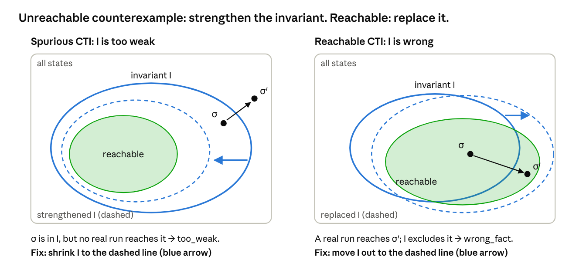
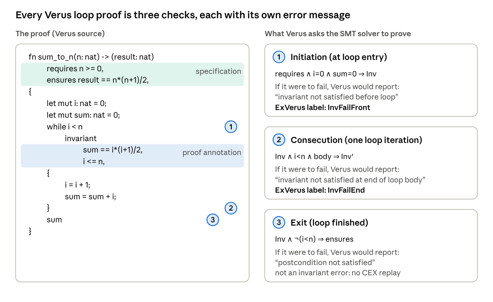
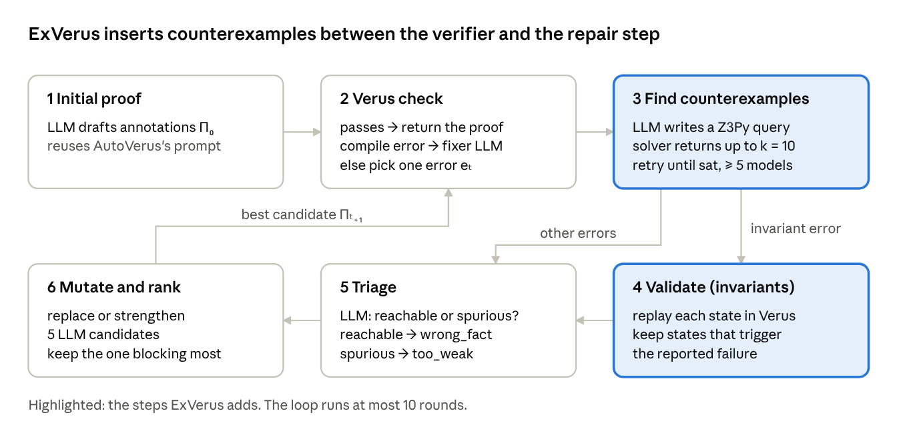
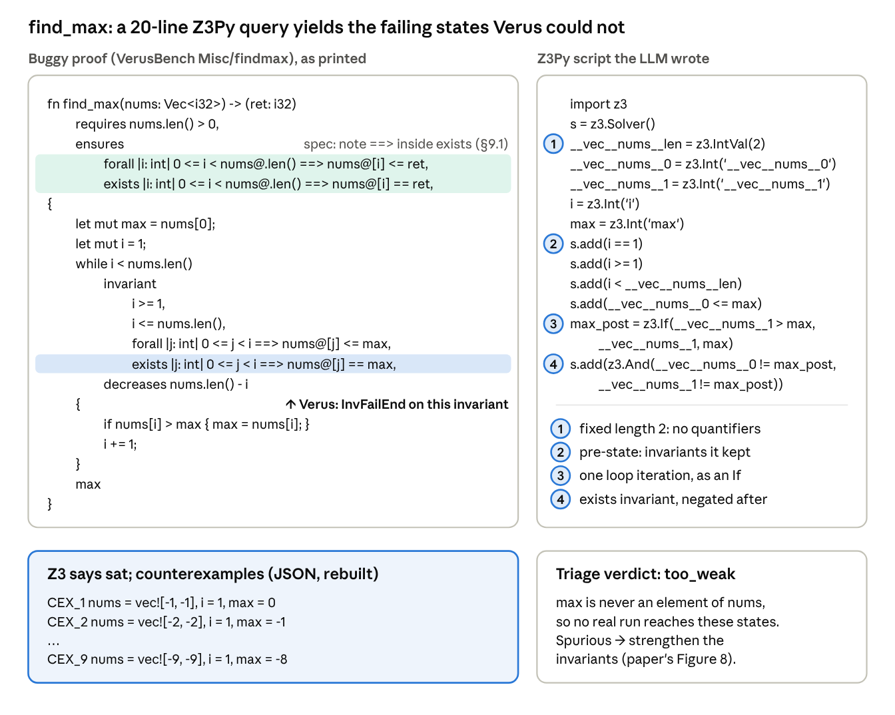
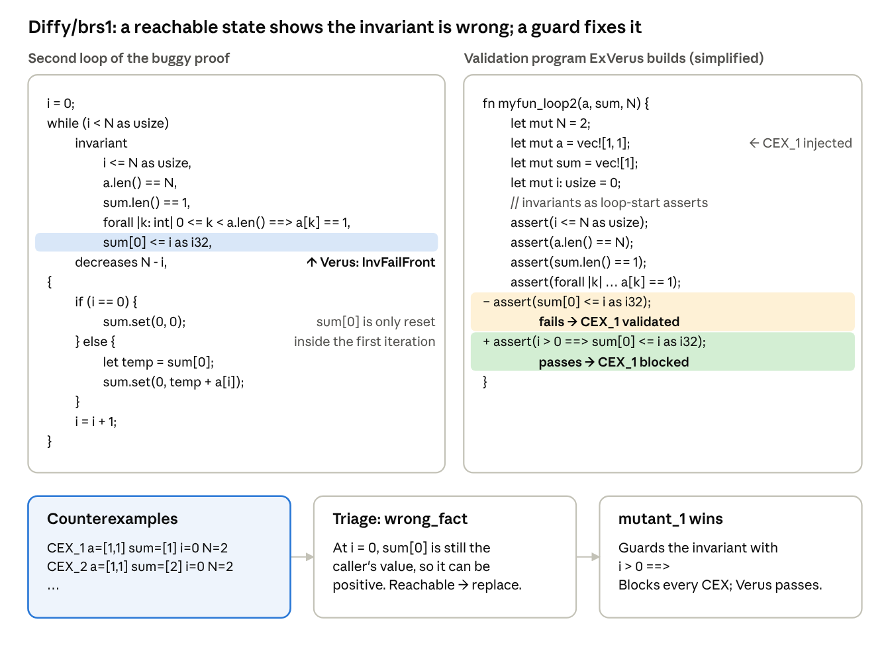
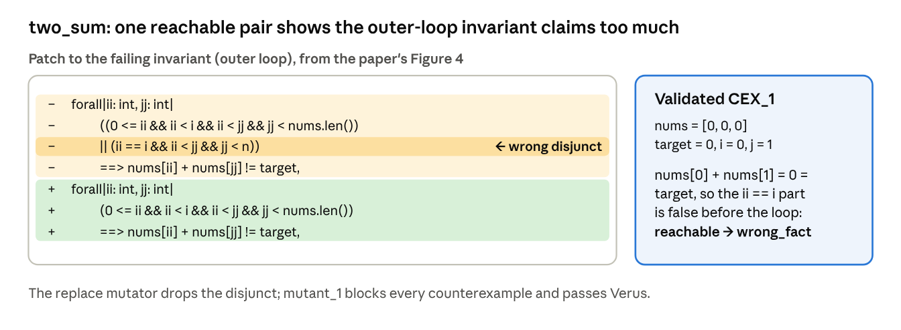
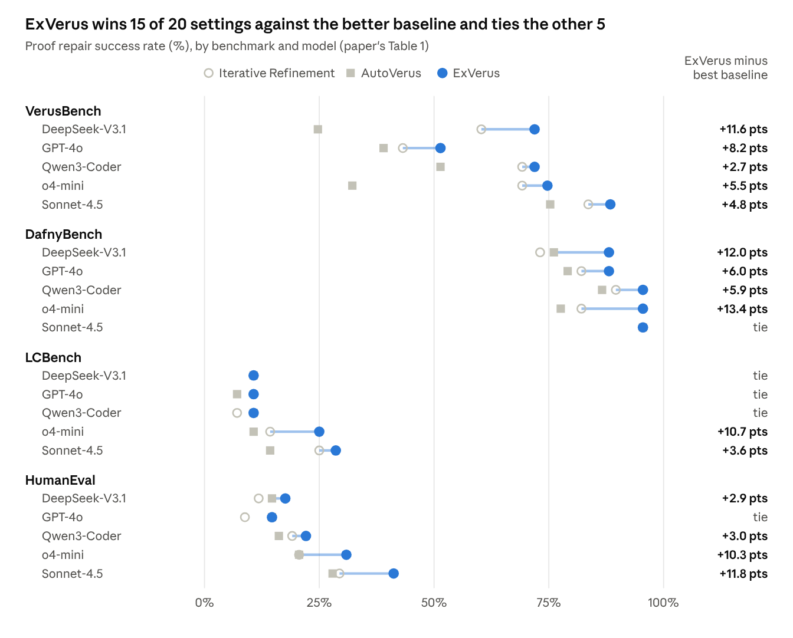

## 1. About this tutorial

ExVerus repairs failing Verus proofs. When a proof fails, it has an LLM write a small Z3 script that produces concrete states breaking the proof. It checks those states, then edits the proof until it rules them out.

*Paper: [ExVerus: Verus Proof Repair via Counterexample Reasoning](https://arxiv.org/abs/2603.25810) by Yang, Sun, Wu, Caridad, Yuan, Yao, Lu and Pei, arXiv 2603.25810, 2026.*

### 1.1 Who this is written for

This assumes only that you have written Z3 scripts and know what bounded model checking (CBMC-style) does. Everything else the paper relies on is taught in Section 3, and only as much as the paper needs.

### 1.2 The main idea in context

**In one line:** ExVerus brings counterexample-guided repair, the core loop of IC3 in model checking (Section 3.4), to LLM proof generation for Verus, where the verifier cannot supply readable counterexamples itself. In Verus the LLM generates the proof part (invariants and hints), and Z3 checks it.

**What already existed.**

- SMT solvers produce counterexamples in principle: when Z3 answers `sat`, it returns a model. Some tools show it to the user: Dafny's IDE has a counterexample feature, and Boogie had a verification debugger.
- Verus had an experimental counterexample feature, but its developers dropped it because the values misled users (the paper's Appendix F).

**Why those counterexamples were unusable for Verus.**

- Models describe Verus's internal encoding, not the Rust variables: values like `Poly!val!31` and SSA snapshots that cannot be mapped back to the code.

**What ExVerus adds.**

1. **Makes counterexamples usable** (Section 6.2). The LLM writes a small Z3 query over the source variables, with fixed sizes and no quantifiers, so Z3 returns readable states like `nums = [-1, -1], max = 0`.
2. **Checks them** (Section 6.3). For invariant errors, each state is replayed through Verus to confirm it really triggers the failure.
3. **Uses them to repair** (Sections 6.4 and 6.5). Whether a state is reachable or spurious decides between replacing and strengthening the invariant, and candidate fixes are ranked by how many counterexamples they block.

## 2. The idea in one paragraph

LLM proof repair for Verus usually gets one coarse signal back from the verifier, such as "invariant not satisfied at end of loop body". ExVerus adds a concrete witness: a small set of variable values under which the failing check breaks. Verus's own SMT models are unreadable, so ExVerus skips them. Instead, the LLM writes a small Z3Py query over the source-level variables, solves it, and gets back states like `nums = [-1, -1], i = 1, max = 0`. For loop invariants, those states are replayed through Verus to confirm they really trigger the failure. An LLM then decides whether the states are reachable (so the invariant is **wrong** and must be replaced) or spurious (so the invariant is **too weak** and must be strengthened). It generates candidate edits and keeps the one that blocks the most counterexamples.

### 2.1 Where the idea comes from

The loop is borrowed from model checking (the IC3/PDR algorithm): find a state that breaks the proof, decide whether a real run can reach it, then fix the proof so it no longer allows that state. ExVerus puts an LLM into each of those steps. Section 3.4 explains just enough of IC3 to follow the paper.

## 3. Background: Verus in ten minutes

The paper assumes three pieces of background: Hoare logic for loops, how Verus writes it, and one idea from model checking. Each is covered below at the depth the paper needs and no further.

### 3.1 Hoare logic: only the part this paper uses

The paper uses one idea from Hoare logic: a loop is proved correct with a **loop invariant**, and that proof splits into three implications an SMT solver can check.

**Triples.** A Hoare triple {P} C {Q} says: if code C starts in a state where P holds, Q holds when it finishes. P is the *precondition* and Q the *postcondition*. In Verus, P is written `requires` and Q is written `ensures`.

**Loops need an invariant.** A loop can run any number of times, so it cannot be checked one iteration at a time. Instead you write a **loop invariant** I: a fact that must be true every time the loop is about to test its condition. If I passes three checks, the loop is correct.

*Table 1: The three checks for a loop `while g { body }` with invariant I*

| # | Check | In words | Verus error if it fails |
| --- | --- | --- | --- |
| 1 | Initiation: pre ⇒ I | I holds when the loop is first reached | "invariant not satisfied before loop" |
| 2 | Preservation: I ∧ g ∧ one run of body ⇒ I′ | If I holds and the loop runs once more, I holds again (I′ = I in the new state) | "invariant not satisfied at end of loop body" |
| 3 | Exit: I ∧ ¬g ⇒ post | When the loop stops, I gives the postcondition | "postcondition not satisfied" |

An invariant that passes check 2 is called **inductive**: it carries itself through one iteration.

**True on every real run is not the same as inductive.** An invariant can hold on every run of the program and still fail check 2. Being true for all real runs does not mean the induction step goes through. The reason: check 2 is asked about *every* state that satisfies I, including states no real run ever reaches. A tiny example, reused in Section 3.4:

- The program sets `x = 0`, then loops forever doing `x = x + 2`. The invariant is that x is never 5.
- The invariant I = "x ≠ 5" is true on every real run, since x is always even (as x starts from 0).
- But check 2 fails. The state x = 3 satisfies I, and one step later x = 5. No real run reaches x = 3, but I does not rule it out, and the solver only knows I.
- The fix is to **strengthen** I by adding a conjunct: I = "x ≠ 5 and x % 2 == 0". Strengthening means exactly this, adding facts with "and". Now x = 3 is excluded and check 2 passes. (Since an even x is never 5, this is the same as just "x is even".)

**Note: what strengthening actually does.** Strengthening I shrinks the set of **states** it allows, moving it toward the **states** the program actually reaches. Two clarifications:

- **Close enough, not exact.** Every working invariant sits between two sets: reachable program states ⊆ I ⊆ states where the property holds. Cut out a reachable state and I becomes false (the "wrong" case below). The reachable set itself always works but is often hard to write down, so in practice you strengthen only until no state I allows can step outside I. In the x example, the reachable states are 0, 2, 4, …. The strengthened I = "x ≠ 5 and x % 2 == 0" also allows −2, −4 and other even numbers no run produces. That is fine: from any even x the next x is even too, so none of these extra states can leave I.

**Two reasons a check can fail.** This split runs through the whole paper:

- **I is wrong:** it is false on some state a real run reaches. Fix: *replace* it with a correct fact. ExVerus calls this `wrong_fact`.
- **I is true but too weak:** it holds on real runs, but it also allows unreachable states that break check 2. Fix: *strengthen* it, adding facts that exclude those states. ExVerus calls this `too_weak`.

*Figure 1: The two kinds of counterexample and their fixes. The black arrow is one iteration of the loop. σ′ is the counterexample: the state where the invariant fails. σ is the state one iteration before it, which satisfies I, as it existed before that iteration ran. \
Left: no real run reaches σ, so shrink I (strengthen). \\
Right: a real run reaches σ′, so move I out to cover it (replace).*

Verus prints the same error in both cases. Telling them apart is what ExVerus's counterexamples are for.

**How the solver does each check.** Each check is an implication A ⇒ C. Z3 proves it by searching for a state where A ∧ ¬C holds. If there is none (`unsat`), the check passes. If there is one (`sat`), that state is a **counterexample**: concrete values that make the check fail. Definition 2.1 in Section 5 is exactly this.

### 3.2 How Verus writes these

*Table 2: Verus annotations and their Hoare-logic counterparts*

| Annotation | Role | In Section 3.1 terms |
| --- | --- | --- |
| `requires` / `ensures` | Pre- and postcondition: the specification, the thing being proved | P and Q of the triple |
| `invariant` | Loop invariant | I, subject to the three checks |
| `decreases` | Termination measure | Not used in this paper |
| `assert`, `proof { }` blocks, lemma calls | Hints that help Z3 finish a check | Intermediate steps, like lines in a pen-and-paper proof |

The paper calls all of this together — code, spec and annotations — "the proof". In ExVerus the **spec is fixed**; only the annotations are generated and repaired.

### 3.3 One loop, three checks: the sum\_to\_n example

*Figure 2: sum\_to\_n from the paper's §2.1, and the three checks Verus generates for its loop.*

Each loop produces the three obligations above, and each failure has its own Verus message. ExVerus's counterexample replay (Section 6.3) works only for checks 1 and 2, the two invariant errors.

### 3.4 One idea from model checking: IC3/PDR

You do not need the IC3 algorithm to read this paper. You need the loop it is built on, which ExVerus copies, and three terms the paper uses.

**What IC3/PDR is.** IC3 (Bradley, 2011), also published as PDR ("Property-Directed Reachability"), is a model-checking algorithm. Unlike BMC, which checks only the first k steps, it proves a property for *all* steps. It does this by building an inductive invariant (Section 3.1) one fix at a time.

**The loop, on the x example from Section 3.1:**

1. **Find a state that breaks check 2.** Ask the solver for a state that satisfies the current invariant but leaves it after one step. This is a **counterexample to induction (CTI)**. Here: x = 3, which steps to 5.
2. **Ask whether a real run can reach it.** x = 3 cannot be reached, since x is always even.
3. **Unreachable ("spurious") → strengthen.** Add a fact that excludes this state and others like it. Here: "x is even". This step is called **blocking** the CTI.
4. **Reachable → something is really wrong.** In IC3, that means a real bug. In ExVerus, where the code and spec are taken as correct, it means the invariant is false and must be replaced.
5. **Repeat** until no CTI exists. The invariant is then inductive, and the proof goes through.

Figure 1 (Section 3.1) is the picture to keep in mind for the rest of the paper. Every counterexample ExVerus finds lands in one of its two panels, and its "triage" step (Section 6.4) decides which.

*Table 3: What ExVerus borrows from IC3, and what it changes*

| IC3 / PDR | ExVerus |
| --- | --- |
| The solver finds a CTI from the real verification formula | Z3 finds counterexamples from a query the LLM writes (Section 6.2) |
| The solver decides whether the CTI is reachable | An LLM decides: "reachable" or "spurious" (Section 6.4) |
| Unreachable → add a blocking fact (strengthen) | `too_weak` → strengthen mutator |
| Reachable → real bug, or the property is wrong | `wrong_fact` → replace mutator |
| Generalize one state into a blocking fact by a fixed rule | The LLM generalizes from about 10 counterexamples at once |

The paper cites PDR as its inspiration for using several counterexamples at once. The main difference: in IC3 every step is a solver query, so its answers are exact. In ExVerus, two steps (writing the query, judging reachability) are done by an LLM and can be wrong. Section 9 returns to this.

### 3.5 Two Verus details the paper relies on

1. **Loop isolation.** By default, a Verus loop body sees only the loop invariants, not the function's `requires`. A fact you need inside the loop, such as `nums.len() > 0`, must be restated as an invariant.
2. **Quantifiers and triggers.** Invariants about arrays use `forall` and `exists`. Z3 handles these by pattern-based instantiation, which is incomplete. So Verus queries often return `unknown` rather than `sat` with a usable model. This is the root problem the paper works around (Section 4).

## 4. Why counterexamples, and why Verus cannot give usable ones

A Verus error names the check that failed, not the reason. Getting a concrete failing state from Verus's own solver run is practically impossible, so ExVerus produces one another way.

### 4.1 Error messages are too coarse

"Invariant not satisfied at end of loop body" does not say whether the invariant is false on real runs or true but too weak to carry itself through an iteration. Those two cases need opposite fixes: rewrite it, or add more invariants.

Prior LLM tools fill the gap with hand-built knowledge, which is costly and brittle:

- **AutoVerus** uses about ten repair agents, each with prompts written for one error type. One example from the paper: if a failing assertion contains `.filter(`, the prompt says to add `reveal(Seq::filter);`. These prompts were tuned to one Verus version. On the newer toolchain, the authors measured AutoVerus dropping from 75.3% to 52.7% on VerusBench with GPT-4o.
- **SAFE** fine-tunes a model on synthetic proofs. The paper cites about a month of continuous GPT-4o calls plus rejection sampling to build the data.

### 4.2 Why not just ask Z3 for a model?

In CBMC you get a trace for free: after unrolling, the formula is quantifier-free, and a SAT model maps straight back to program variables. Verus differs in two ways that break this.

1. **Lossy lowering.** Before building VCs, Verus resolves ownership, borrowing and lifetimes. It encodes `Vec<T>` and ghost state into a generic `Poly` sort and adds SSA snapshot variables. A model is an assignment to these lowered symbols, and mapping it back to source variables means recovering structure that is no longer there.
2. **Quantifiers.** Array invariants are `forall`/`exists` formulas. Z3's instantiation heuristics are incomplete on these, so large queries often come back `unknown` or time out. Even a returned model can be partial.

### 4.3 What this looks like on one small function

The paper's running example is `find_max` from VerusBench (traced in Section 7.1).

*Table 4: Verus's own counterexample route vs. ExVerus's, on find\_max*

|  | Verus's own SMT route | ExVerus's route |
| --- | --- | --- |
| Query size | 7,083 lines of SMT-LIB, compiled from the proof | About 20 lines of Z3Py, written by the LLM |
| Solver answer | `unknown`, reason "incomplete quantifiers", plus a 3,130-line log | `sat`, with up to 10 distinct models |
| What a model says | `i = 537`, `nums.len = 1681`, most elements unconstrained, one element is an opaque `Poly!val!31` set to -2147474703 | `nums = vec![-1, -1], i = 1, max = 0` |
| Tool support | Verus's debugger: "assignments are unsupported in debugger mode" | JSON output, replayable through Verus |

The Verus developers have dropped counterexample support because the values misled users (the paper's Appendix F). That is the gap ExVerus fills.

### 4.4 The key move

ExVerus does not decompile Verus's VCs. It asks the LLM to write a *new*, small query: only the failing obligation and the annotations it depends on, written over the original variable names. Quantifiers are removed by fixing sizes, for example by assuming the array has exactly 2 elements. The query is no longer sound with respect to the real VC. But because the answer is a concrete state, it can be checked afterwards (Section 6.3).

## 5. Problem formulation: counterexamples and iterative blocking

The paper frames repair as a loop: at step t, pick one verification error, find states that witness it, and edit the proof so those states no longer witness it.

### 5.1 Setup

The input is a program P with a fixed specification Φ = (pre, post). The output is a proof Π, the set of annotations (invariants, assertions, lemmas) that makes P verify. At step t the current proof Πₜ has one targeted error eₜ, which comes from a failing obligation of the form Aₜ ⇒ Cₜ (antecedent ⇒ consequent).

### 5.2 Definition 2.1: counterexample

A counterexample is a concrete program state σ under which the failing obligation is false:

$$
\sigma \models A_t(\sigma) \land \lnot C_t(\sigma)
$$

**In plain English:** σ is one concrete set of values for the program's variables that makes the check's "if" part true and its "then" part false. In other words, a concrete example where the check breaks.

- **σ:** one concrete state, e.g. x = 3
- **⊨:** "makes true"
- **Aₜ:** the "if" part of the failing check
- **¬Cₜ:** the "then" part is false

In the x example from Section 3.1, the check is "if x ≠ 5 holds and the loop runs once more, then x ≠ 5 still holds". The state x = 3 makes the "if" part true, but afterwards x = 5, so the "then" part is false. So x = 3 is a counterexample.

ExVerus usually finds several such states at once. The paper calls this set Σₜ = {σ₁, …, σₖ}.

### 5.3 Definition 2.2: iterative blocking

The next proof Πₜ₊₁ is a valid refinement if none of the counterexamples still witnesses the failure:

$$
\forall \sigma \in \Sigma_t .\; \sigma \not\models A_{t+1}(\sigma) \land \lnot C_{t+1}(\sigma)
$$

**In plain English:** after the fix, none of the old counterexamples breaks the check any more. The paper calls this **blocking** the counterexamples.

- **∀σ ∈ Σₜ:** "for every counterexample found at step t"
- **⊭:** "does NOT make true"
- **Aₜ₊₁ ∧ ¬Cₜ₊₁:** "the check fails", now using the fixed proof (step t+1)

In the x example, Σₜ = {x = 3}. With the fixed invariant "x ≠ 5 and x % 2 == 0", x = 3 no longer satisfies the invariant. So the "if" part is false, and the check cannot fail there.

The loop ends when Verus reports no errors.

### 5.4 Two ways to block, matching the two repair modes

A state can stop being a counterexample in two ways, and these are exactly ExVerus's two mutators.

*Table 5: The two ways to block a counterexample*

| Way to block σ | What changes | ExVerus mutator | When it is right |
| --- | --- | --- | --- |
| Make the antecedent false at σ | Add or tighten invariants so σ no longer satisfies them at loop start | Strengthen | σ is spurious (unreachable): the invariants were too weak to exclude it |
| Make the consequent true at σ | Rewrite the failing invariant so it holds at σ | Replace | σ is reachable: the invariant is simply false on a real run |

Blocking is necessary but not sufficient. An edit can block every σ in Σₜ and still fail: a strengthened invariant can break initiation, and a weakened one can stop proving the postcondition. That is why Verus, not the counterexample count, makes the final call each round.

## 6. The ExVerus pipeline

ExVerus is a repair loop of six steps. Steps 3 and 4 are its contribution; the rest is a standard LLM repair loop.

*Figure 3: The ExVerus repair loop, redrawn from the paper's Figure 2 and Algorithms 1–3.*

Each round fixes one targeted error. A round ends early if any candidate already passes Verus.

### 6.1 Steps 1–2: initial proof and Verus check

The first draft uses AutoVerus's phase-1 prompt unchanged, so any gain comes from the repair stage. Compile errors such as syntax or type mismatches go to a separate fixer prompt, since steps 3–6 only handle verification errors. If several errors appear, ExVerus picks one and works on it.

### 6.2 Step 3: counterexample generation

The LLM receives the buggy proof and the targeted error, and writes a Z3Py script. The prompt (Appendix I.1) is long, and its rules are where most of the engineering lives.

*Table 6: Rules in the counterexample-query prompt (the paper's Appendix I.1)*

| Prompt rule | What it achieves |
| --- | --- |
| Translate the invariants or assertions of the failing loop faithfully; do not add facts from outside it | Mirrors Verus's loop isolation, so the query sees only what Verus sees |
| Name vector elements `__vec__nums__0`, `__vec__nums__1`, …, with optional `__vec__nums__len` | The tool can rebuild `nums = vec![…]` from the model |
| Use small concrete sizes (e.g. length 2) and avoid quantifiers | Keeps the query decidable and fast |
| Constrain machine integers to their ranges (i32: −2³¹ to 2³¹−1); do not model wraparound | Values stay realistic for the Rust type |
| "Prefer SAT over faithfulness when ambiguous" | Getting some state beats getting `unknown` |
| Enumerate up to k distinct models by adding a blocking clause after each | Several states make the shared pattern visible |
| Write results to `__z3_cex_status__` and `__z3_cex_results__` as JSON | Machine-readable output |

Algorithm 2 wraps this in a retry loop. If the status is not `sat`, or fewer than k/2 models survive a basic sanity check, the result goes back to the LLM and it tries again, up to a cap.

Read that table with one caveat in mind. Bounded sizes, "prefer SAT over faithfulness" and no wraparound all make the query a guess about the real VC, not an encoding of it. This is why step 4 exists.

### 6.3 Step 4: counterexample validation (invariant errors only)

This step involves no LLM. ExVerus turns each counterexample into a small Verus program and checks whether it really causes the reported failure:

1. **Loop extraction.** Copy the failing loop into a standalone function `loop_func`.
2. **Invariant translation.** Turn every invariant into an `assert` at the top of the body (*loop-start*) and at the bottom (*loop-end*), mimicking one iteration.
3. **Counterexample injection.** Assign the counterexample's values at the start of the function, e.g. `let mut nums = vec![0, 0, 0];`.

The expected symptom depends on the error type:

*Table 7: When a replayed counterexample counts as validated*

| Error | The counterexample is kept if… | Meaning |
| --- | --- | --- |
| `InvFailFront` | the loop-start assertion for that invariant fails | A concrete entry state violates the invariant |
| `InvFailEnd` | all loop-start assertions pass, but the loop-end one fails | A concrete CTI: the invariants hold, one step later they don't |

For assertion and postcondition errors there is no such harness, so their counterexamples are passed on unchecked. The authors argue they still help as structured reasoning.

### 6.4 Step 5: error triage

An LLM reads the proof, the counterexamples and the Verus output, and returns a verdict and a short rationale. The question is the IC3 one: can these states occur on a real run starting from a valid input?

- **Reachable** → `wrong_fact`. The invariant is false on real executions and must be replaced or relaxed.
- **Spurious** → `too_weak`. The invariant may be true, but the invariants together do not rule out this impossible state. They must be strengthened.

The solver plays no part in this judgment; reachability is decided by the LLM.

### 6.5 Step 6: mutation and ranking

The verdict selects a mutator. The **strengthen** mutator adds invariants or assertions, for a too-weak invariant or a missing assertion. The **replace** mutator rewrites an invariant or assertion that is false on reachable states. Each prompt includes the counterexamples, the triage rationale and a few repair examples, and asks for 5 candidates.

Candidates are ranked as follows:

1. Drop candidates that do not compile; return the first one that passes Verus.
2. For invariant errors, score each candidate by how many validated counterexamples it **blocks**. Blocked means that, replayed under the new invariant, the state no longer triggers the failure.
3. For other errors, score by the number of verified sub-goals Verus reports, as AutoVerus does.

The top candidate becomes Πₜ₊₁.

## 7. Worked examples from the paper

This section walks through three of the paper's examples, covering both triage verdicts. In the two worked repairs (7.2 and 7.3), AutoVerus failed and ExVerus succeeded.

*Table 8: The three examples covered in this section*

| # | Task | Error | Verdict | Fix |
| --- | --- | --- | --- | --- |
| 7.1 | `find_max` (VerusBench) | `InvFailEnd` | too\_weak (spurious states) | Strengthen (final fix not shown) |
| 7.2 | Diffy/brs1 (VerusBench) | `InvFailFront` | wrong\_fact (reachable) | Guard the invariant with `i > 0 ==>` |
| 7.3 | CloverBench two\_sum (ObfsBench) | `InvFailFront` | wrong\_fact (reachable) | Drop a wrong disjunct |

### 7.1 find\_max: the motivating example

#### 7.1.1 Motivating Example

The function returns the maximum of a non-empty vector. Verus reports that the `exists` invariant is not preserved by one iteration (`InvFailEnd`). Verus's own SMT query is 7,083 lines and returns `unknown`. ExVerus's query is the one below.

*Figure 4: The motivating example, find\_max: buggy proof, the Z3Py query the LLM wrote, the counterexamples and the triage verdict (redrawn from the paper's Figures 1 and 8).*

**Reading the LLM-generated Z3 script.** It fixes the vector at two elements, so no quantifier is needed.

1. It assumes the invariants it kept at loop start, with `i = 1`
2. It runs one iteration as an `If` on `max`
3. It then asks for a state where `max_post` equals neither element, i.e. the `exists` invariant fails afterwards
4. Each model found is blocked so the next one is new, giving CEX₁ to CEX₉.

**Reading the triage.** Every state has `max` greater than both elements, which no real run produces, since `max` starts as `nums[0]`. So the states are spurious and the verdict is `too_weak`. In IC3 terms: unreachable CTIs, so strengthen. The paper does not show the final repaired proof for this task (see `7.1.2`  for the solution).

#### 7.1.2 Key idea: the quantifier ranges over every integer

The bug in this example is easy to miss unless you know one fact about how Verus reads quantifiers.

**The fact.** In `forall |j: int| …` and `exists |j: int| …`, j ranges over **all** integers. The `|j: int|` part only names the variable and its type. The range condition `0 <= j < i` is not a limit on j. It is part of the formula (i.e. the *body*), next to the property P.

*Table 9: Terms used in this subsection*

| Term | Meaning |
| --- | --- |
| j | The quantified variable: any integer (negative, in range, or past the end) |
| range | The condition `0 <= j < i`: j is a valid index among the first i elements of `nums` |
| P | The property at index j: `nums@[j] <= max` in the `forall` line, `nums@[j] == max` in the `exists` line |
| body | The formula after the variable declaration, which combines range and P with `==>` or `&&` |
| `range ==> P` | "If j is in range, then P holds at j." True whenever j is out of range, whatever P says |
| `range && P` | "j is in range and P holds at j." False whenever j is out of range |
| `forall` | True only if the body is true for every integer j |
| `exists` | True if the body is true for at least one integer j |
| witness | For an `exists`: a particular j that makes the body true |
| in-range j | 0 ≤ j < i, e.g. 0, 1, …, i−1 |
| out-of-range j | Any other integer, e.g. −1, i, i+1, … |

**Where the rule comes from.** In maths we often write the range on the quantifier, as in ∀ j ∈ \[0, i). P. Verus has no place for that, so the range moves into the body, and the connective decides what it means.

*Table 10: The four ways to combine a quantifier with a range*

| Quantifier | Body | Out-of-range j | In-range j | Whole statement | OK? |
| --- | --- | --- | --- | --- | --- |
| `forall` | `range ==> P` | Body is true: these j impose no condition (✓, we don't care about them) | Body = P: P must hold at each one | P holds at every index in range | ✓ |
| `forall` | `range && P` | Body is false: one such j makes the whole `forall` false (✗) | Body = P (fine) | Always false | ✗ |
| `exists` | `range && P` | Body is false: they cannot be the witness (✓) | Body = P: the witness must be a real index with P | Some index in range has P | ✓ |
| `exists` | `range ==> P` | Body is true: any such j is a witness on its own (✗) | Never needed | Always true | ✗ |

The rule: **`forall` goes with `==>`, `exists` goes with `&&`.**

**The two invariants of find\_max, checked one value of j at a time.** Take a state no real run can produce: i = 2, `nums = [3, 5]`, `max = 7`. The value 7 is not in the array.

*Table 11: Each invariant line evaluated at every j (i = 2, nums = \[3, 5\], max = 7)*

| j | In range? | `forall` line: `range ==> nums[j] <= 7` | `exists` line as printed: `range ==> nums[j] == 7` | `exists` line fixed: `range && nums[j] == 7` |
| --- | --- | --- | --- | --- |
| −1 | no | true | **true** | false (j is out-of-range) |
| 0 | yes | true (3 ≤ 7) | false (3 ≠ 7) | false (3 ≠ 7) |
| 1 | yes | true (5 ≤ 7) | false (5 ≠ 7) | false (3 ≠ 7) |
| 2 | no | true | **true** | false (j is out-of-range) |
| **Whole line** |  | **true**: every j passes | **true**: j = −1 is a witness | **false**: no j works |

Reading the table:

- **The `forall` line is right.** It only claims max is at least every element seen so far, and 7 is.
- **The  `exists` line accepts max = 7.** It is trivially true for every value of max. This is the bug (row 4 of Table 10).
- **The fixed `exists` line rejects max = 7.** It requires max to be one of the elements seen so far.

**What this means for the paper's example.** CEX₁ (`nums = [-1, -1]`, `i = 1`, `max = 0`) is the same situation: it satisfies every invariant as printed, because the `exists` line constrains nothing. So the invariants really are too weak, and the triage verdict `too_weak` is right. The fix is to change `==>` to `&&` in the `exists` invariant, which is a strengthening.

**Note:** The invariants hold true here in the loop - so there is no "counterexample to induction" found -- its just that, the underlying backend ("Z3") cannot prove this invariant is preserved so it gives up and raises an error message saying that it cannot find a proof or counterexample.

#### 7.1.3 What does Verus Check?

*Table 12: What Verus reports for each answer from Z3*

| Z3's answer | Meaning | What Verus reports |
| --- | --- | --- |
| `unsat` | Proof found: no state can break the check | Verified ✓ |
| `sat` | A real counterexample exists | Error |
| `unknown` | Z3 gave up: no proof and no counterexample | **Error, with the same message** |

Verus is sound but incomplete: it never accepts a false invariant, but it can reject a true one. For find\_max, the paper's Figure 1 shows Z3 answering `unknown` with the reason "(incomplete quantifiers)". So "invariant not satisfied at end of loop body" here means "could not prove it", not "found a state that breaks it".

### 7.2 Diffy/brs1: a wrong invariant, found and guarded

The function's first loop fills `a` with ones; the second sums them into `sum[0]`. The proof's invariant `sum[0] <= i as i32` is needed for the postcondition `sum[0] <= N`, but it fails at loop entry (`InvFailFront`). On entry, `sum[0]` still holds whatever the caller passed in. It is reset to 0 only inside the first iteration.

*Figure 5: Diffy/brs1 from VerusBench: the failing loop, the validation program, and the guarded fix (redrawn from the paper's Figure 3).*

How each stage contributes:

1. **Generation.** The Z3Py query returns entry states with `i = 0` and `sum[0]` positive.
2. **Validation.** Injected into the harness, CEX₁ makes the loop-start assert for that invariant fail, which is the `InvFailFront` symptom. So it is kept.
3. **Triage.** The precondition only fixes `sum.len() == 1`, so a positive `sum[0]` at entry is reachable. Verdict: `wrong_fact`, use the replace mutator.
4. **Mutation and ranking.** The mutator sees the shared pattern (`i = 0`, `sum[0] > 0`) and proposes guarded variants. `mutant_1`, `i > 0 ==> sum[0] <= i as i32`, makes the loop-start assert pass on every counterexample and then passes Verus.

For contrast, AutoVerus failed this task. It spent 15 generation attempts, 4 refinement attempts and 21 debugging attempts, 16 of them on this same "invariant not satisfied before loop" message.

Note what the guard does logically: it weakens the invariant just enough to exclude the first state, while keeping it for every later iteration. That edit is easy to make once you see `i = 0, sum = [1]`, and hard to guess from the error message alone.

### 7.3 two\_sum: dropping a wrong disjunct

The function finds indices `(i, j)` with `nums[i] + nums[j] == target`, using an outer loop on `i` and an inner loop on `j`. The outer invariant says no pair checked so far sums to `target`. But its second disjunct also covers *every* pair starting at index `i`, up to `n`. That part is false at loop entry whenever `nums[0] + nums[1]` already equals `target`.

*Figure 6: CloverBench two\_sum from ObfsBench: the patch that drops the wrong disjunct, and the counterexample behind it (redrawn from the paper's Figure 4).*

The paper's own postcondition bounds the same disjunct by `jj < r.1`, the returned `j`. So the bug looks like an inner-loop fact (`jj < j`) written with the outer bound `n`. ExVerus's fix removes the disjunct instead of correcting the bound, and that is enough for the outer loop. AutoVerus failed this task after 40 attempts, 14 of them on assertion failures.

## 8. Evaluation: what the numbers say

ExVerus never does worse than the better of the two baselines, and it does better in 15 of 20 settings. The gains are at most 13.4 points. On the two hard benchmarks, LCBench and HumanEval, success stays at 41% or below.

### 8.1 Setup

*Table 13: Benchmarks used in the evaluation*

| Benchmark | Tasks | What it is |
| --- | --- | --- |
| VerusBench | 146 (of 150; 4 no longer verify on current Verus) | AutoVerus's suite: MBPP, CloverBench, Diffy and Verus tutorial examples |
| DafnyBench (Dafny2Verus) | 67 | DafnyBench tasks translated to Verus, filtered by an LLM judge for trivial specs |
| LCBench (Leetcode-Verus) | 28 | Expert-written LeetCode proofs, about 200 lines each |
| HumanEval-Verus | 68 | Hand-written Verus versions of HumanEval tasks |
| ObfsBench (new) | 266 | VerusBench tasks rewritten by six obfuscation strategies |
| InvariantInjectBench (new) | 187 | Correct proofs with one invariant broken on purpose |

The models are DeepSeek-V3.1, GPT-4o, Qwen3-Coder (480B), o4-mini and Claude Sonnet 4.5. The baselines are AutoVerus and "Iterative Refinement", a plain loop that feeds Verus's error back to the LLM.

### 8.2 Main result

*Figure 7: Repair success rate by benchmark and model (source: the paper's Table 1; temperature 1.0, 10 repair rounds).*

The paper headlines this as "38% more tasks on average, 2× on harder benchmarks". Those are relative gains. On the small benchmarks they rest on a few tasks: on LCBench (28 tasks), o4-mini's 14.3% → 25.0% is 4 tasks → 7 tasks.

### 8.3 Cost

*Table 14: Cost per task (from the paper's Table 3)*

| Model | Method | Tokens in / out (K) | Cost per task | Time per task |
| --- | --- | --- | --- | --- |
| DeepSeek-V3.1 | AutoVerus | 422.7 / 50.6 | $0.17 | 2,989 s |
| DeepSeek-V3.1 | ExVerus | 93.8 / 14.8 | $0.04 | 720 s |
| GPT-4o | AutoVerus | 92.3 / 46.2 | $0.69 | 234 s |
| GPT-4o | ExVerus | 83.1 / 21.0 | $0.42 | 250 s |

The "4× cheaper, 4× faster" headline is the DeepSeek row. With GPT-4o, ExVerus is 39% cheaper and slightly slower.

### 8.4 Ablations and sensitivity

- **Mutation and validation matter.** ExVerus\_no\_mut gets the counterexamples but repairs directly, with expert repair knowledge written into the prompt. The full system beats it in most settings; the largest gap is on ObfsBench with DeepSeek, 65.4% → 81.6%.
- **More counterexamples help, a little.** On InvariantInjectBench with one repair attempt, 10 counterexamples solve 106 of 187 tasks, against 100 with a single counterexample.
- **Blocking predicts success.** Mutants that block at least one counterexample verify 64.5% of the time, against 38.6% for mutants that block none. This is the evidence behind ranking by blocked counterexamples.
- **The two tools are complementary.** Across all benchmarks ExVerus alone solves 101 tasks and AutoVerus alone 26. ExVerus's edge is on invariant-heavy tasks (63 unique tasks needing many invariants, against 4). AutoVerus is better on tasks that need asserts or proof blocks (on VerusBench, 39.4% vs. 18.2% with asserts), where its hand-tuned prompts apply.

## 9. Reading it critically

The idea is sound and cheap: CEGAR/IC3-style blocking, with an LLM supplying the counterexamples and the generalization. The weak points are that nothing checks the counterexample query against the real VC, that reachability is judged by an LLM, and some reporting gaps in the tables.

### 9.1 The motivating example's spec, as printed, is vacuous

The paper's Figure 1 prints both the ***postcondition*** and the invariant as `exists |i| 0 <= i < len ==> nums@[i] == ret`. With `==>` inside an `exists`, any out-of-range `i` (say `i = -1`) makes the body true. ***So this clause holds for every `ret` and constrains nothing. The intended form is `&&`.***

Two consequences, whether this is a slip in the figure or the real benchmark text:

- **The Z3 query does not follow the text.** For the post-state it encodes the `&&` meaning ("`max` equals some element"), and it drops the pre-state `exists` entirely. The LLM translated the meaning it guessed, and nothing in the pipeline compares the query with what Verus actually checks.
- **"Spurious" can be produced by the query itself.** Under the `&&` meaning with `i = 1`, the pre-state invariant would force `nums[0] == max`, and none of CEX₁–CEX₉ satisfy that. The states are unreachable partly because the query omitted an invariant, not only because the invariants are too weak.

It is worth checking the artifact's VerusBench `findmax` task. If the `==>` is really there, spec strength in the benchmark (a known problem the authors addressed only for Dafny2Verus) needs a second look.

### 9.3 Validation checks the symptom, not reachability

Replaying a state through `loop_func` confirms it is a genuine CTI for the current invariants. It does not tell you whether a real run can reach it, and that question decides which mutator runs. The answer comes from the LLM triage, and the paper reports no accuracy for it. A misjudged verdict sends the repair the wrong way: a wrong invariant gets strengthened instead of fixed, or a true one gets rewritten.

An IC3 implementation answers the same question with a relative-inductiveness check against the previous frame. A cheap partial check would be possible here too: run the program from valid inputs and see whether the state ever appears.

### 9.5 What "verified" guarantees here

The spec is fixed, so ExVerus cannot weaken the `ensures` to make a proof pass. The paper does not say whether the mutators are barred from escape hatches such as `assume(...)`, `admit()` or `#[verifier::external_body]`. A blocking-count ranker would not catch these by itself. Check the artifact before relying on the success rates.
