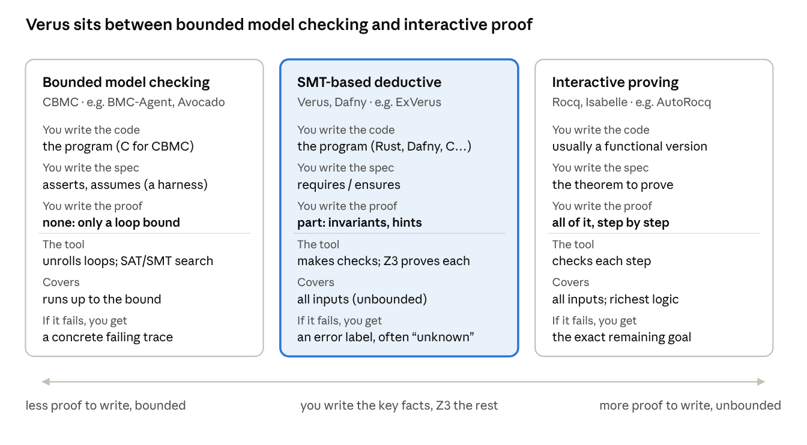
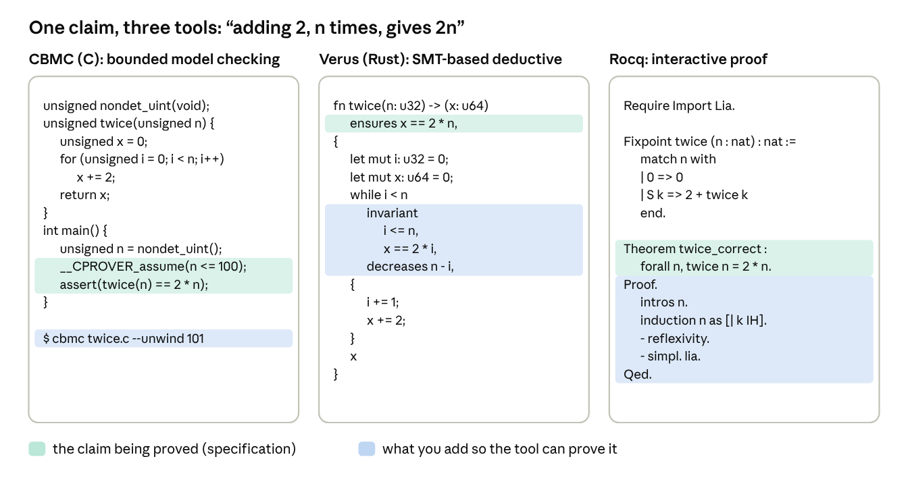

The three approaches differ in who writes the proof and how much the result covers. Bounded model checking needs no proof but covers only runs up to a bound. Rocq covers everything, but you write every step. Verus sits in between: you write the key facts (invariants), and Z3 works out the rest.

## 1. The spectrum

*Figure 1: Where SMT-based deductive verification sits between bounded model checking and interactive proving. Examples of agentic papers at each point: BMC-Agent and Avocado (CBMC), ExVerus (Verus), AutoRocq (Rocq).*

## 2. Hello world: one claim, three tools

The program starts at x = 0 and adds 2, n times. The claim: the result is 2n. All three versions below were run and pass (CBMC 5.95, Verus 0.2025.07.12, Rocq/Coq 8.18).

*Figure 2: The same claim proved with CBMC, Verus and Rocq. Green: the claim being proved. Blue: what you must add so the tool can prove it.*

*Table 1: What each version needs and what it proves*

| Tool | What you add beyond the code | What gets proved | How the tool gets there |
| --- | --- | --- | --- |
| CBMC | A bound on n and an unrolling limit (`--unwind 101`) | The claim for every n ≤ 100, and nothing beyond | Unrolls the loop 100 times and asks a SAT solver for a failing run |
| Verus | One loop invariant, `x == 2 * i`, plus `decreases` | The claim for every u32 value of n, with no bound: x is a u64, so 2n always fits | Generates three checks for the loop; Z3 proves each one. (1) Entry: at i = 0, x = 0, the invariant holds (0 == 2 · 0). (2) One iteration: if x == 2 · i and i < n, then after the body x + 2 == 2 · (i + 1). (3) Exit: when the loop stops, i = n, so x == 2 · n. |
| Rocq | A proof script: induction on n, then `lia` for the arithmetic | The claim for every natural number n | Checks each step you write; nothing is searched for you |

Three things to notice:

- **The bound plays a different role.** In CBMC the bound is essential: the tool can only unroll a fixed number of iterations. Verus needs no bound: the invariant works for any n, and making `x` a `u64` means 2n always fits (`2^64` at max). Rocq is valid for infinitely large values.
- **The invariant is the whole proof in Verus.** `x == 2 * i` is exactly the fact the Rocq proof establishes by induction. Verus asks you only for that fact and lets Z3 do the induction step for you.
- **Rocq usually proves a functional version.** The loop is written as a recursive function, which is standard in Rocq.

*Companion to [ExVerus: Counterexample-Guided Verus Proof Repair]().*
