## 1. How to use this tutorial

**AFix automatically fixes atomicity violations: bugs where two related accesses by one thread to a shared variable, such as a check and the use that relies on it, get split by another thread's access. Given a bug report, it puts a lock around exactly the code between the two accesses on every execution path, proves the added code cannot cause a double lock, an unlock without a lock or a new data race, and merges related fixes so they don't deadlock each other.** On eight real bugs it fully fixes six, adds under 1% overhead in seven, and needs at most one second of analysis per program.

Paper: Guoliang Jin, Linhai Song, Wei Zhang, Shan Lu and Ben Liblit, *Automated Atomicity-Violation Fixing*, PLDI 2011 (University of Wisconsin–Madison).

### 1.1 What you can skip

Most of the background comes from papers you've already worked through in this series. Shan Lu is an author here and on the ASPLOS'08 study, and the paper cites both that study and LOOM.

***Table 1:*** *Background this paper assumes, and where it was covered earlier in the series.*

| Concept | Where you saw it | What is new in AFix |
| --- | --- | --- |
| Atomicity violations, single-variable vs. multi-variable, "add a lock" as the usual fix | Lu et al., *Learning from Mistakes* (ASPLOS'08) | Nothing; the paper cites the study as the reason to target single-variable violations |
| Deadlocks, reentrant (counted) locks | Same post | Where a patch needs them, decided by static analysis (Section 6) |
| "Region X must be mutually exclusive with region Y" as a fix spec; Kivati | LOOM (OSDI'10) | AFix computes the region boundaries from the CFG; in LOOM the developer writes them in a filter |
| Active testing: predict a bad interleaving, then inject delays to force it | RaceFuzzer (PLDI'08); REINS, whose related work lists CTrigger | CTrigger's bug report: the three accesses that make up one bug, named p, c and r (Sections 1.2 and 3) |
| Lockset and happens-before detection | Eraser, RaceFuzzer | Context only |
| Deterministic execution | Stable multithreading | Related work only |

The tutorial also assumes control-flow graphs (CFGs), forward and backward reachability, call graphs and a little LLVM.

### 1.2 The one idea to hold onto

**The bug AFix fixes.** One thread makes two accesses to the same shared variable that are meant to happen together, for example a size check and the copy that relies on it. If another thread's access to that variable lands between them, the program breaks. This is a single-variable atomicity violation.

**Naming the three accesses.** The paper calls the first access **p** (preceding), the second **c** (current) and the other thread's access **r** (remote). A bug report is the triple (p, c, r). In the running example (Section 2.2), p is Thread 1's size check at line 2, c is its copy at line 6, and r is Thread 2's update of the buffer length at line 8.

**The rule.** Hold one lock on every statement that lies on some execution path from p to c, and take the same lock around r. Then r can never run between p and c. AFix finds those statements on the function's control-flow graph (CFG): the graph whose nodes are statements and whose edges are the possible jumps between them. Everything else in the paper (timed locks, reentrant locks, choosing a common function, merging) exists to keep that rule safe when the program gets more complicated.

## 2. The problem: concurrency patches are easy to get wrong

**Even with an accurate bug report, the obvious lock-based patch for the paper's Apache example deadlocks in three different ways.** In the paper's sample, developers took up to 30 days to check in a correct fix, and for two of the eight bugs their first patches were incomplete.

### 2.1 Why fixes are hard

The paper (Section 1.1) gives three reasons:

- **Root causes are hard to see.** Failures are non-deterministic and the cause is spread across threads. Even with detectors and replay tools, patches often miss part of the bug.
- **Synchronization has non-local effects.** A new lock can add a deadlock or a race somewhere else. The patch for Mozilla bug #54743 caused new concurrency bugs, and fixing those took over a year.
- **Synchronization costs performance.** Constraining interleavings can serialize hot code.

So AFix sets itself four goals for every patch: fix the reported bug, add no new bug, avoid unnecessary slowdown and keep the code readable.

### 2.2 The running example: Apache's buf\_write

Two threads append to a shared log buffer by running the same function, buf\_write. A detector reports two atomicity violations on it, A and B. For each one, Figure 1 marks p and c (Thread 1's two accesses) and r (Thread 2's access that slips between them).

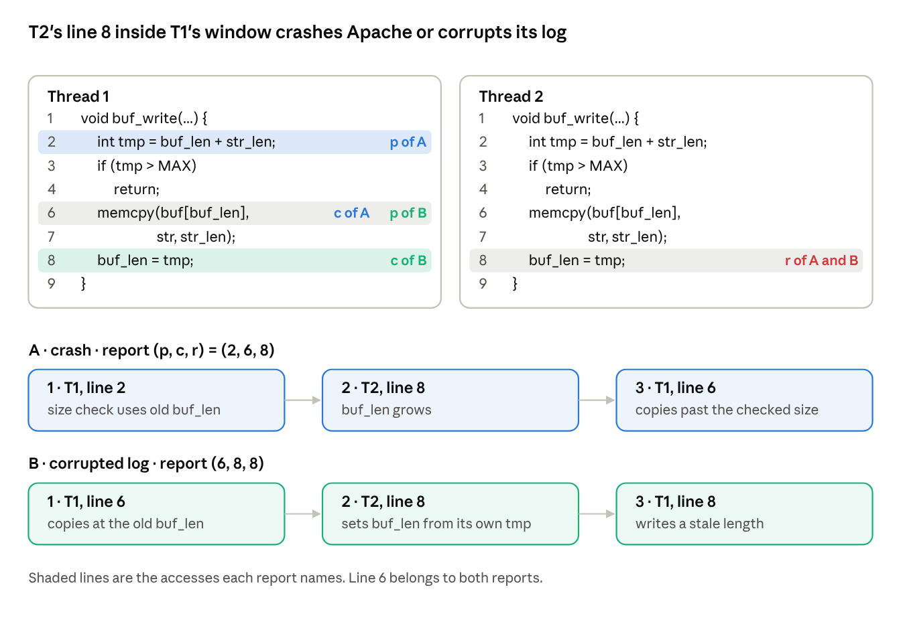

***Figure 1:*** *The Apache buf\_write bug: two atomicity violations reported on four lines (paper's Figure 1).*

In **A**, Thread 2 writes `buf_len` between Thread 1's size check (line 2) and its copy (line 6), so the copy uses a larger `buf_len` than the check approved and can overflow.

In **B**, Thread 2 writes `buf_len` between Thread 1's copy (line 6) and its write-back (line 8), so Thread 1 overwrites Thread 2's update with a stale length and the log is corrupted. Here p is line 6, and line 8 is both c (in Thread 1) and r (in Thread 2).

Now try to fix it with locks the obvious way. Each attempt below is from the paper's introduction.

***Table 2:*** *Three obvious patches for Figure 1 and why each deadlocks.*

| Patch attempt | What goes wrong | Fixed in |
| --- | --- | --- |
| For A: lock before line 2, unlock after line 6 | When the check fails, the function returns at line 4 still holding the lock; the next call to `buf_write` deadlocks | Section 5 |
| For B: one critical region over lines 6–8, another over line 8 (the r access), same lock | Line 8 is inside the 6–8 region, so the thread re-acquires a lock it already holds | Section 7 |
| Both fixes, each with its own lock L1 and L2 | One thread holds L1 (taken at line 2) and waits for L2 before line 6; another holds L2 (taken at line 6) and waits for L1 before line 8 | Section 8 |

All three are the same mistake: placing lock and unlock by looking at the reported lines instead of at every control-flow path and every other patch.

**Obvious?**: AFix's final patch for this function is one lock, taken before line 2 and released before line 4 and after line 8 (Section 8.4).

## 3. Background: what CTrigger hands to AFix

**AFix is a fixer, not a finder: its input is a list of (p, c, r) triples, each a confirmed failure where a remote access r lands between two consecutive accesses p and c by one thread to the same shared variable.** This is the one piece of background the earlier posts in the series did not cover.

### 3.1 CTrigger in two phases

CTrigger (Park, Lu and Zhou, ASPLOS'09) targets single-variable atomicity violations. It is active testing in the RaceFuzzer mould: predict first, then force.

- **Detection.** Monitor a few runs of the program, predict which unserializable interleavings could happen under the same input, and output the instructions p (preceding), c (current) and r (remote) for each.
- **Testing.** Inject delays at selected points to force each predicted interleaving. Report the triples whose interleaving actually makes the program fail.

A triple is reported only when its interleaving gives a result no serial order of the two threads could give. On one variable x, that leaves four patterns.

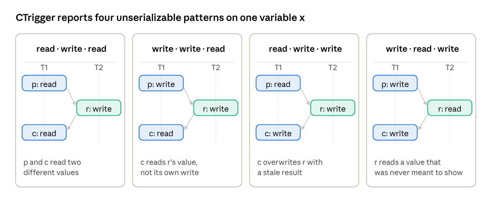

***Figure 2:*** *The four interleaving patterns CTrigger reports, with p and c in Thread 1 and r in Thread 2 (paper's Figure 2). Which pattern a reported triple shows depends on the underlying code: whether p, r and c read or write x.*

Because p and c are **consecutive** accesses to x, no other instance of p or c lies between them. Section 5's algorithm relies on this.

### 3.2 Two changes the authors made to CTrigger

What suits a bug finder doesn't always suit a bug fixer. The authors changed two things:

- **Report every triple, not one per c.** The original CTrigger kept one (p, c, r) for each distinct c to keep detection simple. A fixer that sees only some of the triples writes an incomplete patch.
- **Report full call stacks.** The original CTrigger  reported only instruction addresses. When p and c sit in different functions, AFix needs to know through which calls each was reached (Section 6.3).

Two detector limitations remain, and both show up in the evaluation: one root cause can produce several separate reports (Section 8), and a reported atomicity violation can be only a side effect of a different kind of bug (Section 10).

### 3.3 The naive fix

Given one triple, the naive patch acquires a lock before p and before r and releases it after c and after r. The authors implemented it as a baseline. It fixes **none** of the eight bugs and deadlocks in **seven**. It fails in four distinct ways, each of which a later section of AFix is designed to avoid. Figures 3a–3d walk through each one step by step, showing which thread does what and how many threads it takes.

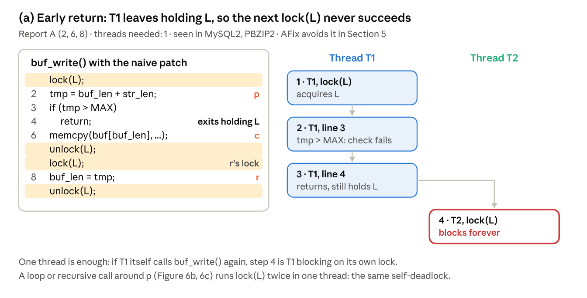

***Figure 3a:*** *Naive fix, case 1: an early return leaks the lock. T1 returns at line 4 still holding L, so the next lock(L), by T2 or by T1 itself, never succeeds. One thread is enough. Amber lines are the locks the naive rule adds.*

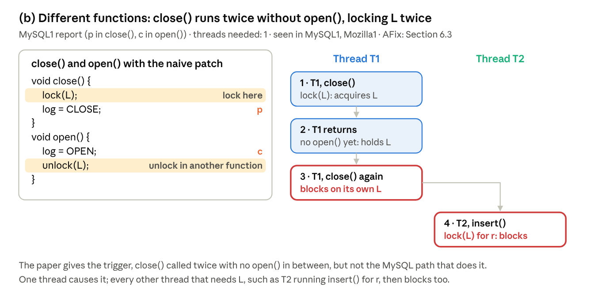

***Figure 3b:*** *Naive fix, case 2: p and c in different functions. The lock is taken in close() and released in open(), so when close() runs twice with no open() in between, T1 blocks on its own lock. One thread is enough.*

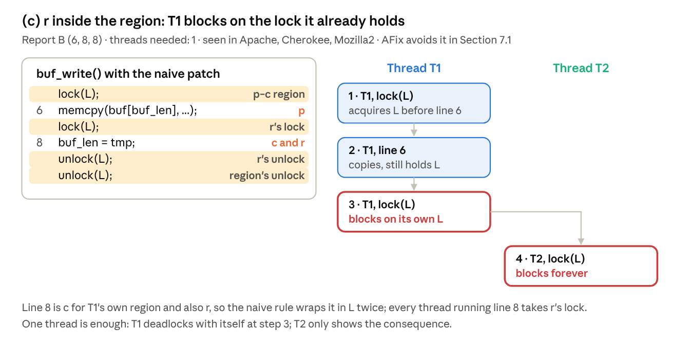

***Figure 3c:*** *Naive fix, case 3: r inside the p–c region. p, c and r are all in buf\_write(), so both threads run the same code, and the lock added for r also runs inside T1's own region. Line 8 is both c and r, so T1 takes L before line 6 and again before line 8, and deadlocks with itself. One thread is enough.*

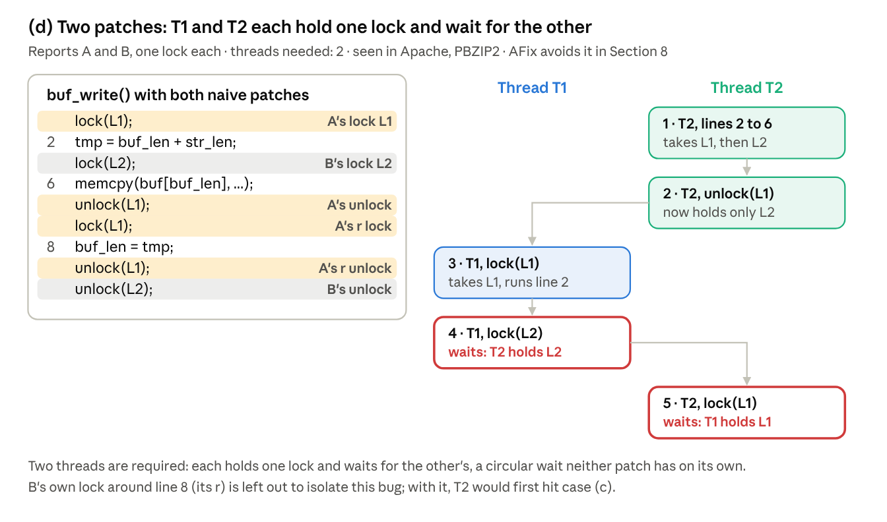

***Figure 3d:*** *Naive fix, case 4: two patches, two locks. T2 ends up holding L2 and needing L1, while T1 holds L1 and needs L2: a circular wait that takes two threads. Amber lines are patch A's lock L1, grey lines patch B's lock L2.*

## 4. AFix at a glance

**AFix copies a developer's fixing workflow in four steps: understand the bug, patch each report, merge the patches, then test and monitor them.** Steps 2 and 3 are static and took at most one second per program in the evaluation.

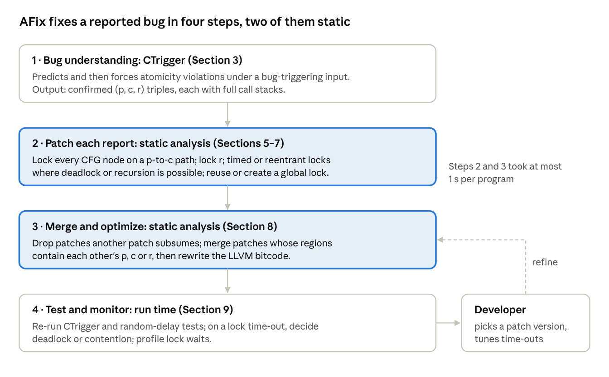

***Figure 4:*** *The AFix pipeline. The two highlighted steps are the paper's main contribution.*

Fixing one triple (p, c, r) means making the code from p to c mutually exclusive with r. The paper (Section 3.1) breaks that into four sub-tasks:

1. **Put p and c in one critical region on every path**, without a double lock, a double unlock, an unlock without a lock or a deadlock (Sections 5 and 6).
2. **Put r in its own critical region.** This is easy: lock before r, unlock after it.
3. **Make the two regions cooperate**, which takes more than giving them the same lock (Section 7.1).
4. **Choose the lock** (Section 7.2).

Implementation notes: AFix is built on LLVM 2.7 and rewrites the program's bitcode with POSIX `pthread` locks. CTrigger reports instruction addresses, so AFix maps each one back to a source line and never places a lock or unlock in the middle of a line, even if that widens a region slightly. This keeps patches readable.

## 5. Fixing one bug in one function

**AFix holds the lock at exactly the CFG nodes that lie on some path from p to c: it computes that set as P ∩ C, puts a lock on every edge into it and an unlock on every edge out of it, in time linear in the CFG.** This section assumes p and c are in the same function and the function is not recursive; Section 6 removes both assumptions.

### 5.1 Computing the protected nodes

The paper's recipe (Section 3.2):

1. **P:** search forward from p, treating c as if it had no successors.
2. **C:** search backward from c, treating p as if it had no predecessors.
3. **Protected nodes = P ∩ C:** reachable from p, and able to reach c, without passing through p or c again on the way.

Then AFix inserts `lock` on every edge from an unprotected node to a protected one, and `unlock` on every edge from a protected node to an unprotected one. To put code "on" an edge x → y, it splits the edge with a new node n (x → n → y) and puts the code in n.

Two searches and an intersection are each linear in nodes plus edges, so the whole step is linear in the size of the function's CFG.

Figure 5 runs the four steps on Apache report A from Figure 1, with p = line 2 and c = line 6.

***Figure 5:*** *Computing the protected nodes for Apache report A: the forward search P from p, the backward search C from c, their intersection, and the lock and unlock edges where control enters or leaves that set (the paper's Section 3.2 algorithm; the control-flow graph is drawn here from Figure 1's code).*

### 5.2 The three traps, replayed

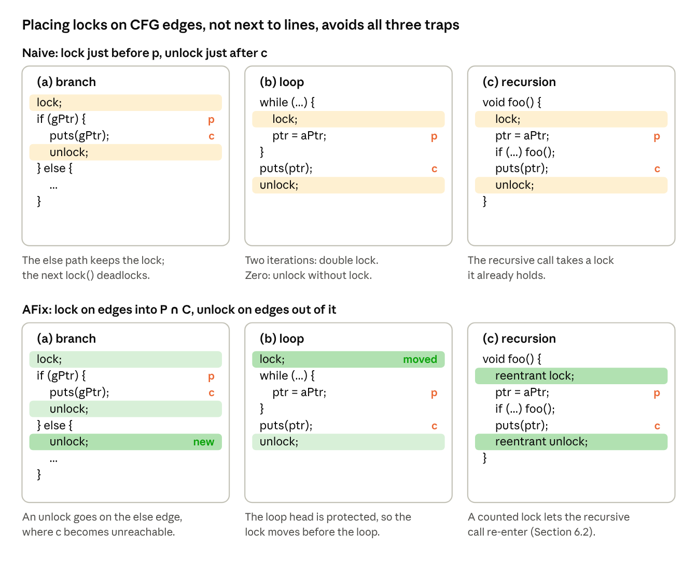

***Figure 6:*** *Naive lock placement vs. AFix's edge-based placement on three traps (paper's Figures 3 and 4).*

To check the rule, I replayed it in a short script on the paper's examples. Table 3 lists the result; the Apache rows are the two reports from Figure 1.

***Table 3:*** *Protected nodes and lock edges computed for four examples (replayed in a script).*

| Example | P ∩ C | lock on edge | unlock on edges |
| --- | --- | --- | --- |
| (a) branch | p, c | entry → p | p → else, c → join |
| (b) loop | p, loop head, c | pre-loop → loop head | c → after |
| Apache report A (2, 6, 8) | lines 2, 3, 6 | entry → 2 | 3 → 4 (the return), 6 → 8 |
| Apache report B (6, 8, 8) | lines 6, 8 | 3 → 6 | 8 → exit |

Figure 7 draws each row of Table 3 as a control-flow graph.

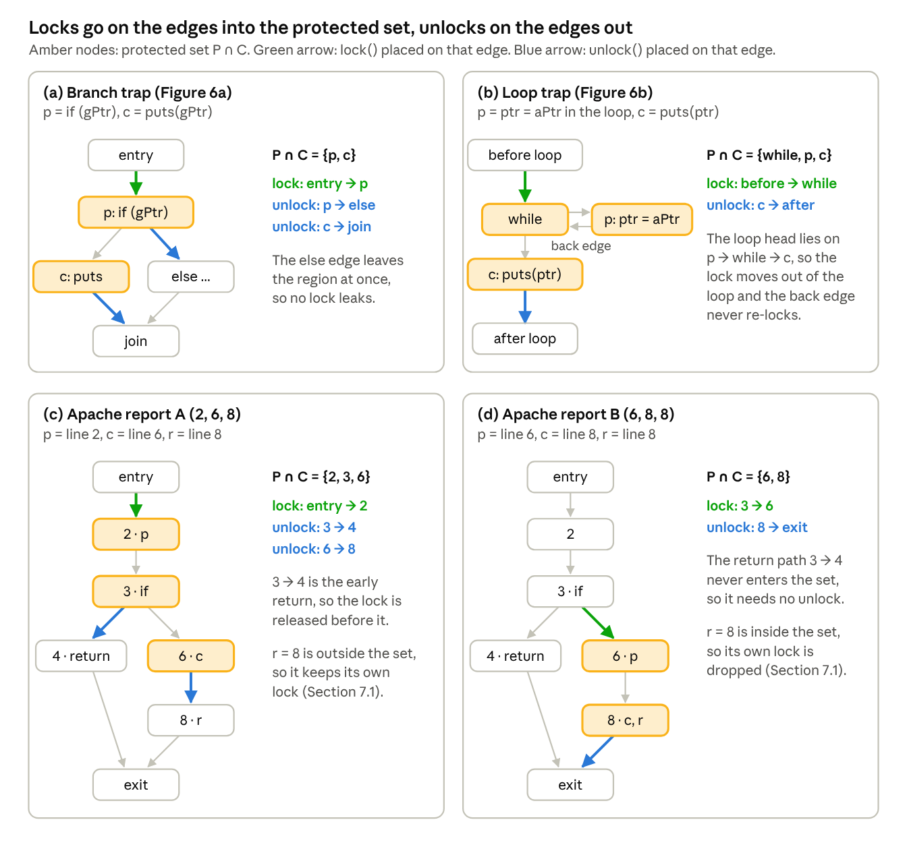

***Figure 7:*** *The four examples of Table 3 as control-flow graphs: the protected nodes P ∩ C, the edge that gets lock() and the edges that get unlock(). Graphs drawn here from the paper's Figures 1 and 3; the lock placement replays the Section 3.2 rule.*

Two things to notice:

- In (b) the loop head is protected because it lies on the path p → head → c. That is why the lock moves out of the loop. It also means the lock is held while the loop condition is checked, even on a run that never executes p. The region is slightly larger than strictly needed, but correct.
- In Apache report A, the return path gets its own unlock on edge 3 → 4. This is exactly what the first naive patch in Table 2 missed.

### 5.3 What AFix guarantees

Because the lock is taken only when control enters the protected set and released only when it leaves, two facts hold: the lock is held at every protected node, and never at an unprotected one. The paper's guarantees follow from those two facts.

***Table 4:*** *Correctness questions the paper answers for one patched function (Section 3.2).*

| Question | Answer | Why |
| --- | --- | --- |
| Are p and c inside the region on every path? | Yes | Every node on any p → c path is in P ∩ C |
| Can the patch add a double lock? | No | A lock is placed only on edges leaving unprotected nodes, where the lock is not held |
| Can it add a double unlock or an unlock without a lock? | No | An unlock is placed only on edges leaving protected nodes, where the lock is held |
| Can it add a data race? | No | Locks only remove interleavings: every schedule of the patched program was possible before |
| Can it add a deadlock? | Not provable in general for C/C++ | Handled by a static check plus timed locks (Section 6.1) |

The first three answers depend on nobody else taking the same lock inside the region. Recursion breaks that (Section 6.2), and so does an r region nested inside the p–c region (Section 7.1).

### 5.4 Why this policy

The authors implemented other placement policies, some of which give smaller regions for certain control-flow shapes. They kept this one because it is simple to reason about, composes well across functions and gives readable patches, and they saw no excessive slowdown from it. It also ends the region as soon as c can no longer be reached, as on the else edge in (a).

## 6. Deadlocks, recursion and p, c in different functions

**Section 5's rule can't prove deadlock freedom, breaks under recursion and assumes p and c share a function; AFix handles these with timed locks, reentrant locks and by moving the region up to the innermost function both call stacks share.**

### 6.1 Possible deadlocks: timed locks

AFix scans each new critical region for operations that can block. Here that means the p–c region from Section 5: p, c and every statement on any path between them (the protected set P ∩ C). It looks for:

- lock acquisitions, condition waits, barriers and thread joins, which are easy to find;
- ad-hoc spin loops: AFix conservatively treats **any loop inside the region that touches heap or global variables** as a possible spin loop.

If the region has none, a deadlock is impossible and AFix uses an ordinary `pthread_mutex_lock`. If it has one, AFix uses `pthread_mutex_timedlock`, with a default time-out of **10 seconds**. A circular wait then ends in a time-out instead of a hang, and the run-time system (Section 9.1) works out whether it was a real deadlock.

> **Major drawback.** The cost is that **a timed-out lock gives up atomicity**: the thread goes on without the lock, so the bug can still happen on that run. The paper names this as one of the two cases where AFix can fail.

Figures 8a–8c walk through the problem step by step on a small example: the original bug, AFix's fix drawn on the control-flow graphs, and how that fix can deadlock.

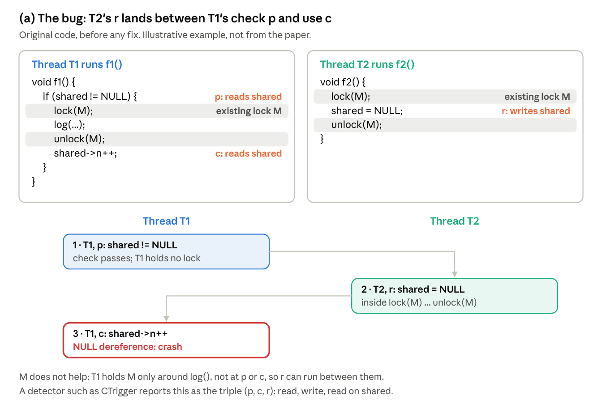

***Figure 8a:*** *The original code and the atomicity violation (p, c, r): T2 sets shared to NULL between T1's check p and its use c, and T1 crashes. The existing lock M does not prevent it because T1 does not hold M at p or c. Illustrative example, not from the paper.*

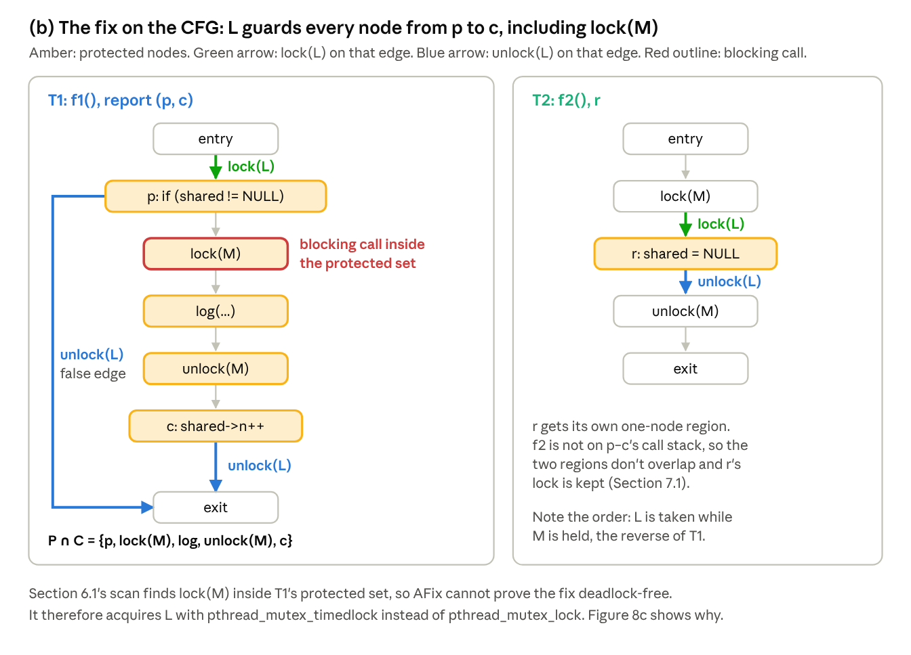

***Figure 8b:*** *AFix's fix on the control-flow graphs. In T1, lock(L) goes on the edge into the protected set and unlock(L) on both edges out of it (the end of the if and the false branch). In T2, r gets its own one-node region. The existing lock(M) lies inside T1's protected set, which is what makes the fix risky.*

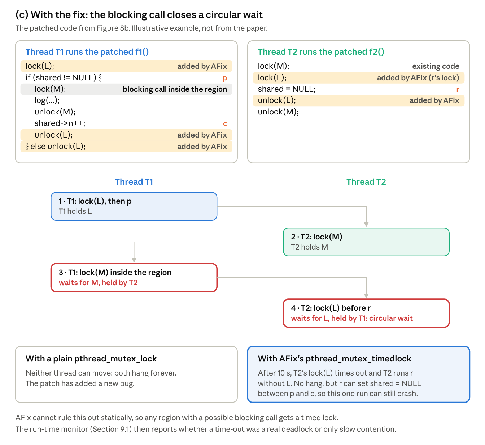

***Figure 8c:*** *With the fix applied: T1 holds L and blocks on M inside the region, while T2 holds M and waits for L before r. A plain lock hangs forever; AFix's timed lock ends the wait after 10 s but loses atomicity on that run. Illustrative example, not from the paper.*

### 6.2 Recursion: reentrant locks

If a function containing an AFix region can call itself, directly or through other calls, while inside that region, the thread will try to take a lock it already holds (Figure 6c). AFix finds these cases with reachability on the static call graph. Figures 9a–9c walk through it step by step: the original bug, AFix's fix drawn on the control-flow graph, and what the recursive call does to that fix.

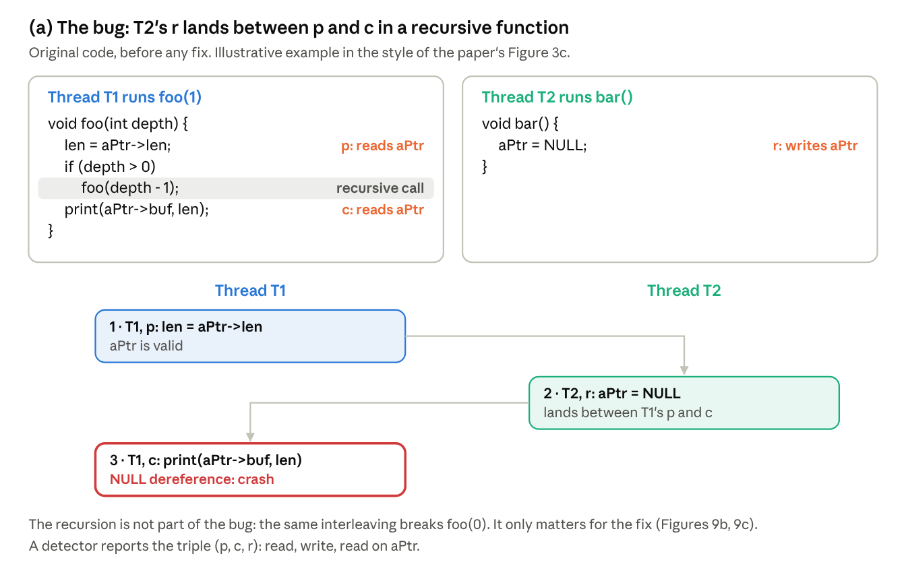

***Figure 9a:*** *The original code and the bug: T2 sets aPtr to NULL between T1's read p and its use c inside the recursive function foo(). Illustrative example in the style of the paper's Figure 3c.*

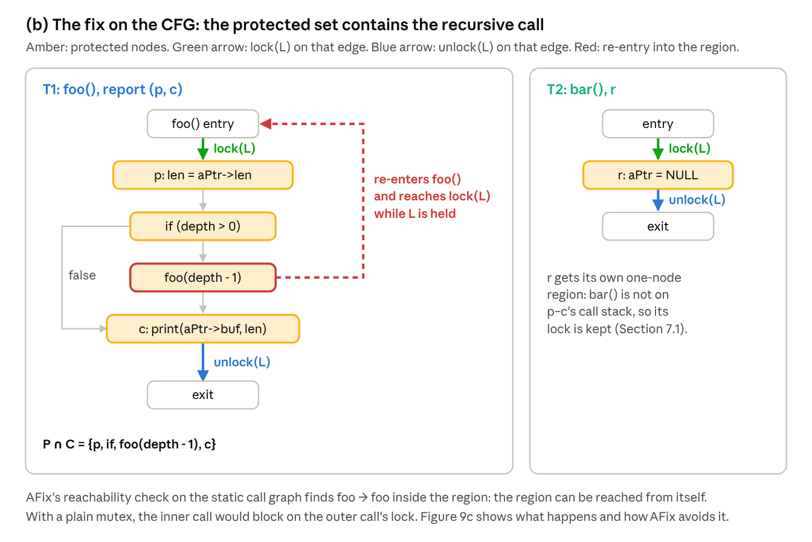

***Figure 9b:*** *AFix's fix on the control-flow graph: lock(L) on the edge into foo()'s protected set and unlock(L) on the edge out, plus a one-node region around r in T2. The protected set contains the recursive call, which re-enters foo() and reaches lock(L) while L is still held.*

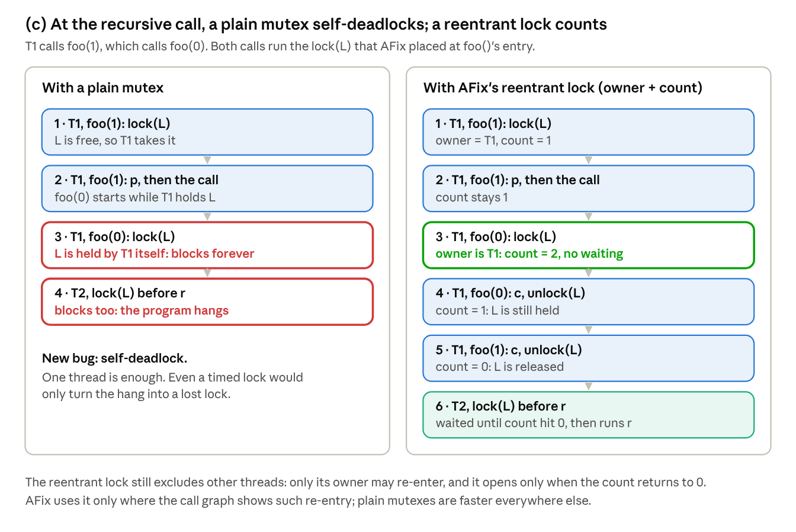

***Figure 9c:*** *What happens at the recursive call. With a plain mutex, T1 blocks on the lock it already holds. With AFix's reentrant lock, T1 re-enters by raising the count, and L opens for T2 only when the count returns to 0.*

When an AFix region can be reached from another AFix region that uses the same lock, AFix uses a **reentrant lock**: a mutex plus an owner thread ID and a nesting count. Everywhere else it uses plain mutexes, which are faster.

***Table 5:*** *Which lock AFix inserts, and when.*

| Situation in the region | Lock AFix uses |
| --- | --- |
| No blocking operations, no recursion | `pthread_mutex_lock` |
| A possibly blocking operation (lock, wait, barrier, join, suspected spin loop) | `pthread_mutex_timedlock`, 10 s default |
| Region reachable from another region with the same lock | Reentrant lock (owner ID + count) |

### 6.3 p and c in different functions

**In short:** when p and c sit in different functions, AFix moves the critical region up into the innermost function that calls both, and protects those two calls.

**The problem.** The paper's MySQL example rotates the log: `newlog()` calls `close()` (p) and then `open()` (c). Another thread's `insert()` checks whether the log is open in between, sees it closed, and silently drops its log entry.

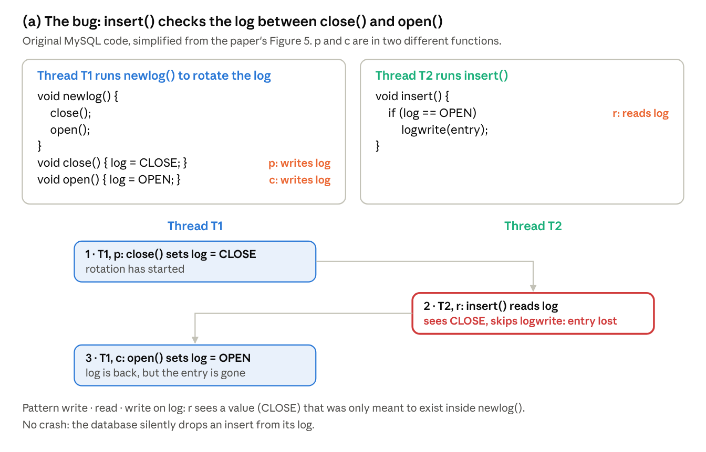

***Figure 10a:*** *The bug: T2's insert() reads the log state after close() and before open(), and drops its entry. p and c are writes in two different functions (simplified from the paper's Figure 5).*

**Why the basic algorithm doesn't work here.** Section 5 finds the region inside one function's control-flow graph, and no single CFG here contains both p and c. The two obvious workarounds both put lock and unlock in different functions. Splitting the lock between `close()` and `open()` is the naive patch of Figure 3b, which deadlocks. A full interprocedural analysis could compute a region that spans functions, but it would have the same split, which composes badly; the authors note that developers' own patches almost always keep lock and unlock in one function.

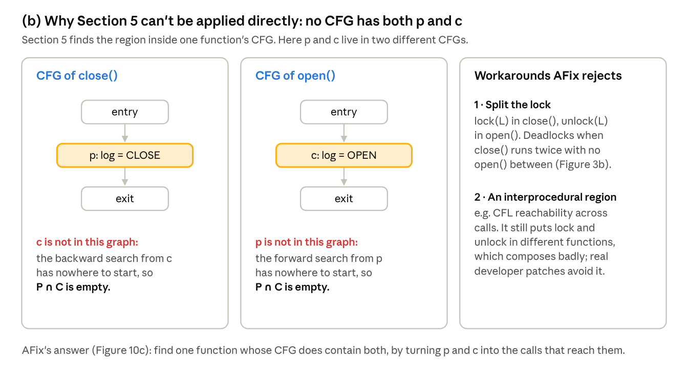

***Figure 10b:*** *Why Section 5 can't be applied directly: close()'s CFG has no c and open()'s CFG has no p, so P ∩ C is empty in both. The two workarounds AFix rejects are listed on the right.*

**AFix's solution: move up to a common caller.** AFix does what a developer would. Figure 10c runs these steps on the MySQL example, and Figure 10d shows the resulting code.

1. Compare the call stacks CTrigger reported for p and for c.
2. Take **f**, the innermost function on their common prefix.
3. If p is not directly in f, replace p with the call node in f that leads to p. Do the same for c.
4. Run Section 5's algorithm inside f.

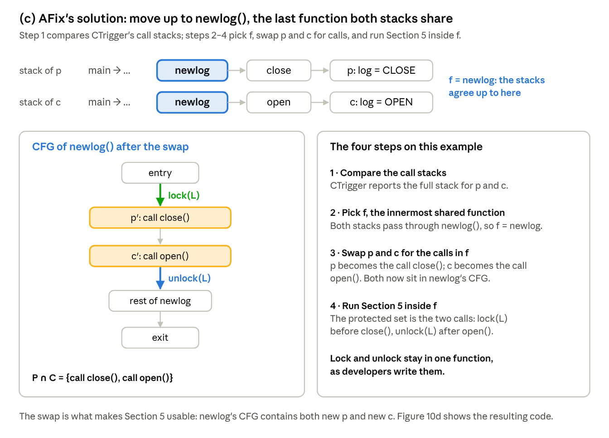

***Figure 10c:*** *AFix's solution on MySQL: the call stacks of p and c agree up to newlog(), so p and c are replaced by the calls close() and open(), and Section 5 runs on newlog()'s CFG. The lock goes before close() and the unlock after open().*

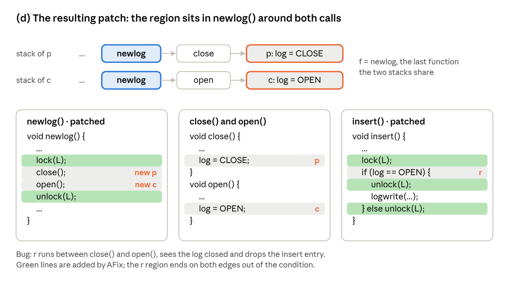

***Figure 10d:*** *The resulting patch: lock(L) before close() and unlock(L) after open() inside newlog(), plus r's own region in insert() (paper's Figure 5; the insert() patch is drawn here following the edge rule).*

**The cost.** The new p and c are whole call sites, so the region now covers everything `close()` and `open()` do. Any blocking operation inside those calls would also be inside the region; the paper doesn't say how deep Section 6.1's scan follows calls.

## 7. Pairing the p–c region with r, and choosing a lock

**If reaching r already implies being inside the p–c region, AFix drops r's own lock operations; otherwise it keeps them, and it guards both regions with one new global lock.** This removes the second deadlock in Table 2.

### 7.1 Do the two regions overlap?

Let f be the function holding the p–c region (after Section 6.3's substitution). AFix checks r's reported call stack:

- **f is not on r's stack:** the regions can't overlap, so r keeps its lock and unlock.
- **r is directly in f:** they overlap if r is one of the protected nodes.
- **f is on r's stack, but r is deeper:** find the call node in f that leads to r; they overlap if that call node is protected.
- **Recursion puts f on the stack several times:** if any of f's calls leading to r is inside the p–c region, r's lock operations are redundant.

When they overlap, r's lock and unlock are removed; otherwise taking the lock at r would be a double lock. In Apache report B (6, 8, 8), r is line 8, which is in the protected set {6, 8}, so AFix drops the separate region around line 8.

This is checked only for **the stack configuration CTrigger reported**. If another path reaches r outside the p–c region and also fails, AFix relies on CTrigger to report that path separately.

### 7.2 Choosing the lock

For a single report, AFix creates **a new global lock** and uses it at the boundaries of both regions.

Reusing an existing lock would be nicer, especially if p and c are already inside a critical section. But the lock would have to be live and reachable at r and on every edge into or out of the p–c region. For heap locks reached through linked data structures that is hard, and harder still when r is in another function with different locals.

Global locks have fixed names, so AFix does try one kind of reuse: if a global lock already protects the intended p–c region in the same function, AFix uses it and adds no lock operations around p–c. None of the eight evaluation bugs had such a lock.

### 7.3 When AFix can still fail

The paper (Section 3.7) names two cases:

1. **A timed lock times out** (Section 6.1). Atomicity is lost on that run; the run-time system reports it so the patch can be refined.
2. **p or c has several dynamic instances that touch different memory.** The p–c pair that needs protection may not be the consecutive pair AFix protects. The authors call this theoretically possible but very rare, and illustrate it with a made-up example.

**Case 2, step by step.** The paper's made-up example has a loop in which c runs more than once. Figure 11a shows the bug, Figure 11b where Section 5's rule puts the lock, Figure 11c the patch as code, and Figure 11d why the patch still lets the bug through.

**The problem.** A detector reports static lines, not runs. Here c is one line that runs twice, and only its second run writes the same location as p.

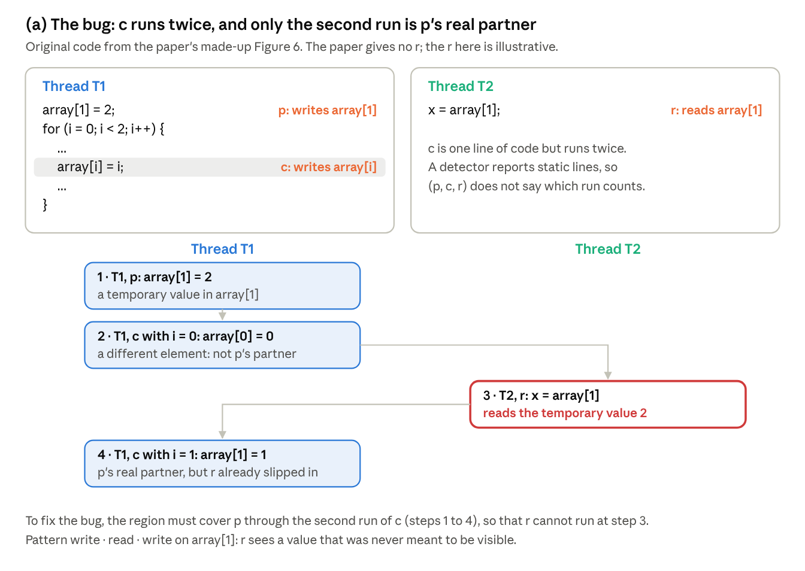

***Figure 11a:*** *The code and the bug: c runs twice and only the second run writes p's location, array\[1\]. To fix the bug, r must be kept out of the window from p to that second run. Code from the paper's made-up Figure 6; the paper gives no r, so the r here is illustrative.*

**What AFix does.** Section 5's rule stops the forward search at the first c it reaches, so the region ends right after that first run.

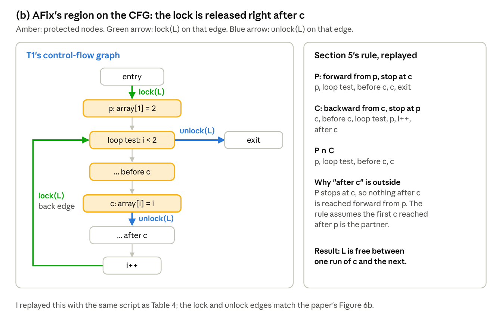

***Figure 11b:*** *AFix's region on the control-flow graph: the protected set is {p, loop test, body before c, c}. Because the rest of the loop body is outside the set, unlock(L) goes right after c and lock(L) goes on the back edge.*

**The patch as code.** Figure 11c shows the same lock and unlock edges written into the source.

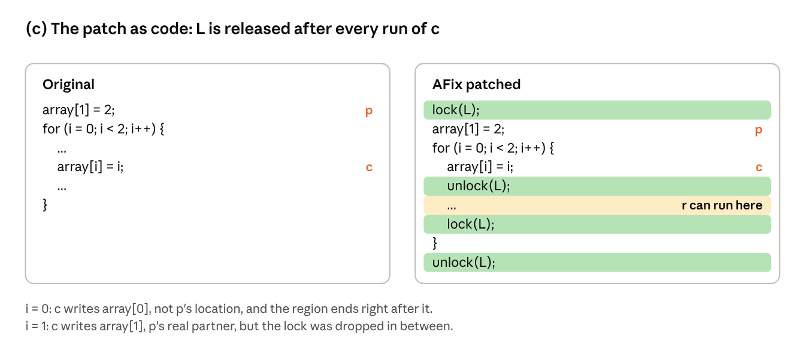

***Figure 11c:*** *The same patch as code (paper's Figure 6): the lock is released after every run of c and taken again before the next one.*

**What goes wrong.** Between the two runs of c, L is free, so r can take it and run in exactly the window the fix was meant to close.

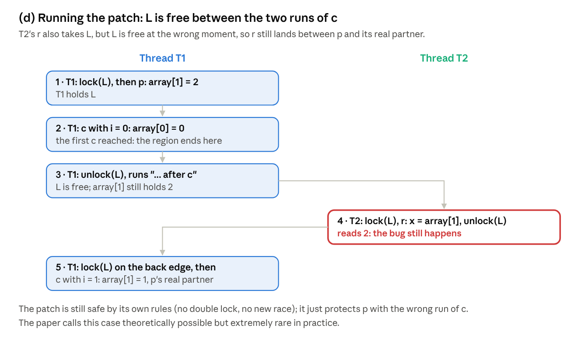

***Figure 11d:*** *Running the patch: L is free between the first and second runs of c, so r can still land between p and its real partner.*

This case is a direct consequence of Section 5's rule: a path that passes through c once already counts as having reached c, so the region ends there.

## 8. Fixing many reports together

**AFix first patches each report on its own, then drops patches that another patch subsumes and merges patches whose lock-guarded regions contain each other's p, c or r, repeating until nothing more merges.** For Apache this turns two reports, two locks and a cross-patch deadlock into one lock, one lock call and two unlock calls.

### 8.1 Removing redundant patches

Each patch has two regions: p–c and r. A patch is fully redundant if another patch subsumes both. If only its p–c region is subsumed, AFix still drops that region, and switches r's region to the subsuming patch's lock; r is a single instruction, so a separate region for it costs little.

Under AFix's placement rule, region p–c is subsumed by region p′–c′ exactly when its CFG nodes are a subset of p′–c′'s: the outer lock is already held at every inner node.

Across functions, let f hold p–c, let f′ hold p′–c′, and let n be the call node in f′ that eventually leads to f. Then p′–c′ subsumes p–c if and only if:

1. f′ is on the common prefix of p's and c's call stacks, and
2. n is inside the p′–c′ region.

The full call stacks from Section 3.2, and the rule that each region's lock and unlock live in one function, are what keep this check simple.

### 8.2 When to merge

For each patch i, AFix keeps two node sets:

- **Anchorsᵢ**: the nodes of the bug it was made for, initially {pᵢ, cᵢ, rᵢ}.
- **Criticalᵢ**: every node inside a region guarded by patch i's lock: the pᵢ–cᵢ protected nodes plus rᵢ.

$$
\text{merge}(i, j) \iff \mathit{Anchors}_i \cap \mathit{Critical}_j \neq \emptyset \;\lor\; \mathit{Anchors}_j \cap \mathit{Critical}_i \neq \emptyset
$$

In words: merge two patches when one patch's lock already guards an access of the other's bug. The merged patch gets the union of both Anchors sets and both Critical sets and is itself a candidate for further merging, until no patch's p, c or r lies inside another patch's guarded region.

### 8.3 How to merge

1. **Recompute the boundaries.** Put an unlock on every edge leaving the merged Critical set and a lock on every edge entering it. Lock operations that now sit strictly inside the set disappear.
2. **Use one lock variable.** Pick either patch's lock arbitrarily and use it in every lock and unlock of the merged patch.

This merge runs only on regions in the same function, and it also covers intraprocedural redundancy. AFix removes interprocedural redundant patches first (8.1), then merges.

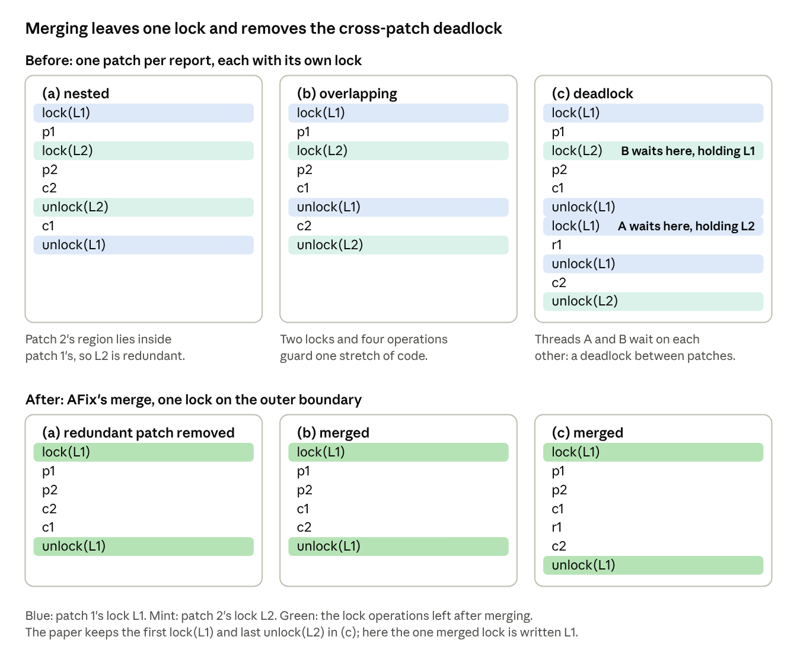

***Figure 12:*** *Three scenarios where patches should or must merge, before and after AFix's merge (paper's Figure 7; the "after" rows follow the paper's description in Section 4.2.2).*

### 8.4 Apache, end to end

Putting Sections 5, 7 and 8 together on Figure 1. My script from Section 5 reproduces each step:

1. Report A (2, 6, 8): protected {2, 3, 6}. r = line 8 is outside, so it gets its own L1 region.
2. Report B (6, 8, 8): protected {6, 8}. r = line 8 is inside, so its separate region is dropped.
3. Anchors\_B = {6, 8} lies inside Critical\_A = {2, 3, 6, 8}, so the patches merge.
4. Merged Critical = {2, 3, 6, 8}: lock on entry → 2, unlock on 3 → 4 and on 8 → exit.

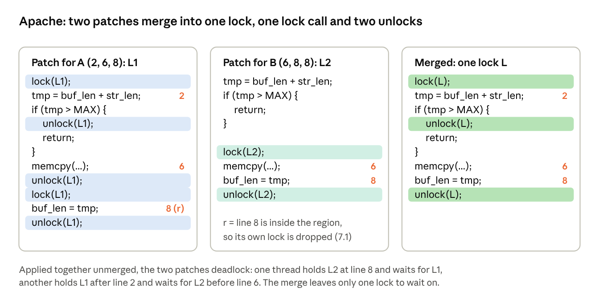

***Figure 13:*** *The Apache bug's two patches, each correct alone, and the merged patch AFix applies.*

The result matches the paper exactly: one lock before line 2, unlocks before line 4 and after line 8. The paper notes the merged patch closely resembles the developers' own fix.

**The whole technique on one page.** Figure 14 runs AFix end to end on the Apache bug: the input, the patch for each report with its control-flow graph and how its lock edges were chosen, the merge test, and the merged patch.

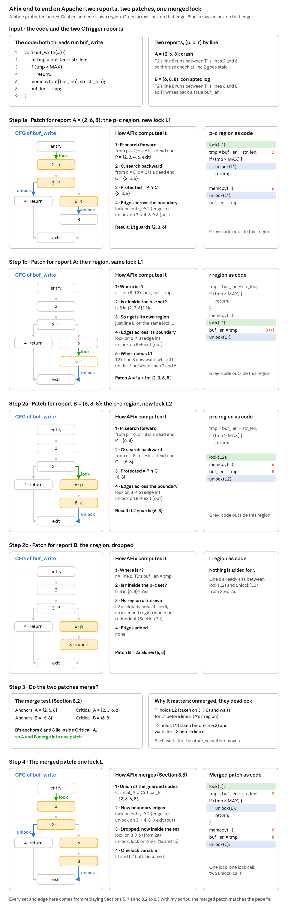

***Figure 14:*** *AFix end to end on Apache. Steps 1a and 2a compute each report's p–c region (forward search, backward search, intersection) and place lock and unlock on the edges that cross its boundary. Steps 1b and 2b handle r separately: A's r (line 8) lies outside its p–c region and gets its own region on L1, while B's r is already inside, so no region is added. Step 3 applies the merge test and shows the deadlock the two separate patches would cause. Step 4 takes the union of the guarded nodes and recomputes the boundary, which leaves one lock L, one lock call and two unlock calls.*

### 8.5 What merging buys

***Table 6:*** *Effects of merging on patch quality (paper's Section 4.2.3).*

| Property | Effect | Caveat |
| --- | --- | --- |
| Readability | Far fewer locks; one lock in five of the six multi-report bugs | Judged by manual inspection |
| Performance | Usually better: fewer lock operations without much larger regions | Not guaranteed; larger regions can cut concurrency |
| Correctness | Same or better, because regions only grow | Helps most when the detector misreports the root cause (Section 10) |
| Deadlock between AFix patches | Impossible, by the paper's argument: two AFix locks that one thread could hold at once would have been merged | The argument is about regions inside one function |

## 9. Run-time monitoring and patch testing

**Because a timed lock turns a deadlock into a time-out, AFix ships two detectors that decide afterwards whether a time-out was a real deadlock, plus two rounds of noise-injection testing for each patch.** Not everything about a patch can be settled statically; this step gives the developer the evidence to refine it.

### 9.1 Was that time-out a deadlock?

A lock can time out without any deadlock, simply because of heavy contention. AFix offers two detectors, both added by rewriting LLVM bitcode.

***Table 7:*** *AFix's two run-time deadlock detectors (paper's Section 5.1).*

|  | Always-on detector | Post-time-out detector |
| --- | --- | --- |
| Meant for | In-house patch testing | Production runs |
| Starts | At program start | At the first AFix lock time-out, moment T |
| What it tracks | Every lock acquire and release, condition wait and signal, kept as a resource graph | Only lock events after T |
| Answer | Immediately at the time-out: is there a cycle? | Somewhat later, once enough events after T have been seen |
| Overhead | Under 5% except Mozilla1 (300%) and Mozilla2 (97%), whose JavaScript engines lock very often | Nearly zero until a time-out happens |

The post-time-out detector uses the lock events it sees after T to work out which locks each thread held or was waiting for at T, then checks for a cycle. Both detectors can miss deadlocks that involve ad-hoc synchronization such as spin loops.

**What the developer does with the answer.** A time-out that is not a deadlock suggests raising that lock's time-out. A real deadlock suggests discarding the patch and choosing another, for example the merged version instead of the unmerged one. The authors suggest that deadlock-immunity systems could automate this later.

**Profiling mode.** During in-house testing AFix can record, for each lock acquisition in a patch, the wait time and the number of time-outs. Long waits at a big merged region are a hint to split it.

### 9.2 Testing each patch

Every AFix patch goes through two testing phases:

1. **CTrigger's own test.** CTrigger, through the Pin binary-instrumentation framework, deterministically sleeps at the points that force each reported interleaving (before c, after p and so on). If the patched program still fails, the patch is incomplete.
2. **Random noise injection.** Before every instruction inside an AFix critical region, a random draw decides whether to sleep; random delays also go right before AFix's locks and right after its unlocks. The sleep probability and length are tunable. This catches patches that fail because CTrigger described the root cause wrongly.

Phase 2 is also how Section 10 measures failure rates.

## 10. Evaluation

**Merged AFix patches eliminate failures for six of eight real bugs and cut them sharply for the other two (74% to 30%, 94% to 20%); seven of the eight add under about 1% overhead, while naive patches deadlock in seven of eight.** Both misses come from CTrigger describing the wrong root cause, not from AFix's patching.

### 10.1 Setup and bugs

AFix runs on LLVM 2.7; experiments used an eight-core Intel Xeon with Red Hat Linux 5 (kernel 2.6.18). All eight bugs were first reported by users. CTrigger was run with each bug report's triggering input, and the authors confirmed each reported triple leads to the users' failure symptom.

***Table 8:*** *The eight bugs (paper's Table 1).*

| Bug | Application | Size (LoC) | Developer fix time | CTrigger reports |
| --- | --- | --- | --- | --- |
| FFT | FFT | 1.2K | n/a | 5 |
| PBZIP2 | PBZIP2 | 2.0K | n/a | 4 |
| Apache | Apache | 333K | 30 days | 2 |
| MySQL1 | MySQL v4.0.12 | 681K | 10 days | 1 |
| MySQL2 | MySQL v4.0.19 | 693K | 13 days, incorrect patches along the way | 2 |
| Mozilla1 | Mozilla JavaScript engine v1.4.2 | 87K | 12 days, incorrect patches along the way | 2 |
| Mozilla2 | Mozilla JavaScript engine v1.5 | 108K | over 3 days (reporter suggested the fix) | 1 |
| Cherokee | Cherokee v0.9.2 | 83K | over 1 day (reporter suggested the fix) | 4 |

Fix time runs from the developers' first response to the check-in of a correct patch, taken from Bugzilla.

Each bug gets four patched versions: **naive** (Section 3.3), **unmerged** AFix, **merged** AFix and the developers' **manual** patch, all compared with the **original** buggy program.

### 10.2 Overall patch quality

***Table 9:*** *Overall patch quality (paper's Table 2). Fixed = bug gone, no new bug, negligible slowdown; partial = failures reduced without hurting performance; bad = new bug, little effect or intolerable slowdown. For manual patches, partial means developers first submitted incomplete patches.*

| Bug | Naive | Unmerged | Merged | Manual |
| --- | --- | --- | --- | --- |
| FFT | bad | bad | partial | fixed |
| PBZIP2 | bad | bad | bad | fixed |
| Apache | bad | bad | fixed | fixed |
| MySQL1 | bad | fixed | fixed | fixed |
| MySQL2 | bad | fixed | fixed | partial |
| Mozilla1 | bad | fixed | fixed | partial |
| Mozilla2 | bad | fixed | fixed | fixed |
| Cherokee | bad | fixed | fixed | fixed |

Merged AFix fixes six of eight; unmerged fixes five, losing Apache to the cross-patch deadlock of Figure 13. For MySQL2 and Mozilla1 the merged patch beats the developers' first attempts. The merged PBZIP2 patch lowers failures but is rated bad because of its slowdown (10.4).

### 10.3 Failure rates under noise injection

Each version ran 100 times with the random noise of Section 9.2, injected in the same region, with the same sleep probability and length, for all versions of a given bug. The settings were tuned per bug so that the original program fails often.

***Table 10:*** *Failure rates under interleaving testing, 100 runs each (paper's Table 3). "Deadlock" marks inputs where the naive patch deadlocks every time.*

| Bug | Original | Naive | Unmerged | Merged |
| --- | --- | --- | --- | --- |
| FFT | 74% | 73% | 87% | 30% |
| PBZIP2 | 94% | 100%, deadlock | 66% | 20% |
| Apache | 85% | 100%, deadlock | 83% | 0% |
| MySQL1 | 41% | 100%, deadlock | 0% | 0% |
| MySQL2 | 53% | 100%, deadlock | 0% | 0% |
| Mozilla1 | 41% | 100%, deadlock | 0% | 0% |
| Mozilla2 | 48% | 100%, deadlock | 0% | 0% |
| Cherokee | 81% | 100%, deadlock | 0% | 0% |

How to read it:

- **Why FFT and PBZIP2 stay above 0%.** Both are really ordering bugs that CTrigger reported as atomicity violations. In FFT, r must not run after **any** of six instructions; in PBZIP2, r must run after **both** p and c. AFix correctly keeps r out from between p and c, which is only part of the problem. Merging puts all six FFT instructions in one region, which is why merged (30%) does so much better than unmerged (87%).
- **Why unmerged fails on Apache and PBZIP2.** The patches deadlock with each other (Figure 12c). The timed lock then expires, atomicity is lost and the failure can happen anyway.
- **Why naive deadlocks (Figures 3a–3d).** MySQL2 and PBZIP2: control flow as in Figure 6. MySQL1 and Mozilla1: p and c in different functions, so the lock taken in one function is taken again if it is called twice before the other. Apache, Cherokee and Mozilla2: r inside the p–c region, a double lock. Apache and PBZIP2 also deadlock between patches.

Re-running CTrigger itself on the patched code finds all eight bugs fixed by both AFix versions, which shows how much the random-noise test adds. The authors also checked every patch by hand; the 0% cases are truly fixed.

### 10.4 Performance

***Table 11:*** *Run-time overhead relative to the original program (paper's Table 4). n/a: the naive patch deadlocks, so speed can't be measured.*

| Bug | Naive | Unmerged | Merged | Manual |
| --- | --- | --- | --- | --- |
| FFT | −0.02% | −0.07% | −0.02% | 0.19% |
| PBZIP2 | n/a | 89,132% | 181.82% | 0.20% |
| Apache | n/a | 0.45% | −0.97% | −0.26% |
| MySQL1 | n/a | 0.48% | 0.48% | 0.45% |
| MySQL2 | n/a | −0.09% | −0.09% | 1.02% |
| Mozilla1 | n/a | 0.49% | 0.55% | 0.12% |
| Mozilla2 | n/a | −0.40% | −0.40% | −0.20% |
| Cherokee | n/a | −1.02% | −1.04% | 0.39% |

The added regions are short and off the hot paths, so the overhead is in the noise. The exception is **PBZIP2**: the parent thread sometimes destroys shared objects before the workers finish. Developers fixed it by making the parent wait for the workers, which is cheap. AFix, misled into seeing an atomicity violation, wraps almost the whole worker in one critical region (181.82%), and the unmerged version also keeps hitting deadlock time-outs (89,132%).

AFix's own analysis, patch design and code injection took **at most one second** per program.

### 10.5 Readability and other results

For six of the eight bugs CTrigger reports two to five violations, so unmerged patches add two to five locks and up to ten critical regions. Merging brings five of those six down to a single lock, and the authors judged every merge to improve readability.

**Cherokee** shows the effect most clearly: four reports in three functions became four global locks, six lock operations and seven unlock operations unmerged; merged, they became **one lock, one lock operation and one unlock operation**, close to the developers' patch.

The run-time deadlock detector classified time-outs correctly. In PBZIP2, both versions time out. It reports that the unmerged time-outs are deadlocks between patches, while the merged ones are contention on a large region that needs a longer time-out.
