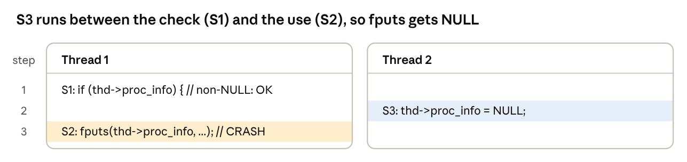
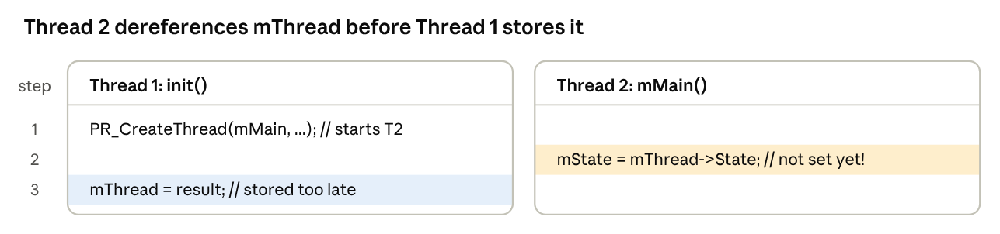
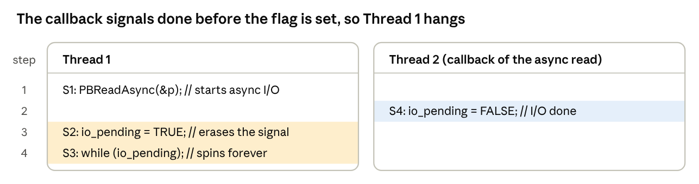
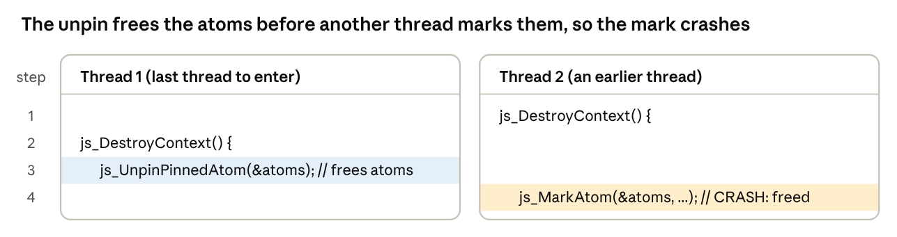
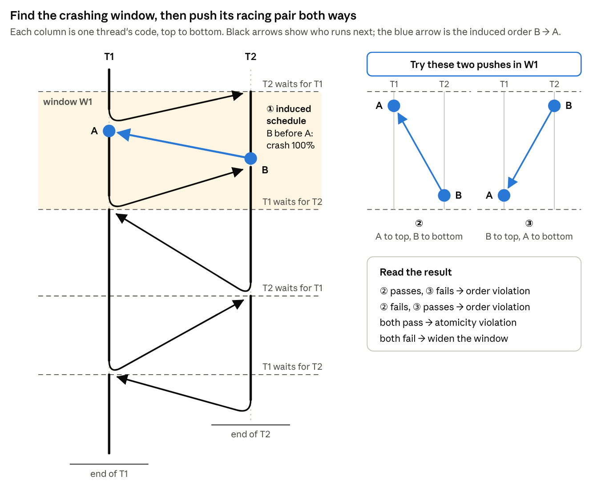
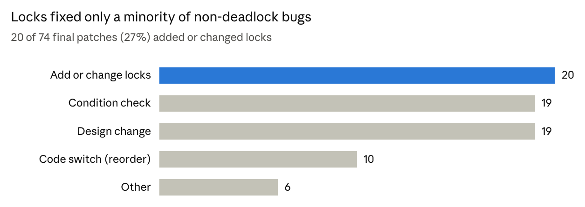
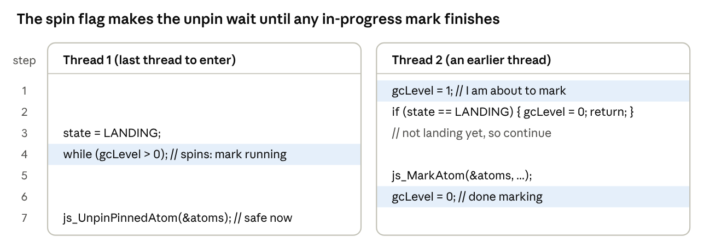
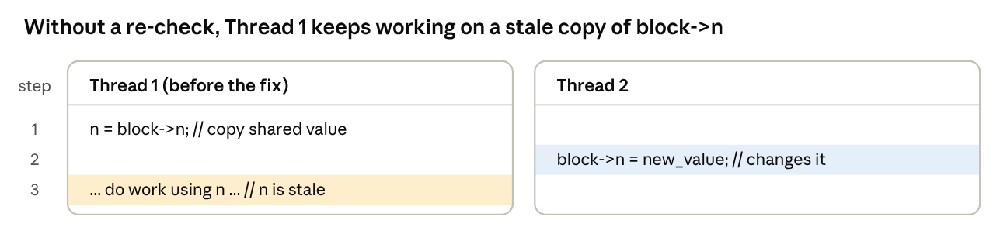
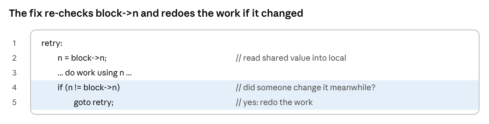
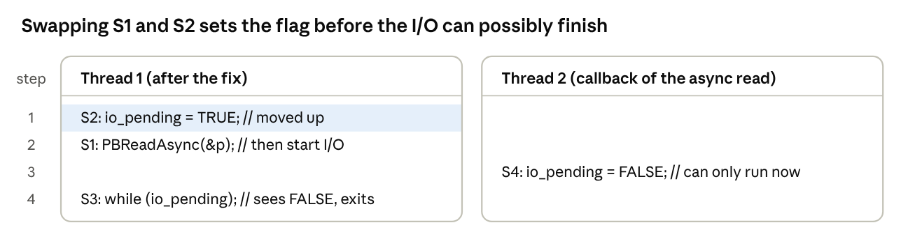

### 5. Learning from Mistakes: real-world concurrency bug characteristics

**Paper:** Shan Lu, Soyeon Park, Eunsoo Seo and Yuanyuan Zhou, *Learning from Mistakes — A Comprehensive Study on Real World Concurrency Bug Characteristics*, ASPLOS 2008. [Read the full post]().

> Most real concurrency bugs are **atomicity or order violations**, not just data races. They are shallow (at most two threads and four accesses), and locks alone rarely fix them.

#### The study

The authors keyword-searched the bug trackers of four mature C/C++ programs (MySQL, Apache, Mozilla and OpenOffice), randomly sampled about 500 reports, and kept the 105 that were verified concurrency bugs: 74 non-deadlock and 31 deadlock. Each bug is classified by its **pattern** (which programmer intention was violated), its **manifestation** (what it takes to trigger it) and its **fix**.

> **"Data race" is not a pattern.** A race may be benign (a spin flag), and a race-free program can still be buggy: two accesses can each hold a lock and still run in the wrong order, or be interrupted between them.
>
> ***So races are a symptom, not a category.***

#### Bug patterns: what kind of mistake? (Findings 1–2)

72 of the 74 non-deadlock bugs fall into just two patterns: atomicity violation or order violation. The second pattern alone covers about a third (24 bugs), and 2008-era detectors did not look for it.

| Application | Atomicity | Order | Other | Total |
| --- | --- | --- | --- | --- |
| MySQL | 12 | 1 | 1 | 14 |
| Apache | 7 | 6 | 0 | 13 |
| Mozilla | 29 | 15 | 0 | 41 |
| OpenOffice | 3 | 2 | 1 | 6 |
| **Overall** | **51** | **24** | **2** | **74** |

The columns sum to 77, not 74: three bugs fit both atomicity and order and are counted in both.

##### Findings and implications

> **Finding 1.** 97% (72/74) of non-deadlock bugs are atomicity or order violations. **Implication:** detection, testing and language design should focus on these two patterns first.

> **Finding 2.** 32% (24/74) are order violations. **Implication:** we need new tools for order bugs. A race detector or atomicity checker misses them, because two accesses can be perfectly locked and still run in the wrong order.

**Why this mattered:** before this paper, "concurrency bug" was nearly synonymous with "data race" or "deadlock." Naming *order violation* as a first-class category, and showing it is common, redirected a decade of tool research.

#### Atomicity violation: MySQL `ha_innodb.cc`

***Figure 1:*** *MySQL `ha_innodb.cc`: an atomicity violation, step by step.*

**The intention:** S1 and S2 form one unit, so the value checked is the value used. **The violation:** S3 slips between them. Programmers write it because they think sequentially; two adjacent lines *feel* atomic.

#### Order violation

An order violation breaks an intention of the form **"A must happen before B"**. Locks do not help: they keep A and B apart, but cannot say which goes first. The intention comes in three shapes:

| Shape | Example | What should come first |
| --- | --- | --- |
| Write → read, one variable | Figure 2 (Mozilla `nsthread.cpp`) | Assign `mThread` before Thread 2 reads it |
| Write → write, one variable | Figure 3 (Mozilla `macio.c`) | Set `io_pending = TRUE` before the async callback sets it `FALSE` |
| Group → group, many variables | Figure 4 (Mozilla JS engine) | All `js_MarkAtom` calls before `js_UnpinPinnedAtom` frees the atoms |

##### Write → read: Mozilla `nsthread.cpp`

***Figure 2:*** *Mozilla `nsthread.cpp`: an order violation, step by step.*

- **The intention:** `mThread` is assigned before Thread 2 reads it. It *seems* guaranteed, because Thread 1 creates Thread 2.
- **What goes wrong:** the new thread can start running before `PR_CreateThread` returns and the assignment happens.
- **Result:** Thread 2 dereferences an uninitialized pointer.

##### Write → write: Mozilla `macio.c`

***Figure 3:*** *Mozilla `macio.c`: a write-write order violation that causes a hang.*

- **The intention:** S2 sets `io_pending = TRUE` before the I/O callback's S4 sets it back to `FALSE`.
- **What goes wrong:** if the I/O finishes very fast, S4 runs *before* S2, so S2 sets the flag to TRUE after the "done" signal.
- **Result:** S3 spins forever, a **hang**.
- **Fix:** swap S1 and S2, so the flag is set before the I/O starts (see the fixes below).

##### Group → group: Mozilla JS engine

***Figure 4:*** *Mozilla `jscntxt.c`, `jsgc.c`: a group-to-group order violation, step by step.*

- **The setup:** several threads run `js_DestroyContext`. Each thread that is not the last one calls `js_MarkAtom`, which may touch elements of the shared `atoms` array. The last thread calls `js_UnpinPinnedAtom`, which frees them.
- **The intention:** an order between two **groups** of operations: every mark must finish before the unpin.
- **What goes wrong:** the unpin runs first, and a later mark touches freed atoms.
- **Result:** the program crashes.
- **Fix:** a spin flag makes the last thread wait for every in-progress mark before it unpins (Figure 7, in the fixes below).

#### The "Other" category: MySQL

Only 2 bugs fit neither pattern. In one, a monitor thread crashes the server if any thread waits on a lock longer than `fatal_timeout`, assuming that means deadlock. Under heavy load (2,048 worker threads), normal waits exceeded the timeout and the server kept killing itself. The broken assumption was about **performance**, not atomicity or order.

#### Telling order from atomicity violations, from a schedule

The patterns above are defined by the programmer's intent. In practice you start from a **schedule**: you have a flaky crash, and a tool has found a realizable interleaving that reproduces it every time. Is it an order or an atomicity violation?

##### The idea

The code's own switch points (`wait` / `signal`, `unlock`…`lock`, `yield`, `await`, blocking calls, joins) already fix the order of large chunks of the run. Only the accesses *between* two switch points can move. So find the window where the crash happens, then push the two racing accesses to opposite edges of that window, once in each direction.

***Figure 5:*** *The whole picture. T1 and T2 hand control back and forth at switch points the code creates. Window W1 is where both run at once; ① marks the induced schedule found there (B before A), which crashes 100% of the time. ② and ③ push A and B to opposite edges of W1, once in each direction.*

##### Classifying the race

**Input:** a realizable interleaving ① that reproduces the original crash report 100% of the time.

1. **Mark the switch points.** These are every place the code hands control to another thread: `wait` / `signal`, `unlock`…`lock`, `yield`, `await`, blocking calls, joins. They split the run into **windows** whose order the program already fixes.
2. **Locate ①.** Find the window containing the two accesses whose order the crash depends on: one from T1 and one from T2, to the same data.
3. **Push both ways, to the edges.** Inside that window only, and without crossing a switch point:
   - **②:** T1's access at the top edge, T2's access at the bottom edge.
   - **③:** the reverse.

   Push all the way to the edge, not just past the neighbouring access.
4. **Run ② and ③ several times each** under the enforced schedule, and score each one:
   - **Fail:** reproduces the **same crash signature as the original crash report** (same sanitizer report and access pair), **100% of the time**.
   - **Pass:** never produces that crash.
   - **Anything else** (an intermittent crash, or a different crash): the schedule isn't controlling everything that matters.
5. **Read the verdict.**

| ② | ③ | Verdict |
| --- | --- | --- |
| Pass | Fail | **Order violation**: one direction is wrong |
| Fail | Pass | **Order violation**: one direction is wrong |
| Pass | Pass | **Atomicity violation**: the crash needs one access to land *between* two of the other thread's |
| Fail | Fail | **Undecided**: another access, thread or window is involved. Widen the window and repeat from step 2. |
| Anything else | Anything else | **Undecided**: same as above |

This tells you **which race causes the flakiness**, and whether it is an order or an atomicity race.

#### Manifestation: what does it take to trigger a bug? (Findings 3–8)

Real concurrency bugs are **"shallow"**. This is the most practically important part of the paper for testing.

- **Few threads:** 101 of 105 bugs need at most two threads.
- **Few accesses:** 97 of 105 (92%) need an order among at most 4 memory accesses.
- **One thread = self-deadlock only:** the 7 single-thread bugs are all self-deadlocks, where a thread waits on a lock it already holds. No interleaving is involved.
- **Two threads for everything else**, with four exceptions: 2 bugs need more than two threads, and 2 need an external event, such as another program touching the same file.

##### The key definition: manifestation condition

The **manifestation condition** of a bug is the smallest set *S* of memory accesses plus a specific order on *S*, such that if that order happens — however it is forced — the bug is **guaranteed** to appear.

**Worked example — the MySQL bug (Figure 1).** *S* = {S1, S3, S2}. The order is S1 → S3 → S2. So:

- threads = 2 (Thread 1 runs S1 and S2; Thread 2 runs S3)
- variables = 1 (`thd->proc_info`)
- accesses = 3

Every other instruction in the program, and every other thread, is irrelevant. That is what makes a small manifestation condition so valuable: a tester only has to force three accesses into one order.

##### How many threads? (Findings 3–4)

| Bug type | 1 thread | 2 threads | > 2 threads | Needs external event |
| --- | --- | --- | --- | --- |
| Non-deadlock (74) | 0 | 71 | 1 | 2 |
| Deadlock (31) | 7 | 23 | 1 | 0 |

> **Finding 3.** 96% (101/105) of bugs involve no more than two threads. **Implication:** test threads *pairwise*. Instead of exploring all orderings of 1,000 threads, explore orderings between each pair.

- **What about heavy load?** Bugs do show up more under heavy load, and the paper reconciles this. Load creates more context switches and contention, which raises the *probability* of hitting the bad order between two threads. The condition itself still involves only two.
- **Environment bugs:** the 2 "environment" bugs depend on something outside the program. In one Mozilla bug, another process had to modify the same file at the same time.

> **Finding 4.** 22% (7/31) of deadlocks involve a single thread, typically re-acquiring a lock it already holds. **Implication:** these are easy to detect without reasoning about other threads, so eliminate them first.

##### How many variables? (Findings 5–7)

| Bug type | Involves 1 variable / resource | Involves more than 1 | Breakdown of "more than 1" |
| --- | --- | --- | --- |
| Non-deadlock (74) | 49 | 25 | Not split further in the paper |
| Deadlock (31) | 7 | 24 | 23 involve 2 resources, 1 involves more than 2 |

> **Finding 5.** 66% (49/74) of non-deadlock bugs involve one variable. **Implication:** the single-variable focus of race detectors (Eraser, RaceTrack) and atomicity checkers (AVIO, SVD) is a reasonable simplification.

> **Finding 6.** 34% (25/74) involve multiple variables. **Implication:** we need new detectors for multi-variable bugs, because single-variable tools miss them by construction.

> **Finding 7.** 97% (30/31) of deadlocks involve at most two resources. **Implication:** deadlock testing can check the acquire/release order of each pair of resources.

##### How many accesses? (Finding 8)

Even with 2 threads and 1 variable, a thread might touch that variable millions of times. So the authors count the accesses in *S*.

| Accesses in *S* | Non-deadlock | Deadlock |
| --- | --- | --- |
| 1 | 0 | 7 (self-deadlocks) |
| 2 | 22 | 3 |
| 3 | 33 | 20 |
| 4 | 12 | 0 |
| > 4 | 7 | 1 |

> **Finding 8.** 90% (67/74) of non-deadlock bugs and 97% (30/31) of deadlocks manifest deterministically once an order among ≤ 4 accesses is enforced. **Implication:** test all orders among every small group of accesses. This turns an exponential search into a polynomial one.

###### Why this makes testing polynomial

Take two threads with *n* shared-memory accesses each, and a bug that fires when *k* specific accesses run in one order:

$$
\text{Try every interleaving:}\quad \binom{2n}{n} \;\approx\; \frac{4^{n}}{\sqrt{\pi n}} \qquad \text{(exponential in } n\text{)}
$$

$$
\text{Force every ordered group of } k \text{ accesses:}\quad \binom{2n}{k}\,k! \;\le\; (2n)^{k} \qquad \text{(polynomial in } n \text{ for fixed } k\text{)}
$$

Finding 8 says *k* ≤ 4 catches about 92% of bugs, so a tester can bound *k* and still find most of them. This also gave empirical backing to **iterative context bounding** (the CHESS line of work, cited as \[28\]), which explores schedules with few preemptions first.

###### The caveat

> **One honest caveat.** Knowing *which* 4 accesses to order is still hard, and forcing that order needs control over inputs and scheduling. The paper explicitly leaves "how to leverage this" as future work.

#### How were the bugs fixed? (Findings 9–10)

The paper looks at fixes separately for the 74 **non-deadlock** bugs and the 31 **deadlocks**.

##### Non-deadlock bugs (74): locks are rarely the fix

- **The expectation:** most fixes would add or change locks.
- **The reality:** locks fixed only 27% of them.

***Figure 6:*** *Fix strategies for the 74 non-deadlock bugs (Lu et al., ASPLOS'08).*

> **Finding 9.** Adding or changing locks fixed only 20 of 74 non-deadlock bugs. **Implication:** there is no silver bullet. A tool that only says "these accesses aren't under a common lock" is not enough. Developers also need the bug pattern (atomicity or order?) and the consistency condition that must hold.

**Why locks are not enough.** There are two reasons.

1. **Order violations need an order fix, and mutexes give exclusivity, not order.** A mutex says "not together," never "A first."
2. **Even when locks would work, they may be a poor choice.** They cost performance, and adding a lock can create a new deadlock.

**The strategies used instead:**

###### 1. Condition check (COND, 19 bugs)

**The idea:** add a flag or a check instead of preventing the bad interleaving.

**Spin on a flag (order violation).** Wait until the other thread signals it is done.

***Figure 7:*** *Spin-flag fix: the final fix for the group-to-group order bug (Figure 4). Thread 1 spins at step 4 until Thread 2 clears `gcLevel` at step 6.*

**Optimistic retry (atomicity violation), MySQL `btr0sea.c`.** Run without a lock, then check whether anything changed, and retry if it did.

***Figure 8:*** *The MySQL `btr0sea.c` bug before the fix. The paper shows only the fixed code; this buggy version is reconstructed from its description.*

***Figure 9:*** *The MySQL `btr0sea.c` fix: optimistic retry.*

- **How it works:** it does not stop the bad interleaving; it **detects and recovers** from it.
- **Why use it:** it is faster than locking when conflicts are rare.

###### 2. Code switch (Switch, 10 bugs)

- **The idea:** reorder statements so the intended order holds naturally.
- **Example:** the `macio.c` bug (Figure 3) was fixed by swapping S1 and S2: set `io_pending = TRUE` *before* starting the async read, so the callback can never run first.

***Figure 10:*** *Code-switch fix for the `macio.c` bug (Figure 3): S2 now runs before S1, so the callback's S4 can only come after it. The paper describes this fix in words; the code is reconstructed from that description.*

###### 3. Design change (Design, 19 bugs)

**The idea:** change data structures or algorithms so the sharing disappears. Examples:

- MySQL #7209: `HASH::current_record` was shared but did not need to be. Developers made it per-thread. No sharing, no bug.
- Mozilla #201134: copy the shared `nsCertType` into a local, operate on the local, write it back once.
- Mozilla #131447: redesign message queueing to tolerate a reply arriving before its callback is registered.

**Why it is hard:** these fixes require understanding program **semantics**, not just which accesses conflict.

##### Deadlock bugs (31): usually fixed by dropping a lock

| Strategy | What it means | Bugs (of 31) |
| --- | --- | --- |
| Give up resource | Simply don't take one of the locks | 19 |
| Change acquisition order | Make all threads take locks in the same order | 7 |
| Split resource | Break one big lock into finer locks | 1 |
| Other | — | 4 |

> **Finding 10.** 61% (19/31) of deadlocks were fixed by giving up a lock. **Implication:** this can trade a deadlock for an atomicity violation. Fixed deadlocks deserve extra checking.

**The risk:** dropping a lock removes the circular wait, but whatever the lock protected is now unprotected. In some reports developers *said* the fix introduced a new non-deadlock bug and shipped it anyway, betting it would be rare.
