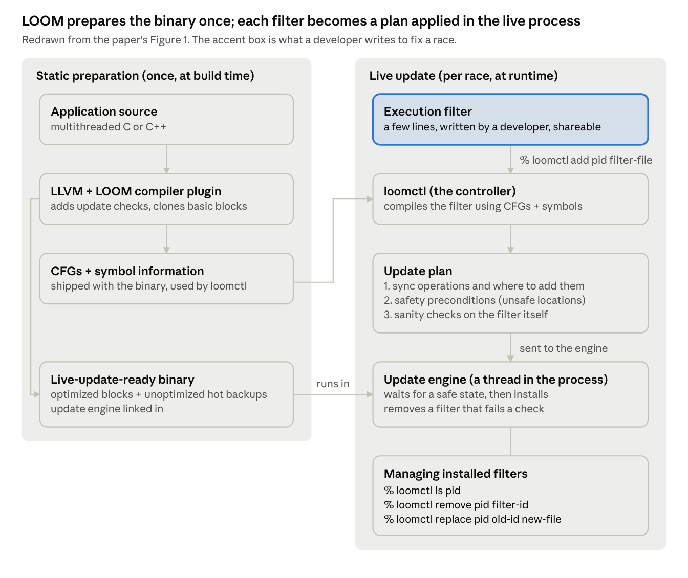
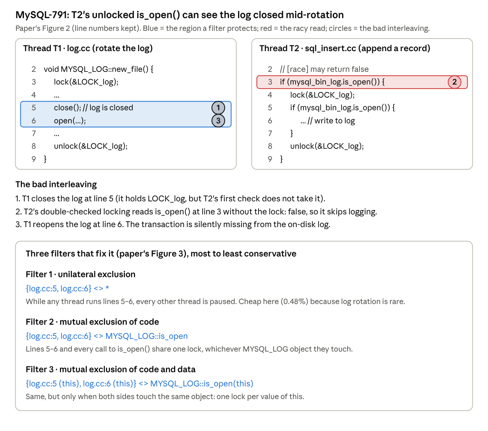
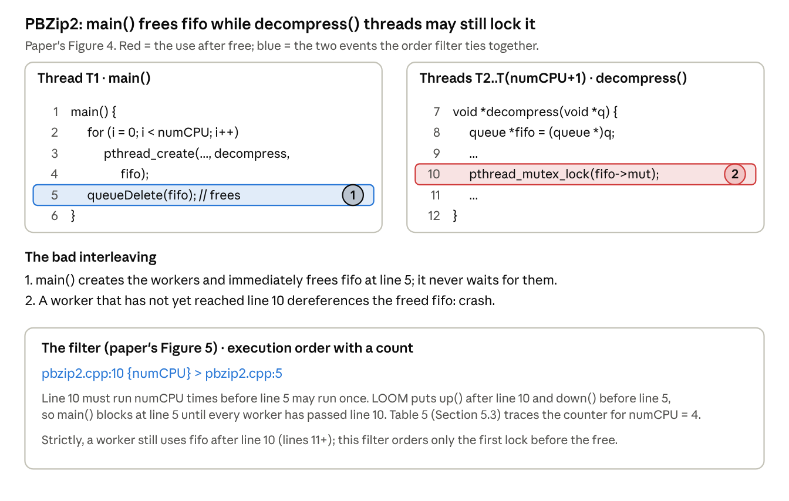
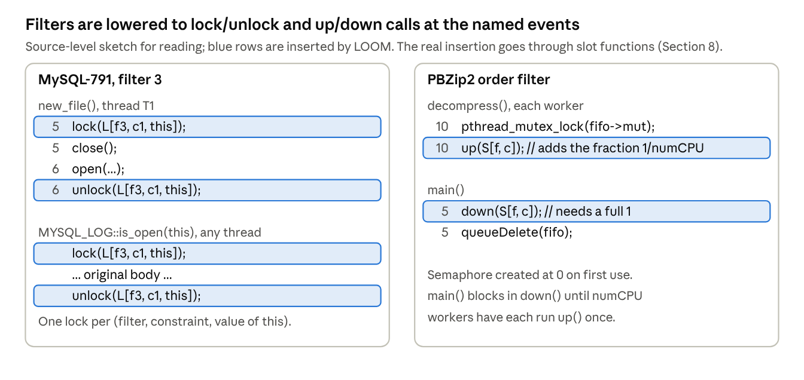
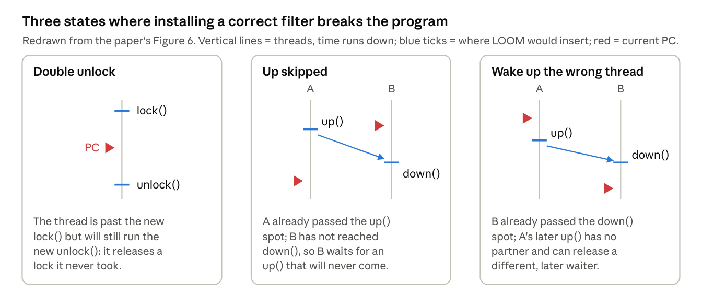
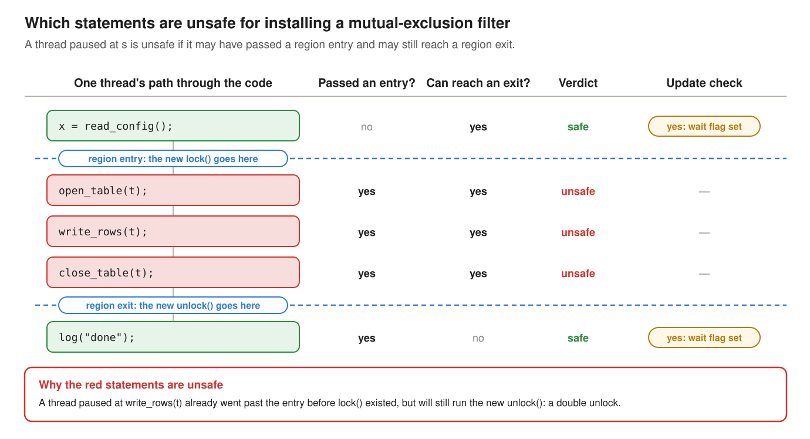

### 6. LOOM: bypassing races in live applications

**Paper:** Jingyue Wu, Heming Cui and Junfeng Yang, *Bypassing Races in Live Applications with Execution Filters*, OSDI 2010. [Read the full post]().

> Patch a race in a running program without restarting it: write a small declarative **execution filter**, and LOOM turns it into locks or semaphores and installs them only once no thread is at a location where the new synchronization could break.

#### The problem

Of nine well-studied real races, the time from bug report to a released fix ranged from 18 days to nearly 8 years, even though most reports already contained a correct diagnosis. LOOM protects the running program during that gap. Its fix for data races, atomicity violations and order violations is the same kind of thing: **add synchronization that removes the bad interleavings.**

#### LOOM at a glance

**LOOM does its expensive work once at build time, so that at runtime installing a fix is just compiling a few-line filter and flipping some flags inside the running process.** It runs in user space on Linux and needs no OS or compiler changes.

***Figure 1:*** *LOOM architecture: static preparation at build time and live update at runtime.*

##### The pieces

- **Compiler plugin (build time).** Runs inside LLVM: it links in the update engine, adds cheap update checks on loop backedges and around blocking calls, keeps a hot-backup copy of every basic block, and saves CFGs and debug symbols for the controller.
- **Controller, `loomctl` (runtime, outside the process).** Takes a filter and a process ID and compiles the filter into an **update plan** with three parts: the synchronization operations and their locations, the safety preconditions (which program locations are unsafe), and sanity checks on the filter.
- **Update engine (runtime, a thread inside the process).** Receives the plan, waits until every precondition holds (evacuation, below), installs the operations, and later removes the filter if a sanity check fails (again only in a safe state).

#### The execution filter language

A filter says *what* must be synchronized, not *how*: "these regions exclude each other" or "this event happens before that one". Because the intent is explicit, LOOM can check it and compile it, instead of reverse-engineering scattered `lock()`/`unlock()` calls.

The paper gives three reasons for a declarative language:

- **Productivity:** developers skip low-level synchronization details.
- **Analyzable safety:** LOOM never has to guess what a critical section is meant to cover.
- **Free error checking:** LOOM can insert checks when it lowers the filter (see below).

##### Syntax

***Table 1:*** *Execution filter language: syntax and meaning.*

| Construct | Syntax | Meaning |
| --- | --- | --- |
| Event `e` | `file:line` | A dynamic instance of the statement at that file and line |
| Event with data | `file:line (expr)` | Only instances where `expr` has a matching value are synchronized with each other |
| Event with count | `e{n}` | The event's number of occurrences; used in execution order |
| Region `r` | `{e1, …, ei ; ei+1, …, en}` | A dynamic instance of a code region: entry events before `;`, exit events after |
| Region from a function | `func (args)` | One call of `func`; `(args)` tells different calls apart |
| Execution order | `e1 > e2 > … > en` | e1 happens before e2, e2 before e3, … |
| Mutual exclusion | `r1 <> r2 <> … <> rn` | Every pair ri, rj is mutually exclusive |
| Unilateral exclusion | `r <> *` | r runs as if single-threaded: all other threads pause |

- **Allowed expressions** for `expr` and `n`: a constant or primitive variable `a`, `a+b`, `&a`, `&a[i]`, `&a->f`, and nested combinations. **No function calls and no dereferences**, for safety.
  - `&a->f` and `&a[i]` are not dereferences in this sense: they only compute an address (`a` plus an offset) and never read memory through the pointer.
- **Mutual vs. unilateral exclusion:** mutual exclusion needs every participant to take the same lock. Unilateral exclusion needs no cooperation from the other code: it stops everyone else. The paper's footnote adds that it is subtly different from single-threaded execution because it allows no context switches.

##### Example 1: an atomicity violation in MySQL (MySQL-791)

***Figure 2:*** *MySQL-791: the racy interleaving and three execution filters that fix it.*

**Why not just patch the source?** The obvious fix is to delete the unlocked check at T2 line 3. But when MySQL is configured to skip logging for speed, that always takes `LOCK_log` and raised response time by more than 10% in the authors' runs. So the real MySQL developers built a more involved fix (a new flag field and a changed `close()`).

**The filters trade reliability for speed, and the user picks.** Filter 1 is the bluntest and still costs only 0.48%, because log rotation is rare. Filters 2 and 3 narrow the second region and then the data. This flexibility is the paper's main argument for filters as workarounds.

##### Example 2: an order violation in PBZip2

***Figure 3:*** *PBZip2: the use-after-free order violation and its execution-order filter.*

Here the bug is not that two regions overlap, but that one event (`free`) can come before another (`lock` on the queue). The fix is an **execution order** constraint, with `{numCPU}` saying how many times the first event must occur.

##### What the three constraint types cover

***Table 2:*** *Which constraint type fits which race class.*

| Race class | Natural constraint | Paper's examples |
| --- | --- | --- |
| Atomicity violation | mutual or unilateral exclusion | MySQL-169, -644, -791; Apache-21287, -25520 |
| Order violation | execution order | PBZip2; SPLASH2 fft, lu, barnes |
| Data race | mutual exclusion of the two accesses | (subsumed by the above in the evaluation) |

The paper says new constraint types are easy to add, but these three were enough for all nine races.

#### How filters become locks and semaphores

Each constraint becomes ordinary synchronization at the named events: mutual exclusion is a lock, execution order is a semaphore, and unilateral exclusion reuses the evacuation machinery to pause everyone else.

***Figure 4:*** *Lowering filters to synchronization: MySQL filter 3 becomes a lock, the PBZip2 filter becomes a semaphore.*

##### The three lowerings

- **Execution order `ei > ei+1`:** a semaphore `up()` at `ei` and a `down()` at `ei+1`. A chain `e1 > e2 > e3` is one such pair per arrow.
  - `e1 > e2`: `up(S1)` after e1, `down(S1)` before e2.
  - `e2 > e3`: `up(S2)` after e2, `down(S2)` before e3.
  - So e2 gets both: it waits on S1 before running and signals S2 after, which forces e1, then e2, then e3.
  - S1 and S2 must be separate semaphores. With one shared semaphore, e3's `down()` could consume e1's `up()`, and e3 could run before e2. (My interpretation: the paper keys objects by filter, constraint and expr, and a chain is one constraint, so it does not say this explicitly.)
- **Mutual exclusion `r1 <> r2`:** `lock()` at every region entry and `unlock()` at every region exit, all on the same lock.
- **Unilateral exclusion `r <> *`:** no lock can do this, since the other code never calls it. LOOM uses evacuation (below) to pause all other threads at safe locations while `r` runs, and resumes them afterwards.

##### Synchronization objects are made on demand

- **Key:** (filter ID, constraint ID, value of `expr` if present). So filter 3 gets one lock per `MYSQL_LOG` object.
- **Creation:** the first time an inserted operation touches a key. Locks start unlocked, semaphores start at 0.
- **Storage:** a hash table (default 256 entries).
- **Garbage collection:** an object may be freed when it is unlocked or its counter is 0, and re-created if needed later. In the experiments it was never needed.

##### What `{n}` counts

For `e1{n1} > e2{n2}`, `up()` adds **1/n1** to the counter and `down()` takes away **1/n2**. So the first event must happen n1 times to "pay for" n2 occurrences of the second. `n` is read the first time its event runs and later changes are ignored.

Tracing the PBZip2 filter, `pbzip2.cpp:10 {numCPU} > pbzip2.cpp:5`, with numCPU = 4 (no `{n}` on line 5, so n2 = 1):

***Table 3:*** *Semaphore counter trace for the PBZip2 filter with numCPU = 4.*

| Step | Event | Counter | main() at line 5 |
| --- | --- | --- | --- |
| 0 | main() reaches line 5, calls `down()` | 0 | blocked (needs 1) |
| 1 | worker 1 passes line 10, `up()` | 1/4 | blocked |
| 2 | worker 2 passes line 10, `up()` | 2/4 | blocked |
| 3 | worker 3 passes line 10, `up()` | 3/4 | blocked |
| 4 | worker 4 passes line 10, `up()` | 1 → 0 after `down()` | runs `queueDelete(fifo)` |

The paper says the implementation uses integers rather than fractions but not how. One natural reading (my interpretation): scale by n1 · n2, so `up()` adds n2 and `down()` needs n1.

##### Evaluating `expr` and `n`

- `expr` and `n` are found through **debug information**. LOOM parses them with GDB's `parse_exp_1()` into an expression tree, then compiles the tree into low-level instructions using the DWARF library.
- This happens **in the controller**, so the running program never pays for it.
- Only side-effect-free forms are allowed (see the syntax above), so evaluating them inside the application cannot change its behavior.

##### Three safety mechanisms in the lowering

1. **Isolation between filters.** Keys include the filter and constraint ID, so two filters never share a lock or semaphore.
2. **Sanity checks in the update plan.** E.g., for a region `c`, check that `c`'s `unlock()` never releases a lock that `c`'s `lock()` did not take.
3. **Deadlock recovery.** A buggy filter can deadlock, but then one of its own operations must be in the wait cycle. LOOM detects this with **timeouts** and removes the offending filter automatically (again in a safe state).

Note the division of labour. These checks catch a **bad filter**. A **good filter installed at a bad moment** is a separate problem, which the next two subsections handle.

#### Unsafe application states

A filter that is correct by itself can still break the program if a thread is already in the middle of the code it protects when it is installed. LOOM must install only when no thread is in such a place, and it must check and install atomically while threads keep running.

##### Three ways a good filter goes wrong

***Figure 5:*** *Three unsafe states for installing a filter: double unlock, up skipped, wrong thread woken.*

The safe conditions follow directly:

- **Mutual exclusion:** no thread is executing inside any of the protected regions.
- **Execution order `e1 > e2`:** either both `e1` and `e2` have already occurred, or neither has.

##### Why function quiescence is not enough

**Function quiescence** is the standard live-update safety rule: replace a function only when no stack frame of that function is active. It works for many updates. It fails here because **a filter's constraint can span several functions**, and a thread can be *between* them.

Two things go wrong:

1. **Thread looks safe, but isn't.** Say the fix locks in `open_table()` and unlocks in `close_table()`. A thread between the two calls has neither function on its stack, so the update looks safe, yet that thread is inside the new critical section.
2. **Correct fix, but never installed.** Say the fix goes inside a server's request loop. There are moments when installing it would be fine, such as when the thread is at some line `L` outside the fix's region. But **function quiescence** waits for the **whole** loop function to leave the stack, which never happens, so the update waits forever. In the paper's tests, an Apache fix waiting for function quiescence was still not installed after an hour.

LOOM's answer is to **quiesce an arbitrary set of program locations**, chosen from the filter, rather than whole functions. That is evacuation.

#### The evacuation algorithm

Evacuation quiesces an arbitrary set of code regions on demand: LOOM computes which program locations are unsafe for this filter, lets threads in those locations run until they leave, parks every thread at a safe location, installs the filter, and resumes. It never needs a whole function to be inactive.

Three steps:

1. **Compute unsafe locations** for the filter (static, conservative).
2. **Evacuate:** let threads at unsafe locations run on, and block every thread at a safe location.
3. **Install** the filter and resume the threads.

##### Computing unsafe program locations

**Mutual exclusion.** LOOM works on the **interprocedural control flow graph (ICFG)**, which links each function's CFG through calls and returns. `reachable(s1, s2)` means there is an ICFG path from s1 to s2. For a filter `f` with `r1 <> r2 <> … <> rn`, the paper defines:

$$
\mathit{unsafe}(f) = \{\, s \mid \exists i \in [1,n].\ \mathit{reachable}(r_i.\mathit{entries},\, s) \wedge \mathit{reachable}(s,\, r_i.\mathit{exits}) \,\}
$$

In words: s is unsafe if a thread there may have passed a region entry (where the new `lock()` goes) and may still reach a region exit (where the new `unlock()` goes).

***Figure 6:*** *Unsafe statements for one region. Between the entry and the exit, a paused thread has passed the entry but can still reach the exit, so installing the filter there would leave it running the new `unlock()` without the matching `lock()`.*

##### Pausing only at safe locations

**Update checks** are points the compiler plugin inserts on loop backedges, at recursive function entries and around blocking calls. A thread passing an update check parks there if an update is waiting, and otherwise carries on.

Two kinds of variables decide *where* a thread may park:

- **A wait flag at each update check.** If the flag is set, a thread stops there. LOOM sets flags only at **safe** update checks, so a thread at an unsafe one keeps running until it reaches a safe one. This is called evacuation.
  - **In Figure 6:** say there are update checks at `x = read_config();` and `log("done");`. Both are safe, so LOOM sets their wait flags.
  - **A thread before the region** parks at `read_config()`, before it can reach the entry.
  - **A thread inside the region**, say at `write_rows(t)`, is not stopped there. It keeps running through `close_table(t)` and past the exit, then parks at `log("done")`.
- **A counter at each blocking call:** how many threads are currently inside it (a counter, not a flag, since several threads can be in the same call).
  - **In Figure 6:** if `write_rows(t)` were a blocking call, a thread blocked inside it would be at an unsafe location. LOOM waits until that callsite's counter drops to 0.

Once every thread is parked at a safe site or blocked at a safe call, LOOM installs the filter.

#### Results: can filters fix the races, and at what cost?

All nine races were fixed, each in more than one way (checked by inspecting the binaries). Filters are small: **3.79 events on average, at most 16.**

***Table 4:*** *Filter size and overhead for atomicity violations.*

<table class="compact">
  <thead>
    <tr><th rowspan="2">Race</th><th colspan="3">Mutual exclusion</th><th colspan="3">Unilateral exclusion</th></tr>
    <tr><th>Events</th><th>TPUT</th><th>RESP</th><th>Events</th><th>TPUT</th><th>RESP</th></tr>
  </thead>
  <tbody>
    <tr><td>MySQL-169</td><td>2</td><td>0.14%</td><td>0.15%</td><td>1</td><td>3.28%</td><td>3.37%</td></tr>
    <tr><td>MySQL-644</td><td>4</td><td>0.22%</td><td>0.20%</td><td>4</td><td>32.58%</td><td>48.34%</td></tr>
    <tr><td>MySQL-791</td><td>4</td><td>0.23%</td><td>0.32%</td><td>2</td><td>0.33%</td><td>0.48%</td></tr>
    <tr><td>Apache-21287</td><td>16</td><td>−0.02%</td><td>−0.03%</td><td>2</td><td>54.03%</td><td>118.16%</td></tr>
    <tr><td>Apache-25520</td><td>1</td><td>0.52%</td><td>0.55%</td><td>1</td><td>86.04%</td><td>637.03%</td></tr>
  </tbody>
</table>

***Table 5:*** *Filter size and overhead for order violations.*

| Race | Events | Overhead |
| --- | --- | --- |
| PBZip2 | 6 | 1.26% |
| SPLASH2-fft | 6 | 0.08% |
| SPLASH2-lu | 2 | 1.68% |
| SPLASH2-barnes | 2 | 1.99% |

The overheads are on top of LOOM's own normal-run overhead. What the tables show:

- **Mutual-exclusion filters are nearly free** (under 0.6%).
- **Unilateral filters are shorter to write but can be very expensive:** 637% response time for Apache-25520, whose logging code runs on every request. They are cheap only when the protected code is rare (MySQL-791, MySQL-169).
- **A practical recipe:** install a unilateral filter for immediate protection, then `loomctl replace` it atomically with a faster mutual-exclusion filter. Or keep the "expensive" one if your workload rarely runs that code.
