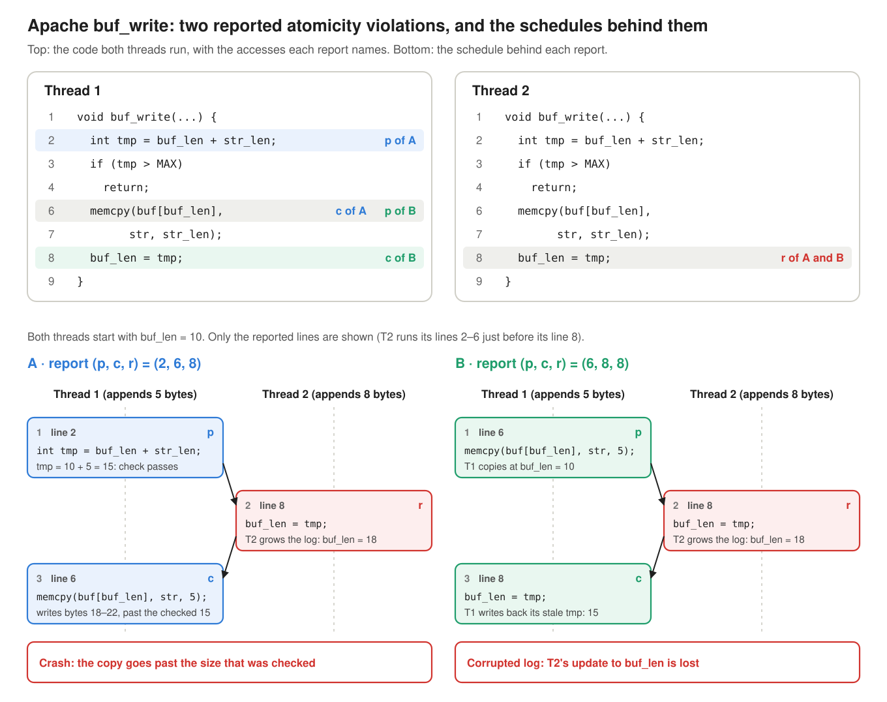
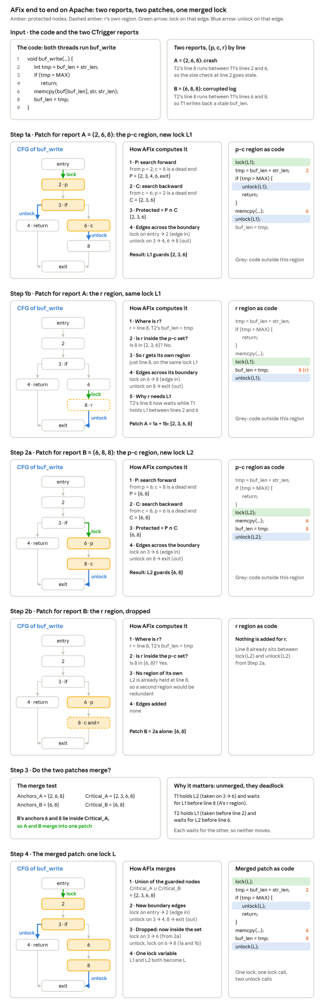

### 7. AFix: automated atomicity-violation fixing

**Paper:** Guoliang Jin, Linhai Song, Wei Zhang, Shan Lu and Ben Liblit, *Automated Atomicity-Violation Fixing*, PLDI 2011. [Read the full post]().

> Given a bug report (p, c, r), hold one lock on every statement on some path from p to c, and take the same lock around r. Then r can never run between p and c.

#### The problem

An atomicity violation has three accesses to one shared variable. One thread makes two accesses that are meant to happen together: **p** (preceding) and **c** (current). Another thread's access **r** (remote) lands between them. A detector such as CTrigger reports each bug as a triple (p, c, r), and AFix turns those reports into a lock-based patch.

The paper's running example is Apache's `buf_write`, which two threads run to append to a shared log buffer. The detector reports two atomicity violations on it, A and B:

***Figure 1:*** *The Apache buf\_write bug. Top: the accesses each report names. Bottom: the schedules. In A, Thread 2 grows `buf_len` between Thread 1's size check and its copy, so the copy overflows. In B, it grows `buf_len` between Thread 1's copy and its write-back, so Thread 1 writes back a stale length.*

Fixing this with locks by hand is easy to get wrong. The obvious patches deadlock in three different ways:

- An early return at line 4 skips the unlock.
- A thread re-acquires a lock it already holds, because line 8 lies in two locked regions.
- Two locks, one per report, wait on each other.

#### AFix on the Apache bug, step by step

Figure 2 uses these ideas:

- **The p–c region.** On the function's control-flow graph, P is everything reachable forward from p without passing c, and C is everything that reaches c backward without passing p. The **protected nodes** are P ∩ C: every statement on some path from p to c.
- **Lock on edges, not lines.** `lock()` goes on every edge that enters the protected nodes, and `unlock()` on every edge that leaves them. An early return therefore gets its own `unlock()`.
- **r's region.** r gets its own small region on the same lock, unless r is already inside the p–c region.
- **Merging.** Each report starts with its own lock. If one patch's accesses (its **anchors** p, c and r) lie inside another patch's guarded nodes (its **critical** set), the two would deadlock, so AFix merges them: it takes the union of the guarded nodes, recomputes the boundary edges and uses one lock.

***Figure 2:*** *AFix end to end on Apache. Steps 1a and 2a compute each report's p–c region and place lock and unlock on the edges that cross its boundary. Steps 1b and 2b handle r: A's r (line 8) lies outside its p–c region and gets its own region on L1, while B's r is already inside, so nothing is added. Step 3 applies the merge test and shows the deadlock the two separate patches would cause. Step 4 takes the union of the guarded nodes and recomputes the boundary, which leaves one lock L, one lock call and two unlock calls.*

The result is one lock, taken before line 2 and released before line 4 and after line 8. It closely resembles the developers' own fix.
