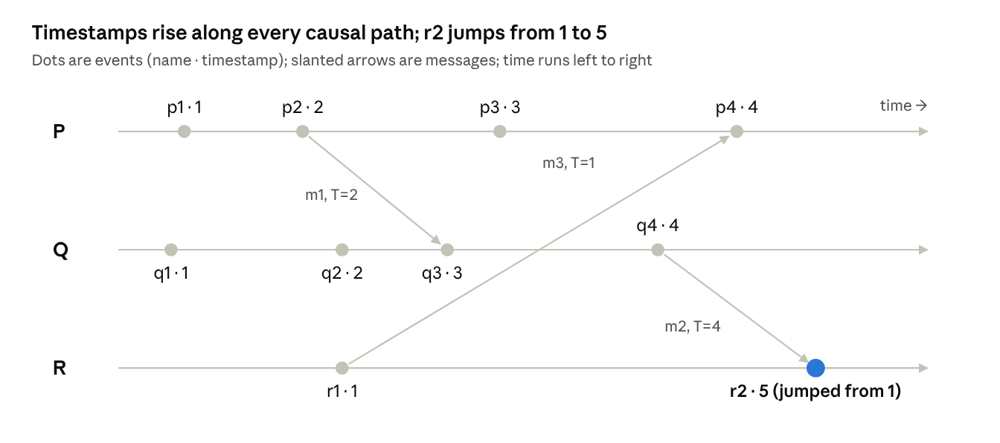
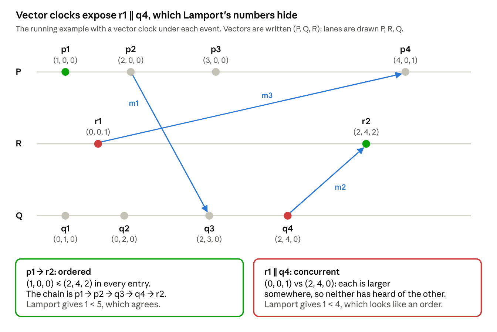
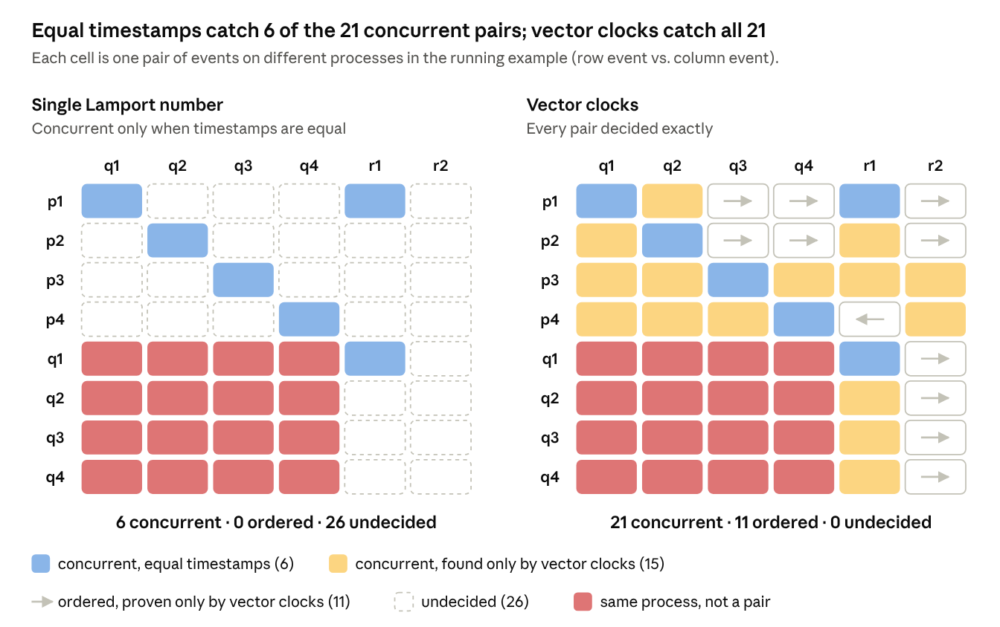

### 1. Lamport's algorithm: logical and vector clocks

**Paper:** Leslie Lamport, *Time, Clocks, and the Ordering of Events in a Distributed System*, CACM 1978. [Read the full post](). Its central idea fits in one sentence: **in a distributed system, "time" really means causality.**

#### Causality, not time

Lamport models a distributed system as a set of **processes**. Each process does one thing after another, so its events are in a fixed order. Sending a message is an event, and receiving one is an event.

He then defines **happened before**, written **a → b**, as the smallest relation satisfying three rules:

1. **Same process:** if a comes before b in the same process, then a → b.
2. **Messages:** if a sends a message and b receives it, then a → b.
3. **Chains:** if a → b and b → c, then a → c.

In plain terms, **a → b means information could have flowed from a to b.** If neither a → b nor b → a, the two events are **concurrent**. Neither could have influenced the other, so neither came "first" in any sense the system can observe.

Here is the running example used throughout this post: three processes, P, Q and R, exchanging three messages.



***Figure 1: The running example: 3 processes, 3 messages, with the Lamport timestamps computed in the next section.***

To check whether a → b, look for a path from a to b that moves forward along process lines and message arrows.

- **p1 → r2:** p1 → p2 → (m1) → q3 → q4 → (m2) → r2. Yes.
- **r1 → p4:** r1 sends m3, p4 receives it. Yes.
- **r1 vs q4:** there is no path either way, so they are **concurrent**. That holds even though r1 is drawn to the left.

A note on the word **"smallest"**: it simply means that → is the **transitive closure** of the three rules. It contains every pair the rules force, and not a single pair more.

#### Logical clocks: a counter is enough

A **logical clock** is just an integer counter kept by each process. It has nothing to do with seconds. Its only job is to satisfy the **Clock Condition**:

> If a → b, then C(a) < C(b).

If a could have influenced b, then a gets the smaller number. Two implementation rules, which Lamport calls IR1 and IR2, are enough to guarantee it:

- **IR1:** tick your counter between any two of your own events.
- **IR2:** stamp every message with your counter. When you receive a message with stamp T, move your counter past T.

In code, the whole algorithm is a few lines:

```python
C = 0  # this process's logical clock

def local_event():
    global C
    C += 1
    return C

def send(msg):
    global C
    C += 1
    msg.T = C
    transmit(msg)

def receive(msg):
    global C
    C = max(C, msg.T) + 1
    return C
```

Run it on the example above and you get the numbers in the diagram. The interesting moment is **r2**. R's clock reads 1, but the message m2 arrives stamped 4, so R jumps straight to **5**. A slow process gets pulled forward the moment it learns about later events.

##### The catch: it only works in one direction

If a → b, then C(a) < C(b); but this does **not** mean that

> If C(a) < C(b), then a → b.

#### What is concurrent?

If two events have **no happened-before relationship** in either direction (neither a → b nor b → a), they are **concurrent**, written a ∥ b.

In the example, r1 and q4 are concurrent: no path of messages connects them. Concurrent does not mean simultaneous, and it does not mean equal timestamps (r1 has 1, q4 has 4). It only means that neither event could have influenced the other.

#### One order everyone agrees on

Happened-before is a **partial** order: concurrent events are left unordered. Many algorithms need more than that. They need **one sequence of all events that every process agrees on**.

Lamport writes this total order as **⇒**: a ⇒ b means "a comes before b in the agreed order (i.e., numbering system)", whether or not a actually happened before b.

Lamport's construction takes two steps:

1. **Sort by timestamp.** This puts every causal pair in the right order, because of the Clock Condition.
2. **Break ties by process ID** (P ≺ Q ≺ R). Only concurrent events can share a timestamp, so the tie-break never contradicts causality.

This gives a lexicographic order on (timestamp, process ID). Lamport writes it as **⇒**. For the example:

| (C, process) | Events in ⇒ order |
| --- | --- |
| (1, ·) | p1, q1, r1 |
| (2, ·) | p2, q2 |
| (3, ·) | p3, q3 |
| (4, ·) | p4, q4 |
| (5, ·) | r2 |

***Table 1: The total order ⇒ on the running example.***

Two things are worth seeing here.

- **The order is fixed when the tie-break rule is kept constant.** Other clock values or another tie-break rule would give a different, equally valid order. Only → is a real property of the execution.
- **That is fine.** No process needs the "true" order. What matters is that every process computes the same one, on its own. Each event carries a fixed stamp chosen by its sender, and everyone sorts with the same rule. Same inputs and same rule give the same output, with no coordination.

Compare this with sorting by **arrival time**. One process might receive A then B, while another receives B then A, and the two would disagree.

#### Telling concurrent from ordered: vector clocks

The tie-breaks above show the only thing a single Lamport number can say about concurrency: **equal timestamps mean concurrent**. In the running example that finds 6 of the 21 concurrent pairs, and it never proves that two events are ordered. **Vector clocks** decide every pair exactly. They are not in Lamport's paper; Colin Fidge and Friedemann Mattern introduced them independently in 1988.

##### What a single number can tell you

| What you see, for a and b on different processes | What you can conclude | Why |
| --- | --- | --- |
| C(a) = C(b) | a ∥ b | a → b would force C(a) < C(b) |
| C(a) < C(b) | Only that b does not happen before a; a and b may be ordered or concurrent | The Clock Condition only works one way |

***Table 2: What a single Lamport number lets you conclude about two events.***

So with one number, concurrency shows up only as a tie, and an order can never be proven.

##### The idea

Instead of one counter, every process keeps **one counter per process**. Q's entry for P records how much of P's history Q has heard about, directly or through a chain of messages.

##### The rules

These are a small change to Lamport's two rules:

1. Every process starts with all entries at 0.
2. Before each event, a process adds 1 to **its own** entry.
3. A message carries the sender's whole vector.
4. On a receive, the process first takes the **larger value of each entry** (its own vector vs. the message's), then applies rule 2.

##### The test

For two events a and b:

- **a → b** exactly when every entry of V(a) is ≤ the matching entry of V(b), and the vectors differ.
- **a ∥ b** exactly when each vector is larger in some entry.
- **Shortcut:** a → b exactly when b's entry for a's process is at least a's own entry. In words: b has heard of a.

**Why the shortcut gives the same answer as the full comparison.** a's own entry, say k, simply means "a is the k-th event of its process". If b's entry for that process is at least k, then a chain of messages carried news of a to b, so a → b; and anything a had heard of, b has heard of too, so the whole vector of a is ≤ b's.

##### Vector clocks on the running example



***Figure 2: Vector clocks on the running example. p1 → r2 shows up as "≤ in every entry"; r1 and q4 are each larger somewhere, so they are concurrent, even though Lamport's numbers gave 1 < 4.***

| Event | Rule | Computation | V(event) as (P, Q, R) | Lamport C |
| --- | --- | --- | --- | --- |
| p1 | local | P entry 0 + 1 | (1, 0, 0) | 1 |
| p2 (send m1) | send | P entry + 1; m1 carries (2, 0, 0) | (2, 0, 0) | 2 |
| p3 | local | P entry + 1 | (3, 0, 0) | 3 |
| q1 | local | Q entry 0 + 1 | (0, 1, 0) | 1 |
| q2 | local | Q entry + 1 | (0, 2, 0) | 2 |
| q3 (recv m1) | receive | max((0, 2, 0), (2, 0, 0)) = (2, 2, 0), then Q + 1 | (2, 3, 0) | 3 |
| q4 (send m2) | send | Q entry + 1; m2 carries (2, 4, 0) | (2, 4, 0) | 4 |
| r1 (send m3) | send | R entry 0 + 1; m3 carries (0, 0, 1) | (0, 0, 1) | 1 |
| p4 (recv m3) | receive | max((3, 0, 0), (0, 0, 1)) = (3, 0, 1), then P + 1 | (4, 0, 1) | 4 |
| r2 (recv m2) | receive | max((0, 0, 1), (2, 4, 0)) = (2, 4, 1), then R + 1 | (2, 4, 2) | 5 |

***Table 3: Vector clocks on the running example, next to the Lamport numbers.***

##### Side by side: single number vs. vector clocks

The running example has 32 pairs of events on different processes. Figure 3 judges every one of them both ways.



***Figure 3: Every pair of events on different processes in the running example, judged with a single Lamport number (left) and with vector clocks (right). Equal timestamps catch 6 of the 21 concurrent pairs; vector clocks catch all 21 and prove the other 11 pairs ordered.***

|  | Single Lamport number | Vector clocks |
| --- | --- | --- |
| Concurrent pairs found | 6 (only the ties) | **21** (all of them) |
| Ordered pairs proven | 0 | **11** (all of them) |
| Pairs left undecided | 26 | **0** |

***Table 4: How each method classifies the 32 pairs of events on different processes.***

The six ties (p1–q1, p1–r1, q1–r1, p2–q2, p3–q3, p4–q4) are found by both methods. Every other verdict comes only from the vectors, for example:

- **r1 ∥ q4.** C = 1 vs 4 looks like an order. V = (0, 0, 1) vs (2, 4, 0): each is larger somewhere, so they are concurrent.
- **p3 ∥ r2.** C = 3 vs 5 looks like an order. V = (3, 0, 0) vs (2, 4, 2): p3 is larger in P's entry, r2 in Q's and R's.
- **p1 → r2.** C = 1 vs 5 is only consistent with an order. V = (1, 0, 0) ≤ (2, 4, 2) in every entry proves it.

##### The price

A vector has one entry per process, so every timestamp and message grows with the number of processes. Charron-Bost showed in 1991 that no smaller exact encoding exists in the worst case. Dynamic data race detectors pay that cost to decide whether two memory accesses are ordered.
