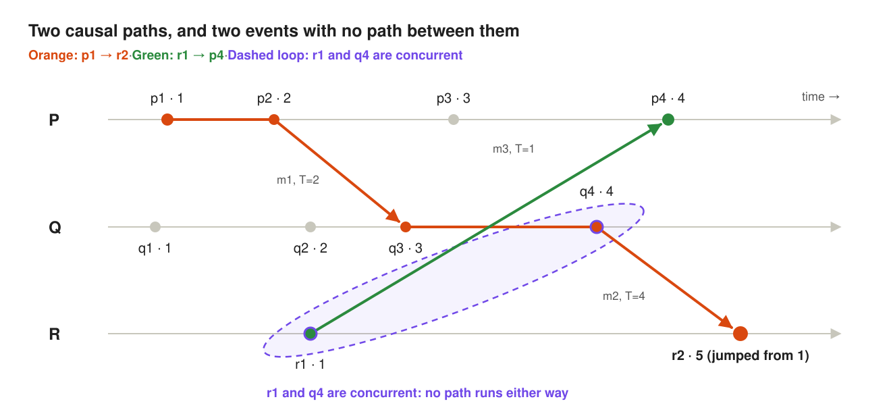
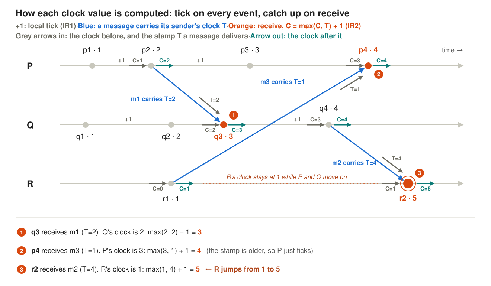
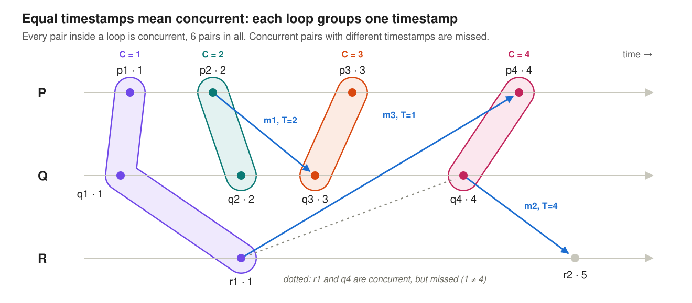
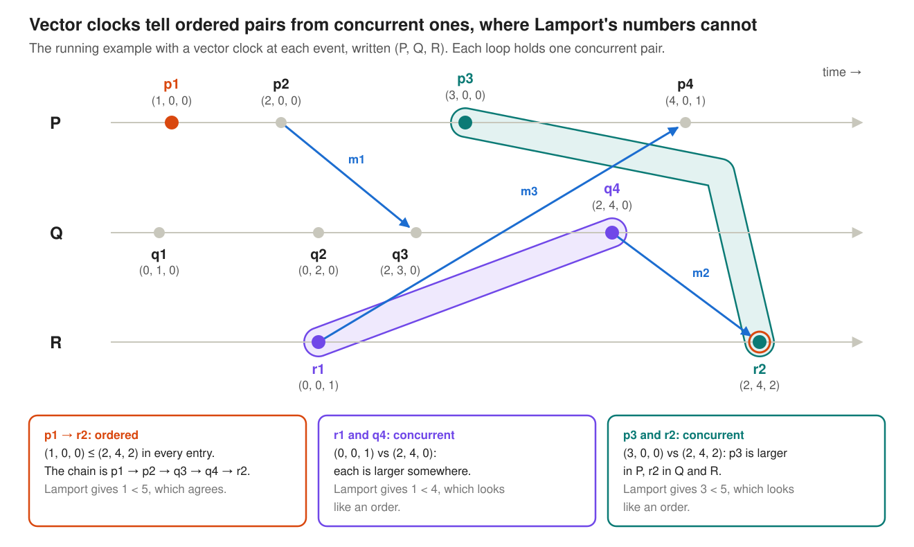
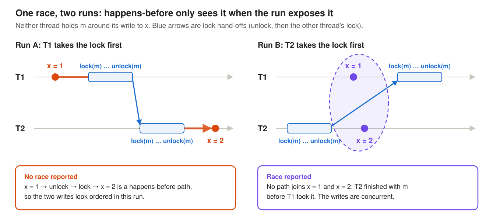

### 1. Lamport's algorithm: logical and vector clocks

**Paper:** Leslie Lamport, *Time, Clocks, and the Ordering of Events in a Distributed System*, CACM 1978. [Read the full post](). Its central idea fits in one sentence: **in a distributed system, "time" really means causality.**

**Vector clocks:** Colin Fidge, [*Timestamps in Message-Passing Systems That Preserve the Partial Ordering*](https://www.cs.uky.edu/~manivann/cs570/Fidge.pdf), Australian Computer Science Conference 1988; Friedemann Mattern, [*Virtual Time and Global States of Distributed Systems*](https://www.vs.inf.ethz.ch/publ/papers/VirtTimeGlobStates.pdf), Workshop on Parallel and Distributed Algorithms 1988.

#### Thinking about Causality, and not the absolute time

Lamport models a distributed system as a set of **processes**. Each process does one thing after another, so its events are in a fixed order. Additionally, each process and can send messages to and receive messages from other processes---thus sending a message is an event, and receiving one is an event.

He then defines **happened before**, written **a → b**, as the smallest relation satisfying three rules:

1. **Same process:** if a comes before b in the same process, then a → b.
2. **Messages:** if a sends a message and b receives it, then a → b.
3. **Chains:** if a → b and b → c, then a → c (think **transitive closure**).

In plain terms, **a → b means information could have flowed from a to b.** If neither a → b nor b → a, the two events are **concurrent**. Neither could have influenced the other, so neither came "first" in any sense the system can observe.

Here is the running example used throughout this post: three processes, P, Q and R, exchanging three messages.



***Figure 1: The running example: 3 processes, 3 messages, with the Lamport timestamps computed in the next section. Orange is the path p1 → r2, green is r1 → p4, and the dashed loop marks r1 and q4 as concurrent.***

To check whether a → b, look for a path from a to b that moves forward along process lines and message arrows. **p1 → r2:** is ordered (orange line); **r1 → p4:** is ordered (green line); but **r1 vs q4:** is concurrent (even if r1 is to the left).

<!-- - **p1 → r2:** p1 → p2 → (m1) → q3 → q4 → (m2) → r2. Yes.
- **r1 → p4:** r1 sends m3, p4 receives it. Yes.
- **r1 vs q4:** there is no path either way, so they are **concurrent**. That holds even though r1 is drawn to the left. -->

<!-- A note on the word **"smallest"**: it simply means that → is the **transitive closure** of the three rules. It contains every pair the rules force, and not a single pair more. -->

#### Logical clocks: a counter is enough

A **logical clock** is just an integer counter kept by each process. It has nothing to do with seconds. Its only job is to satisfy the **Clock Condition**:

> If a → b, then C(a) < C(b).

If a could have influenced b, then a gets the smaller number. Two implementation rules, which Lamport calls IR1 and IR2, are enough to guarantee it:

- **IR1:** tick your counter between any two of your own events.
- **IR2:** stamp every message with your counter. When you receive a message with stamp T, move your counter past T.



***Figure 2: The update rules at work. Every event ticks the clock by 1 (IR1); each message carries its sender's clock; each receive (orange) sets the clock to max(C, T) + 1 (IR2). At every send and receive, the grey arrows show what goes in (the clock, and on a receive the message's stamp T) and the teal arrow the clock coming out. Only r2 actually jumps.***

#### What is concurrent?

##### The definition

Concurrency is defined in terms of happened-before, not clocks:

> If two events have **no happened-before relationship** in either direction (neither a → b nor b → a), they are **concurrent**, written a ∥ b.

- **Example:** r1 and q4 are concurrent. No path of messages connects them.
- **What it does not mean:** concurrent is not "simultaneous". It only means that neither event could have influenced the other.

##### The problem: deriving it from clock numbers

- **The goal:** the definition talks about paths, but an algorithm cannot "see" paths. All it has are the logical clock numbers we just assigned. So we would like to decide a ∥ b from C(a) and C(b) alone.
- **The catch:** the Clock Condition only works in one direction. If a → b, then C(a) < C(b); but this does **not** mean that

  > If C(a) < C(b), then a → b.

- **A counterexample:** C(r1) = 1 < C(q4) = 4, yet r1 ∥ q4. A smaller number shows up for ordered pairs, but also for plenty of concurrent ones.
- **So:** C(a) < C(b) only rules out b → a. It cannot tell "ordered" from "concurrent".

##### The rule used in practice: equal timestamps mean concurrent

**Claim.** If two events have the **same** timestamp, C(a) = C(b), then a ∥ b.

**Why.**

1. If a → b, the Clock Condition would force C(a) < C(b). It doesn't, so **not a → b**.
2. If b → a, it would force C(b) < C(a). It doesn't, so **not b → a**.
3. Neither direction holds, which is exactly the definition: **a ∥ b**.

**On the running example**, the rule groups events into one loop per timestamp. Every pair inside a loop is concurrent:



***Figure 3: The equal-timestamp rule on the running example. The four loops hold 6 concurrent pairs: p1 ∥ q1, p1 ∥ r1, q1 ∥ r1, p2 ∥ q2, p3 ∥ q3 and p4 ∥ q4. The dotted pair, r1 and q4, is concurrent too, but their timestamps differ, so the rule misses it.***

**Strengths and limits.**

- **No false alarms:** every pair it reports really is concurrent.
- **Misses many pairs:** it also works in one direction only. Concurrent events with different timestamps, like r1 (1) and q4 (4), slip through. It finds only 6 of the running example's 21 concurrent pairs. Catching the rest needs [vector clocks](#telling-concurrent-from-ordered-vector-clocks), below.

#### Telling concurrent from ordered: vector clocks

As [shown above](#what-is-concurrent), the only thing a single Lamport number can say about concurrency is that **equal timestamps mean concurrent**. In the running example that finds 6 of the 21 concurrent pairs, and it never proves that two events are ordered. **Vector clocks** decide every pair exactly. They are not in Lamport's paper; Colin Fidge ([*Timestamps in Message-Passing Systems That Preserve the Partial Ordering*](https://www.cs.uky.edu/~manivann/cs570/Fidge.pdf)) and Friedemann Mattern ([*Virtual Time and Global States of Distributed Systems*](https://www.vs.inf.ethz.ch/publ/papers/VirtTimeGlobStates.pdf)) introduced them independently in 1988.

##### What a single number can tell you

| What you see, for a and b on different processes | What you can conclude | Why |
| --- | --- | --- |
| C(a) = C(b) | a ∥ b | a → b would force C(a) < C(b), and b → a would force C(b) < C(a) |
| C(a) < C(b) | Only that b does not happen before a; a and b may be ordered or concurrent | The Clock Condition only works one way |

***Table 1: What a single Lamport number lets you conclude about two events.***

So with one number, concurrency shows up only as a tie, and an order can never be proven.

##### **The idea**

- Instead of one counter, every process keeps **one counter per process**. Q's entry for P records how much of P's history Q has heard about, directly or through a chain of messages. If a vector that reaches a process is **≤ its own in every entry**, the process has already heard everything that vector carries. So the event behind that vector **happened before** the process's current event.

##### **The rules**

These are a small change to Lamport's two rules:

1. Every process starts with all entries at 0.
2. Before each event, a process adds 1 to **its own** entry.
3. A message carries the sender's whole vector.
4. On a receive, the process first takes the **larger value of each entry** (its own vector vs. the message's), then applies rule 2.

##### **The test**

For two events A and B:

- **A → B** exactly when every entry of V(A) is ≤ the matching entry of V(B), and the vectors differ.
- **A ∥ B** exactly when each vector is larger in some entry.
- **Shortcut:** A → B exactly when B's entry for A's process is at least A's own entry. In words: B has heard of A.

##### Why the shortcut gives the same answer as the full comparison?
- A's own entry, say k, simply means "A is the k-th event of its process". 
- If B's entry for that process is at least k, then a chain of messages carried news of A to B, so A → B; and anything A had heard of, B has heard of too, so the whole vector of A is ≤ B's.

##### Vector clocks on the running example



***Figure 4: Vector clocks on the running example. p1 → r2 (orange) shows up as "≤ in every entry". The two loops are concurrent pairs, r1 and q4 and p3 and r2: in each, every vector is larger somewhere, even though Lamport's numbers (1 < 4, 3 < 5) look like an order.***

##### Side by side: single number vs. vector clocks

- The running example has 32 pairs of events on different processes. Table 2 counts how each method judges them.

|  | Single Lamport number | Vector clocks |
| --- | --- | --- |
| Concurrent pairs found | 6 (only the ties) | **21** (all of them; including the six) |
| Ordered pairs proven | 0 | **11** (all of them) |
| Pairs left undecided | 26 | **0** |

***Table 2: How each method classifies the 32 pairs of events on different processes.***

##### The price

- A vector has one entry per process. With N processes, every timestamp is N numbers, every message carries N extra numbers, and every comparison checks up to N entries, where a Lamport clock needs just one. Charron-Bost showed in 1991 that no smaller exact encoding exists in the worst case. Dynamic data race detectors, where the processes are threads, pay that cost on memory accesses to decide whether two of them are ordered.

#### Strengths and weaknesses for race detection

A happens-before race detector treats threads as the processes and synchronization as the messages: an unlock followed by a lock of the same lock, a fork, a join. It keeps vector clocks and reports two conflicting accesses (same location, at least one write) when neither happened before the other.

##### Strengths

- **No false alarms on the run (i.e  specific schedule) it sees.** If two accesses are unordered in this run, nothing kept them apart, so they really could be concurrent. Every report is a real race.
- **Works with any synchronization.** Locks, fork/join and messages all become edges.
- **Exact.** Vector clocks decide every pair as ordered or concurrent, with no guessing.

##### Weaknesses

- **It only knows the observed run (i.e. specific schedule).** It judges the one interleaving that actually happened, and cannot predict what another interleaving would do.
- **Unrelated synchronization hides races.** The example below shows this.
- **Cost.** N-entry vectors on memory accesses, as described above.

##### Example: one race, two runs

Two threads write `x` without holding any lock. Each also takes lock `m` for some unrelated work:

```text
T1:  x = 1                 T2:  lock(m)
     lock(m)                    ...
     ...                        unlock(m)
     unlock(m)                  x = 2
```

The writes to `x` race in every run, because no lock protects them. Whether happens-before notices depends on which thread takes `m` first (see Figure. 5) :



***Figure 5: The same race in two runs. In run A, T1 releases m before T2 takes it, so happens-before records a partial order (i.e. no race). In run B, T2 is done with m before T1 takes it, nothing orders the two writes, and the race is reported.***

So happens-before is **very conservative**. It reports only what the observed run proves, and stays silent about races that a different schedule would expose. Lockset analysis (Eraser, next) addresses this.
