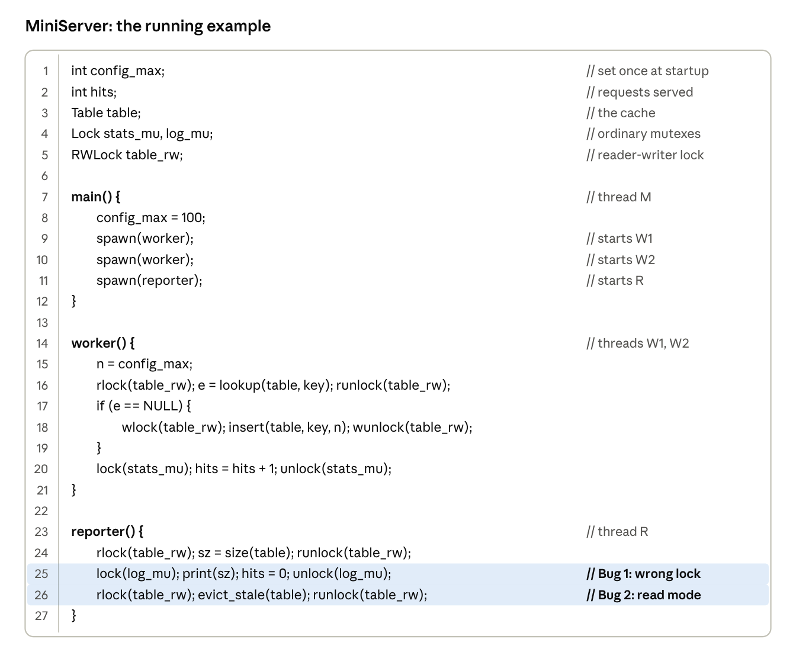
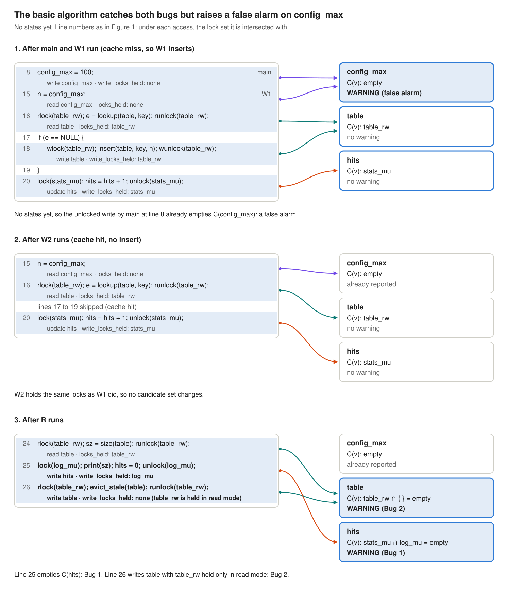
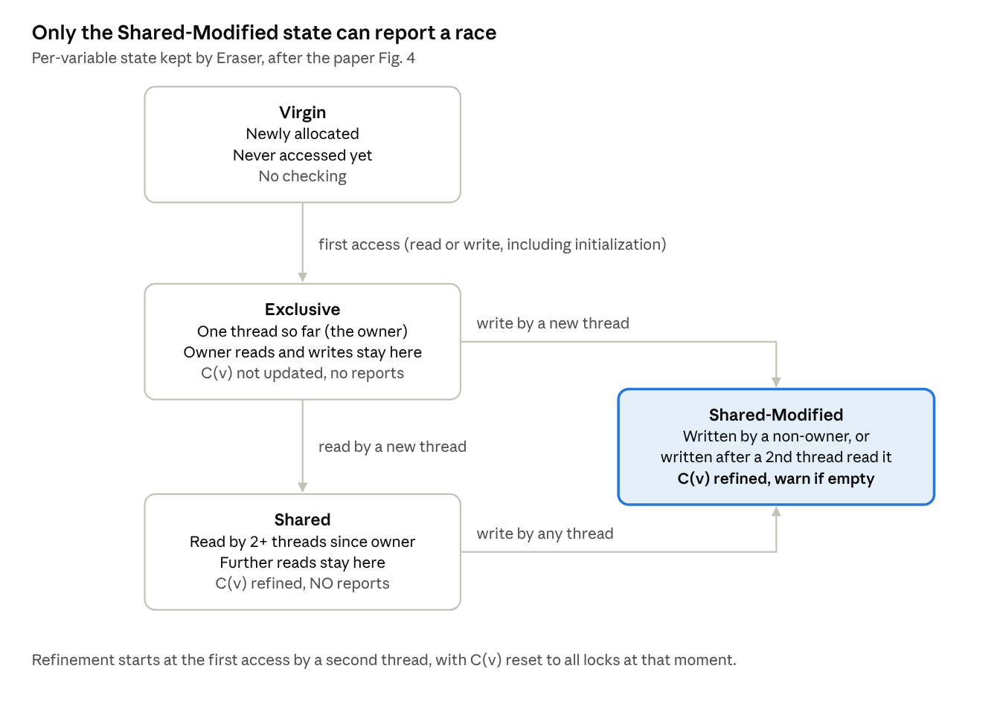
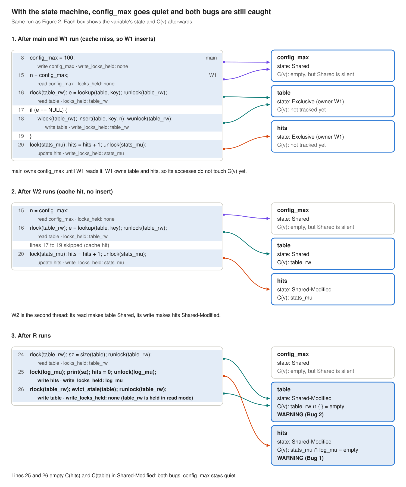
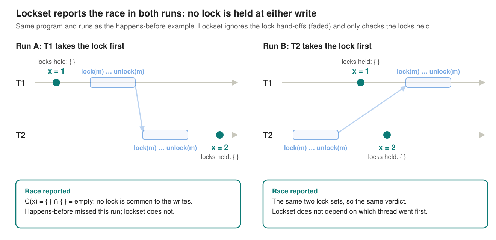
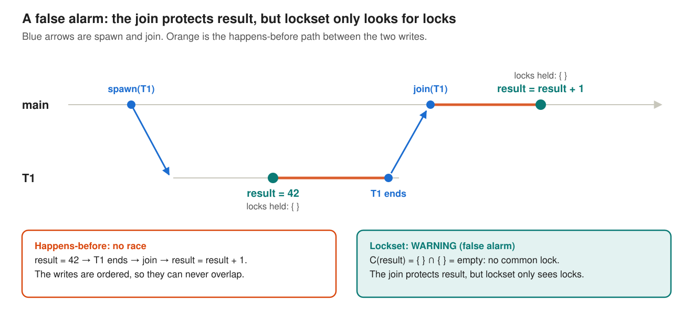

### 2. Lockset analysis: Eraser

**Paper:** Savage, Burrows, Nelson, Sobalvarro and Anderson, *Eraser: A Dynamic Data Race Detector for Multithreaded Programs*, SOSP 1997 / ACM TOCS 1997. [Read the full post]().

> Instead of asking whether two accesses happened in an order the program enforced, ask whether **one lock was held for every access** to the variable across threads.

#### A tiny server with two bugs

MiniServer is a toy web cache. A main thread sets a config value, two workers serve requests from a shared table, and a reporter thread prints statistics.



***Figure 1: MiniServer. main sets `config_max`, two workers serve requests from the shared `table`, and the reporter prints statistics. The two highlighted lines are the bugs.***

| Variable | Intended protection | What happens | Verdict we want |
| --- | --- | --- | --- |
| `config_max` | none needed: written once before other threads exist, then only read | exactly that | **stay quiet** |
| `hits` | `stats_mu` | the reporter uses the wrong lock `log_mu` | **Bug 1**: wrong lock |
| `table` | `table_rw`, write mode must be used for writes | `evict_stale` writes under a read lock | **Bug 2**: wrong mode |

***Table 1: MiniServer's three shared variables and the verdict a good detector should give for each.***

A good detector flags `hits` and `table` and says nothing about `config_max`. Eraser's design is, more or less, the story of getting all three right.


#### The core idea: intersect the locks

Eraser enforces a **locking discipline**: every shared variable is protected by some common lock, held on every access across threads. The program never says which lock protects which variable, so Eraser infers it from the run. For each variable `v` it keeps a **candidate set** C(v):

```text
locks_held(t)@l       = locks t holds in ANY mode when it executes line l
write_locks_held(t)@l = locks t holds in WRITE mode when it executes line l

C(v) := all locks                        // initially
on each access op(v) by thread t at line l:
    if op(v) = read then
        C(v) := C(v) ∩ locks_held(t)@l
    else if op(v) = write then
        C(v) := C(v) ∩ write_locks_held(t)@l
    if C(v) = { } then warn
```

Writes are checked more strictly than reads because of **reader-writer locks**. A reader-writer lock held in read mode lets other readers in at the same time, so it protects a read but not a write. An ordinary mutex is always exclusive, so it counts in both sets.

This is all done dynamically: the instrumented program updates `locks_held(t)` on every lock and unlock, and intersects on every load and store.

##### Dry run on MiniServer

**Assumed schedule:** main runs first, then W1 (a cache miss, so it inserts), then W2 (a cache hit), then R, each running to completion. Line numbers refer to the MiniServer code above.



***Figure 2: The basic lockset algorithm on MiniServer, with C(v) after every access. Arrows link each access to the candidate set it updates (purple `config_max`, teal `table`, orange `hits`). It catches both bugs but raises a false alarm on `config_max`.***

This basic version gets two of three right. It catches Bug 1 (line 25 writes `hits` under the wrong lock) and Bug 2 (line 26 writes `table` while holding `table_rw` only in read mode). But it raises a false alarm on `config_max`, whose first write held no lock.

#### Quieting false alarms: a per-variable state machine

Two common patterns are harmless but violate the naive rule:

- Initializing data without a lock before anyone else can see it.
- Sharing data that is only read after initialization.

Eraser's two fixes:

- **For initialization:** Eraser cannot tell when initialization ends, so it uses a proxy. A variable counts as initialized when a **second thread** first touches it.
- **For read-only sharing:** Eraser reports only once a variable is **written** after being shared.

##### State Machine for the above two fixes



***Figure 3: Eraser's per-variable state machine (after the paper's Fig. 4). Accesses by the owner are never checked; C(v) is refined from the second thread on, and only Shared-Modified can warn.***

One detail that trips people up: allocation is not an access. Allocating memory just marks it Virgin. The first real read or write (initialization is treated as a write), by any thread, makes that thread the owner, and the owner's accesses never enter C(v).

##### Dry run with the state machine

**Assumed schedule:** the same as in the first dry run: main, then W1 (cache miss), then W2 (cache hit), then R.



***Figure 4: The same run with the state machine. `config_max` stays Shared, so its empty C(v) is never reported, and both bugs are still caught in Shared-Modified.***

With this, `config_max` goes Exclusive (owned by main), then Shared when a worker reads it. C(v) is empty, but Shared never reports, so the false alarm is gone. Both bugs are still caught, so the scorecard is three for three: quiet on `config_max`, warnings on `hits` and `table`.

#### Back to the race happens-before missed

Lockset and happens-before fail in opposite directions. Two tiny programs show both sides.

##### Strength: it finds the race in every run

- **The program:** the [two-run example](#example-one-race-two-runs) from the happens-before section. Both threads write `x` without a lock, and each takes `m` for unrelated work.
- **What happens-before did:** it missed the race in run A, because the hand-off on `m` happened to order the two writes.
- **What lockset checks instead:** never the order, only which locks were held at each access to `x`.



***Figure 5: The happens-before example under lockset. No lock is held at either write, so C(x) empties and Eraser warns in both runs. The hand-offs on m (faded) play no part.***

##### Weakness: false alarms from synchronization that is not a lock

- **The program:** the threads are ordered by a join, not by a lock.

| main | T1 |
| --- | --- |
| `spawn(T1)` | |
| | `result = 42` |
| `join(T1)` (wait for T1 to finish) | |
| `result = result + 1` | |



***Figure 6: The simplest false alarm. The join orders T1's write before main's, so there is no race. But no lock is held at either write, so C(result) empties and Eraser warns.***

##### Not schedule-dependent, but coverage-dependent

- **What lockset needs:** only the set of locks held at each access. That set is fixed by the code a thread executes, not by how the threads interleave.
- **So the schedule does not matter:** runs A and B in Figure 5 give the same lock sets, so the same warning. Any other order of the same statements would too.
- **What it does need is coverage:** the racy statements must execute at least once during the test. If a branch never runs, lockset never sees its accesses. In MiniServer, the insert on line 18 runs only on a cache miss.
- **Compare happens-before:** it needs coverage *and* an interleaving that leaves the racy accesses unordered.
