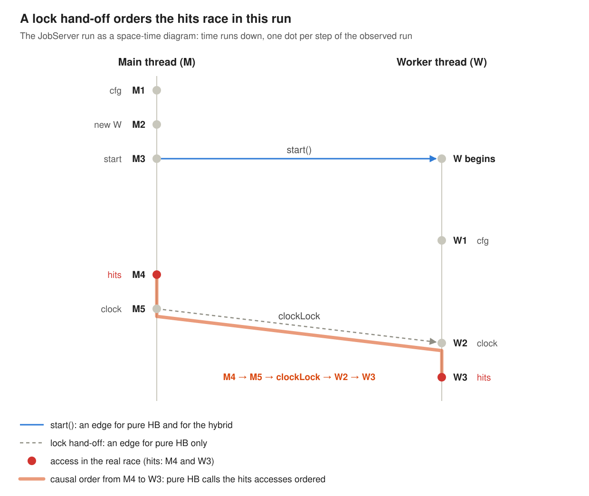
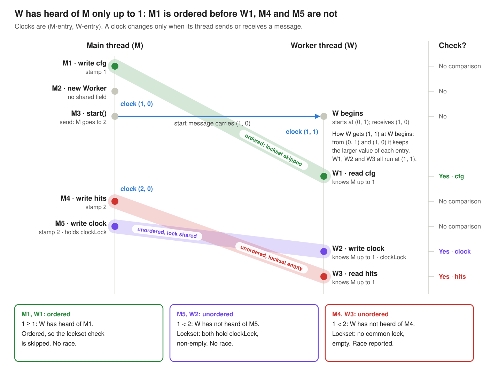

### 3. Hybrid detection: lockset plus limited happens-before

**Paper:** Robert O'Callahan and Jong-Deok Choi, *Hybrid Dynamic Data Race Detection*, PPoPP 2003. [Read the full post]().

> Report a race only when **no common lock** was held **and** a deliberately **limited** happens-before relation cannot order the two accesses.

#### A small program with three fields

I'll use one small Java program, **JobServer**, for the whole section. A main thread **M** starts one worker **W**, and the two share three fields. **One field holds a real race, one is safe but fools lockset, and one is correctly locked.** Each field copies a case from the paper's own figures.

***Figure 1: The JobServer program, built from cases in the paper's own figures, laid out as the observed run. Under each statement are the events it emits: MEM = memory access, ACQ = lock acquire, REL = lock release, SND = message send, RCV = message receive (gs is the start message).***

A detector sees one run, and Figure 1 shows the one we'll replay, in the order of the circled numbers.

Nothing goes wrong in this run: at step 8, W3 happens to read 7. A good detector must still warn about `hits`, because the truth is this:

| Field | What protects it | Verdict | Why |
| --- | --- | --- | --- |
| `cfg` | `start()` | Safe | Written once before W exists, only read afterwards |
| `hits` | Nothing | **Real race** | In another schedule W3 runs before M4 and W reads 0 |
| `clock` | `clockLock` | Safe | Every access holds `clockLock` |

***Table 1: What a perfect detector would say about each JobServer field.***

A perfect detector reports `hits`, and nothing else. The sections below try lockset, pure happens-before, and the hybrid in turn.

#### Lockset: cheap, but has false positives

The paper treats the program as a black box that emits events: memory accesses `MEM(m, a, t)`, lock acquires and releases `ACQ(l, t)` / `REL(l, t)`, and thread messages `SND(g, t)` / `RCV(g, t)`. Every detector is then a **predicate over pairs of events**. Lockset's predicate is:

$$
\begin{aligned}
\text{IsPotentialLocksetRace}(i,j) =\;& e_i = \mathrm{MEM}(m_i,a_i,t_i) \wedge e_j = \mathrm{MEM}(m_j,a_j,t_j) \\
&\wedge t_i \ne t_j \wedge m_i = m_j \wedge (a_i = \mathrm{WRITE} \vee a_j = \mathrm{WRITE}) \\
&\wedge L_i(t_i) \cap L_j(t_j) = \emptyset
\end{aligned}
$$

Two different threads, the same location, at least one write, and **no lock held at both accesses**. Li(t) is the set of locks thread t holds just before event i.

Two details differ from Eraser:

- **Pairs, not a running intersection.** Eraser intersects one candidate set with every access, which can go empty even when every conflicting pair shares a lock. Three threads writing under {a, b}, {b, c} and {a, c} are mutually exclusive, yet Eraser warns. The pairwise check stays silent.
- **One report per memory location.** A location is one variable in memory; in Java, a field of one object, such as `srv.hits`. The check is over pairs of events, but the tool reports only the first racing pair on each location and then stops watching it. So it only needs to store a set of `(a, t, L)` tuples per location, and drops any access whose tuple is already there.

On JobServer:

| Field | First racing pair reported | Correct? | With the state machine |
| --- | --- | --- | --- |
| `cfg` | M1 ↔ W1 | False alarm: `start()` orders them | **Removed**: M1 runs while only M has touched `srv`, so it is skipped |
| `hits` | M4 ↔ W3 | Real race | Still reported: W1 already shared `srv` before M4 |
| `clock` | none | Correct: both accesses hold `clockLock` | none |

***Table 2: The pairwise lockset check on the JobServer run, without and with the state machine (Eraser's first-thread filter).***

The real race is found, but so is one false alarm. It comes from synchronization that is not a lock: `start()`.

#### Pure happens-before: precise, but blind in a different way

Pure happens-before turns **every** interaction between threads into a message: `start`, `join`, `notify`, every lock release to the next acquire, and every memory write to later accesses of that location. Two accesses race only if no chain of messages orders them.

***Figure 2: The JobServer run as a space-time diagram. Pure HB also adds memory write-to-read edges, not drawn here.***

Following the arrows in Figure 2:

| Field | Pair | Path in Figure 2 | Pure HB says | Right? |
| --- | --- | --- | --- | --- |
| `cfg` | M1 ↔ W1 | M1 → `start()` → W1 | Ordered | ✓ |
| `hits` | M4 ↔ W3 | M4 → M5 releases `clockLock` → W2 acquires it → W3 | Ordered | ✗ **real race missed** |
| `clock` | M5 ↔ W2 | Through `clockLock` | Ordered | ✓ |

***Table 3: Pure happens-before on each JobServer field, following the arrows in Figure 2.***

No false alarms, but `hits` slips through. `clockLock` protects `clock`, not `hits`; the ordering is an accident of this schedule. Had W2 taken `clockLock` first, M4 and W3 would be unordered and pure HB would report them. This is the paper's Figure 4, and it is the key observation: **not every happens-before edge reflects real synchronization.**

##### HB is expensive

- The best earlier pure HB detector for Java, TRaDe, slowed programs 4 to 15 times relative to an *interpreter*, and JIT-compiled code is about ten times faster still. The cost comes from vector clocks. Every lock release and every memory write becomes a pending message, and each carries a vector with one entry per thread.

#### The hybrid: keep only the edges that mean something

The paper's move is to split the work. **Locks are judged by the lockset check, which understands them.** Happens-before is kept only for the few events that really order threads, and lock hand-offs and memory accesses stop being messages.

| Message source | Send | Receive | Pure HB | Hybrid |
| --- | --- | --- | --- | --- |
| `t2.start()` | caller | t2 as it begins | ✓ | ✓ |
| `t2.join()` | t2 as it ends | caller when join returns | ✓ | ✓ |
| `o.notify()` / `notifyAll()` | the notifier | every thread waiting on `o` | ✓ | ✓ |
| Lock hand-off | after `REL(l)` | the next `ACQ(l)` | ✓ |  |
| Memory | after each write to *m* | later accesses to *m* | ✓ |  |

***Table 4: Thread messages, and which detector uses them.***

Call the resulting relation ⇢. The hybrid check is the lockset check plus one line:

$$
\text{IsPotentialHybridRace}(i,j) \;=\; \text{IsPotentialLocksetRace}(i,j) \;\wedge\; \neg(i \dashrightarrow j) \;\wedge\; \neg(j \dashrightarrow i)
$$

That gives two consequences at once:

- **Few messages, so cheap clocks.** Threads start, join and notify rarely compared with how often they touch memory or locks.
- **Lock/Unlock edges can no longer hide races.** `clockLock` stops ordering `hits`. Mutual exclusion is handled by the lockset analysis.

The reports nest neatly:

$$
\text{Pure HB reports} \;\subseteq\; \text{Hybrid reports} \;\subseteq\; \text{Lockset reports}
$$

- **Hybrid ⊆ lockset**, because the hybrid adds a condition to the lockset check.
- **Pure HB ⊆ hybrid.** A pair pure HB reports cannot share a lock, since a common lock's release-to-acquire chain would order it. And ⇢ has fewer edges than →, so a pair that → cannot order, ⇢ cannot order either.

The gap between pure HB and the hybrid is where the trade lives. It holds a **real race pure HB misses** (`globalInt`, our `hits`) and a **false alarm pure HB avoids**.

#### The hybrid on JobServer

##### Vector clocks, the paper's way

- **Ordinary vector clocks:** the hybrid computes ⇢ with ordinary [vector clocks](#telling-concurrent-from-ordered-vector-clocks).
- **One-entry stamps:** using [the shortcut](#the-test), each access stores only its own thread's entry v, and B's new access is ordered after it iff B's entry for A ≥ v.
- **Only sends bump the clock:** a thread's entry rises only right after it **sends** a message, since only a message can let another thread hear about its past.
- **Cheap:** with only `start`, `join` and `notify` as messages, clocks rarely change. Updates are rare (O(\|T\|) each) and checks are cheap (O(1) on every access).

On JobServer:

- **One message:** M3's `start()` is the only message in the whole run.
- **M's stamps:** M's own entry goes from 1 to 2 right after the send, so M1 carries stamp 1 and every later M access carries 2.
- **W's clock:** W becomes (1, 1) when it begins and never changes, so W knows M only up to 1.

***Figure 3: Vector clocks on the JobServer run, written as (M-entry, W-entry). The start message tells W about M up to 1, so W1 can see M1, but W2 and W3 cannot see M5 and M4. The clock pair is still safe: both writes hold clockLock.***

##### The checks

Each new access is compared with the stored access from the other thread. Ordered pairs are dropped; unordered pairs go to the lockset check:

| New access | Locks held | Compared with | Ordered? (B's entry for A ≥ v) | Locks shared? | Result |
| --- | --- | --- | --- | --- | --- |
| W1 READ `cfg` | {} | M1, v = 1 | **yes**: 1 ≥ 1 | no | no race |
| W2 WRITE `clock` | {clockLock} | M5, v = 2 | no: 1 < 2 | **yes** | no race |
| W3 READ `hits` | {} | M4, v = 2 | no: 1 < 2 | no | **race M4 ↔ W3** |

***Table 5: The hybrid check on every cross-thread comparison in the JobServer run.***

- **`cfg`:** ordered by `start()`, so the lockset check is skipped.
- **`clock`:** unordered, but both writes hold `clockLock`, so no race.
- **`hits`:** unordered and no common lock, so the race is reported.

##### Every detector compared

The hybrid gets all three right. Here is every detector on the same run:

| Field | Truth | Lockset | Lockset + State Machine | Pure HB | Hybrid |
| --- | --- | --- | --- | --- | --- |
| `cfg` | safe | false alarm | — | — | — |
| `hits` | race | found | found | **missed** | found |
| `clock` | safe | — | — | — | — |
| **Real found / false** |  | 1 / 1 | 1 / 0 | 0 / 0 | **1 / 0** |

***Table 6: Every detector on the JobServer run.***

#### What the paper found on real programs

On toy JobServer, "Lockset + State Machine" ties with the hybrid.

On real programs the difference is clear. The authors ran eleven Java programs, from small Java Grande kernels up to the Resin and Tomcat web servers. These are the ones where something was reported, counted in fields:

| Program | Hybrid: bug / benign / false | Lockset + State Machine: bug / benign / false |
| --- | --- | --- |
| hedc | 4 / 0 / 0 | 3 / 0 / 1 |
| tsp | 1 / 0 / 2 | 0 / 0 / 2 |
| mtrt | 2 / 3 / 0 | 2 / 2 / 7 |
| raytracer | 1 / 0 / 0 | 0 / 0 / 0 |
| specjbb | 0 / 1 / 1 | 0 / 1 / 1 |
| resin | 1 / 18 / 57 | 1 / 25 / 152 |
| tomcat | 3 / 6 / 13 | 2 / 6 / 17 |

***Table 7: Reported fields on the paper's benchmarks (its Tables 2 and 3).***

- **Fewer false alarms:** 57 false fields on Resin instead of 152, and 0 on mtrt instead of 7.
- **More bugs found:** one more bug field in hedc, tsp, raytracer and Tomcat.
