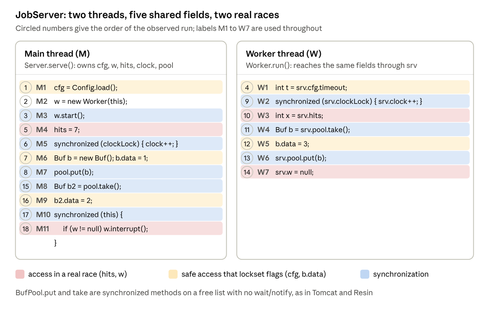
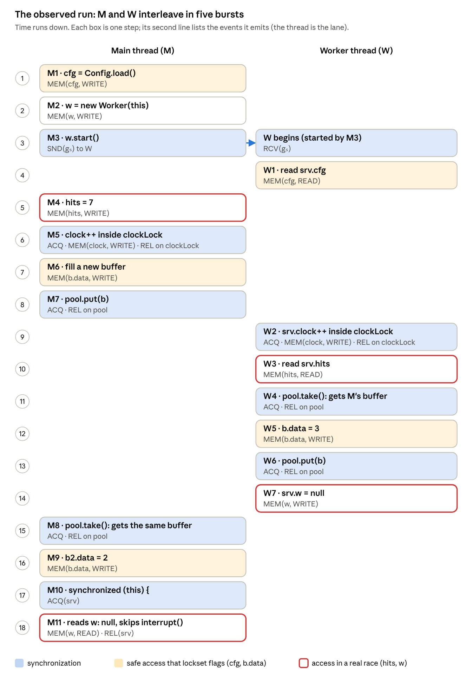
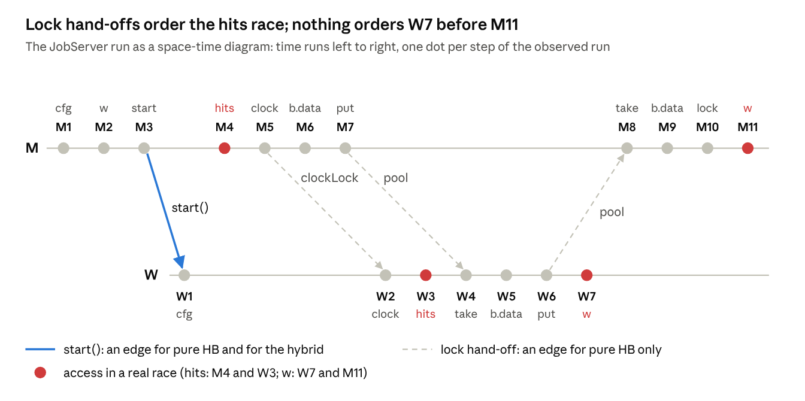

### 3. Hybrid detection: lockset plus limited happens-before

**Paper:** Robert O'Callahan and Jong-Deok Choi, *Hybrid Dynamic Data Race Detection*, PPoPP 2003. [Read the full post]().

> Report a race only when **no common lock** was held **and** a deliberately **limited** happens-before relation cannot order the two accesses.

#### A small program with five fields

I'll use one 18-line Java program, **JobServer**, for the whole post. A main thread **M** starts one worker **W**, and the two share five fields. **Two fields hold real races, two are safe but fool lockset, and one is correctly locked.** Each field copies a case from the paper's own figures.

***Figure 1: The JobServer program, stitched together from the paper's Figures 1, 2 and 4.***

- `cfg` is the paper's `globalFlag`: written once before W starts, then only read.
- `w` is the paper's `childThread`: W clears it, while M later reads it and calls `interrupt()`.
- `hits` is the paper's `globalInt`, and `clock` is the counter next to it, guarded by `clockLock`.
- `Buf.data` is the paper's recycled `BigObject`, handed between threads through `BufPool`. The pool's `put` and `take` are `synchronized`, with no `wait`/`notify`.

A detector sees one run. Here is the one we'll replay, in the order of the circled numbers:

***Figure 2: The observed run of JobServer, step by step, with the events each step emits. MEM = memory access, ACQ = lock acquire, REL = lock release, SND = message send, RCV = message receive (gs is the start message).***

The run does **not** crash. M11 reads `null` and skips the call. A good detector must still warn about it, because the truth is this:

| Field | What protects it | Verdict | Why |
| --- | --- | --- | --- |
| `cfg` | `start()` | Safe | Written once before W exists, only read afterwards |
| `w` | Nothing on W's side | **Real bug** | If W7 lands between M11's null check and `interrupt()`, M throws a NullPointerException |
| `hits` | Nothing | **Real race** | In another schedule W3 runs before M4 and W reads 0 |
| `clock` | `clockLock` | Safe | Every access holds `clockLock` |
| `Buf.data` | Ownership handed over through the pool | Safe | Only the thread that took the buffer touches it |

***Table 1: What a perfect detector would say about each JobServer field.***

A perfect detector reports `w` and `hits`, and nothing else. Let's see who manages it.

#### Lockset: cheap, but it cries wolf

The paper treats the program as a black box that emits events: memory accesses `MEM(m, a, t)`, lock acquires and releases `ACQ(l, t)` / `REL(l, t)`, and thread messages `SND(g, t)` / `RCV(g, t)`. Every detector is then a **predicate over pairs of events**. Lockset's predicate is:

$$
\begin{aligned}
\text{IsPotentialLocksetRace}(i,j) =\;& e_i = \mathrm{MEM}(m_i,a_i,t_i) \wedge e_j = \mathrm{MEM}(m_j,a_j,t_j) \\
&\wedge t_i \ne t_j \wedge m_i = m_j \wedge (a_i = \mathrm{WRITE} \vee a_j = \mathrm{WRITE}) \\
&\wedge L_i(t_i) \cap L_j(t_j) = \emptyset
\end{aligned}
$$

Two different threads, the same location, at least one write, and **no lock held at both accesses**. Li(t) is the set of locks thread t holds just before event i.

Two details differ from Eraser:

- **Pairs, not a running intersection.** Eraser intersects one candidate set with every access, which can go empty even when every conflicting pair shares a lock. Three threads writing under {a, b}, {b, c} and {a, c} are mutually exclusive, yet Eraser warns. The pairwise check stays silent.
- **One report per location.** The tool reports the first race on a location and stops watching it. So it only needs to store a set of `(a, t, L)` tuples per location, and drops any access whose tuple is already there.

On JobServer:

| Field | First racing pair reported | Correct? |
| --- | --- | --- |
| `cfg` | M1 ↔ W1 | False alarm: `start()` orders them |
| `w` | M2 ↔ W7 | Right field, **wrong pair** (the dangerous one is W7 ↔ M11) |
| `hits` | M4 ↔ W3 | Real race |
| `clock` | none | Correct: both accesses hold `clockLock` |
| `Buf.data` | M6 ↔ W5 | False alarm: the pool hands the buffer over |

***Table 2: The pairwise lockset check on the JobServer run.***

Two real races found, two false alarms, and one report that points at the harmless pair. Every false alarm comes from synchronization that is not a lock: `start()` and the pool.

#### Pure happens-before: precise, but blind in a different way

Pure happens-before turns **every** interaction between threads into a message: `start`, `join`, `notify`, every lock release to the next acquire, and every memory write to later accesses of that location. Two accesses race only if no chain of messages orders them.

***Figure 3: The JobServer run as a space-time diagram. Pure HB also adds memory write-to-read edges, not drawn here.***

Following the arrows in Figure 3:

| Field | Pair | Path in Figure 3 | Pure HB says | Right? |
| --- | --- | --- | --- | --- |
| `cfg` | M1 ↔ W1 | M1 → `start()` → W1 | Ordered | ✓ |
| `w` | W7 ↔ M11 | No path from W7 to M11 | **Reported** | ✓ right pair |
| `hits` | M4 ↔ W3 | M4 → M5 releases `clockLock` → W2 acquires it → W3 | Ordered | ✗ **real race missed** |
| `clock` | M5 ↔ W2 | Through `clockLock` | Ordered | ✓ |
| `Buf.data` | M6 ↔ W5, W5 ↔ M9 | Through the pool's lock | Ordered | ✓ |

***Table 3: Pure happens-before on each JobServer field, following the arrows in Figure 3.***

No false alarms, but `hits` slips through. `clockLock` protects `clock`, not `hits`; the ordering is an accident of this schedule. Had W2 taken `clockLock` first, M4 and W3 would be unordered and pure HB would report them. This is the paper's Figure 4, and it is the key observation: **not every happens-before edge reflects real synchronization.**

##### Every pure HB race is a lockset race

The paper's Theorem 1 says pure HB never reports a pair that lockset would miss. Its proof is omitted, but it is three lines. If both accesses held a common lock *l*, the first thread must release *l* before the second acquires it. That release-to-acquire chain orders the two accesses, so pure HB would not report them.

The converse fails, as `cfg` and `Buf.data` show. This is the "folk theorem": happens-before has fewer false positives than lockset, but more false negatives.

##### And it is expensive

The best earlier pure HB detector for Java, TRaDe, slowed programs 4 to 15 times relative to an *interpreter*, and JIT-compiled code is about ten times faster still. The cost comes from vector clocks. Every lock release and every memory write becomes a pending message, and each carries a vector with one entry per thread.

#### The hybrid: keep only the edges that mean something

The paper's move is to split the work. **Locks are judged by the lockset check, which understands them.** Happens-before is kept only for the few events that really order threads, and lock hand-offs and memory accesses stop being messages.

| Message source | Send | Receive | Pure HB | Hybrid |
| --- | --- | --- | --- | --- |
| `t2.start()` | caller | t2 as it begins | ✓ | ✓ |
| `t2.join()` | t2 as it ends | caller when join returns | ✓ | ✓ |
| `o.notify()` / `notifyAll()` | the notifier | every thread waiting on `o` | ✓ | ✓ |
| User-marked methods (e.g. `put` / `take`) | the marked send | the marked receive |  | ✓ (optional) |
| Lock hand-off | after `REL(l)` | the next `ACQ(l)` | ✓ |  |
| Memory | after each write to *m* | later accesses to *m* | ✓ |  |

***Table 4: Thread messages, and which detector uses them.***

Call the resulting relation ⇢ (the paper draws an arrow with a dot over it). The hybrid check is the lockset check plus one line:

$$
\text{IsPotentialHybridRace}(i,j) \;=\; \text{IsPotentialLocksetRace}(i,j) \;\wedge\; \neg(i \dashrightarrow j) \;\wedge\; \neg(j \dashrightarrow i)
$$

That gives two consequences at once:

- **Few messages, so cheap clocks.** Threads start, join and notify rarely compared with how often they touch memory or locks.
- **Lock edges can no longer hide races.** `clockLock` stops ordering `hits`. Mutual exclusion is handled by the lockset half of the check.

The reports nest neatly:

***Figure 4: Lockset, hybrid and pure happens-before reports as nested sets, with the paper's own examples placed.***

- **Hybrid ⊆ lockset**, because the hybrid adds a condition to the lockset check.
- **Pure HB ⊆ hybrid**, because of Theorem 1, and because ⇢ has fewer edges than →: a pair that → cannot order, ⇢ cannot order either.

The middle ring is where the trade lives. It holds a **real race pure HB misses** (`globalInt`, our `hits`) and a **false alarm pure HB avoids** (the pooled object, our `Buf.data`). The paper accepts the second to get the first, plus a large speedup.

#### Vector clocks, the paper's way

The hybrid decides ⇢ with vector clocks: every live thread keeps one counter per thread, each message carries its sender's vector, and the receiver takes the entrywise max. (The [Lamport clocks post]() walks through the standard version.) The paper's version differs in two ways:

- **A stamp is one integer.** Each access is stored with only its own thread's entry, v, not the whole vector.
- **Only sends bump the clock.** A thread's own entry rises only right after it sends a message (`start`, `join`, `notify` or an annotated channel). Reads, writes and lock operations leave it alone, so long runs of accesses share one stamp.

The check is then one comparison:

> An earlier access by thread A, stamped v, is ordered before thread B's new access **iff B's entry for A ≥ v**: B has already heard of that point in A's history.

***Figure 5: Vector clocks on the JobServer run, written as (M-entry, W-entry). The start message tells W about M up to 1, so W1 can see M1 but W3 cannot see M4.***

The check runs online: each time a thread touches *m*, the new access is compared at that moment against the accesses stored for *m*. That is why the trade is deliberate: **few clock updates** (each O(\|T\|), only on sends and receives) and **many clock checks** (each O(1), on every access).

#### The hybrid on JobServer

Only one message is sent in the whole run: M3's `start()`. M's own entry goes from 1 to 2 right after it, so M1 and M2 carry stamp 1 and every later M access carries 2. W begins at (1, 1) and never changes. Here is every access that meets a stored access from the other thread:

| New access | Locks held | Compared with | Ordered? (B's entry for A ≥ v) | Locks shared? | Result |
| --- | --- | --- | --- | --- | --- |
| W1 READ `cfg` | {} | M1, v = 1 | **yes**: 1 ≥ 1 | no | no race |
| W2 WRITE `clock` | {clockLock} | M5, v = 2 | no: 1 < 2 | **yes** | no race |
| W3 READ `hits` | {} | M4, v = 2 | no: 1 < 2 | no | **race M4 ↔ W3** |
| W5 WRITE `Buf.data` | {} | M6, v = 2 | no: 1 < 2 | no | **race M6 ↔ W5** (false alarm) |
| W7 WRITE `w` | {} | M2, v = 1 | **yes**: 1 ≥ 1 | no | no race; W7 is stored |
| M11 READ `w` | {srv} | W7, v = 1 | no: 0 < 1 | no | **race W7 ↔ M11** |

***Table 5: The hybrid check on every cross-thread comparison in the JobServer run.***

The `w` rows are the ones I like best. Lockset alone reported M2 ↔ W7, the harmless pair, and then stopped watching `w`. The hybrid knows `start()` orders M2 before W7, so it keeps looking and reports **W7 ↔ M11**, the pair that can crash. The paper saw the same effect on real programs: lockset's first report on a field was sometimes false, while the hybrid skipped it and found a true race on the same field.

Score so far: both real races found, `cfg` correctly silent, and one false alarm left on `Buf.data`.

#### Removing the pool false alarm

The `Buf.data` alarm is the paper's **object-pool problem**: ownership moves through the pool's lock, and the hybrid deliberately ignores lock hand-offs. The tool offers two fixes:

- **Automatic, for blocking channels.** If a class calls `wait` or `notify`, every release of that class's locks becomes a send and the next acquire a receive. A blocking queue is caught this way. `BufPool` never blocks, so it is not.
- **Manual, for everything else.** The user marks `put` as a send and `take` as a receive.

With `BufPool` marked, the new messages move the clocks. M7's `put` bumps M to (3, 0), and W's `take` at W4 lifts W to (2, 1). At W5 the check against M6 now passes: 2 ≥ 2, ordered. The return trip works the same way, so M9 is ordered after W5. The real races survive. W3 still knows M only up to 1, below M4's stamp of 2. And W's send at W6 lifts W7's stamp to 2, while M11 knows W only up to 1.

The annotation is **trusted, not checked**. It tells the detector that everything a thread did before `put` happens before everything the taker does after `take`, for all data, not just the buffer. A race on some other field that happens to straddle a `put`/`take` in the observed run is then hidden, exactly as `clockLock` hid `hits` from pure HB. (A thread that keeps writing a buffer after returning it is still caught: its clock moves past the send.)

Here is every detector on the same run:

| Field | Truth | Lockset | Lockset + thread locality | Pure HB | Hybrid | Hybrid + pool marked |
| --- | --- | --- | --- | --- | --- | --- |
| `cfg` | safe | false alarm | — | — | — | — |
| `w` | bug | found (wrong pair) | found | found | found | found |
| `hits` | race | found | found | **missed** | found | found |
| `clock` | safe | — | — | — | — | — |
| `Buf.data` | safe | false alarm | false alarm | — | false alarm | — |
| **Real found / false** |  | 2 / 2 | 2 / 1 | 1 / 0 | 2 / 1 | **2 / 0** |

***Table 6: Every detector on the JobServer run.***

"Lockset + thread locality" is the paper's **Detailed-NoHB** baseline, its stand-in for earlier lockset tools. It is lockset with a filter that ignores an object's accesses until a second thread touches it. That avoids the `cfg` alarm by luck of timing: M1 happens while only M has touched `srv`.
