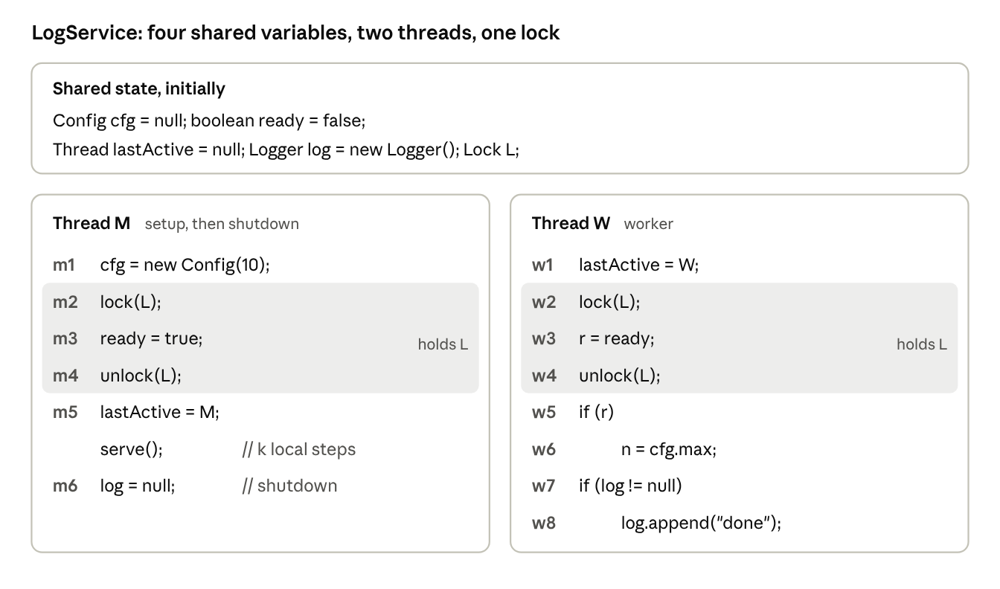
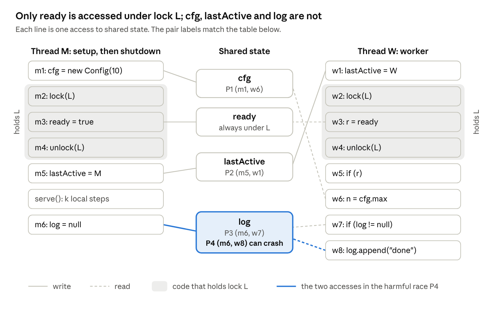
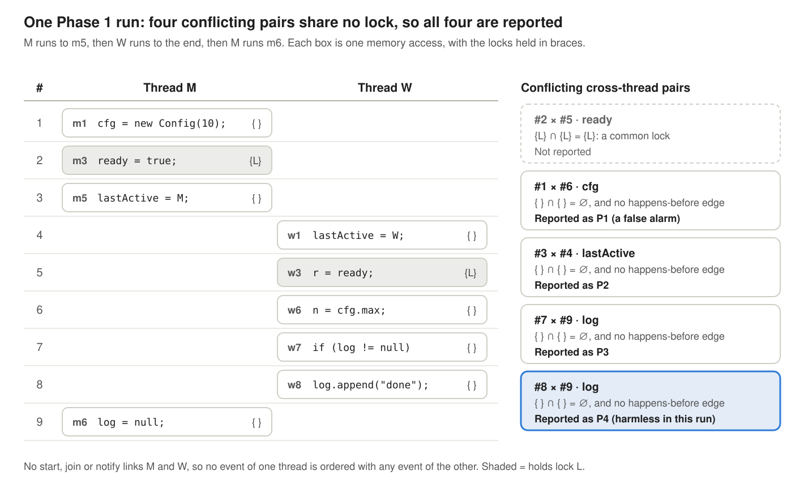
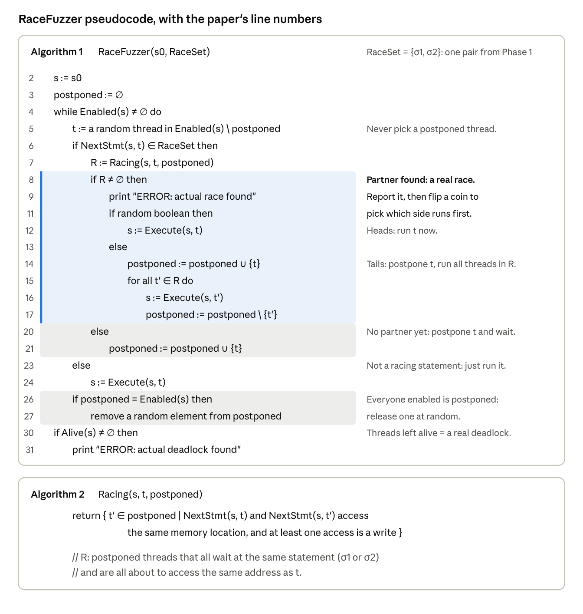
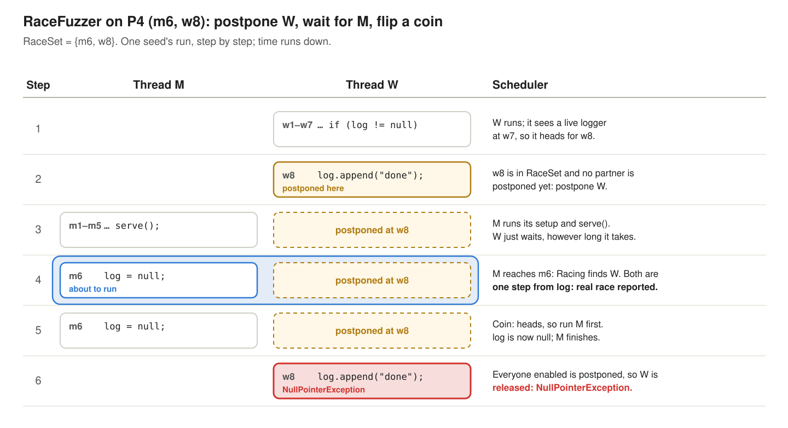
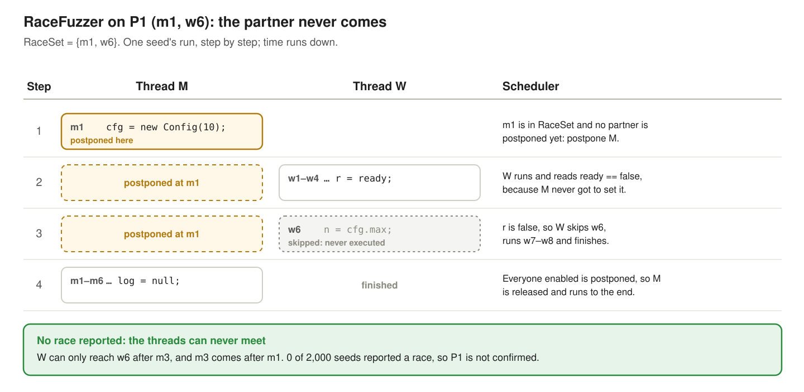

### 4. RaceFuzzer: race-directed random testing

**Paper:** Koushik Sen, *Race Directed Random Testing of Concurrent Programs*, PLDI 2008. [Read the full post]().

> Take each race a predictive detector suspects, and steer the thread scheduler until the two racing accesses are **one step apart in two different threads**. If that moment happens, the race is real.

#### A tiny program with four suspects

`LogService` has two threads. **M** sets up a config, signals readiness under a lock `L`, serves requests for a while, then shuts the logger down. **W** is a worker: it reads the config if the service is ready, then writes to the logger if the logger still exists. A launcher starts both threads together, so nothing like `start` or `join` orders them.

***Figure 1: LogService. M sets up a config, signals readiness under `L`, serves, then shuts the logger down. W reads the config if the service is ready, then appends to the logger if it still exists.***

The paper's model assumes each statement touches at most one shared variable. That's why the null check (`w7`) and the call (`w8`) are separate statements. In practice this holds automatically, because the tool works on Java bytecode, where every field access is its own instruction.

Only `ready` is accessed under `L`. The other three shared variables are touched with no lock held:

***Figure 2: Every access to shared state, by thread. Only `ready` is accessed under `L`.***

So any lock-based detector will suspect four pairs of statements. Here is what is actually true of each:

| Pair | Variable | Truth |
| --- | --- | --- |
| **P1** (m1, w6) | `cfg` | **False alarm.** W reads `cfg` only after seeing `ready == true`, which M sets after `m1`. The flag, guarded by `L`, orders them. |
| **P2** (m5, w1) | `lastActive` | **Real, benign.** A debugging field nobody reads. |
| **P3** (m6, w7) | `log` | **Real, harmless.** If the shutdown wins, the null check sees `null` and W skips the append. |
| **P4** (m6, w8) | `log` | **Real, harmful.** If the shutdown lands between the check and the use, W throws a `NullPointerException`. |

***Table 1: The four pairs a lock-based detector suspects, and what is actually true of each.***

A good tool should stay quiet on P1, confirm P2 through P4, and show that P4 can crash.

#### Phase 1: where the suspects come from

RaceFuzzer doesn't invent its suspects. It takes them from an existing predictive detector. The paper uses the **hybrid** detector of O'Callahan and Choi (PPoPP 2003), but says any static or dynamic detector would do. This phase is not the paper's contribution.

It is the [hybrid check from section 3](#3-hybrid-detection-lockset-plus-limited-happens-before): two accesses are flagged when they share no common lock and are not ordered by `start`, `join` or `wait/notify`. The statements behind a flagged pair become a **racing pair**.

Here is one run of LogService in which M runs up to `m5`, W runs to the end, and then M shuts down:

***Figure 3: One Phase 1 run of LogService, event by event. M runs up to `m5`, W runs to the end, then M shuts down. All four pairs are flagged, and nothing crashes.***

All four suspects are flagged, including the false alarm P1: the real ordering goes through `ready` and `L`, and the hybrid test ignores lock edges. Notice also that nothing crashed in this run. Phase 1 predicts P4 from a run where it did not crash. That's the payoff of lockset-style reasoning.

Two terms are worth keeping apart here:

- An **event race** is two specific executions in one run, such as events #8 and #9 above.
- A **racing pair** is the two *statements* (static program text) behind them, here (m6, w8). Many event races, from many schedules, converge on the same pair, and the pair is what Phase 1 hands to Phase 2.

#### Phase 2: postpone, then flip a coin

Phase 2 is the contribution. It takes **one** racing pair at a time, `RaceSet = {σ1, σ2}`, and runs the program under its own scheduler. Only one thread runs at a time, and every choice comes from a seeded random number generator:

***Figure 4: The Phase 2 scheduler and its `Racing` check (the paper's Algorithms 1 and 2, with its line numbers).***

The idea, step by step:

1. **Pick a random thread** that is enabled and not postponed.
2. **If its next statement isn't σ1 or σ2, just run it.** Everything outside the pair is uninteresting.
3. **If it is, look for a partner.** `Racing` returns `R`: the postponed threads that all wait at the same statement (σ1 or σ2) and are all about to access the same address as this thread, with at least one write.
4. **No partner yet: postpone the thread.** It waits, frozen one step before its racing access.
5. **Partner found: that's a real race.** Two threads are each one step from conflicting accesses to the same address, with nothing in between. RaceFuzzer reports it, then flips a coin. Heads: run this thread first. Tails: postpone it, and run every thread in `R` first.
6. **If every enabled thread is postponed, release one at random.** That thread runs its next statement unconditionally, which avoids an infinite loop. This is how a false pair ends: the partner never shows up, so the waiting thread is eventually let go.

Three details make this work.

- **The invariant.** At line 5, no two postponed threads ever race with each other. Every race is detected the moment it becomes complete, when a thread that isn't postponed arrives to finish the pair, and it's settled right away. That's why tails runs *all* of `R`, not just one thread: leaving one behind would put two racing threads in `postponed`, where nothing ever compares them.
- **The coin flip doesn't fix anything.** It only decides which of the two conflicting accesses goes first. Both orders are possible in real executions, and usually only one is harmful, so trying both at random is how RaceFuzzer finds out whether the race can crash the program.
- **Replay is free.** Because the seed fixes every choice, rerunning with the same seed reproduces the crash exactly. Nothing needs to be recorded.

#### Watching it work on LogService

To check the traces and numbers below, I wrote a small simulator of the algorithm and ran it on LogService.

##### P4: the crash

With `RaceSet = {m6, w8}`, one run goes like this:

***Figure 5: One seed's run with `RaceSet = {m6, w8}`. W waits at `w8` until M is one step from `m6`; the coin runs M first, and W's append then throws.***

If the coin had gone the other way, W would have appended first and nothing would break. If M had reached `m6` first, M would have waited for W instead, and the race would be found from W's side. Over 2,000 seeds, the race was created in **100%** of runs and the crash happened in about **50%**.

##### P1: the partner never comes

With `RaceSet = {m1, w6}`, one run goes like this:

***Figure 6: One seed's run with `RaceSet = {m1, w6}`. M waits at `m1` for a partner that never arrives: W skips `w6`, so M is released and no race is reported.***

RaceFuzzer stays silent on this false alarm without anyone reading the code.

##### The scorecard

| Pair | Phase 1 | Race created | Crash | RaceFuzzer's verdict |
| --- | --- | --- | --- | --- |
| P1 (m1, w6) | suspected | 0% | — | not confirmed |
| P2 (m5, w1) | suspected | 100% | 0% | real |
| P3 (m6, w7) | suspected | 100% | 0% | real |
| P4 (m6, w8) | suspected | 100% | ≈ 50% | real **and harmful** |

***Table 2: RaceFuzzer on each pair over 2,000 seeds of my simulator.***

Phase 1 gave four identical-looking warnings. Phase 2 sorted them into three tiers.

#### What the paper found on real programs

The paper ran RaceFuzzer on 14 Java programs and libraries (about 600K lines), using the hybrid detector as Phase 1:

| Program | Hybrid warnings | Confirmed real by RaceFuzzer | Not confirmed | Exceptions: RaceFuzzer / default scheduler |
| --- | --- | --- | --- | --- |
| moldyn | 59 | 2 | 57 | 0 / 0 |
| raytracer | 2 | 2 | 0 | 0 / 0 |
| montecarlo | 5 | 1 | 4 | 0 / 0 |
| cache4j | 18 | 2 | 16 | 1 / 0 |
| sor | 8 | 0 | 8 | 0 / 0 |
| hedc | 9 | 1 | 8 | 1 / 0 |
| weblech | 27 | 2 | 25 | 1 / 1 |
| jspider | 29 | 0 | 29 | 0 / 0 |
| jigsaw | 547 | 36 | 511 | 0 / 0 |
| vector 1.1 | 9 | 9 | 0 | 0 / 0 |
| LinkedList | 12 | 12 | 0 | 5 / 0 |
| ArrayList | 14 | 7 | 7 | 7 / 0 |
| HashSet | 11 | 11 | 0 | 8 / 1 |
| TreeSet | 13 | 8 | 5 | 8 / 1 |
| **Total** | **763** | **93** | **670** | **31 / 3** |

***Table 3: Hybrid warnings and the races RaceFuzzer confirmed, per program (the paper's Table 1). "Not confirmed" pairs were never created in Phase 2: likely false alarms, though RaceFuzzer cannot prove it.***

- **Far fewer warnings to inspect:** 763 hybrid warnings became 93 confirmed races. On the jigsaw web server, 547 became 36.
- **More crashes found:** RaceFuzzer's scheduler triggered exceptions on 31 pairs, against 3 with the JVM's default scheduler.
