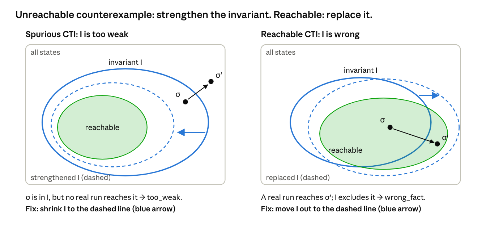
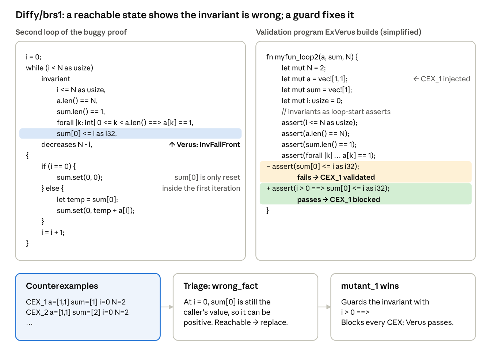
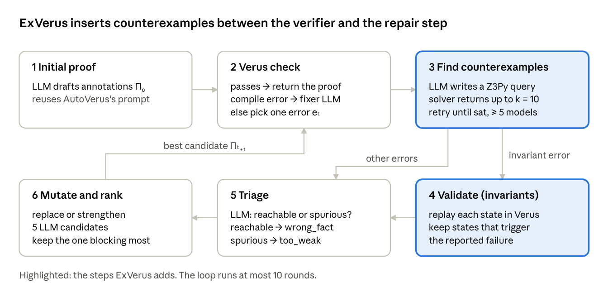

### 12. ExVerus: Verus proof repair via counterexample reasoning

**Paper:** Yang, Sun, Wu, Caridad, Yuan, Yao, Lu and Pei, *ExVerus: Verus Proof Repair via Counterexample Reasoning*, [arXiv:2603.25810](https://arxiv.org/abs/2603.25810), 2026. [Read the full post]().

> When a Verus proof fails, have an LLM write a small Z3 query that produces concrete states breaking the proof, check those states, decide whether a real run can reach them, and edit the proof until it rules them out.

#### The idea

When a Verus proof fails, the verifier only says *which* check failed, such as "invariant not satisfied at end of loop body". ExVerus adds concrete witnesses: the LLM writes a small Z3 query over the source variables, gets back states that break the check, and confirms them by replaying them through Verus. It then decides whether those states are reachable (the invariant is wrong: replace it) or spurious (the invariant is too weak: strengthen it), and keeps the edit that blocks the most counterexamples.

#### Background: loop invariants and the three checks

Verus proves a loop correct with a **loop invariant** I: a fact that holds every time the loop tests its condition. Z3 then checks three implications. For each one it searches for a state that breaks it; such a state is a **counterexample**.

***Table 1:*** *The three checks for a loop `while g { body }` with invariant I*

| # | Check | In words | Verus error if it fails |
| --- | --- | --- | --- |
| 1 | Initiation: pre ⇒ I | I holds when the loop is first reached | "invariant not satisfied before loop" |
| 2 | Preservation: I ∧ g ∧ one run of body ⇒ I′ | If I holds and the loop runs once more, I holds again (I′ = I in the new state) | "invariant not satisfied at end of loop body" |
| 3 | Exit: I ∧ ¬g ⇒ post | When the loop stops, I gives the postcondition | "postcondition not satisfied" |
{: .wrap}

A check can fail for two reasons, and Verus prints the same error for both:

- **I is wrong** (`wrong_fact`): it is false on some state a real run reaches. Fix: *replace* it.
- **I is too weak** (`too_weak`): it holds on every real run, but also allows unreachable states that break check 2. For a loop that starts at x = 0 and adds 2, "x ≠ 5" allows x = 3, whose next step is 5. Fix: *strengthen* it, here to "x is even".

***Figure 1:*** *The two kinds of counterexample and their fixes. The black arrow is one iteration of the loop. σ′ is the counterexample: the state where the invariant fails. σ is the state one iteration before it, which satisfies I. Left: no real run reaches σ, so shrink I (strengthen). Right: a real run reaches σ′, so move I out to cover it (replace).*

Telling the two apart is what ExVerus's counterexamples are for.

#### The ExVerus pipeline, on one example

##### The example: Diffy/brs1

In this example the counterexample is a state a real run reaches, so the invariant is simply false and has to be replaced. The function's first loop fills `a` with ones; the second sums them into `sum[0]`. The proof's invariant `sum[0] <= i as i32` is needed for the postcondition `sum[0] <= N`, but it fails at loop entry (`InvFailFront`). On entry, `sum[0]` still holds whatever the caller passed in. It is reset to 0 only inside the first iteration.

***Figure 2:*** *Diffy/brs1 from VerusBench: the failing loop, the validation program ExVerus builds, the counterexamples, the triage verdict and the winning fix.*

As in the benchmark, the first iteration only resets `sum[0]`, so the loop sums `a[1..N-1]`; the postcondition `sum[0] <= N` still holds.

##### The repair loop

ExVerus is a repair loop of six steps. Steps 3 and 4 are its contribution; the rest is a standard LLM repair loop. Each round fixes one targeted error, and a round ends early if any candidate already passes Verus.

***Figure 3:*** *The ExVerus repair loop.*

##### Step 3: counterexample generation

The LLM turns the failing loop into a small Z3Py query (small concrete sizes, no quantifiers) and asks Z3 for several states that break the check. The query is only an approximation of what Verus checks, so step 4 confirms each state.

- **On Diffy/brs1:** the query returns entry states with `i = 0` and a positive `sum[0]`, such as CEX₁: `a = [1, 1]`, `sum = [1]`, `i = 0`, `N = 2`.

##### Step 4: counterexample validation (invariant errors only)

This step involves no LLM. ExVerus turns each counterexample into a small Verus program and checks whether it really causes the reported failure:

1. **Loop extraction.** Copy the failing loop into a standalone function.
2. **Invariant translation.** Turn every invariant into an `assert` at the top of the body (*loop-start*) and at the bottom (*loop-end*), mimicking one iteration.
3. **Counterexample injection.** Assign the counterexample's values at the start of the function.

The expected symptom depends on the error type:

***Table 2:*** *When a replayed counterexample counts as validated*

| Error | The counterexample is kept if… | Meaning |
| --- | --- | --- |
| `InvFailFront` | the loop-start assertion for that invariant fails | A concrete entry state violates the invariant |
| `InvFailEnd` | all loop-start assertions pass, but the loop-end one fails | A counterexample to induction: the invariants hold, one step later they don't |
{: .wrap}

- **On Diffy/brs1:** with CEX₁ injected (`let mut sum = vec![1];`, `i = 0`), the loop-start assert `sum[0] <= i as i32` fails, which is the `InvFailFront` symptom. So CEX₁ is kept.

##### Step 5: error triage

An LLM reads the proof, the counterexamples and the Verus output, and decides whether the states can occur on a real run starting from a valid input:

- **Reachable** → `wrong_fact`. The invariant is false on real executions and must be replaced.
- **Spurious** → `too_weak`. The invariant may be true, but it does not rule out this impossible state. It must be strengthened.

- **On Diffy/brs1:** the precondition only fixes `sum.len() == 1`, so a positive `sum[0]` at entry is reachable. Verdict: `wrong_fact`, so use the replace mutator.

##### Step 6: mutation and ranking

The verdict selects a mutator: **strengthen** adds invariants or assertions, and **replace** rewrites one that is false on reachable states.

- **On Diffy/brs1:** the mutator sees the shared pattern (`i = 0`, `sum[0] > 0`) and proposes guarded variants. `mutant_1`, `i > 0 ==> sum[0] <= i as i32`, makes the loop-start assert pass on every counterexample and then passes Verus.

##### Why it matters

For contrast, AutoVerus failed this task. It spent 15 generation attempts, 4 refinement attempts and 21 debugging attempts, 16 of them on this same "invariant not satisfied before loop" message.

The guard replaces a false invariant with a true one: it drops the claim for the first state, where it fails, and keeps it for every later iteration. That edit is easy to make once you see `i = 0, sum = [1]`, and hard to guess from the error message alone.
