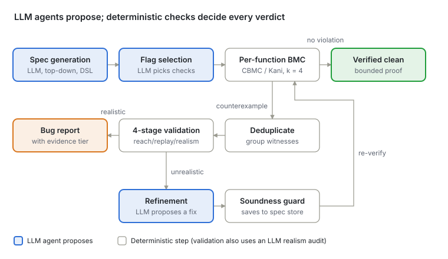
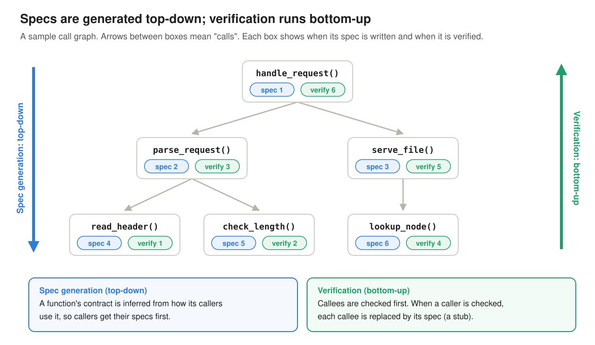

### 9. BMC-Agent: agentic model checking

**Paper:** Youcheng Sun, Jiawen Liu, Daniel Kroening and Jason Xue, *Agentic Model Checking*, [arXiv:2605.21434](https://arxiv.org/abs/2605.21434), 2026. [Read the full post]().

> Let LLM agents do the jobs that need *judgment* (guessing what a function is supposed to do, deciding whether a crash is realistic), and let a **bounded model checker** do every job that needs *proof*: **agents propose, solvers verify.**

#### The core idea

BMC-Agent takes a C or Rust codebase with no specs at all, invents a contract for every function, checks each function one at a time with CBMC (C) or Kani (Rust), and then filters the crashes it finds through a four-stage pipeline so that only believable bugs get reported. Every task that needs semantic judgment goes to an LLM agent; every decision that could change a verification verdict is double-checked by something deterministic (a parser, the BMC solver, a soundness guard, or actually running the code).



***Figure 1:*** *The BMC-Agent pipeline. Blue boxes are LLM agents; every LLM output passes through a deterministic step before it can change a verdict.*

The work is split across the codebase's call graph in two passes, in opposite directions:



***Figure 2:*** *A sample call graph. Specs are generated top-down, because a function's contract comes from how its callers use it. Verification runs bottom-up, one function at a time: by the time a caller is checked, every callee has a spec that stands in for it as a stub.*

#### End-to-end walkthrough: the `kapi_file_size` bug

**The paper's motivating example is a 5-line function in VibeOS (an LLM-written ARM64 hobby kernel) that looks safe because it checks for NULL — and BMC-Agent proves it still crashes.** Follow it phase by phase.

##### The code

```c
static int kapi_file_size(void *node) {
    if (!node) return -1;
    vfs_node_t *n = (vfs_node_t *)node;
    return (int)n->size;
}
```

User applications call this through a **function-pointer table** (`kapi`) — the kernel's public API. Read it as a reviewer: there's a NULL check, so it looks defensive. What's wrong?

##### Phase 1 — Spec generation (LLM)

The spec agent reads the body plus a **domain summary** of the codebase, which says `kapi_*` functions are the user-facing API. It writes:

- **Pre:** `null(node) || valid(node)` — callers may pass anything: NULL or some pointer.
- **Post:** if `node` is NULL, return -1; otherwise return `(int)node->size`.

Notice the **gap**: the precondition admits *any* non-null pointer, but the postcondition only makes sense if that pointer actually addresses a real `vfs_node_t`. The C type system (`void *`) can't express that obligation. **The gap between pre and post is the bug.**

##### Phase 2 — BMC (CBMC)

The harness picks `node` nondeterministically, calls the function, and asserts the postcondition. A sketch of it, in the style BMC-Agent generates:

```c
void harness_kapi_file_size(void) {
    void *node = nondet_pointer();   // any pointer: NULL, valid, or bogus
    // pre: null(node) || valid(node) admits any value, so nothing is assumed
    int r = kapi_file_size(node);
    if (node == NULL)
        __CPROVER_assert(r == -1, "post: NULL case");
    else
        __CPROVER_assert(r == (int)((vfs_node_t *)node)->size, "post: non-NULL case");
}
```

CBMC also adds its own memory-safety checks to every pointer dereference. It returns a counterexample: a **non-null pointer that doesn't point to a valid `vfs_node_t`**. The NULL check passes; `n->size` reads garbage memory.

##### Phase 3, Stage 1 — Reachability

A call-site scan finds **no callers inside the codebase** — the function is only reached via the `kapi` table. So it's a **system entry point**: whatever a user program passes arrives unfiltered. Nothing stops an app passing a dangling, freed, or made-up pointer. → tier **CONFIRMED\_SYSTEM\_ENTRY**.

##### Phase 3, Stage 3 — Dynamic replay

BMC-Agent compiles a real C harness with GCC that calls `kapi_file_size` with a non-null bogus pointer, with signal handlers installed. A simple version:

```c
static void on_crash(int sig) {
    printf("crashed: signal %d\n", sig);
    exit(1);
}

int main(void) {
    signal(SIGSEGV, on_crash);           // catch the crash instead of dying silently
    void *bogus = (void *)0xdeadbeef;    // non-null, but no vfs_node_t lives here
    kapi_file_size(bogus);               // the NULL check passes, n->size faults
    return 0;
}
```

Result: **SIGSEGV**. → upgraded to **CONFIRMED\_DYNAMIC** (the strongest tier).

##### Phase 3, Stage 4 — Realism audit

An LLM reviews the whole record and rates it **REALISTIC**: the function is user-reachable, and the only defense is a NULL check any non-null value bypasses.

##### The lesson: why each stage is needed

***Table 1:*** *Why each stage is needed: what each one cannot do alone.*

| Alone, this stage… | …cannot |
| --- | --- |
| LLM review | prove the postcondition holds or fails for *all* inputs |
| BMC | tell whether the witness input is reachable in the real system |
| Dynamic execution | *find* the bad input in the first place |

**Fix (from the paper):** a NULL check is insufficient for an untrusted pointer. Either pass a typed handle validated at creation, or validate `node` against a registry of live VFS nodes before dereferencing.
