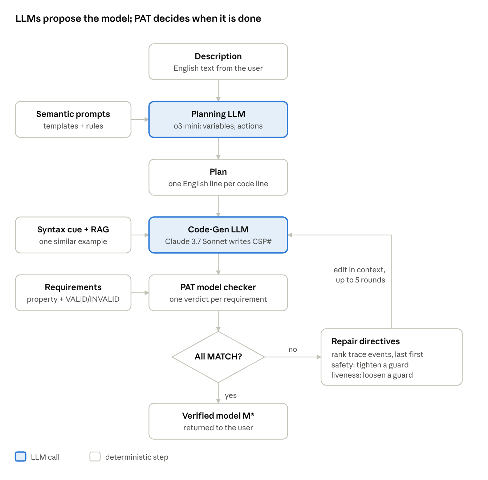
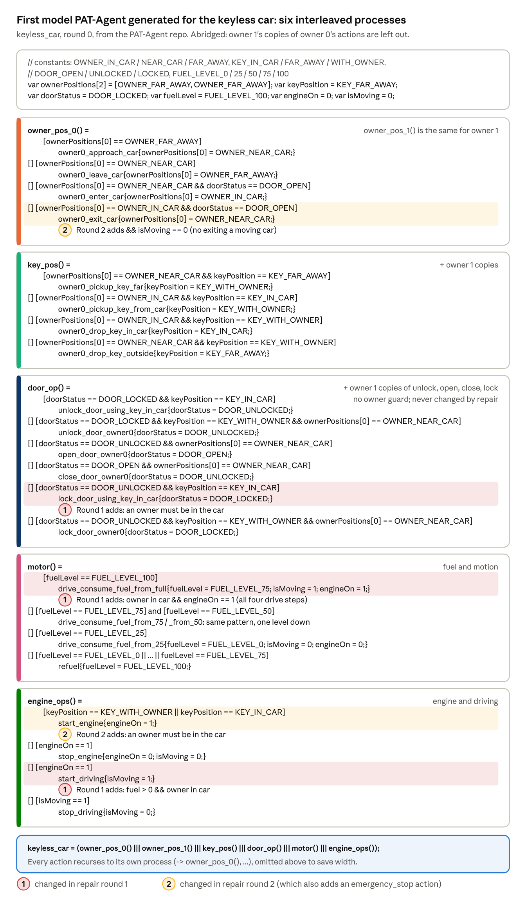
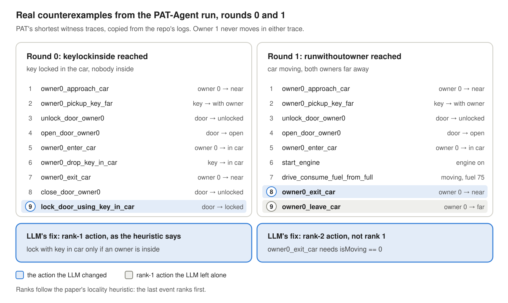
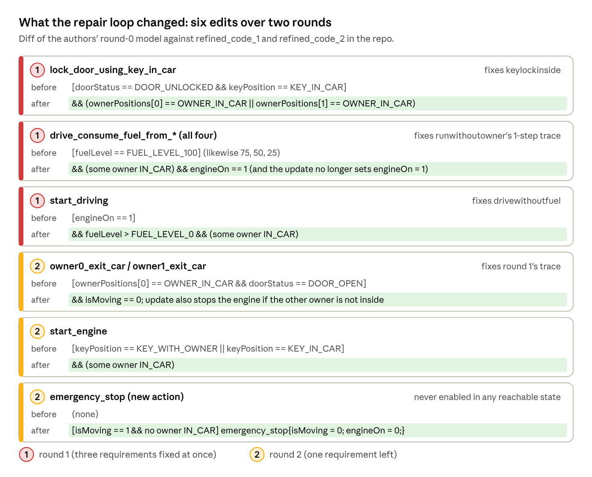

### 10. PAT-Agent: autoformalization for model checking

**Paper:** Xinyue Zuo, Yifan Zhang, Hongshu Wang, Yufan Cai, Zhe Hou, Jun Sun and Jin Song Dong, *PAT-Agent: Autoformalization for Model Checking*, ASE 2025 ([arXiv 2509.23675](https://arxiv.org/abs/2509.23675)). [Read the full post]().

> Turn an English description of a concurrent system into a CSP# model, let the PAT model checker judge it, and feed PAT's counterexamples back to an LLM until every requirement matches. The LLMs propose; PAT decides.

#### The pipeline

PAT-Agent splits the job into four parts.

1. A **Planning LLM** (o3-mini) reads the description and fills structured templates: constants, variables, and guarded actions, as JSON. It then writes a line-by-line plan in plain English.
2. A **Code Generation LLM** (Claude 3.7 Sonnet) turns each plan line into CSP#, helped by a PAT syntax cheat sheet and one retrieved example of a similar plan and its code.
3. The **PAT model checker** checks each requirement and reports whether its outcome matches what the user expected.
4. A **Repair Loop** takes PAT's counterexample, ranks the actions in it that are likely to blame, and asks the code LLM for a targeted edit, up to 5 times.

The LLMs propose; PAT decides. Nothing is accepted because an LLM says it is right. It is accepted only when PAT's verdicts match the user's expected outcomes.

***Figure 1:*** *The PAT-Agent pipeline.*

Read it top to bottom. The two shaded boxes are the only LLM calls; every arrow back into Code-Gen carries a counterexample-driven edit, never a fresh plan.

#### The running example: a keyless car

The paper's running example is a car with **keyless entry** (the benchmark calls it `keyless_car`). "Keyless" means the key is a fob that only has to be with an owner or inside the car; nobody turns it in a lock. So the key is still part of the model. Its benchmark entry describes four subsystems: the **owners** (there are two, owner 0 and owner 1), the **key**, the **door** and the **motor**. The model the pipeline generated (Figure 2) gives each owner its own process and splits the motor into `motor` (fuel and motion) and `engine_ops` (engine and driving), so it has six processes.

***Figure 2:*** *The first model PAT-Agent generated for the keyless car (repair round 0), abridged. Source: the authors' repo, `Experiments_Demo/generated_code/keyless_car/0.csp`.*

The last line interleaves all six processes. The six are one process per owner (the benchmark specifies two owners), plus the key, the door, the motor and the engine. Red and amber rows mark the guards the repair loop changed in rounds 1 and 2 (see the walkthrough below).

How to read one line of Figure 2, for example `[] [ownerPositions[0] == OWNER_NEAR_CAR] owner0_leave_car{ownerPositions[0] = OWNER_FAR_AWAY;}`:

1. `[]` means **or**: this is one more alternative the process can choose.
2. `[ownerPositions[0] == OWNER_NEAR_CAR]` is the **guard**: this alternative is allowed only while owner 0 is near the car.
3. `owner0_leave_car` is the **event**, the name that shows up in traces.
4. `{ownerPositions[0] = OWNER_FAR_AWAY;}` is the **update**: what changes when the event happens.

So the whole line says: *or, if owner 0 is near the car, owner 0 may leave, and is then far away.*

The benchmark gives eight requirements. The paper shows three of them, renamed and simplified to a single owner:

| Name in the repo | Requirement (benchmark's wording) | Expected | In the paper |
| --- | --- | --- | --- |
| deadlockfree | The system never deadlocks | VALID | P1 |
| keylockinside | Key in the car, door locked, neither owner in the car | INVALID | P2 (`keyInsideDoorLocked`) |
| runwithoutowner | Car moving, both owners far away | INVALID | closest to P3 (`driveWithoutDriver`) |
| drivewithoutfuel | Car moving with an empty tank | INVALID | not shown |
| (4 more) | Four more requirements exist in the benchmark but are not discussed here |  | not shown |
{: .wrap}

***Table 1:*** *The car's requirements discussed here, with the outcome the user expects.*

The "Expected" column is the key idea. `reaches X` is VALID when X *can* happen. So to say "X must never happen", the user writes `reaches X` and expects **INVALID**. A requirement is satisfied when PAT's verdict equals the expected one.

#### Verification and repair

For each requirement (φᵢ, oᵢ), PAT runs the matching engine (deadlock, reachability or LTL) and returns VALID or INVALID. That raw result is compared with oᵢ to give sᵢ ∈ {MATCH, MISMATCH}. Over all m requirements this gives the verdict vector s.

For the car's first model M₀ in the authors' run, five of the eight requirements match and three mismatch: `keylockinside`, `runwithoutowner` and `drivewithoutfuel` are all reachable but should not be.

The loop repeats until every requirement matches, for at most 5 rounds. Each round turns the trace C\_k = (t₀ → t₁ → … → t\_ℓ) into directives R\_k in two steps.

##### Heuristics for fault localization ([code](https://github.com/ZuoXinyue/PAT-Agent/blob/master/Automated_Pipelines/Full_Pipeline/pipeline.py#L861-L908))

1. **Rank the suspects** with a locality-of-fault heuristic. Actions closer to the end of the trace rank higher, and actions that occur more often rank higher.
2. **Pick the edit by property type.**
   - Safety violated (a bad state is reachable): **tighten** a guard on a high-ranked action.
   - Liveness violated (something good never happens): **loosen** guards that block it.
   - Deadlock: make sure every state has an outgoing transition, or relax over-strict conditions.

The directives go into the code LLM's prompt as context, for example "tighten guard of START\_DRIVING". Planning is not rerun. The goal is a small, local edit that keeps the parts of the model that already work.

#### Walkthrough: the authors' real repair run

The repo logs a complete run on the keyless car. The first model fails three of the eight requirements. One round of repair fixes all three but exposes a new path to one of them, and a second round passes all eight (k\* = 2).

**Round 0 (M₀, 1,125 states).** PAT reports three mismatches, each with a witness trace:

| Requirement | Expected | M₀ gives | PAT's shortest trace |
| --- | --- | --- | --- |
| keylockinside | INVALID | VALID | 9 events (left panel of Figure 3): owner 0 drops the key in the car, gets out, closes the door, and `lock_door_using_key_in_car` locks it |
| runwithoutowner | INVALID | VALID | 1 event: `drive_consume_fuel_from_full`. In M₀ that action needs only a full tank and sets `isMoving = 1` and `engineOn = 1` itself, so the car drives off from the initial state with both owners far away |
| drivewithoutfuel | INVALID | VALID | 8 events: four drive steps empty the tank, then `start_engine` and `start_driving` |
{: .wrap}

***Figure 3:*** *The real counterexamples from round 0 (left) and round 1 (right). Source: the authors' repo, `mismatch_traces.json` for each round.*

**Repair 1.** The repair prompt carried all three traces, and the LLM tightened three guards in one round (red rows of Figure 4). Locking with the key inside now needs an owner inside. Every drive step needs an owner inside and the engine on. `start_driving` needs fuel and an owner inside.

**Round 1 (M₁, 994 states).** `keylockinside` and `drivewithoutfuel` now match. `runwithoutowner` still mismatches, through a longer path (right panel of Figure 3): owner 0 starts the car, drives, steps out of the moving car and walks away. The paper's printed trace, where the owner gets out and the car then starts driving, looks like a simplified version of this failure.

**Repair 2.** Under the locality heuristic, the last event, `owner0_leave_car`, ranks first. But walking away from a car you have already left is normal. The LLM instead edited the rank-2 event, `owner0_exit_car`: nobody may exit while the car moves. It also made `start_engine` require an owner inside and added an `emergency_stop` action (amber rows of Figure 4).

**Round 2 (M₂, 706 states).** All eight requirements match, so the loop halts with k\* = 2. This final model is the repo's `verifiedCode.csp`.

***Figure 4:*** *Every edit the repair loop made, before and after. Source: the authors' repo, `0.csp` against `refined_code_1.csp` and `refined_code_2.csp`.*
