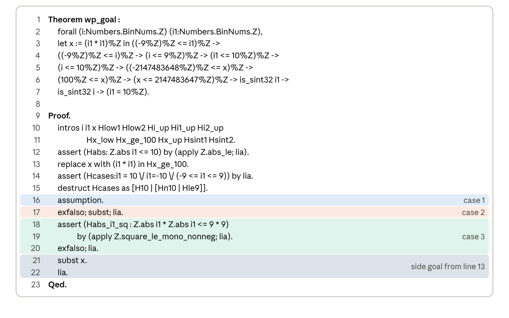
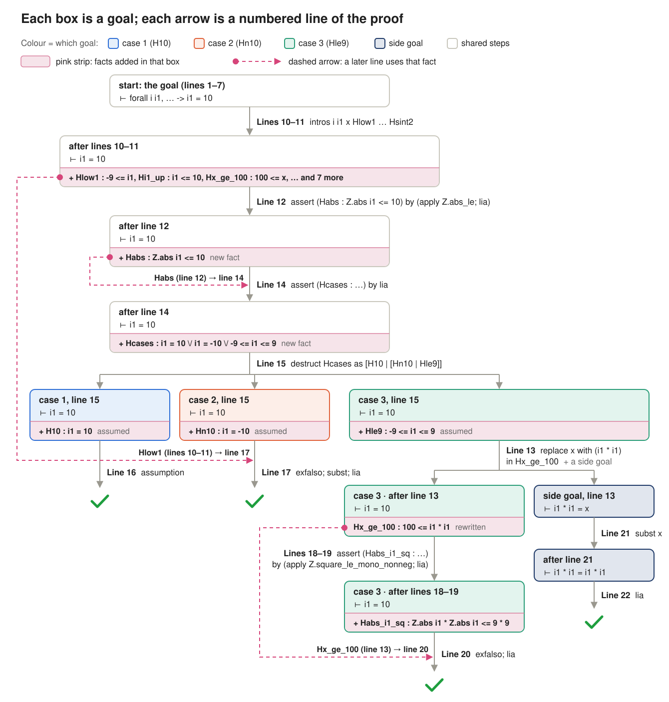

### 14. AutoRocq: agentic verification of software systems

**Paper:** Tu et al., *Agentic Verification of Software Systems*, FSE 2026, [doi:10.1145/3808164](https://doi.org/10.1145/3808164). [Read the full post]().

> An LLM agent that talks to Rocq in a loop: at every step it either tries a tactic or first asks Rocq a question, such as searching for a library lemma, while keeping track of which goals in the proof tree are still open.

#### The idea

- **Earlier tools** either predict one tactic at a time from a trained model (Proverbot9001, QEDCartographer), or have an LLM write a whole proof and repair it (PALM, Rango, Copra).
- **AutoRocq is a proof agent.** An off-the-shelf LLM (GPT-4.1) works with Rocq step by step, using three ingredients:
  - **Context search:** when it is missing a fact, it asks Rocq with `Search` for lemmas from the loaded libraries.
  - **Proof-tree awareness:** it tracks the tree of goals, so it always knows which ones are still open.
  - **Feedback:** every Rocq error goes back to the LLM. After three repeated errors it runs a context search instead.

#### The example: `wp_goal`

The goal comes from an SV-COMP C program, extracted by Frama-C (`%Z` markers dropped):

```coq
Theorem wp_goal :
  forall (i i1 : Z),
  let x := i1 * i1 in
  -9 <= i1 ->                (* Hlow1      *)
  -9 <= i ->                 (* Hlow2      *)
  i <= 9 ->                  (* Hi_up      *)
  i1 <= 10 ->                (* Hi1_up     *)
  i <= 10 ->                 (* Hi2_up     *)
  -2147483648 <= x ->        (* Hx_low     *)
  100 <= x ->                (* Hx_ge_100  *)
  x <= 2147483647 ->         (* Hx_up      *)
  is_sint32 i1 ->            (* Hsint1     *)
  is_sint32 i ->             (* Hsint2     *)
  i1 = 10.
```

- **In plain words:** if `i1` is between -9 and 10 and `i1 * i1 >= 100`, then `i1 = 10`.
- **Why it is true:** if `i1` were between -9 and 9, then `i1 * i1` would be at most 81, contradicting `100 <= x`.
- **Why it is hard for a machine:** `lia` cannot multiply unknowns, so it cannot use `i1 * i1` directly. The proof needs two library lemmas that appear nowhere in the goal.

#### AutoRocq's proof, line by line



***Figure 1:*** *AutoRocq's proof of `wp_goal`. Row colours match the goals in Figure 2.*



***Figure 2:*** *The proof tree for `wp_goal`, drawn by the flow of information. Each box is a goal, each arrow a numbered line of Figure 1, and each pink dashed arrow a fact a later line uses. Line 13 runs before the case split, but only case 3 uses its result, so it is drawn inside case 3 together with its side goal.*

##### Lines 10–11: introduce everything

`intros` brings in `i`, `i1`, `x` and the ten hypotheses under their names. The goal is now `i1 = 10`.

##### Line 12: |i1| ≤ 10, from a library lemma

`assert (Habs : Z.abs i1 <= 10) by (apply Z.abs_le; lia)`.

- **The lemma**, found with `Search (Z.abs _ <= _).`:

  ```coq
  Z.abs_le : forall a b : Z, Z.abs a <= b <-> -b <= a <= b
  ```
- `apply Z.abs_le` turns the goal into `-10 <= i1 <= 10`, and `lia` proves it from `Hlow1` and `Hi1_up`.

##### Line 13: rewrite `x` inside `Hx_ge_100`

`replace x with (i1 * i1) in Hx_ge_100` makes it `100 <= i1 * i1`, which case 3 needs. It leaves the side goal `i1 * i1 = x`, closed on lines 21–22.

##### Lines 14–15: split into three cases

- **Line 14:** `assert (Hcases : i1 = 10 \/ i1 = -10 \/ (-9 <= i1 <= 9)) by lia`, using `Habs`.
- **Line 15:** `destruct Hcases` opens one goal per case.

##### Lines 16–20: close each case

- **Case 1, `i1 = 10` (line 16):** the goal is exactly `H10`, so `assumption` closes it.
- **Case 2, `i1 = -10` (line 17):** impossible, since `Hlow1` says -9 ≤ i1. `exfalso; subst; lia`.
- **Case 3, -9 ≤ i1 ≤ 9 (lines 18–20):** also impossible, but `lia` needs a bound on the square first.
  - **The lemma**, found with `Search (_ * _ <= _ * _).`:

    ```coq
    Z.square_le_mono_nonneg : forall n m : Z, 0 <= n -> n <= m -> n * n <= m * m
    ```
  - **Lines 18–19:** `assert (Habs_i1_sq : Z.abs i1 * Z.abs i1 <= 9 * 9) by (apply Z.square_le_mono_nonneg; lia)`. It uses `Z.abs i1` because the lemma needs `0 <= n`, and `i1` can be negative.
  - **Line 20:** `exfalso; lia`. The context now says `i1 * i1 >= 100` and `i1 * i1 <= 81`, which is a contradiction.

##### Lines 21–22: close the side goal

`subst x` turns `i1 * i1 = x` into `i1 * i1 = i1 * i1`, and `lia` closes it. `Qed`.

#### Results

- **On this goal:** 48 of AutoRocq's 59 tactic attempts failed, yet it found the proof in 156.7 seconds. A Rocq expert needed 20 minutes for a different proof.
- **Benchmark:** the authors extracted VCs from 131 SV-COMP C programs. AutoRocq proves 48.0% of CoqGym math lemmas and 30.9% of the verification lemmas, beating five baselines.
- **Ablation:** removing context search hurts the most, from 44.3% to 30.0%.
- **Linux kernel case study:** it proves 12 of 60 lemmas from functions such as `memmove`, `strcpy` and `hex2bin`.
