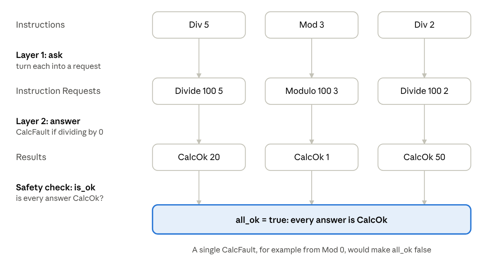
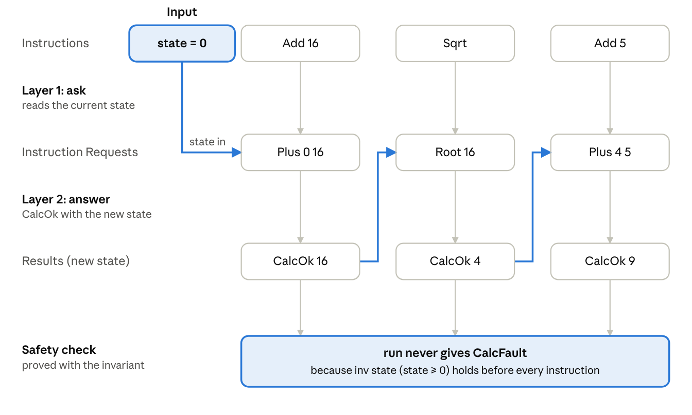
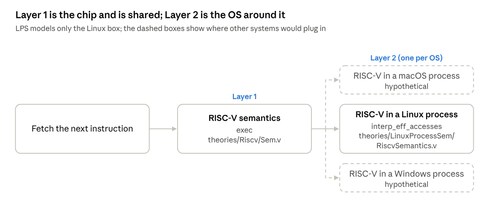
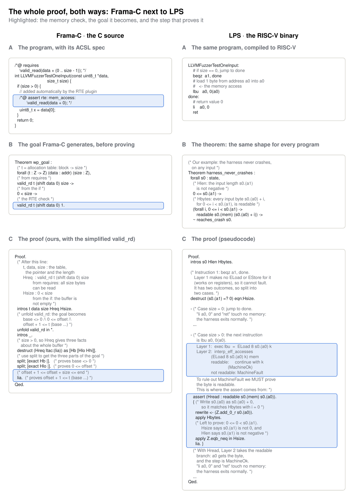

### 16. Anthropic: library-level verification of memory safety

**Source:** Anthropic's research post on [formal verification](https://www.anthropic.com/research/formal-verification), with the public proofs at [theorem-labs/oss-verify-proofs](https://github.com/theorem-labs/oss-verify-proofs). The proofs are stated in LPS, Theorem's Rocq model of a Linux process running a RISC-V binary ([theorem-labs/rocq-linux-process-semantics](https://github.com/theorem-labs/rocq-linux-process-semantics)). [Read the full post]().

> Instead of writing a spec in C terms and letting Frama-C generate goals, compile the library's fuzz tests to RISC-V machine code and state one generic theorem: "this fuzz test never crashes, for any input under 64 MB". Claude then has to prove that theorem in Rocq.

#### A primer: a machine in formal logic

Before the real machine, the same idea on a toy calculator.

##### Step 1: a calculator with no state



***Figure 1:*** *Every instruction is asked, answered, then checked. Each column is one instruction of the program.*

- **Layer 1 (ask)** turns each instruction into a request, such as `Div 5` into `Divide 100 5`. It computes nothing.
- **Layer 2 (answer)** answers the request: `CalcOk` with the result, or `CalcFault` when dividing by 0.
- **Safety:** the program is safe if every answer is `CalcOk`. With no state, each instruction can be checked on its own.

##### Step 2: add a running total (state)



***Figure 2:*** *Each instruction starts from the state the previous one left. The blue arrows carry each new state to the next request.*

- **State:** the calculator now keeps a running total. Layer 1 reads it into the request, and Layer 2's answer becomes the new state.
- **Faults now depend on the past:** `Sqrt` faults on a negative number, so whether it is safe depends on every instruction before it.
- **The program is fixed:** `prog = [Add 16; Sqrt; Add 5]`. Only the starting state varies, and the proof is about these three instructions only, not about every possible program.
- **The invariant** `inv state := state >= 0` fixes this. Check each of the three instructions in turn: if `inv` holds before it, it cannot fault and `inv` still holds after it.
  - `Add 16` and `Add 5` add a non-negative number, so the state stays `>= 0`.
  - `Sqrt` gets a state `>= 0`, so it does not fault, and its result is `>= 0`.
- **The result:** `inv` holds before every instruction of `prog`, so `prog` never faults. A different program, such as one with `Add -20` before `Sqrt`, would need its own proof, and this one would fail.

##### Step 3: the proof makes the fuzzer redundant

For this fixed `prog`, a fuzzer samples starting states, while the theorem covers all of them:

```text
(* fuzzing: sample *)
repeat 1,000,000 times:
  state0 := random_nonnegative_number()
  if run state0 prog = CalcFault then report "bug found for input" state0

(* proof: one statement that covers every non-negative starting state *)
Theorem prog_safe : forall state0, inv state0 -> run state0 prog <> CalcFault.
(* inv state0 := state0 >= 0 *)
```

The premise `inv state0` requires the starting state to be non-negative: the proof only covers starts where `inv` already holds, the same starts the fuzzer samples. Once `prog_safe` is proved, the fuzzer can never report a bug, because there is none to find, even for states it would never try, such as 10^100.

##### Step 4: the proof, unrolled

The proof of `prog_safe` runs the program on a symbolic starting state, one instruction at a time, just as an LPS proof steps through the binary:

| Instruction # | Program | Proof |
| --- | --- | --- |
|  |  | <code class="language-plaintext highlighter-rouge">intros state<sub>0</sub> Hinv.</code><br><code class="language-plaintext highlighter-rouge">Hinv : state<sub>0</sub> &gt;= 0</code> |
| 1 | <code class="language-plaintext highlighter-rouge">Add 16 state<sub>0</sub></code><br><code class="language-plaintext highlighter-rouge">state<sub>1</sub> := state<sub>0</sub> + 16</code> | never faults<br><code class="language-plaintext highlighter-rouge">show inv state<sub>1</sub></code>: state<sub>0</sub> &gt;= 0, so state<sub>1</sub> &gt;= 0 (`lia`) |
| 2 | <code class="language-plaintext highlighter-rouge">Sqrt state<sub>1</sub></code><br><code class="language-plaintext highlighter-rouge">state<sub>2</sub> := sqrt state<sub>1</sub></code> | faults if <code class="language-plaintext highlighter-rouge">state<sub>1</sub> &lt; 0</code><br><code class="language-plaintext highlighter-rouge">show ~ (state<sub>1</sub> &lt; 0)</code>: rules out the fault, from <code class="language-plaintext highlighter-rouge">inv state<sub>1</sub></code><br><code class="language-plaintext highlighter-rouge">show inv state<sub>2</sub></code>: a square root is &gt;= 0 |
| 3 | <code class="language-plaintext highlighter-rouge">Add 5 state<sub>2</sub></code><br><code class="language-plaintext highlighter-rouge">state<sub>3</sub> := state<sub>2</sub> + 5</code> | never faults<br><code class="language-plaintext highlighter-rouge">show inv state<sub>3</sub></code>: state<sub>2</sub> &gt;= 0, so state<sub>3</sub> &gt;= 0 (`lia`) |
|  |  | <code class="language-plaintext highlighter-rouge">CalcOk state<sub>3</sub> &lt;&gt; CalcFault.</code><br>`Qed.` |
{: .wrap}

***Table 1:*** *The proof of `prog_safe`, unrolled. Each row is one instruction of `prog`, next to what the proof must show at that step.*

- **Each instruction is one step** that updates the symbolic state.
- **The only real obligation** is at `Sqrt`: it can fault, and the proof must show that this cannot happen. That is where `inv` is used.
- **Starting from 0**, this is exactly Figure 2: the state becomes 16, then 4, then 9.

Anthropic's work is this idea at full scale: the fixed program is one library's compiled fuzz test, Layers 1 and 2 are `exec` and `interp_eff_accesses`, `CalcFault` is `MachineFault`, and the invariant says the input bytes are readable. The unrolling works the same way, but over a real binary with loops and memory, which is why its proofs are so large.

#### The idea

AutoRocq and LemmaNet prove goals that Frama-C generates from a human-written spec. Here there is no per-program spec at all:

- **One statement for every program.** Each fuzz target is built twice, plain and with AddressSanitizer (ASan). The theorem, called `agrees`, is the same for every library: on every input within the limits, both builds are error-free and behave the same. ASan aborts on any bad memory access, so "the ASan build is error-free" means no memory errors.
- **The binary, not the source.** The proof is about the machine code that actually runs, so a compiler bug cannot hide a crash.
- **"Memory error" is defined by the machine model.** No one writes `\valid_read` checks; a load from a byte that no readable segment holds is simply a fault in the model.

***Table 2:*** *Two ways to say "no memory errors"*

|  | Frama-C (AutoRocq, LemmaNet) | Anthropic / LPS |
| --- | --- | --- |
| What is analysed | The C source | The compiled RISC-V binary |
| What "memory error" means | ACSL checks such as `\valid_read(p)`, added by a human or by Frama-C's RTE plugin | A `MachineFault` in the machine model, or an `abort()` from ASan |
| Who writes the spec | Humans, or the RTE plugin | Nobody: every program gets the same statement |
| What gets proved | Many small goals, one per check | One theorem about every execution of the whole binary |
| Loop invariants | Written in the annotations, before goals exist | Stated and proved inside the Rocq proof |
{: .wrap}

#### The machine model

For each instruction, LPS fetches it and passes it through two layers:



***Figure 3:*** *One machine step in LPS. Layer 1 (`exec`) is the RISC-V chip; Layer 2 (`interp_eff_accesses`) is the Linux process around it. LPS models only Linux.*

- **Layer 1 (`exec`)** turns the instruction into requests, such as `ELoad` ("read n bits at address a") or `EStore`. It never touches memory.
- **Layer 2 (`interp_eff_accesses`)** answers each request against memory. A readable load continues; an unreadable one returns `MachineFault`.
- **Fail-closed:** a step the model cannot interpret returns `MachineUnmodeled`, which also counts as an error, so it can never pass as safe.

#### One example, both ways

The fuzz test reads the first byte of its input, guarded so it never reads an empty buffer:

```c
int LLVMFuzzerTestOneInput(const uint8_t *data, size_t size) {
  if (size > 0) {
    uint8_t x = data[0];   // the only memory access
  }
  return 0;
}
```



***Figure 4:*** *The same program proved both ways. Left: Frama-C on the C source. Right: LPS on the RISC-V binary. Highlighted: the memory check, the goal it becomes, and the step that proves it. The LPS proof is pseudocode.*

Reading Figure 4 row by row:

1. **The program.** Frama-C's RTE plugin inserts `assert \valid_read(data + 0)` before the read. The binary has no assertion, just a `beqz` (skip if `size == 0`) and an `lbu` (load one byte).
2. **The goal.**
   - *Frama-C:* the assert becomes `wp_goal`: from "all `size` bytes are readable" and `0 < size`, prove "1 byte is readable".
   - *LPS:* a generic theorem: for any start state whose input bytes are readable, the harness never reaches a crash.
3. **The proof.**
   - *Frama-C:* unfold `valid_rd`, then `lia`: the whole buffer fits in its block and the buffer is not empty, so its first byte fits too.
   - *LPS:* step through the instructions. `beqz` touches no memory, so split on `size = 0`. In the `size > 0` case, Layer 1 turns `lbu` into an `ELoad`, and Layer 2 faults unless the byte is readable. So the proof **must** prove `readable s0.(mem) s0.(a0)`, from the input hypothesis with i = 0.

**The key point:** both proofs have the same core, "one byte fits in a non-empty buffer". Frama-C writes the obligation down in advance; in LPS it appears by itself at the `lbu`, as a case of Layer 2 that the proof has to rule out.

#### What it buys, and what it costs

- **No spec writing:** "never crashes" needs no human to describe what the program should do.
- **The compiler is not trusted**, since the proof is about the binary.
- **The guarantee is narrower:** no crash for inputs under 64 MB, on static, single-threaded RISC-V Linux, using ASan's notion of a crash. It says nothing about computing the right answer.
- **The proofs are huge:** the reasoning a Frama-C user puts into annotations moves into the proof. The post reports about 600,000 lines of Rocq for a typical library.
